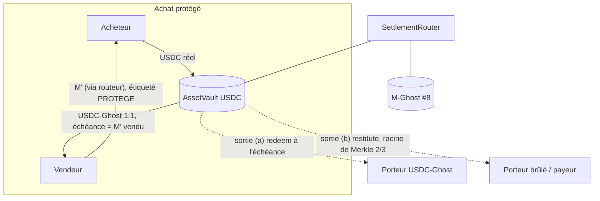

# Design — Règlement §10bis (#84) : routeur, coffre par actif, Ghost de paiement, restitution

Itération 1 (2026-10-11, Kiro pour @denybs). Dérive de la décision §10bis
(`docs/OPEN_ANSWERS.md`, validée en session, à relire par l'équipe) et de #85 (piste b, PR #102).
Choix d'agent provisoires : `docs/OPEN_QUESTIONS.md` §16. Données **fictives** uniquement.

## 0. Objectif

Le voleur ne reçoit jamais que du Ghost ; tout le risque porte sur les acteurs du **M' pur** ; le
protocole ne garde rien (ni fonds, ni frais). On construit une **couche au-dessus de `GhostToken`
(#8)**, sans le modifier tant que la PR #123 n'est pas mergée.

## 1. Pièces

| Contrat | Rôle |
| --- | --- |
| `SettlementRouter` (`ISettlementRouter`) | seul transféreur du M' pendant la fenêtre ; attribue le statut `PROTEGE`/`PUR`/`CHEQUE` ; crée un coffre par actif |
| `AssetVault` (`IAssetVault`) | bloque UN actif réel ; deux sorties codées en dur (`redeem` à l'échéance, `restitute` 2/3 par racine de Merkle) ; aucune sortie protocole/multisig |
| `AssetGhost` | Ghost de paiement d'un actif (le « USDC-Ghost »), 1:1 avec l'actif bloqué, échéance = celle du M' vendu, mêmes règles de circulation que le M-Ghost |

`ISettlementTypes.TrancheStatus = { NONE, PROTEGE, PUR, CHEQUE }`.

## 2. Statut d'une tranche (point 1)

Porté **par le routeur** (`statusOf(account, maturity)`), pas par le `GhostToken` : on ne touche
pas au contrat de #123 tant qu'il n'est pas mergé (choix d'agent, OPEN_QUESTIONS §16). Règles :
acheté contre du vrai M via le routeur ⇒ `PROTEGE` ; acheté alors que c'était du M' ⇒ `PUR` ;
reçu sans paiement on-chain ⇒ `CHEQUE` ; revendre avant l'échéance ⇒ `PUR` chez l'acheteur ; un
don ne donne jamais `PROTEGE` (anti-blanchiment).

## 3. Coffre à deux sorties (points 2-3)

- `lockAndIssue(seller, amount, maturity)` (routeur) : bloque `amount` d'actif, émet `amount` de
  Ghost de paiement au vendeur, échéance = celle du M' vendu.
- `redeem(amount)` (sortie a) : le porteur convertit son Ghost de paiement **échu** contre l'actif
  bloqué, 1:1. Refusé avant l'échéance.
- `restitute(to, amount, nonce, proof)` (sortie b) : feuille prouvée contre la `restitutionRoot`
  posée par le multisig 2/3 (racine de Merkle, #85 piste b), idempotente par `nonce`.
- **Aucune autre fonction de sortie** : ni protocole, ni multisig.

Invariant maître : `asset.balanceOf(vault) >= assetGhost.totalSupply()` (I-COFFRE).

## 4. Destruction confirmée (point 4)

Déclenchée par le flux 2/3 de `GhostToken` (#8). Pour chaque lot (racine de Merkle) :
1. brûler le M' contaminé et le Ghost de paiement **des seules adresses graines** ;
2. restituer l'argent bloqué du voleur : d'abord aux porteurs brûlés du lot au prorata du montant
   brûlé, **plafonné par leur prix payé** ; le reste à celui qui a payé le voleur ;
3. un `PROTEGE` récupère son **propre** paiement bloqué ;
4. le vrai M brûlé (blanchiment) libère du collatéral vers la réserve de restitution (#8, §0bis-c).

Calcul des parts : **hors chaîne**, publié en racine de Merkle contestable ; le coffre ne fait que
vérifier une feuille et payer `to`. Le contrat ne recalcule pas le prorata on-chain (coût, et
cohérence avec #85 piste b).

## 5. Invariants Foundry exigés (#84)

1. aucun vrai actif ne sort du coffre vers un vendeur **avant l'échéance** ;
2. `coffre(actif) >= Σ Ghost de paiement de cet actif` ;
3. aucune sortie du coffre vers le protocole ou le multisig ;
4. un porteur `PROTEGE` ne perd jamais rien ;
5. `Σ restitutions ≤ argent bloqué du voleur` ; conservation `Σ redeem + Σ restitutions = Σ entrées` ;
6. rejeu des cas 1 (achat protégé), 2 et 2bis (chaîne des 40), 3 (salaire chèque).

@Yannis1307 a proposé d'écrire ces invariants contre les interfaces figées ci-dessus.

## 6. Plan d'implémentation (petites PR)

1. **(cette PR)** interfaces figées + design. ✅
2. `AssetGhost` + `AssetVault` (lock/redeem, I-COFFRE), tests unitaires + invariants 1-3.
3. `SettlementRouter` (buyWithAsset/sellPure, statut), tests + cas 1/2/2bis/3.
4. `restitute` par racine de Merkle + flux 2/3, invariants 4-5.
5. Enforcement « M' seulement via le routeur » dans `GhostToken` — **après** le merge de #123.

## 7. Hors périmètre / différé

- Modif de `GhostToken` (statut par tranche, restriction de transfert) : différée au point 6.5,
  après le merge de #123, pour ne pas déstabiliser la PR en relecture.
- Multi-chaînes, oracle, prix plancher : écartés (§10bis « Options écartées »).
- `docs/CONTRACTS.md` (événements Ghost portant statut + actif) : zone sensible, à proposer au
  propriétaire de `shared/`, non modifiée ici.

## 8. Limites connues (audit, à dire au jury — jamais cachées)

Relevées en relisant la couche de règlement ; honnêtes, pas des bugs (`docs/CLAIMS.md`) :

- **Restitution bornée au libéré** (corrigé) : `restitute` ne peut puiser que dans
  `locked() − assetGhost.totalSupply()`, l'argent effectivement libéré par les burns de graines.
  Ainsi `locked >= totalSupply` tient même si le multisig publie une racine trop large — aucun
  porteur honnête ne se retrouve non adossé. Test `test_restitute_keepsOtherHolderBacked`.
- **Croissance du tableau de tranches** du Ghost de paiement : coût d'un transfert/burn linéaire
  en nombre d'échéances distinctes détenues. Borné en pratique (échéances alignées au créneau,
  issues de ventes de M'), mais à surveiller ; si gênant, agréger par créneau comme `MaturityBuckets`.
- **Statut par tranche approximé** : le routeur étiquette la tranche à l'échéance *la plus tardive*
  vendue ; un achat couvrant plusieurs échéances n'étiquette que celle-là. Suffisant pour la démo,
  à affiner si le statut par wei devient nécessaire.
- **Jetons à frais de transfert** : `lockAndIssue` revert (sous-collatéralisation refusée) plutôt
  que de mal émettre — ils ne sont donc pas utilisables comme actif de coffre. MockUSDC n'en a pas.
- **Unicité des nonces de restitution** : à garantir hors chaîne entre deux destructions (un nonce
  déjà réclamé sous une ancienne racine resterait bloqué). Au pire une restitution légitime est
  retardée, jamais de fonds perdus.
