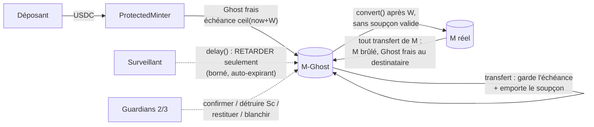

# contracts

- **Rôle** : smart contracts Solidity (**Foundry**), cible **Avalanche Fuji** (testnet).
- **Propriétaire** : @denybs (voir `docs/TEAM.md`).
- **Lancer** : installer Foundry et les dépendances (ci-dessous), puis `forge build` /
  `forge test` depuis `contracts/`.

> Données **fictives** uniquement (collatéral `MockUSDC`, stables « (fictif) »). Jamais de vraie
> clé privée : les tests utilisent des adresses `makeAddr(...)`, sans clé.

## Contenu

```
contracts/
├── foundry.toml            # solc 0.8.33, evm cancun, profils default / deep
├── .gitignore              # lib/ (dépendances installées localement), .plan/
├── DEPLOYMENTS.md          # adresses déployées sur Fuji (aucune pour l'instant)
├── src/
│   ├── MockUSDC.sol        # collatéral FICTIF, 6 décimales, faucet ouvert
│   ├── StableToken.sol     # stable FICTIF du monde SANS protection (VulnerableMinter)
│   ├── VulnerableMinter.sol# VOLONTAIREMENT vulnérable (démo de l'attaque)
│   ├── GuardianPausable.sol# pause globale, multisig simulé 3/3
│   ├── GuardianActions.sol # actions humaines 2/3 (destruction, restitution, Extend, Clear)
│   ├── ProtectedMinter.sol # volet 1 : montant et destinataire dérivés on-chain -> Ghost frais
│   ├── GhostToken.sol      # M-Ghost (#8) : quarantaine liquide, soupçon, surveillant, 2/3
│   ├── GhostedStable.sol   # vrai token M : minté par conversion, tout transfert redevient Ghost
│   ├── lib/MaturityBuckets.sol  # tranches d'échéance par adresse (anneau N + 1)
│   └── interfaces/         # IGhostRisk (vues lues par #7/#84), IGhostToken (figées)
└── test/
    ├── utils/BaseTest.sol, utils/GhostBase.sol   # déploiements + helpers (_mintGhost, _destroy…)
    ├── Tokens.t.sol
    ├── VulnerableMinter.t.sol
    ├── GuardianPausable.t.sol
    ├── ProtectedMinter.t.sol   # un test (ou plus) par invariant I1–I5
    ├── GhostedStable.t.sol     # M : mint réservé, transfert = burn + Ghost frais, marge d'entrée
    ├── ScenarioA.t.sol         # même attaque rejouée sur les deux contrats
    ├── StolenServiceKey.fuzz.t.sol
    ├── ghost/                  # une règle du design -> au moins un test (Buckets, Suspicion,
    │                           #   Convert, Watcher, Guardian, Events, LedgerParity)
    ├── gas/GhostGas.t.sol      # mesures de gas (--isolate), recopiées plus bas
    └── invariant/
        ├── ProtectedMinterHandler.sol
        ├── ProtectedMinter.invariant.t.sol
        ├── GhostHandler.sol            # modèle d'ombre (tranches, étiquettes, séries)
        └── Ghost.invariant.t.sol       # invariants (a)–(f), 2 configurations
```

## Installer Foundry (Windows)

Foundry s'installe principalement via `foundryup`, pensé pour un shell Unix. Sous Windows :

**Option A — WSL (recommandé)** dans un terminal Ubuntu/WSL :

```bash
curl -L https://foundry.paradigm.xyz | bash
foundryup
```

**Option B — Git Bash** : même commande que ci-dessus, depuis Git Bash.

**Option C — zip officiel** : télécharger `foundry_stable_win32_amd64.zip` depuis les releases
<https://github.com/foundry-rs/foundry/releases> et extraire `forge.exe` (par ex. dans
`%USERPROFILE%\.foundry\bin`).

Vérifier l'installation :

```bash
forge --version
```

Si `forge` n'est pas dans le `PATH` (PowerShell) : appeler le binaire directement,
`& "$env:USERPROFILE\.foundry\bin\forge.exe" test`.

Doc officielle : https://book.getfoundry.sh/getting-started/installation

## Dépendances (une commande, tags figés)

Choix : **`lib/` n'est pas versionné** (gitignoré) ; chacun installe les dépendances à des tags
figés avec `--no-git` (pas de sous-module git, pas de `.gitmodules`). Raison : OpenZeppelin
complet représente des centaines de fichiers, illisibles en revue de PR si on les vendore.

Depuis `contracts/` :

```bash
forge install --no-git foundry-rs/forge-std@v1.17.0 OpenZeppelin/openzeppelin-contracts@v5.4.0
```

- `forge-std` **v1.17.0**, `openzeppelin-contracts` **v5.4.0** (remappings dans `foundry.toml`).
- **Toujours `--no-git`** : sans cette option, `forge install` ajoute des sous-modules git à la
  racine du dépôt — à éviter.
- Repli si `forge install` échoue (réseau, proxy) : télécharger
  `https://github.com/foundry-rs/forge-std/archive/refs/tags/v1.17.0.zip` et
  `https://github.com/OpenZeppelin/openzeppelin-contracts/archive/refs/tags/v5.4.0.zip`, puis
  extraire leur contenu dans `contracts/lib/forge-std/` et
  `contracts/lib/openzeppelin-contracts/` (même arborescence que le dépôt d'origine).

Le projet n'a pas été créé par `forge init` : `foundry.toml` est écrit à la main (équivalent),
ce qui évite le contrat d'exemple `Counter` et l'écrasement de ce README.

## Compiler et tester

```bash
forge build
forge test -vv
```

> Rappel : `out/`, `cache/` et `broadcast/` sont ignorés par le `.gitignore` racine.

## Contrat vulnérable (`VulnerableMinter`) — démo uniquement

**Volontairement vulnérable, à ne jamais déployer comme « vrai » contrat.** Il reproduit le
schéma Resolv :

1. un utilisateur appelle `requestSwap(depositAmount)` : le collatéral est prélevé et la demande
   enregistrée ;
2. un compte `SERVICE_ROLE` appelle `completeSwap(requestId, recipient, mintAmount)` : le contrat
   vérifie le rôle et que la demande est en attente, mais **mint le montant choisi vers le
   destinataire choisi**, sans lien avec le dépôt.

Une clé de service volée transforme donc un petit dépôt réel en mint arbitraire.
Tests : `test/VulnerableMinter.t.sol` (`test_attack_smallDepositHugeMint`,
`test_attack_mintToArbitraryRecipient`, `testFuzz_vulnerable_mintsAnyAmount`). Les montants
utilisés (200 000 USDC déposés, 80 M de stables mintés) sont des **fixtures** reprenant l'ordre
de grandeur de l'incident cité dans `docs/OPEN_ANSWERS.md` §1, pas des mesures.

```bash
forge test --match-contract VulnerableMinterTest -vv
```

## Contrat protégé (`ProtectedMinter`) — volet 1

La clé `SERVICE_ROLE` n'autorise plus que **« traiter la demande n°X »** :
`completeSwap(requestId)` n'a **ni montant ni destinataire**. Tout est dérivé de la demande
enregistrée on-chain au moment du dépôt.

| Invariant | Appliqué par |
|---|---|
| **I1** `minted = deposit × rate` | `quoteMint(deposit, rate) = deposit × 1e12 × rate / 1e18` (6 → 18 décimales), arrondi vers le bas, **ε = 0** (aucun frais). Le taux est **figé à la création de la demande** (snapshot) : le moment où la clé de service traite la demande ne change pas le montant. |
| **I2** demande existante, en attente, traitée une seule fois | statut `None / Pending / Completed` ; `RequestNotFound` (demande inventée ou future), `RequestNotPending` (rejeu). |
| **I3** destinataire = déposant | pas de paramètre destinataire : le mint va à `request.depositor`. |
| **I4** un seul chemin de mint | `StableToken.minter` est immuable et égal au `ProtectedMinter` (déployé par son constructeur) ; seul `completeSwap` appelle `mint`. |
| **I5** (côté contrat) `totalSupply == totalMinted` | pas de burn ni de rachat dans ce périmètre. |

Ce que peut faire une clé de service volée : traiter (ou ne pas traiter) des demandes existantes,
au moment de son choix. Ce qu'elle ne peut pas faire : choisir un montant, choisir un
destinataire, rejouer une demande, inventer une demande, minter directement, changer le taux,
pauser / dépauser, s'attribuer un rôle.

- **Taux** : valeur on-chain `rate` (précision `1e18` = 1 stable pour 1 USDC), `> 0`, modifiable
  seulement par `RATE_ADMIN_ROLE` (`setRate`), qui émet `RateChanged`. Pas d'oracle externe.
- **Rôles** (OpenZeppelin `AccessControl`) : `admin` = `DEFAULT_ADMIN_ROLE` + `RATE_ADMIN_ROLE` ;
  `service` = `SERVICE_ROLE` ; le constructeur refuse `admin == service`.
- **Pause globale** (`GuardianPausable`) : multisig **simulé** de 3 guardians figés au
  déploiement ; pause **3/3** (`approvePause`), dépause **3/3** par le même multisig
  (`approveUnpause`) ; aucun acteur seul, admin compris, ne peut pauser ni dépauser. La pause
  bloque `requestSwap` et `completeSwap` ; `setRate` reste possible.
- **Pas de plafond fixe par opération** (`docs/OPEN_ANSWERS.md` §0).
- **Token Ghost / quarantaine : hors périmètre** de ce contrat (issue #8).
- Collatéral attendu : ERC20 standard à 6 décimales (vérifié au constructeur), sans frais de
  transfert. Contrat non upgradable. Pas d'annulation ni de remboursement de demande.

### Événements pour le monitor

| Événement | Champs |
|---|---|
| `SwapRequested` | `requestId` (indexé), `depositor` (indexé), `depositAmount`, `rate` |
| `SwapCompleted` | `requestId`, `depositor`, `recipient` (indexés), `depositAmount`, `mintedAmount`, `rate` |
| `RateChanged` | `oldRate`, `newRate`, `changedBy` (indexé) ; émis aussi au déploiement (`oldRate = 0`) |
| `GuardianApproval` | `guardian`, `round`, `pauseAction` (indexés), `approvals` |
| `Paused` / `Unpaused` | `account` (OpenZeppelin `Pausable`) |
| `RoleGranted` / `RoleRevoked` / `RoleAdminChanged` | OpenZeppelin `AccessControl` |

`StableToken` émet en plus le `Transfer(address(0), depositor, minted)` standard de l'ERC20.

### Scénario A — même attaque, deux contrats

`test/ScenarioA.t.sol` rejoue la même séquence avec le même attaquant détenteur de
`SERVICE_ROLE` : dépôt de 200 000 USDC fictifs, puis tentative de mint de 80 M de stables vers
lui-même (fixtures, ordre de grandeur `docs/OPEN_ANSWERS.md` §1). Sur `VulnerableMinter` le mint
gonflé passe ; sur `ProtectedMinter` l'appel avec montant/destinataire n'existe pas, le seul
appel possible mint exactement le dépôt converti (1:1 au taux 1e18), et le rejeu échoue. Une
demande d'une victime traitée par l'attaquant va à la victime.

```bash
forge test --match-contract ScenarioATest -vv   # affiche les montants mintés côte à côte
```

## Volet 2 — perte maximale bornée (vérifiée par tests d'invariants)

Tests Foundry à base de **handler** (`test/invariant/`) et de **fuzz** (`test/StolenServiceKey.fuzz.t.sol`)
contre `ProtectedMinter`, avec un acteur détenant la clé `SERVICE_ROLE` **volée** (qui peut aussi
déposer) et 4 déposants aléatoires. Les valeurs attendues sont **recalculées par le test**
(`deposit × 1e12 × rate / 1e18`, taux suivi par le handler), sans appeler `quoteMint`.

### Hypothèses

- **H1** clé admin **non compromise**. La clé `RATE_ADMIN_ROLE`, elle, est désormais **durcie**
  (#131) : `proposeRate` est borné à `MAX_RATE_STEP_BPS` (5 %, provisoire) de variation et
  temporisé par `RATE_DELAY` (1 h, provisoire) avant `executeRate`, et un guardian peut annuler
  (`cancelRate`). Une clé de taux volée ne peut donc plus mint sans limite — au pire elle décale
  le taux de quelques % par période, après un délai pendant lequel la surveillance alerte et un
  guardian annule. Voir `test/RateGuard.t.sol` et `OPEN_QUESTIONS` §18 pour les seuils provisoires ;
- **H2** clés des guardians **non compromises** ;
- **H3** collatéral ERC20 standard (`MockUSDC`, pas de frais de transfert) ;
- **H4** contrat non upgradable, code tel que testé ;
- **H5** pas de burn ni de rachat dans ce périmètre.

### Borne énoncée

Sous H1–H5, dans tout état atteint par les séquences explorées :

- `totalSupply == Σ_{demandes complétées} deposit_i × rate_i ≤ Σ_{demandes créées} deposit_i × rate_i`
  (avec `rate_i` figé à la création, conversion 6 → 18 décimales, arrondi vers le bas) ;
- chaque demande est complétée **au plus une fois**, et `minted_i == deposit_i × rate_i` ;
- chaque mint va au **déposant** de la demande ;
- le solde stable du détenteur de la clé de service volée est `≤ Σ deposit_j × rate_j` sur
  **ses propres** dépôts : la clé volée ne crée **aucun** stable au-delà du collatéral déjà
  déposé (perte attribuable au-delà des dépôts = 0).

C'est **vérifié par tests d'invariants** avec les paramètres de `foundry.toml`, **pas prouvé**.

| Invariant / fuzz | Ce qui est vérifié |
|---|---|
| `invariant_solvency` | `totalSupply ≤ Σ dépôts × taux` (toutes demandes créées) |
| `invariant_supplyEqualsCompletedQuotes` | `totalSupply == Σ` des demandes complétées `== totalMinted` |
| `invariant_collateralBacking` | collatéral détenu par le minter `== Σ dépôts == totalDeposited` |
| `invariant_eachRequestCompletedAtMostOnce` | ≤ 1 complétion par demande, statut on-chain cohérent |
| `invariant_mintedPerRequestEqualsQuote` | par demande : minté observé `==` delta de supply `== deposit × rate` |
| `invariant_recipientIsDepositor` | solde de chaque acteur `==` somme de ses propres demandes complétées |
| `invariant_stolenKeyBound` | borne ci-dessus pour la clé volée + aucune action interdite n'a réussi |
| `testFuzz_stolenKey_*` | gonfler, rediriger, rejouer, minter directement, changer le taux, pauser |

Actions de la clé volée explorées par le handler : traiter une demande (y compris déjà traitée
ou pendant la pause), traiter une demande inexistante, appeler `stable.mint`, appeler
`completeSwap(uint256,address,uint256)`, appeler `setRate`. Actions honnêtes : dépôts,
`setRate` par l'admin, approbations de pause / dépause par les guardians.

### Limites

- La clé volée peut **ne pas traiter** des demandes (déni de service, collatéral immobilisé :
  pas d'annulation ni de remboursement) et choisir le **moment** du traitement (sans effet sur le
  montant grâce au snapshot du taux).
- Un taux faux posé par un admin compromis sort de H1 : c'est le rôle du surveillant hors
  chaîne (`docs/OPEN_ANSWERS.md` §1).
- Exploration bornée : dépôts dans `[1, 1e18]` unités, taux honnête dans `[1e6, 1e24]`. Ce sont
  des paramètres d'exploration, pas des mesures.

### Lancer

```bash
forge test                                   # tout (profil default)
forge test --match-path "test/invariant/*" -vv
forge test --match-contract StolenServiceKeyFuzzTest -vv
FOUNDRY_PROFILE=deep forge test              # bash : profil approfondi
```

PowerShell : `$env:FOUNDRY_PROFILE="deep"; forge test; Remove-Item Env:FOUNDRY_PROFILE`.

| Profil | fuzz `runs` | invariant `runs` | invariant `depth` | `fail_on_revert` |
|---|---|---|---|---|
| `default` | 256 | 256 | 128 | false |
| `deep` | 1024 | 512 | 256 | false |

## Token Ghost (#8) — quarantaine liquide

**L'idée en une image** : un chèque qu'on peut endosser et faire circuler librement, mais qu'on ne
peut **encaisser** qu'après un délai `W`, et que la banque peut **annuler** (à hauteur de la part
volée) si un vol est confirmé avant l'encaissement. Le vrai token **M** est l'argent liquide ; le
**M-Ghost** est le chèque.



Règles (design `contracts/.plan/design.md` §3, décisions `docs/OPEN_ANSWERS.md` §0bis et §9) :

1. **Tranches d'échéance** : chaque valeur entrée en Ghost reçoit l'échéance
   `ceil((t + W) / créneau) × créneau` et la **garde** en circulant (la circulation ne remet
   jamais le compteur à zéro). Envoi : part échue d'abord, puis tranches les plus anciennes.
2. **Soupçon par adresse** : montant absolu en deux parts, **confirmé** `Sc` et **en attente**
   `Sp` (qui s'éteint seul à l'expiration de son incident). Un transfert emporte le **ratio de
   l'expéditeur**, arrondi vers le haut (sens sûr), et la somme est conservée exactement.
3. **Conversion** Ghost → M : seulement la part échue, hors fenêtre allongée, sous les seuils de
   ratio **et** de montant, et jamais la part suspecte (`amount ≤ balanceOf − S`).
4. **Surveillant** (`WATCHER_ROLE`) : ne peut que **retarder** des adresses (et semer du `Sp`).
   Bornes : `maxExtensionFactor × W` par incident et par série d'un compte, deux séries séparées
   d'au moins `W`, budget de quarantaine de l'incident courant. Silence = retour à la normale.
5. **Guardians 2/3** : confirmer un incident vivant, **détruire exactement `Sc`** (tranches les
   plus récentes d'abord), restituer à une victime dans la limite de la réserve, retarder hors
   budget (`Extend`, toujours borné), blanchir (`Clear`). Pause globale **3/3**, rounds séparés.
6. **Réserve** = `totalIssued − supplyValue − insuranceFund` : nourrie par les destructions et les
   marges, seule source des restitutions ; bascule au fonds d'assurance après
   `restitutionClaimDelay` sans nouvelle entrée (`sweepToInsurance`, permissionless).

### Ce qui est vérifié (tests unitaires + invariants, jamais « prouvé »)

| Suite | Ce qui est vérifié |
|---|---|
| `test/ghost/GhostBuckets.t.sol` (15) | arrondi au créneau supérieur, rien avant W, échéance gardée au transfert, plus anciennes d'abord, poussière reçue sans effet sur le solde échu, anneau sur 3 fenêtres, `balanceOf == matured + Σ tranches` (fuzz), cas neutres |
| `test/GhostedStable.t.sol` (9) | M minté seulement par le Ghost ; transfert de M = burn + Ghost frais ; allowance ; pause ; marge d'entrée vers la réserve |
| `test/ghost/GhostSuspicion.t.sol` (10) | ratio de l'expéditeur, moyenne pondérée, arrondi haut (fuzz), conservation (fuzz), dilution, Sc/Sp, expiration paresseuse |
| `test/ghost/GhostConvert.t.sol` (12) | chaque condition isolément, seuil arrondi vers le haut, verrou partiel, dispersion d'un Ghost 100 % suspect, marge base + pente, M jamais repris |
| `test/ghost/GhostWatcher.t.sol` (18) | droits, validation, ouverture/ajout, budget (lot entier), incident plus court qui ne raccourcit pas, borne cumulée des incidents enchaînés, vue `maxExtensionEnd`, fan-out vers 16 adresses |
| `test/ghost/GhostGuardian.t.sol` (17) | quorum 2/3, `approveAction` ≠ `approve`, pas de résurrection d'incident expiré, destruction exacte, autre incident vivant intact, `Extend`, `Clear`, restitution plafonnée, assurance, pause 3/3 |
| `test/ghost/GhostEvents.t.sol` (7) | suite exacte des logs (et adresse émettrice) lue par le monitor, id de demande 0 compris |
| `test/invariant/Ghost.invariant.t.sol` (2 × 9) | (a) rien de convertible avant W ; (b) tranches == modèle d'ombre ; (c) conservation du soupçon et verrou partiel ; (d) destruction exacte ; (e) solvabilité et réserve exacte ; (f) bornes du surveillant ; vivacité ; test de fumée du handler |

Les invariants tournent avec deux fixtures (seuils à 0, et seuils > 0 alignés sur
`data/ghost_ledger.py`) ; le handler tient un **modèle d'ombre** indépendant (tranches, étiquettes
d'incident, séries d'extension) et classe chaque action « doit réussir » / « doit échouer ».

### Limites mesurées (fixtures W = 600 s, créneau 60 s, facteur 6 : ce ne sont pas des mesures de production)

- **Friction d'un surveillant compromis** : il peut retarder un même compte `factor × W` sur
  chaque période de `(factor + 1) × W`, indéfiniment. Mesuré : **6/7 du temps**
  (`test_frictionDutyCycle`). La borne porte sur un **taux**, pas sur une durée totale ; le
  remède reste H1 (l'admin révoque `WATCHER_ROLE`).
- **Poussière avec seuils à 0** : 1 wei de soupçon reçu bloque toute la conversion du
  destinataire jusqu'à l'expiration de l'incident (`test_dustGriefing_thresholdsZero`). Avec des
  seuils > 0, seule la part suspecte reste verrouillée.
- **Compte détecté tard** : un compte qui rejoint l'incident vivant n'est retenu que jusqu'à son
  `expiresAt` (`test_lateJoin_marginIsRemainingLifetime`). Parade humaine : une confirmation 2/3
  avant l'expiration fige le soupçon (`Sc`), qui reste verrouillé.
- Le M obtenu **avant** le gel n'est jamais repris (voulu) : seul du Ghost sans soupçon valide
  sort.
- Tailles mesurées (`forge build --sizes`) : `GhostToken` 21 173 o (limite 24 576), initcode
  `ProtectedMinter` 33 546 o (limite 49 152).
- **Parité avec le registre hors chaîne** `data/ghost_ledger.py` : `test/ghost/LedgerParity.t.sol`
  rejoue une chaîne courte (mints, transferts, conversions, transfert de M) et compare soldes,
  tranches et montants convertis aux valeurs du registre, recopiées en dur.
- **Récupération après fragmentation** : `test/ScenarioRecovery.t.sol` (fuzz chaîne + fan-out)
  mesure la part récupérée. Détection complète : 100 % du soupçon semé est récupéré par la
  destruction (rien de suspect n'a pu être converti). Détection partielle (⅓ des détenteurs non
  ciblés) : part récupérée affichée (≈ 73 % sur la graine testée), le soupçon confirmé restant
  reste verrouillé chez les non-ciblés. Confirmation après `expiresAt` : récupération 0 (silence =
  retour à la normale, limite honnête).

### Gas mesuré (`test/gas/GhostGas.t.sol`)

Commande : `forge test --match-path test/gas/GhostGas.t.sol --isolate -vv` (chaque appel est une
transaction séparée, stockage froid). Fixtures N = 10 (anneau de 11). Chiffres d'une exécution
locale (forge 1.5.1), à refaire après tout changement du contrat ; ce ne sont pas des promesses.

| Opération | Gas |
|---|---|
| _référence : transfert ERC-20 OpenZeppelin (MockUSDC), destinataire vide_ | _55 276_ |
| _référence : transfert ERC-20, destinataire déjà crédité_ | _44 679_ |
| transfert de Ghost, 1 tranche, destinataire vide | 131 011 |
| transfert de Ghost, 1 tranche, tranche déjà présente chez le destinataire | 82 413 |
| transfert de Ghost avec soupçon, 2 comptes dans l'incident | 135 022 |
| transfert de Ghost, **pire cas** (11 tranches vers destinataire vide) | 425 786 |
| transfert de Ghost, 11 tranches vers 11 tranches échues à régler | 247 571 |
| transfert de M (burn + Ghost frais) | 124 449 |
| `convert` (11 tranches échues à régler) | 172 651 |
| `delay`, 1 compte (ouvre l'incident) | 251 553 |
| `delay`, 64 comptes (rejoint l'incident) | 7 779 806 |
| destruction 2/3, 64 cibles (approbation qui exécute) | 5 501 318 |

Lecture, rapportée à la référence mesurée ci-dessus : un transfert de Ghost courant coûte de
1,8× (destinataire déjà crédité, 82 413 / 44 679) à 2,4× (destinataire vide, 131 011 / 55 276)
un transfert ERC-20 simple, et le pire cas 7,7× (425 786 / 55 276). Les lots de 64 (`delay`,
destruction) font plusieurs millions de gas : la taille de lot utilisable dépend de la limite de
gas par bloc du réseau visé (à vérifier sur Fuji avant la démo). Si c'est trop cher, seul N
change (§0bis-b), pas l'algorithme.

## À produire plus tard — _proposé, à valider en équipe_

- **Balise de risque** + **faux marché de prêt** (simulé, fictif) qui cesse d'accepter le token
  gelé comme garantie — **volet 3** (#7, PR #111 de @Yannis1307, lit `IGhostRisk`).
- **Routeur de règlement et M' protégé / pur** (#84, §10bis), au-dessus du Ghost.

Détails et arbitrages ouverts : voir `docs/OPEN_QUESTIONS.md` et `docs/CLAIMS.md`.

## Balise de risque + faux marché de prêt (#7, volet 3)

- `src/RiskBeacon.sol` : façade de **lecture** de `IGhostRisk` (aucune écriture de risque).
  `riskOf(a)` → ratio, montant suspect, fin de fenêtre, état (`PAUSE_GLOBALE` > `DETRUIT` >
  `RETARDE` > `NORMAL`), incident. `publish(address[])` permissionless, borné à 64, émet
  `RiskPublished` pour le monitor.
- `src/MockLendingMarket.sol` : prêt FICTIF de MockUSDC contre M / M-Ghost. Avec balise : décote
  `base + slope × ratio` du soupçon **importé au dépôt** (mesuré sur le solde réel du marché),
  emprunt refusé hors état NORMAL ou au-delà des seuils. Verrou de position `window + slot`.
- Tests : `test/RiskBeacon.t.sol` contre `test/utils/MockGhostRisk.sol` (en attendant #8), dont le
  scénario C. Choix provisoires : `docs/OPEN_QUESTIONS.md` §14.
