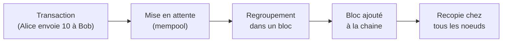
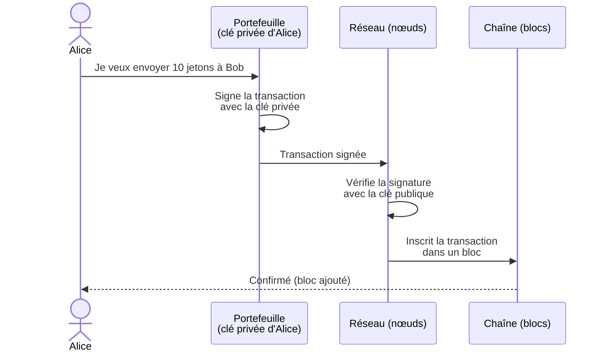
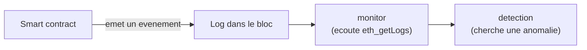

<Info>
**Ce que tu vas comprendre ici**
- Ce qu'est une blockchain, un bloc, une transaction, une adresse.
- La différence entre clé privée et clé publique, et ce qu'est une signature.
- Ce qu'est un smart contract, un événement (log), un ERC20, un stablecoin.
- Ce que veulent dire minter, brûler (burn), le gas, un multisig.
- Pourquoi on travaille sur le réseau de test **Avalanche Fuji**.

Temps de lecture : environ 10 minutes. Aucune connaissance supposée.
</Info>

Tu débarques et tu n'as jamais touché à la crypto ? Cette page est faite pour toi. On explique
chaque mot une seule fois, avec une image du quotidien, et on s'en sert ensuite partout dans la
doc. Garde-la sous le coude.

## La blockchain : un grand cahier partagé

Imagine un **cahier de comptes** posé au milieu d'un village. Tout le monde peut le lire, et
chaque nouvelle ligne écrite est **recopiée chez tous les habitants** en même temps. Personne ne
peut déchirer une page en douce : il faudrait convaincre tout le village de le faire aussi.

Une **blockchain**, c'est exactement ça : un **registre partagé** et public, dupliqué sur des
milliers d'ordinateurs, où chaque opération est enregistrée pour de bon et **très difficile à
effacer**.

<Tip>
**Analogie** : un cahier de comptes recopié chez tous les voisins. Pour tricher, il faudrait
modifier tous les cahiers en même temps — impossible en pratique.
</Tip>

## Le bloc : une page du cahier

On n'écrit pas les opérations une par une : on les **regroupe par paquets**. Un **bloc**, c'est un
paquet de transactions validées ensemble, puis **accroché** au bloc précédent — d'où le mot
« chaîne de blocs », *blockchain*. Chaque bloc pointe vers celui d'avant, comme les wagons d'un
train : on ne peut pas en retirer un du milieu sans tout casser.

Chaque bloc porte une **estampille de temps** (son `block.timestamp`). Dans notre projet, on
mesure les délais avec cette estampille plutôt qu'avec l'horloge d'un ordinateur, parce qu'elle
est la même pour tout le monde.

<Info>
Source : la notion de `block.timestamp` comme référence de temps est utilisée dans
`docs/OPEN_ANSWERS.md` §3 et §5.
</Info>

## La transaction : une ligne du cahier

Une **transaction** est une opération écrite dans le cahier : « Alice envoie 10 jetons à Bob »,
« Alice dépose une garantie », « traiter la demande n°42 ». Une fois dans un bloc, elle est
**définitive**.

C'est le point qui rend la fraude si dangereuse en crypto : une fois la transaction inscrite, on
ne peut pas appeler sa banque pour « annuler le paiement ». C'est tout l'enjeu du projet.

## L'adresse et le portefeuille

Une **adresse** est un numéro de compte public, du genre `0xAAAA…1234`. C'est comme un **IBAN** :
tu peux le donner à n'importe qui pour recevoir des jetons.

Un **portefeuille** (*wallet*) est l'application qui garde tes clés et te laisse signer des
opérations. Il ne « contient » pas vraiment les jetons (ils sont dans le cahier) : il contient le
**pouvoir de les déplacer**.

<Warning>
Dans toute la doc, les adresses sont **fictives** (`0xAAAA…`). On n'écrit jamais de vraie adresse
ni de vraie clé. Les faux secrets ressemblent à `FLAG{team20-canary}`.
</Warning>

## Clé privée, clé publique, signature

C'est le concept le plus important pour comprendre le projet. Prends-le lentement.

- La **clé privée** est un **secret** que toi seul connais. C'est le pouvoir d'agir.
- La **clé publique** (et l'adresse qui en dérive) est le **cadenas correspondant**, visible de
  tous.
- **Signer** une transaction, c'est prouver que tu possèdes la clé privée **sans la révéler**.
  N'importe qui peut vérifier la signature avec la clé publique.

<Tip>
**Analogie** : la clé privée est le code secret de ta carte bancaire ; la signature est la preuve
que tu l'as tapé. Si quelqu'un copie ton code, le distributeur pense que c'est toi — il n'y a pas
de « mot de passe oublié » en crypto.
</Tip>

Retiens cette phrase, elle est le cœur du projet : **une signature volée est acceptée comme si
c'était toi**. Le système ne sait pas distinguer le vrai propriétaire d'un voleur qui a la clé.

## Le smart contract : un distributeur automatique

Un **smart contract** (contrat intelligent) est un **programme** publié sur la blockchain. Une
fois en place, il applique ses règles **tout seul**, sans intervention humaine, et personne ne
peut le convaincre de tricher.

<Tip>
**Analogie** : un distributeur automatique. Tu mets une pièce, il te rend exactement ce qui est
programmé — ni plus, ni moins. Tu ne peux pas négocier avec lui.
</Tip>

C'est l'idée centrale de Secure Horizons : si les règles de sécurité vivent **dans le
distributeur lui-même**, alors même une clé volée ne peut rien lui faire faire d'interdit. On
développe nos contrats en Solidity, le langage des contrats sur Avalanche et Ethereum (voir
`contracts/src/`).

## L'événement (log) : le ticket de caisse

Quand un contrat fait quelque chose d'important, il **émet un événement** (un *log*), comme un
distributeur qui imprime un ticket de caisse. L'événement n'est pas secret : il est écrit dans le
bloc, lisible par tous.

C'est précisément ce que notre module `monitor` écoute : il lit en continu les événements du
contrat (par exemple un transfert, un mint) et les transmet au reste du système.

<Info>
Source : `monitor/README.md` — le `monitor` lit les événements `Transfer` du token par polling
`eth_getLogs` et les convertit en `MintEvent` / `TransferEvent`.
</Info>

## Le gas : les frais de l'opération

Écrire dans le cahier partagé coûte de l'énergie aux ordinateurs qui le tiennent. On paie donc des
**frais**, appelés **gas**, à chaque transaction. Plus l'opération est lourde (plus de calculs,
plus de données), plus elle coûte de gas.

<Tip>
**Analogie** : les frais de port d'un colis. Un petit colis coûte peu, un gros colis coûte plus.
</Tip>

Le gas explique un choix important du projet : certaines idées « élégantes » sont écartées parce
qu'elles coûteraient **trop de gas** (par exemple suivre chaque pièce une par une). On préfère des
mécanismes à **coût constant** (voir [la contamination par ratio](/contamination-par-ratio)).

## Minter et brûler (burn)

- **Minter** = **fabriquer** de nouveaux jetons. C'est comme imprimer des billets neufs.
- **Brûler** (*burn*) = **détruire** des jetons existants. Ils disparaissent du cahier.

<Tip>
**Analogie** : minter, c'est l'imprimante à billets de la banque centrale ; brûler, c'est passer
des billets à la déchiqueteuse.
</Tip>

Normalement, on ne mint un jeton que si une **vraie contrepartie** (le collatéral, voir plus bas)
a été déposée. Un mint sans contrepartie, ce sont des jetons « vides » — exactement l'attaque qui
nous occupe. Notre défense sait aussi **brûler** des jetons suspects pour annuler une fraude.

## ERC20 : le standard des jetons

**ERC20** est la **norme technique** la plus répandue pour un jeton sur Ethereum et Avalanche.
Tous les jetons ERC20 parlent le même langage : les mêmes fonctions (`transfer`, `balanceOf`,
`totalSupply`…) et le même événement `Transfer`.

<Tip>
**Analogie** : la prise électrique standard. Peu importe la marque de l'appareil, il se branche
dans la même prise. Notre `monitor` peut écouter n'importe quel ERC20 parce qu'ils émettent tous
le même événement `Transfer`.
</Tip>

Petit détail utile : un **mint** ERC20 apparaît comme un `Transfer` dont l'expéditeur est
l'adresse zéro (`0x0 → destinataire`), et un **burn** comme un `Transfer` vers l'adresse zéro
(`expéditeur → 0x0`). C'est ainsi que le `monitor` les reconnaît.

<Info>
Source : `monitor/README.md` — « un mint = `Transfer(from = 0x0, to, value)` », les burns sont
`to = 0x0`.
</Info>

## Stablecoin et collatéral

Un **stablecoin** est un jeton conçu pour **valoir toujours à peu près la même chose** (par
exemple 1 dollar). Pour tenir cette promesse, l'émetteur garde en réserve une **garantie** : le
**collatéral**.

<Tip>
**Analogie** : un vestiaire de théâtre. Pour chaque ticket (le stablecoin) remis, il y a un
manteau réel au vestiaire (le collatéral). Tant qu'il y a autant de manteaux que de tickets, tout
le monde peut récupérer son manteau.
</Tip>

La règle de solvabilité du projet est une version de cette image :

> **La valeur des jetons en circulation ne doit jamais dépasser le collatéral déposé.**

Si un voleur mint des jetons « vides » (des tickets sans manteau), cette règle est violée, et les
vrais détenteurs ne peuvent plus tous récupérer leur dû. Dans le projet, les jetons sont fictifs :
le collatéral est un faux dollar (`MockUSDC`, 6 décimales) et le stable un faux dollar à 18
décimales (`StableToken`).

<Info>
Source : `contracts/src/StableToken.sol`, `contracts/src/MockUSDC.sol` ; invariant de solvabilité
`supply ≤ collatéral` dans `docs/OPEN_ANSWERS.md` §0bis-a et §0bis-c.
</Info>

## Décimales : pourquoi 6 et 18 ?

Un jeton n'a pas de virgule : tout est en **nombres entiers**. Pour représenter « 1,5 jeton », on
choisit un nombre de **décimales**. Avec 18 décimales, 1 jeton s'écrit `1 000 000 000 000 000 000`
unités de base.

Notre collatéral fictif a **6 décimales** (comme le vrai USDC), notre stable fictif en a **18**.
Le contrat convertit de l'un à l'autre en multipliant par `10^(18-6)` = `1e12`. Tu n'as pas besoin
de retenir le calcul, juste l'idée : **on manipule des entiers, jamais des nombres à virgule**,
pour éviter les erreurs d'arrondi.

<Info>
Source : `contracts/src/ProtectedMinter.sol` — `DECIMALS_SCALE = 1e12`, `COLLATERAL_DECIMALS = 6`.
</Info>

## Le réseau de test Avalanche Fuji et le faucet

Travailler avec de la vraie monnaie serait dangereux et coûteux. On utilise donc **Fuji**, le
**réseau de test** d'Avalanche : une blockchain jumelle de la vraie, mais où la monnaie **n'a
aucune valeur**. Parfait pour expérimenter sans risque.

Pour obtenir des jetons de test gratuits, on utilise un **faucet** (littéralement « robinet ») :
un site qui t'envoie quelques AVAX de test pour payer le gas sur Fuji.

<Tip>
**Analogie** : Fuji est un billard d'entraînement avec des fausses billes. Le faucet est la
réserve de fausses billes à côté de la table : sers-toi, ça ne coûte rien.
</Tip>

<Info>
Source : `README.md` §8 (« Contraintes AWS ») et `contracts/README.md` — cible Avalanche Fuji,
accès RPC public + faucet AVAX de test à vérifier tôt par chaque membre.
</Info>

## Finalité et réorganisation de chaîne

Quand ta transaction entre dans un bloc, est-ce **vraiment** fini ? Presque. Pendant quelques
blocs, il reste une toute petite chance que le réseau **réorganise** sa chaîne (une *réorg*) et
remplace les derniers blocs. On attend donc quelques **confirmations** (des blocs ajoutés
par-dessus) avant de considérer une transaction comme **finale**.

<Tip>
**Analogie** : à l'encre, une ligne du cahier peut encore baver tant qu'elle n'a pas séché.
Quelques blocs plus tard, l'encre est sèche : la ligne est définitive.
</Tip>

Notre `monitor` gère ça avec un réglage de **confirmations** et un **checkpoint** (il note le
dernier bloc lu) pour reprendre sans trou ni doublon même si le réseau hoquette.

<Info>
Source : `monitor/README.md` — `MONITOR_CONFIRMATIONS`, reprise sur erreur RPC et checkpoint.
</Info>

## Multisig : plusieurs clés pour une décision grave

Un **multisig** (signature multiple) est une règle qui exige l'accord de **plusieurs personnes**
(« M parmi N ») pour qu'une décision passe. Voler **une** clé ne suffit plus.

<Tip>
**Analogie** : le coffre-fort d'une banque qui exige **deux** clés tournées en même temps par deux
responsables différents. Un seul employé — ou un seul voleur — ne peut pas l'ouvrir.
</Tip>

Dans le projet, les décisions graves (détruire des jetons suspects, mettre tout en pause) passent
par un multisig **simulé** de 3 gardiens. On en reparle en détail dans
[Les garde-fous](/les-garde-fous).

<Info>
Source : `contracts/src/GuardianPausable.sol` (multisig simulé 3/3) et `docs/OPEN_ANSWERS.md` §3.
</Info>

<Check>
**À retenir**
- La blockchain est un **cahier partagé** où chaque ligne (transaction) est **définitive**.
- Une **clé privée** signe les opérations ; **volée, elle agit à ta place** — le cœur du risque.
- Un **smart contract** applique ses règles tout seul : c'est là qu'on met la sécurité.
- **Minter** = fabriquer des jetons ; un **stablecoin** doit toujours être couvert par son
  **collatéral**.
- On travaille sur **Fuji** (réseau de test, monnaie sans valeur) avec des données **fictives**.
</Check>

<CardGroup cols={2}>
  <Card title="Le problème" icon="triangle-exclamation" href="/le-probleme">
    Pourquoi une clé volée est si dangereuse, raconté avec le hack Resolv.
  </Card>
  <Card title="L'idée clé" icon="lightbulb" href="/lidee-cle">
    « La sécurité vit dans le contrat » : ce que ça change tout.
  </Card>
  <Card title="Le Token Ghost" icon="ghost" href="/token-ghost">
    La quarantaine liquide, le marché parallèle, le prix décoté.
  </Card>
  <Card title="Glossaire" icon="book" href="/glossaire">
    Tous les termes en une ligne, si un mot t'échappe.
  </Card>
</CardGroup>
