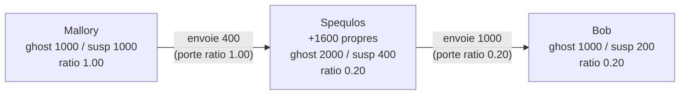
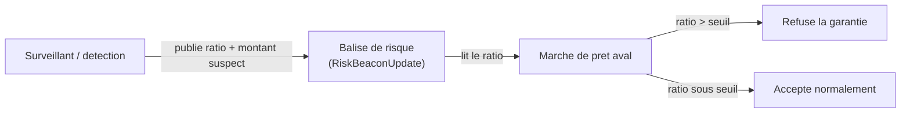

<Info>
**Ce que tu vas comprendre ici**
- Pourquoi on **pricerait** le risque au lieu de bloquer en tout-ou-rien.
- Le **ratio de contamination par adresse**, expliqué avec un exemple chiffré pas à pas.
- Comment le soupçon se **propage** aux transferts (et pourquoi disperser ne nettoie pas).
- Sa **publication** sur la balise de risque et sa **lecture** par les protocoles en aval.
- L'**allongement de fenêtre ciblé** et la **contamination posée après coup** (racine de Merkle).

Temps de lecture : environ 16 minutes. Les mots de base sont dans
[La blockchain en 10 minutes](/bases-blockchain) et dans le [Glossaire](/glossaire).
</Info>

<Note>
Personnages fictifs : **Alice** (honnête), **Bob** (commerçant honnête), **Mallory** (voleuse),
**Spéculos** (acheteur de Ghost). Tous les montants, adresses et ratios sont **fictifs**
(`docs/CLAIMS.md`).
</Note>

## Pricer le risque, pas le bloquer

<Note>
**Décision §0 (2026-10-10, Équipe 20) — tranché en équipe.** Le cœur du projet est de **« pricer le
risque »**. Le ratio par adresse n'est pas qu'un outil de police (geler / détruire) : c'est un
**prix du risque** continu, publié sur la balise de risque et lisible par les protocoles en aval.
</Note>

L'idée centrale : au lieu de dire « cette adresse est bonne / mauvaise » (un interrupteur), on
attache à chaque adresse **un nombre entre 0 et 1** qui dit **quelle fraction** de son solde Ghost
est suspecte. On ne bloque pas la fraude en on/off, on la **rend visible et chiffrée**, et on laisse
le marché et l'aval réagir à ce prix.

<Tip>
**Analogie de l'eau colorée.** Imagine un verre d'eau claire (du Ghost propre). Verse une goutte
d'encre (du Ghost suspect) : toute l'eau prend une **très légère** teinte. Verse beaucoup d'encre
dans peu d'eau : la teinte est forte. Le **ratio de contamination**, c'est l'intensité de cette
teinte : la **proportion** d'encre dans le verre. On ne sait pas dire *quelles* molécules sont de
l'encre, mais on sait dire *quelle part* du verre l'est.
</Tip>

## Le ratio de contamination par adresse

<Note>
**Décision §9 (2026-10-10, Marceau) — validée en session, à relire par l'équipe.** On ne suit
**pas** des pièces. Chaque adresse porte **un seul nombre** : la fraction suspecte de son solde
Ghost. À chaque transfert, le montant envoyé porte le **ratio courant de l'expéditeur** ; le
destinataire met à jour son ratio en **moyenne pondérée par les montants**.
</Note>

Concrètement, chaque adresse stocke deux choses : son solde Ghost, et un **montant suspect absolu**.
Le ratio en **dérive** (`suspect / ghost`). Garder le montant absolu plutôt que le ratio seul est
une parade (voir plus bas « auto-contamination défensive »).

```python data/ghost_ledger.py
@property
def ratio(self) -> float:
    """Fraction suspecte du solde Ghost, dans [0, 1]."""
    ghost = self.ghost
    return min(1.0, max(0.0, self.suspect / ghost)) if ghost else 0.0
```

Ligne à ligne : `self.ghost` = solde Ghost non converti ; `self.suspect` = montant suspect absolu ;
le ratio est leur rapport, borné dans `[0, 1]` et valant `0` si l'adresse n'a aucun Ghost.

### Exemple chiffré pas à pas

Suivons des montants fictifs. (Dans le code, le soupçon est un `float` ; le vrai contrat utilisera
du point fixe — simplification signalée pour #8.)

<Steps>
  <Step title="Mallory part avec 1 000 M-Ghost 100 % suspects">
    Après le mint frauduleux, Mallory a `ghost = 1000`, `suspect = 1000`.
    Son **ratio = 1000 / 1000 = 1,00** (100 % suspect).
  </Step>
  <Step title="Mallory envoie 400 à Spéculos">
    Le montant envoyé porte le ratio **courant** de Mallory (1,00), donc il transporte
    `1,00 × 400 = 400` de suspect.
    - Mallory : `ghost = 600`, `suspect = 1000 − 400 = 600` → ratio **1,00** (toujours 100 %).
    - Spéculos (vide avant) : `ghost = 400`, `suspect = 400` → ratio **1,00**.
  </Step>
  <Step title="Spéculos mélange avec 1 600 Ghost propres">
    Spéculos possédait déjà 1 600 M-Ghost propres (`suspect = 0`). Après réception :
    `ghost = 1600 + 400 = 2000`, `suspect = 0 + 400 = 400`.
    Son **ratio = 400 / 2000 = 0,20** (20 % suspect). La goutte d'encre s'est **diluée**.
  </Step>
  <Step title="Spéculos envoie 1 000 à Bob">
    Le montant porte le ratio **courant** de Spéculos (0,20) : il transporte `0,20 × 1000 = 200`
    de suspect.
    - Spéculos : `ghost = 1000`, `suspect = 400 − 200 = 200` → ratio **0,20** (inchangé).
    - Bob (vide avant) : `ghost = 1000`, `suspect = 200` → ratio **0,20**.
  </Step>
</Steps>

Vérifions la **conservation du soupçon** : au départ, `suspect total = 1000`. À la fin :
Mallory 600 + Spéculos 200 + Bob 200 = **1000**. Fractionner et disperser **n'a rien nettoyé** — le
soupçon total est conservé. C'est l'anti-blanchiment **par construction**.



Dans le registre de référence, la mise à jour du destinataire est exactement cette addition pondérée
(`account.suspect += ratio × amount`), et l'expéditeur retire la part correspondante :

```python data/ghost_ledger.py
ratio = source.ratio
# ... (on prend les tranches les plus anciennes d'abord) ...
source.suspect = max(0.0, source.suspect - ratio * amount)
return self._credit(recipient, amount, at, ratio=ratio, maturities=tuple(taken))
```

### Pourquoi ce modèle, et pas d'autres

| Mécanisme écarté | Problème |
|---|---|
| **FIFO / par lots** (suivre chaque pièce) | Coût gas **explosif**, manipulable par micro-lots. |
| **« Le plus suspect gagne »** | Effet **tache d'huile** : une goutte marque tout le token. |

Le ratio par adresse, lui, a un **coût constant** par transfert (une multiplication, indépendant de
la profondeur), **conserve le soupçon**, évite la tache d'huile (une grosse adresse légitime touchée
par une goutte finit à un ratio minuscule → faux positifs limités), et reste **réversible** (un audit
blanchissant remet les ratios à 0).

<Info>
Source : `docs/OPEN_ANSWERS.md` §9 (« Ciblage chirurgical — modèle de contamination par ratio par
adresse ») et `data/ghost_ledger.py`.
</Info>

## Publication sur la balise de risque, lecture par l'aval

Le ratio d'une adresse est publié sur la **balise de risque** (`RiskBeaconUpdate`), le panneau
public que n'importe quel protocole en aval peut lire. C'est **le prix du risque**.



La balise porte **deux** champs de soupçon (`contamination_ratio` **et** `suspect_amount`), un niveau
de risque (`normal` / `elevated` / `frozen`) et l'adresse couverte — **y compris un pool AMM**, qui
est une adresse avec un ratio comme une autre. C'est l'angle principal de la démo (scénario C :
mauvaises créances d'un faux marché de prêt **avec vs sans** lecture de la balise).

<Info>
Source : modèle `RiskBeaconUpdate` dans `docs/CONTRACTS.md` et `docs/OPEN_ANSWERS.md` §0 / §4
(balise = prix du risque, angle anti-contagion). Les chiffres du scénario C sont **à mesurer**.
</Info>

## Allongement de fenêtre ciblé

Quand le trafic est jugé anormal (**volume élevé ET dispersion effondrée**, §9), on **allonge** la
fenêtre Ghost du périmètre suspect — on ne gèle pas les fonds, on **retarde la conversion** vers le
vrai token. L'allongement est **auto-expirant** : sans confirmation humaine, la fenêtre revient
seule à la normale (silence = retour à la normale, bon biais pour les faux positifs).

Dans le registre de référence, la conversion est **refusée** tant que l'adresse est en fenêtre
allongée, ou que le ratio **ou** le montant absolu suspect dépasse son seuil :

```python data/ghost_ledger.py
if self.is_delayed(address, at):
    return Conversion(0, ratio, "fenetre allongee")
if ratio > self.params.ratio_threshold:
    return Conversion(0, ratio, "ratio au-dessus du seuil")
if account.suspect > self.params.suspect_threshold:
    return Conversion(0, ratio, "montant suspect au-dessus du seuil")
```

Lecture : une conversion ne passe que si l'adresse n'est **pas** retardée, **et** son ratio est sous
le seuil, **et** son montant suspect absolu est sous le sien. Trois verrous, chacun suffisant pour
bloquer. Les détails des trois verbes (retarder / détruire / pause globale) sont dans
[Les garde-fous](/les-garde-fous).

<Warning>
**Auto-contamination défensive (limite assumée).** Un attaquant peut se mélanger du légitime pour
baisser son ratio sous le seuil. La parade est précisément le **montant absolu suspect** : il est
**conservé** (insensible à la dilution), donc un gros montant suspect bloque la conversion même si
le ratio a été dilué. C'est pourquoi le code teste `account.suspect`, pas seulement `ratio`.
</Warning>

<Info>
Source : `docs/OPEN_ANSWERS.md` §3 (ce qui est permis pendant un retard) et §9 (seuils ratio ET
montant absolu). Les seuils sont **à mesurer**.
</Info>

## Contamination posée après coup : recalcul hors chaîne + racine de Merkle (§11)

<Note>
**Décision §11 (2026-10-11, denybs) — validée en session, à relire par l'équipe.** Piste **(b)** :
le surveillant **rejoue les transferts publics**, recalcule rétroactivement qui détient quoi dans le
lot frauduleux, et le **multisig 2/3** soumet la liste des destructions **et** restitutions sous
forme de **racine de Merkle contestable**.
</Note>

**Le problème.** Le ratio se transmet **au moment** du transfert. Si Mallory n'est marquée suspecte
qu'**après** avoir fait circuler son M', son ratio valait **0** pendant les ventes : le soupçon n'a
pas suivi la chaîne. Comment atteindre le M' chez le dernier détenteur (le 40e de la chaîne de
§10bis) ?

### Qu'est-ce qu'une racine de Merkle ? (pour un novice)

<Tip>
**Analogie du sommaire scellé.** Imagine une longue liste : « adresse X doit perdre 7, adresse Y
doit récupérer 3 … ». On la résume en **un seul petit code** (la racine de Merkle), un peu comme le
numéro au dos d'un chèque certifié. Deux propriétés magiques :
1. **changer une seule ligne de la liste change le code** — on ne peut pas trafiquer la liste en
   douce ;
2. **chacun peut prouver que SA ligne est bien dans la liste** sans révéler toute la liste.
Le multisig publie le code ; chaque porteur refait le calcul et **conteste** si sa ligne est fausse.
</Tip>

### La mesure qui tranche

Le module `data/late_marking.py` chiffre les trois pistes sur la **chaîne des 40** (données
**fictives**, voleur marqué **après** avoir tout revendu, détection à 3 min, fenêtre `W = 10 min`) :

| Piste | M' récupéré |
|---|---|
| (a) lignage d'origine par tranche | **100 %** |
| (b) recalcul rétroactif hors chaîne + preuve | **100 %** (même couverture que (a)) |
| (c) contamination prospective seule | **0 %** |

Le code dit explicitement que (b) a **la même couverture** que (a), la différence étant
opérationnelle (preuve hors chaîne contre étiquette on-chain), pas sur le montant :

```python data/late_marking.py
# --- (b) recalcul retroactif hors chaine ---
# Meme couverture que (a) sur le solde encore en Ghost : la difference est operationnelle
# (preuve hors chaine vs etiquette on-chain), pas sur le montant recupere.
retroactive = ChainOutcome(
    strategy="b_retroactif",
    recovered=lineage.recovered,
    escaped_converted=lineage.escaped_converted,
    escaped_prospective_gap=0,
    thief_kept=0,
)
```

**Lecture de la mesure :** (a) et (b) récupèrent autant. Le vrai levier n'est **pas** la piste mais
la **vitesse de détection face à l'échéance** — avec lignage, on récupère tout tant que l'alerte
**précède** l'échéance W, et rien au-delà. (c) ne rattrape jamais une chaîne déjà propagée. Le code
confirme : la récupération de (a)/(b) ne vaut `amount` que si `alert_before_maturity`.

```python data/late_marking.py
alert_before_maturity = alert_at <= maturity
lineage = ChainOutcome(
    strategy="a_lignage_origine",
    recovered=amount if alert_before_maturity else 0,
    escaped_converted=0 if alert_before_maturity else amount,
    escaped_prospective_gap=0,
    thief_kept=0,
)
```

### Pourquoi (b) plutôt que (a), à couverture égale

<AccordionGroup>
  <Accordion title="1. Coût on-chain nul par tranche">
    (a) impose de stocker un identifiant d'origine sur **chaque** tranche et de gérer la **fusion**
    de tranches d'origines différentes — du stockage et une sémantique de mélange dans le contrat
    Ghost (#8), qui doit rester simple. (b) ne demande **aucun** stockage de lignage.
  </Accordion>
  <Accordion title="2. Un seul mécanisme pour détruire ET restituer">
    La §10bis exige déjà que les **restitutions** arrivent sous forme de racine de Merkle. (b) fait
    passer destructions et restitutions par **le même** chemin.
  </Accordion>
  <Accordion title="3. Cohérent avec « l'IA ne décide jamais seule d'une destruction »">
    Le calcul est hors chaîne et **public / reproductible** ; c'est le **multisig humain** qui
    engage la racine, et les porteurs peuvent la **contester** avant exécution.
  </Accordion>
  <Accordion title="4. N'ajoute pas de dépendance de conception à #8">
    Le contrat Ghost garde seulement un **point d'extension** (destruction acceptant une racine de
    Merkle) ; il n'a pas à porter le lignage. Cela **débloque** #84 sans alourdir #8.
  </Accordion>
</AccordionGroup>

<Warning>
Comportement par défaut : **sans** racine soumise, le contrat se comporte comme (c) (on n'atteint
que ce que le voleur détient **encore** + ses Ghost de paiement). (b) est le **sur-ensemble** activé
par le multisig quand une chaîne a déjà propagé. Hypothèses à documenter (`docs/CLAIMS.md`, jamais
garanties) : transferts **publics et complets**, détection **avant** W, racine **contestable** (délai
et format de preuve à figer dans #84).
</Warning>

<Info>
Source : `docs/OPEN_ANSWERS.md` §11, `data/late_marking.py` (mesure, PR #95, incluse dans `make
calibrate`), `docs/OPEN_QUESTIONS.md` §11 (pistes évaluées).
</Info>

## Comment c'est simulé dans le code

<CardGroup cols={2}>
  <Card title="data/ghost_ledger.py" icon="scale-balanced">
    Le **registre de référence hors chaîne** : soldes, tranches d'échéance (§0bis-b), ratio de
    contamination (§9), seuils de conversion ratio **et** montant absolu (§9), réserve de
    restitution (§0bis-c). Ce n'est **pas** le contrat : la vérité reste on-chain. Simplifications
    signalées pour #8 : soupçon en `float`, pas de marge de conversion.
  </Card>
  <Card title="data/late_marking.py" icon="clock-rotate-left">
    La **mesure de #85** (contamination posée après coup) sur la chaîne des 40 : compare les pistes
    (a)/(b)/(c) et balaie le délai de détection pour montrer que le levier est la **vitesse face à
    l'échéance**. Données **fictives**, lancé par `python -m data.late_marking` ou `make calibrate`.
  </Card>
</CardGroup>

<Check>
**À retenir**
- Un **seul nombre par adresse** (ratio) dit **quelle part** de son Ghost est suspecte — pas
  quelles pièces.
- Il se **propage** aux transferts par moyenne pondérée ; disperser **ne nettoie pas** (soupçon
  conservé).
- Le **montant absolu suspect**, conservé lui aussi, est la parade à la dilution défensive.
- Il se **publie** sur la balise (prix du risque) et l'aval le **lit** pour refuser une garantie.
- Posé **après coup**, on le rattrape par **recalcul hors chaîne + racine de Merkle** (piste b) ;
  le vrai levier reste **détecter avant l'échéance**.
- Tout est **simulé** hors chaîne dans `data/ghost_ledger.py` + `data/late_marking.py` ; la vérité
  restera on-chain (#8).
</Check>

<CardGroup cols={2}>
  <Card title="Le Token Ghost" icon="ghost" href="/token-ghost">
    La quarantaine liquide, les tranches, la réserve de restitution.
  </Card>
  <Card title="Les garde-fous" icon="lock" href="/les-garde-fous">
    Les trois verbes, le budget de quarantaine, le multisig.
  </Card>
  <Card title="Les trois volets" icon="layer-group" href="/les-trois-volets">
    Volume élevé ET dispersion effondrée, la baseline médiane + MAD.
  </Card>
  <Card title="Parcours d'une attaque" icon="route" href="/le-parcours-dune-attaque">
    Le ratio en action dans les scénarios C et D.
  </Card>
</CardGroup>
