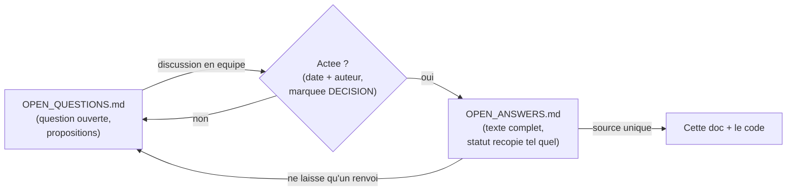

<Info>
**Ce que tu vas comprendre ici**
- La **liste de toutes les décisions** actées, avec pour chacune une explication simple et « ce que
  ça change concrètement ».
- Les **grandes questions encore ouvertes**, marquées « à valider en équipe ».
- Le **processus** : comment une question devient une décision.

Temps de lecture : environ 14 minutes. La **source unique** d'une décision est
`docs/OPEN_ANSWERS.md` ; les questions ouvertes vivent dans `docs/OPEN_QUESTIONS.md`.
</Info>

<Warning>
On ne tranche **aucune** décision ici : on recopie le **statut tel quel** (« tranché »,
« validée en session, à relire par l'équipe »…), sans le renforcer. On ne dit jamais « prouvé », au
mieux « vérifié par tests ». Les décisions dont le statut est « validée en session » restent **à
relire par l'équipe**.
</Warning>

## L'index des décisions actées

Chaque ligne est une décision présente dans l'index de `docs/OPEN_ANSWERS.md`. Le **statut** est
recopié tel quel.

| § | Sujet | Date | Auteur | Statut | Source |
|---|---|---|---|---|---|
| 0 | Où vit la sécurité, et cœur du projet | 2026-10-10 | Équipe 20 | Tranché en équipe | — |
| 0bis | Le Ghost sur le mint seul ou tous les transferts ? | 2026-10-10 | Marceau | Tranché | PR #34 |
| 0bis-a | Affirmation portée : solvabilité ou récupération ? | 2026-10-10 | Marceau | Tranché | Issue #37 |
| 0bis-b | Que produit le transfert d'un Ghost ? | 2026-10-10 | denybs | Validée en session, à relire par l'équipe | Issue #35 |
| 0bis-c | Collatéral libéré par la destruction : réserve de restitution | 2026-10-10 | denybs | Validée en session, à relire par l'équipe | Issue #36 |
| 1 | Détection du mint anormal : invariants, seuils | 2026-10-10 | denybs | Validée en session, à relire par l'équipe | PR #51 |
| 3 | Réponse graduée : retarder ≠ bloquer, machine à états, quorums | 2026-10-10 | Équipe 20 | Tranché en équipe | — |
| 4 | Angle différenciant : anti-contagion + IA + DORA | 2026-10-10 | Équipe 20 | Tranché en équipe | — |
| 5 | Mesure de performance : délai, faux positifs, baseline | 2026-10-10 | denybs | Validée en session, à relire par l'équipe | — |
| 6 | Données synthétiques : JSONL, scénarios recadrés | 2026-10-10 | EnzoFB06 | Tranché (propriétaire `data/`) | — |
| 9 | Volet 2 : surveillance adaptative, contamination par ratio | 2026-10-10 | Marceau | Validée en session, à relire par l'équipe | PR #38 |
| 10 | Lignage d'un swap : `swap-id`, règlement différé | 2026-10-10 | denybs | Validée en session, à relire par l'équipe | Issue #43 |
| 10bis | Qui porte le risque : M' protégé / pur / chèque, routeur | 2026-10-10 | Marceau | Validée en session, à relire par l'équipe | Issue #84 |
| 11 | Contamination posée après coup : Merkle contestable | 2026-10-11 | denybs | Validée en session, à relire par l'équipe | PR #95 |
| 79 | Champs manquants monitor/detection (`request_id`, `is_ghost`, I1/I5/I6) | 2026-10-11 | denybs | Validée en session, à relire par l'équipe | Issue #79 |

<Info>
Source : index de `docs/OPEN_ANSWERS.md`.
</Info>

## Chaque décision expliquée

### §0 — Où vit la sécurité, et le cœur du projet

<Note>Statut : **Tranché en équipe** (2026-10-10, Équipe 20).</Note>

**En clair.** La sécurité vit **dans le contrat**, pas seulement autour : une surveillance « autour »
arrive trop tard face à une clé volée (le mint est déjà valide). Les invariants durs vivent donc
**on-chain** ; la surveillance et le LLM restent autour pour la démo et DORA. Le **cœur** retenu est
« **pricer le risque** » via le Token Ghost à contamination par ratio. Pas de plafond fixe mais une
**baseline adaptative**. Une **marge de conversion** token ⇄ Ghost est prélevée.

**Ce que ça change concrètement.** On écrit un vrai contrat protégé (volet 1) ; on construit la
balise de risque (volet 3 **retenu comme cœur**, pas option) ; priorité **volet 1 → 2 → 3**. La
marge de conversion et tous les seuils restent **à mesurer**.

### §0bis — Le Ghost sur tous les transferts

<Note>Statut : **Tranché** (2026-10-10, Marceau, PR #34).</Note>

**En clair.** Tout transfert produit du Ghost chez le destinataire, converti 1:1 après la fenêtre
(ex. 10 min) sans anomalie. Objectif : pouvoir **récupérer des fonds après coup** (anti-blanchiment),
ce qu'un Ghost limité au mint ne permet pas.

**Ce que ça change concrètement.** 100 % des usages légitimes subissent la fenêtre (friction à
mesurer) ; chaque swap AMM produit du Ghost ; annuler une fraude = défaire des Ghost fragmentés chez
N adresses (le cas normal). Détail : [Le Token Ghost](/token-ghost).

### §0bis-a — Solvabilité en tête, récupération ensuite

<Note>Statut : **Tranché** (2026-10-10, Marceau, issue #37).</Note>

**En clair.** La ligne unique sur le Ghost devient **deux** affirmations : **solvabilité** (aucun
vrai token non adossé si détecté avant la fin de fenêtre, `supply ≤ collateral`) et **récupération**
(un transfert suspect est annulable tant que le Ghost n'est pas converti). La solvabilité passe en
tête car elle se vérifie **seule** par invariants.

**Ce que ça change concrètement.** `docs/CLAIMS.md` porte deux lignes au lieu d'une ; « 100 %
solvable » est retiré (garantie **conditionnelle** à la vitesse de détection).

### §0bis-b — La fenêtre portée par la valeur, tranches d'échéance

<Note>Statut : **Validée en session, à relire par l'équipe** (2026-10-10, denybs, issue #35).</Note>

**En clair.** Un seul Ghost par token, **jamais de « Ghost d'un Ghost »**. La fenêtre court depuis
l'entrée de la valeur et **ne redémarre pas** en circulant. Chaque adresse range son solde en
**tranches d'échéance** arrondies au créneau supérieur ; les plus anciennes partent en premier.

**Ce que ça change concrètement.** Le contrat Ghost (#8) implémente les tranches ; coût borné par N
par transfert. Évite deux failles (mélange, poussière). Détail :
[Pricer le risque](/contamination-par-ratio).

### §0bis-c — La réserve de restitution

<Note>Statut : **Validée en session, à relire par l'équipe** (2026-10-10, denybs, issue #36).</Note>

**En clair.** Invariant `valeur(supply M + M-Ghost) ≤ collatéral`. L'excédent créé en brûlant un
Ghost adossé forme une **réserve cantonnée** : ni profit, ni redistribution automatique. Restituer à
une victime = **multisig 2/3**, plafonné par la réserve.

**Ce que ça change concrètement.** Le contrat ajoute `reserve()` en lecture + une restitution
multisig plafonnée ; le protocole ne perd rien, les porteurs de bonne foi perdent `ratio × solde`,
en partie compensable.

### §1 — Détection du mint anormal

<Note>Statut : **Validée en session, à relire par l'équipe** (2026-10-10, denybs, PR #51).</Note>

**En clair.** **Aucun seuil** sur la taille d'un mint (redondant avec le volet 1). Le surveillant
vérifie, hors chaîne, que les hypothèses du volet 1 tiennent : invariants **I1–I6**, événements
d'administration non annoncés, écart d'oracle. **I3** (destinataire = déposant) est **nouveau** et
doit être appliqué par le contrat.

**Ce que ça change concrètement.** `check_mint()` vérifie I1/I5/I6 + admin + oracle, pas de seuil de
taille ; le contrat protégé applique I3. Valeurs de ε et δ **à mesurer**.

### §3 — Réponse graduée : retarder ≠ bloquer

<Note>Statut : **Tranché en équipe** (2026-10-10, Équipe 20).</Note>

**En clair.** L'IA **retarde** (allonge la fenêtre, auto-expirant), elle ne **bloque** ni ne
**pause** jamais. Pendant un retard, les Ghost **circulent** mais ne se **convertissent** pas.
**Silence = retour auto à la normale.** Quorums : **détruire 2/3**, **pause globale 3/3** (levée par
le même multisig). Machine à états `NORMAL → RETARDÉ → {NORMAL | DÉTRUIT | PAUSE_GLOBALE}`.

**Ce que ça change concrètement.** Base directe de `response/orchestrator.py` (aligné, PR #56). Les
durées exactes restent **à mesurer**. Détail : [Les garde-fous](/les-garde-fous).

### §4 — Angle différenciant

<Note>Statut : **Tranché en équipe** (2026-10-10, Équipe 20).</Note>

**En clair.** Pas un angle isolé : **un principal + deux renforts**, unifiés par « pricer le
risque ». Principal = **anti-contagion** (seul démontrable, scénario C) ; renfort A = **supervision
de l'IA** ; renfort B/cadre = **DORA** (journal d'audit + rapport d'incident).

**Ce que ça change concrètement.** La démo met en avant le scénario C ; DORA reste un **narratif**,
pas un angle technique isolé. Tension assumée : le Ghost transfère une partie de la perte au marché
secondaire (à dire au jury).

### §5 — Mesure de performance

<Note>Statut : **Validée en session, à relire par l'équipe** (2026-10-10, denybs).</Note>

**En clair.** Tout se mesure par rapport à la **fenêtre Ghost** : détecter **avant conversion**.
Délai = `t2 − t0` + **marge avant conversion**. Faux positifs mesurés sur un **jeu de trafic normal
sans attaque**. Baseline = **Resolv tel quel**. Médiane et p95, pas la moyenne.

**Ce que ça change concrètement.** Le générateur produit un timestamp par événement + un jeu normal
(dénominateur des FP) ; le dashboard affiche délai, marge, taux de FP. Toutes les cases chiffrées
restent **vides tant que non mesurées**.

### §6 — Données synthétiques

<Note>Statut : **Tranché** (2026-10-10, EnzoFB06, propriétaire `data/`).</Note>

**En clair.** Format **JSONL** (une ligne = un événement), **schéma = les modèles figés** de
`docs/CONTRACTS.md` (pas de schéma dupliqué). Scénarios recadrés : A (mint gonflé), B (détournement
1:1), C (contagion), D (marché Ghost). Un flux de **trafic normal** par créneaux de 5 min sert de
base de calibration.

**Ce que ça change concrètement.** `data/generate.py` (`make data`) à graine fixe importe les
modèles de `shared/`. Les chiffres (volumes, ratios) sont **à calibrer**, jamais inventés.

### §9 — Volet 2 : surveillance adaptative et contamination par ratio

<Note>Statut : **Validée en session, à relire par l'équipe** (2026-10-10, Marceau, PR #38).</Note>

**En clair.** Deuxième sécurité réactive au-dessus du Ghost. Déclencheur = **volume élevé ET
dispersion effondrée** sur ratios normalisés, baseline **médiane + MAD**. Trois verbes (retarder /
détruire / pause globale). Modèle de **contamination par ratio par adresse** (coût constant, soupçon
conservé). Deux bornes testables : **perte max** ET **friction max** (budget de quarantaine).

**Ce que ça change concrètement.** `check_transfer()` suit ce discriminant ; la destruction ne prend
que `ratio × solde`. Détail : [Pricer le risque](/contamination-par-ratio). Tous les seuils **à
mesurer**.

### §10 — Lignage d'un swap

<Note>Statut : **Validée en session, à relire par l'équipe** (2026-10-10, denybs, issue #43).</Note>

**En clair.** Sur **notre** pool, un swap ne paie pas l'actif sortant tout de suite : il crée une
créance `swap-id`, réclamable à l'échéance du Ghost vendu. Fraude confirmée → les **deux jambes**
s'annulent. Pas de stablecoin pivot. DEX tiers non couverts (limite assumée).

**Ce que ça change concrètement.** Le pool simulé du scénario D porte des créances `swap-id` ;
priorité vague 5. Étendu par §10bis.

### §10bis — Qui porte le risque : protégé / pur / chèque

<Note>Statut : **Validée en session, à relire par l'équipe** (2026-10-10, Marceau, issue #84).</Note>

**En clair.** Le voleur ne reçoit **jamais que du Ghost** ; toute vente passe par un **routeur** ;
le paiement est bloqué dans un **coffre** et le vendeur reçoit un **Ghost de paiement**. Trois
statuts de M' : **protégé** (récupère son paiement), **pur** (porte le risque), **chèque** (recours
hors chaîne). Le protocole **ne garde rien**.

**Ce que ça change concrètement.** Le pool simulé devient un cas du routeur ; la marge de conversion
**n'est plus nécessaire** (à confirmer, modifie §0). Détail : [Le Token Ghost](/token-ghost).

### §11 — Contamination posée après coup : racine de Merkle

<Note>Statut : **Validée en session, à relire par l'équipe** (2026-10-11, denybs, PR #95).</Note>

**En clair.** Si le voleur est marqué **après** avoir fait circuler, son ratio valait 0 pendant les
ventes. **Piste (b)** : recalcul **hors chaîne** des ratios rétroactifs, destructions **et**
restitutions soumises par le **multisig 2/3** sous forme de **racine de Merkle contestable**. (a) et
(b) récupèrent 100 % (mesuré) ; (b) retenue pour son **coût on-chain nul par tranche**.

**Ce que ça change concrètement.** Le contrat Ghost garde un seul **point d'extension**
(destruction par racine de Merkle), sans champ de lignage. Débloque #84. Détail :
[Pricer le risque](/contamination-par-ratio).

### §79 — Champs manquants monitor/detection

<Note>Statut : **Validée en session, à relire par l'équipe** (2026-10-11, denybs, issue #79).</Note>

**En clair.** Trois écarts remontés, un verdict chacun : (1) `MintEvent.request_id` devient
`int | None` — **seul bug corrigé** (la sentinelle `0` entrait en collision avec la vraie demande
n°0) ; (2) `is_ghost` **gardé par design** (fixé par configuration de listener jusqu'au contrat #8) ;
(3) données I1/I5/I6 **gardées en contexte explicite** (aucun contrat ne les émet encore).

**Ce que ça change concrètement.** Un seul changement de modèle non cassant (élargissement du
domaine) ; une révision groupée de `shared/` attendra que le monitor décode les événements dédiés du
contrat #5.

## Les grandes questions encore ouvertes

<Warning>
Les points ci-dessous vivent dans `docs/OPEN_QUESTIONS.md` et sont **à valider en équipe**. Aucun
n'est tranché ; aucun assistant IA ne les décide.
</Warning>

<AccordionGroup>
  <Accordion title="§0bis — Questions existentielles du pivot Ghost — à valider en équipe">
    Le **transfert de la perte** vers un marché secondaire est-il conforme à l'esprit **DORA**
    (protéger tout l'écosystème) ? Impact exact sur la **liquidité** des pools DeFi ? Durée de
    fenêtre W (10 min proposé) ? Ces trois points restent ouverts malgré la décision §0bis.
  </Accordion>
  <Accordion title="§0 — Barème de la marge de conversion — à valider en équipe">
    Forfaitaire vs **indexée sur le ratio** de contamination, et affectation des montants collectés
    (fonds d'assurance ?). La §10bis suggère même qu'elle n'est **plus nécessaire** — à confirmer.
  </Accordion>
  <Accordion title="§2 — Signaux de transferts anormaux — propositions non actées (Yannis)">
    Définitions d'« adresse neuve » et de « point de sortie », mesure de dispersion (indice de
    Herfindahl), rebonds comptés une fois (#87). Ce sont des **propositions**, pas des décisions.
  </Accordion>
  <Accordion title="§8 — BEDROCK_MODEL_ID — proposé par défaut, à confirmer">
    `us.anthropic.claude-sonnet-4-5-...` est une **proposition par défaut** dans `.env.example`
    (inference profile daté, reproductible), pas une décision actée.
  </Accordion>
  <Accordion title="§12 / §13 — Reprise RPC du monitor, surveillant ML — choix provisoires">
    Retry sans limite, checkpoint, `IsolationForest` + prédiction conforme : **mesurés mais non
    branchés / non actés**. La prédiction conforme est citée au jury comme piste, avec sa limite.
  </Accordion>
  <Accordion title="Points faibles chiffrés repérés (Yannis) — à traiter en équipe">
    Le **silence des humains** profite à l'attaquant (durée du retard &gt; temps de réaction du
    multisig) ; le **budget de quarantaine** peut empêcher l'IA de retarder ; un légitime peut être
    **retardé par ricochet**. Exemples chiffrés **fictifs**, mécanismes seuls comptent.
  </Accordion>
</AccordionGroup>

<Info>
Source : `docs/OPEN_QUESTIONS.md` (§0, §0bis, §2, §8, §12, §13 et points faibles).
</Info>

## Le processus : d'une question à une décision

Rien n'est décidé par un assistant IA. Une question se discute, puis s'acte avec une **date** et un
**auteur**. Une fois actée, son **texte complet migre** vers `docs/OPEN_ANSWERS.md`, et
`docs/OPEN_QUESTIONS.md` ne garde qu'un **renvoi**.

<Steps>
  <Step title="Une question naît ouverte">
    Elle est listée dans `docs/OPEN_QUESTIONS.md`, souvent avec des **propositions** (« proposé, à
    valider en équipe »). Une proposition par défaut (ex. §8) **reste** une question.
  </Step>
  <Step title="L'équipe la tranche">
    On la marque **DÉCISION**, avec une **date** et un **auteur**. Le statut peut être « tranché » ou
    « validée en session, à relire par l'équipe ».
  </Step>
  <Step title="Le texte migre vers OPEN_ANSWERS">
    Le texte complet devient la **source unique** dans `docs/OPEN_ANSWERS.md` ; côté questions, il
    ne reste qu'un **renvoi** « → Tranché, voir §… ». Toute modification se fait désormais dans
    `OPEN_ANSWERS.md`.
  </Step>
</Steps>

<Check>
**À retenir**
- Une décision **actée** vit dans `docs/OPEN_ANSWERS.md` ; son statut est recopié **tel quel**.
- Une question **ouverte** vit dans `docs/OPEN_QUESTIONS.md` et porte le badge « à valider ».
- Beaucoup de décisions sont « **validée en session, à relire par l'équipe** » : pas encore une
  relecture finale.
- Le processus est **OPEN_QUESTIONS → DÉCISION (date + auteur) → OPEN_ANSWERS**, avec un renvoi
  laissé côté questions.
</Check>

<CardGroup cols={2}>
  <Card title="Ce qu'on promet au jury" icon="scale-balanced" href="/promesses-jury">
    Les affirmations et comment on les mesure.
  </Card>
  <Card title="Le Token Ghost" icon="ghost" href="/token-ghost">
    Les décisions §0bis-a/b/c, §10, §10bis en détail.
  </Card>
  <Card title="Pricer le risque" icon="gauge-high" href="/contamination-par-ratio">
    Les décisions §9 et §11 en détail.
  </Card>
  <Card title="Glossaire" icon="book" href="/glossaire">
    Tous les termes utilisés ici.
  </Card>
</CardGroup>
