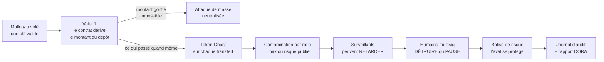
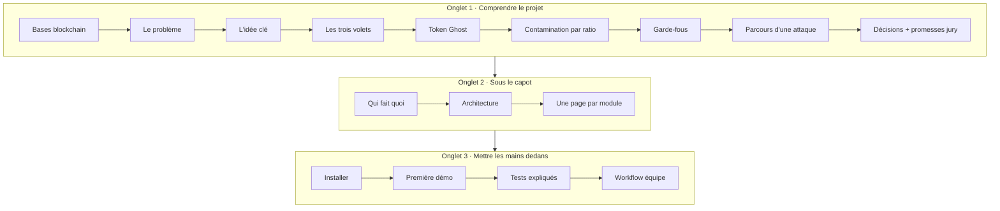

<Info>
**Ce que tu vas trouver ici**
- Le projet en **30 secondes**, puis en **5 minutes**.
- Les **personnages** qui reviennent dans toute la doc.
- **Par où commencer** selon ton profil (curieux, dev, présentation au jury).
- La **carte** des trois onglets de la doc.

Temps de lecture : environ 6 minutes. Aucun prérequis : chaque mot technique est expliqué, et
le [glossaire](/glossaire) est là en cas de doute.
</Info>

<Note>
Cette doc est écrite pour des **novices en crypto ET en développement**. Elle explique **ce
que fait le projet**, **pourquoi**, et **comment c'est codé**, avec des images du quotidien. La
doc technique de l'équipe (décisions, interfaces, roadmap) reste dans le dossier `docs/` du
dépôt : quand les deux divergent, **c'est `docs/` qui fait foi**.
</Note>

## Le projet en 30 secondes

**Secure Horizons rend une clé de signature volée presque sans valeur.** Même quand un voleur
peut signer « comme le vrai service », le contrat refuse de lui laisser fabriquer de l'argent
sans contrepartie. Et ce qui passe quand même reste **récupérable** pendant une courte fenêtre,
avec un **prix du risque** visible par tous.

Notre inspiration : le hack **Resolv** (mars 2026). Un attaquant a obtenu une clé autorisée à
« minter » (fabriquer des jetons), s'en est servi pour créer une énorme quantité de jetons sans
dépôt réel derrière, puis a revendu le tout avant que quiconque réagisse.

## L'analogie à garder en tête

Imagine une **banque** équipée d'une **imprimante à billets**.

<Steps>
  <Step title="Normalement">
    Un client dépose 100 € au guichet. Un employé signe un bon. L'imprimante fabrique 100 € de
    billets pour ce client.
  </Step>
  <Step title="Le hack">
    Mallory a copié la **signature de l'employé**. Elle écrit sur le bon « imprime 50 millions
    pour moi ». L'imprimante obéit : la signature est valide.
  </Step>
  <Step title="La défense classique">
    Un vigile regarde la sortie et crie « alerte ! »… une fois les billets imprimés et partis.
    **Trop tard.**
  </Step>
  <Step title="Notre défense">
    L'imprimante devient **intelligente** : le bon ne peut plus dire que « traite le dépôt
    n°42 », et c'est l'imprimante qui lit le montant du dépôt. Les billets sortent d'abord en
    **billets fantômes** (Token Ghost), échangeables mais annulables pendant quelques minutes.
  </Step>
</Steps>

## Le projet en 5 minutes

Quatre idées portent tout le projet :

<CardGroup cols={2}>
  <Card title="La sécurité vit dans le contrat" icon="shield" href="/lidee-cle">
    Les règles dures sont **dans** le programme on-chain, pas seulement dans un système de
    surveillance qui arrive après.
  </Card>
  <Card title="Les trois volets" icon="layer-group" href="/les-trois-volets">
    Montant dérivé on-chain, perte **et** friction bornées (vérifié par tests), pare-feu de
    contagion.
  </Card>
  <Card title="Le Token Ghost" icon="ghost" href="/token-ghost">
    Chaque transfert passe par un jeton temporaire **échangeable**, converti 1:1 après la
    fenêtre, détruit si une fraude est confirmée.
  </Card>
  <Card title="Pricer le risque" icon="gauge-high" href="/contamination-par-ratio">
    Le cœur acté du projet : un **ratio de contamination** par adresse, publié comme un prix du
    risque que tout le monde peut lire.
  </Card>
</CardGroup>

<Tip>
**La règle de sécurité qui rassure** : n'importe quel surveillant (même l'IA) peut **retarder**,
localement et pour un temps limité. **Détruire** des Ghost ou **mettre tout le protocole en
pause** exige l'accord de **plusieurs humains** (multisig). Le pire cas d'une erreur de
surveillant est donc un **retard**, pas une perte. Détails : [Les garde-fous](/les-garde-fous).
</Tip>

## Les personnages de la doc

Pour que les exemples restent concrets, on suit toujours les mêmes personnes, avec des montants
**fictifs** :

| Personnage | Rôle | Ce qu'il nous apprend |
|------------|------|-----------------------|
| **Alice** | Utilisatrice honnête : dépose des USDC, reçoit des stablecoins | Le parcours normal, et la gêne (friction) qu'on lui impose |
| **Bob** | Commerçant honnête qui reçoit des paiements | Ce que vit un destinataire quand un jeton reçu est suspect |
| **Mallory** | La voleuse de clé de service | Ce que l'attaque tente, et où elle est arrêtée |
| **Spéculos** | Acheteur de Token Ghost qui accepte un risque contre une décote | Comment le risque sort du protocole vers un marché |

## Par où commencer ?

<Tabs>
  <Tab title="Je découvre tout">
    1. [La blockchain en 10 minutes](/bases-blockchain) — les mots de base.
    2. [Le problème](/le-probleme) — pourquoi une clé volée est si dangereuse.
    3. [L'idée clé](/lidee-cle) — notre principe.
    4. [Les trois volets](/les-trois-volets) puis [Le Token Ghost](/token-ghost).
    5. [Le parcours d'une attaque](/le-parcours-dune-attaque) — tout s'assemble.
  </Tab>
  <Tab title="Je vais coder">
    1. [Installer le projet](/pratique/installer) — pas à pas, Windows d'abord.
    2. [Qui fait quoi](/qui-fait-quoi) — qui possède quel dossier.
    3. [L'architecture](/modules/architecture) — le trajet d'une donnée.
    4. La page de **ton** module dans l'onglet « Sous le capot ».
    5. [Les tests expliqués](/pratique/tests-expliques) et
       [Le workflow d'équipe](/pratique/workflow-equipe).
  </Tab>
  <Tab title="Je prépare le jury">
    1. [Le Token Ghost](/token-ghost) et [Pricer le risque](/contamination-par-ratio) — l'angle
       différenciant.
    2. [Les décisions](/decisions) — ce qui est acté, ce qui reste ouvert.
    3. [Ce qu'on promet au jury](/promesses-jury) — et comment on le mesure.
    4. [Première démo](/pratique/premiere-demo) — ce qu'on montrera à l'écran.
  </Tab>
</Tabs>

## La carte de la doc

<AccordionGroup>
  <Accordion title="Onglet « Comprendre le projet » : pour qui ?">
    Pour **tout le monde**, développeur ou non. On y explique le problème, l'idée, les
    mécanismes de défense et l'état des décisions d'équipe, sans lire une ligne de code (les
    extraits présents sont toujours commentés).
  </Accordion>
  <Accordion title="Onglet « Sous le capot » : pour qui ?">
    Pour ceux qui vont **lire ou modifier le code**. Une page par dossier du dépôt (`contracts`,
    `monitor`, `detection`, `response`, `llm`, `dashboard`, `data`, `shared`) : rôle, entrées et
    sorties, fonctionnement pas à pas, tests.
  </Accordion>
  <Accordion title="Onglet « Mettre les mains dedans » : pour qui ?">
    Pour **faire tourner** le projet sur ta machine : installation, démos, tests, et la façon dont
    l'équipe travaille à plusieurs sur GitHub (branches, pull requests, board).
  </Accordion>
</AccordionGroup>

<Warning>
**Tout est fictif.** Le projet utilise uniquement des **comptes de test** (réseau Avalanche Fuji)
et des **données synthétiques**. Aucune vraie clé, aucune vraie valeur. Et on ne promet au jury
**que ce qu'on a mesuré** : on dit « vérifié par tests », **jamais « prouvé »**.
</Warning>

<Check>
**À retenir**
- Le danger : une **clé de signature valide** entre de mauvaises mains. Réagir après coup arrive
  trop tard.
- La réponse : **la sécurité vit dans le contrat** (volet 1 d'abord), renforcée par le **Token
  Ghost** et un **prix du risque** publié.
- Les machines peuvent **retarder** ; seuls des **humains à plusieurs** peuvent détruire ou tout
  mettre en pause.
- Les décisions font foi dans `docs/OPEN_ANSWERS.md` ; ce qui n'y est pas reste **à valider**.
</Check>

## Et ensuite ?

<CardGroup cols={2}>
  <Card title="La blockchain en 10 minutes" icon="cube" href="/bases-blockchain">
    Les mots de base, sans jargon.
  </Card>
  <Card title="Le problème" icon="triangle-exclamation" href="/le-probleme">
    Le hack Resolv raconté pas à pas.
  </Card>
  <Card title="Installer le projet" icon="download" href="/pratique/installer">
    Pour faire tourner le code chez toi.
  </Card>
  <Card title="Glossaire" icon="book" href="/glossaire">
    Plus de 80 termes expliqués en une phrase.
  </Card>
</CardGroup>
