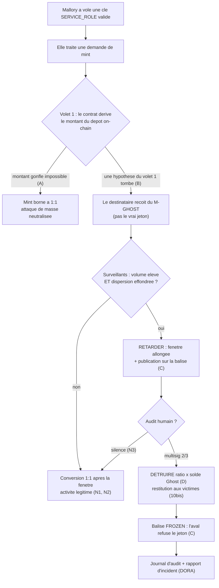
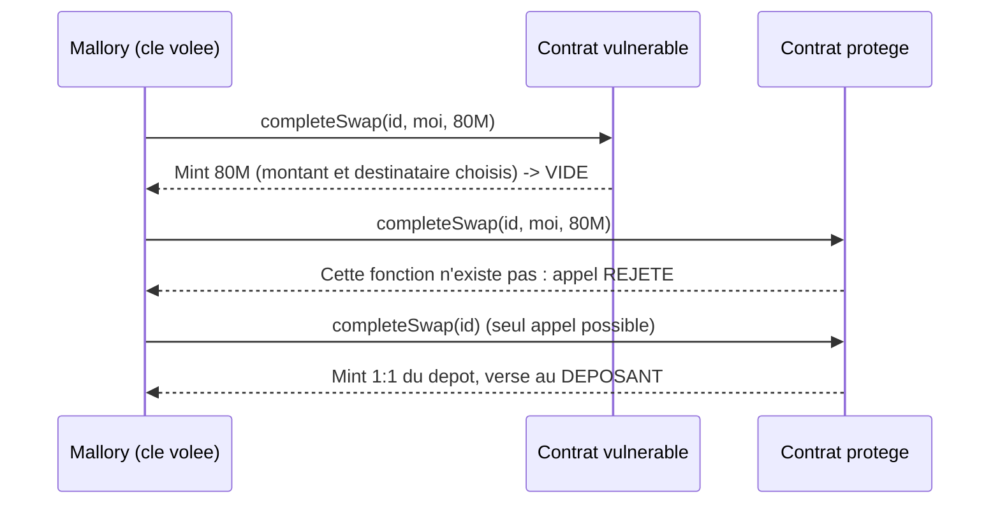
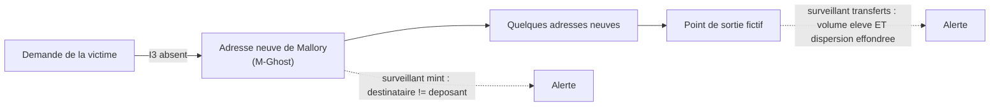
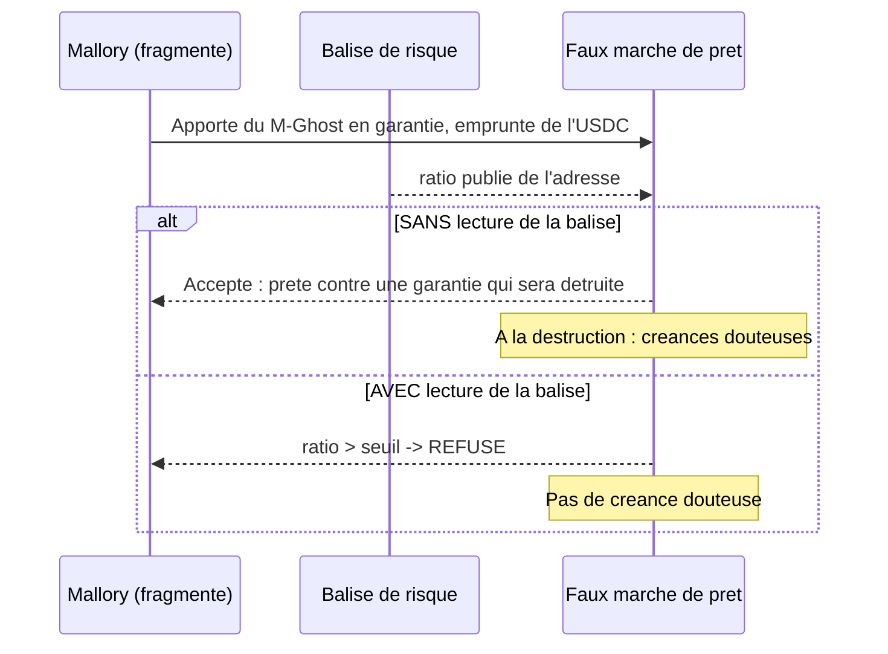
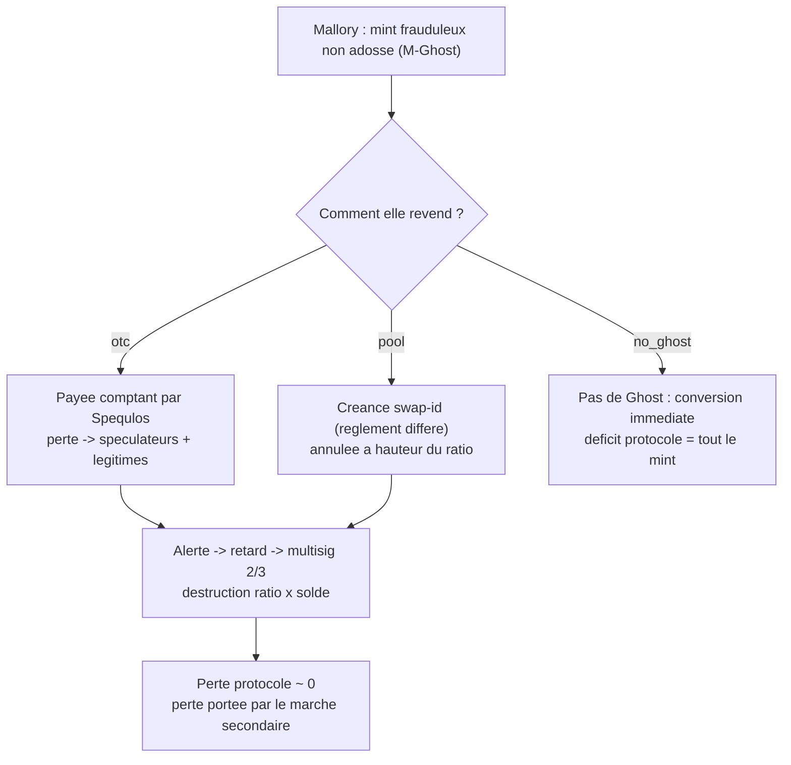
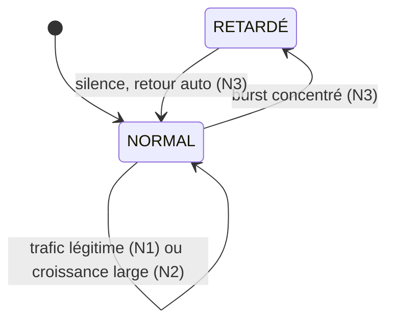

<Info>
**Ce que tu vas comprendre ici**
- Le **chemin complet** d'une attaque, du mint au journal d'audit.
- Les **quatre scénarios** de démo, chacun pas à pas : ce que tente Mallory, où elle est arrêtée.
- Les **scénarios de contrôle** (trafic légitime), qui prouvent qu'on ne crie pas au loup.
- Ce que **voient** les surveillants et ce que **fait** la réponse à chaque étape.

Temps de lecture : environ 15 minutes. Pour les mécanismes, voir [Le Token Ghost](/token-ghost),
[Pricer le risque](/contamination-par-ratio) et [Les garde-fous](/les-garde-fous).
</Info>

<Note>
Personnages fictifs : **Alice** (honnête), **Bob** (commerçant honnête), **Mallory** (voleuse de
clé `SERVICE_ROLE`), **Spéculos** (acheteur de Ghost). Tous les montants sont des **paramètres de
simulation à calibrer**, pas des mesures (`docs/CLAIMS.md`). Les scénarios C et D tournent sur une
**simulation hors chaîne** (`data/scenarios_cd.py`), pas sur le contrat.
</Note>

## Le schéma global



**Le point clé** : à chaque étape, soit l'attaque est bloquée, soit le pire cas est un **retard**
(le temps que les surveillants et l'humain tranchent). Jamais une perte directe pour le protocole.

<Info>
Sources du parcours : `docs/OPEN_ANSWERS.md` §0bis, §1, §3, §9, §10bis ; `data/README.md` ;
`dashboard/scenarios/catalog.py`. Les quatre scénarios A/B/C/D sont ceux de la décision §6.
</Info>

## Scénario A — même attaque, deux contrats (vulnérable vs protégé)

<Note>
**Ce que démontre A** : le **volet 1**. La même autorisation signée, demandant un montant anormal,
rejouée sur le contrat **vulnérable** puis sur le contrat **protégé**.
</Note>

Mallory dépose un petit montant (fixture : 200 000 USDC, ordre de grandeur Resolv) puis tente de
minter un montant gonflé (fixture : 80 M) **vers elle-même**.



Le test Foundry fige exactement ces deux issues :

```solidity contracts/test/ScenarioA.t.sol
function test_scenarioA_vulnerable_inflatedMintSucceeds() public {
    uint256 minted = _attackVulnerable();
    assertEq(minted, INFLATED);          // le vulnerable mint le montant gonfle
    assertGt(minted, DEPOSIT * SCALE);
}

function test_scenarioA_protected_onlyOneToOne() public {
    (uint256 id, bool inflatedCallOk, uint256 minted) = _attackProtected();
    assertFalse(inflatedCallOk);          // l'appel a 3 parametres echoue
    assertEq(minted, DEPOSIT * SCALE);    // 1:1 au taux 1e18
}
```

Lecture : sur le vulnérable, `minted == INFLATED` (80 M) ; sur le protégé, l'appel « à trois
paramètres » échoue (`inflatedCallOk` est faux) et le seul mint possible vaut exactement le dépôt
converti. Un troisième test (`victimRequestCannotBeRedirected`) montre qu'une demande d'une victime
traitée par Mallory va **à la victime**, pas à Mallory.

<Info>
**Ce qui s'affiche** : côte à côte, « montant déposé » vs « montant émis » pour chaque contrat
(perte protocole > 0 sur le vulnérable, = 0 sur le protégé). Sources : `contracts/test/ScenarioA.t.sol`,
`contracts/README.md` (§ Scénario A), `dashboard/scenarios/catalog.py` (`run_a`).
</Info>

## Scénario B — une hypothèse du volet 1 tombe (détournement à 1:1)

<Note>
**Ce que démontre B** : le **surveillant hors chaîne**. Avec le volet 1 et sans plafond fixe,
« rester sous les plafonds » ne rapporte rien. B suppose donc qu'une hypothèse tombe : **I3
(destinataire = déposant) n'est pas appliqué**.
</Note>

<Steps>
  <Step title="B1 — détournement à 1:1">
    La demande d'une **victime** est traitée vers une **adresse neuve** de Mallory. Le bilan global
    reste 1:1 (I1 tient), mais **l'argent change de poche**. Le surveillant de mint doit lever :
    destinataire ≠ déposant de la demande n°X.
  </Step>
  <Step title="B2 — sortie rapide et concentrée">
    Mallory fait sortir les fonds vers quelques adresses neuves puis un **point de sortie** fictif,
    le tout **avant la fin de la fenêtre Ghost**. Le surveillant de transferts doit lever :
    **volume élevé ET dispersion effondrée** (§9).
  </Step>
  <Step title="On mesure la marge avant conversion">
    Succès si l'alerte arrive avec une **marge positive** : il reste du temps avant que les M-Ghost
    suspects ne deviennent du vrai token.
  </Step>
</Steps>



<Warning>
Limite mesurée (`data/README.md`, `make calibrate`) : le **surveillant de mint** ne voit **pas** le
détournement à 1:1 si I3 n'est pas vérifié ; c'est le **surveillant de transferts** qui rattrape B,
et seulement **au-dessus** du seuil de taille. La variante « événement admin » (upgrade / clé volée)
n'est **pas générée** : aucun modèle partagé ne la représente.
</Warning>

<Info>
**Ce qui s'affiche** : alertes émises, délai de détection, marge avant conversion, Ghost suspect
détruit. Sources : `data/README.md` (§ Scénario B), `data/generate.py`, `dashboard/scenarios/catalog.py`
(`run_b`).
</Info>

## Scénario C — contagion : le pare-feu de la balise

<Note>
**Ce que démontre C** : l'**angle principal** (anti-contagion). On compare les mauvaises créances
d'un faux marché de prêt **avec vs sans** lecture de la balise de risque.
</Note>

Mallory fragmente son M-Ghost sur plusieurs adresses neuves et l'apporte en **garantie** à un faux
marché de prêt (un coffre par prêt). Le marché accepte ou refuse selon le ratio publié.



Dans la simulation, le refus est exactement ce test de seuil :

```python data/scenarios_cd.py
if with_beacon and world.published.get(borrower, 0.0) > p.beacon_ratio_threshold:
    refused["attacker" if attacker else "legit"] += 1
    return
```

<Info>
**Ce qui s'affiche** : mauvaises créances **avec** balise vs **sans**, prêts refusés (attaquant /
légitimes). Résultat avec la graine 42 (simulation, à calibrer) : mauvaises créances **nulles avec**
la balise, **75 %** du montant frauduleux **sans** balise. Sources : `data/scenarios_cd.py`
(`_scenario_c`), `data/README.md`, `dashboard/scenarios/catalog.py` (`run_c`).
</Info>

## Scénario D — le marché secondaire du Ghost

<Note>
**Ce que démontre D** : le **Token Ghost** et la contamination par ratio. Mallory revend son Ghost
frauduleux ; le lot suspect est détruit. On regarde **qui** porte la perte.
</Note>

Trois variantes :

<Tabs>
  <Tab title="otc — revente aux spéculateurs">
    Mallory revend son M-Ghost à des **spéculateurs** payés comptant (Spéculos), qui en revendent
    une partie à des légitimes. Au gel, la perte passe aux **spéculateurs** et aux légitimes qui
    leur ont racheté — pas au protocole.
  </Tab>
  <Tab title="pool — règlement différé (§10)">
    Mallory vend à **notre pool** : elle reçoit une créance `swap-id` au lieu d'USDC comptant. Si la
    destruction est confirmée, la créance est annulée à hauteur de `ratio × montant`.
  </Tab>
  <Tab title="no_ghost — baseline « Resolv tel quel »">
    La **même** attaque, **sans** Ghost (fenêtre nulle). C'est la référence : le déficit du
    protocole vaut **tout** le mint frauduleux, converti immédiatement.
  </Tab>
</Tabs>



<Warning>
Deux limites mises en évidence par la simulation (à discuter avec #8 et #43) :
1. **Swaps faits avant l'alerte** : la créance est annulée selon le ratio du vendeur **au moment du
   swap** ; avant l'alerte ce ratio vaut 0, donc ces créances sont payées à Mallory (`scenario_d_pool` :
   3 ventes sur 8 avec la graine 42).
2. **Soupçon qui fuit avant l'alerte** : une adresse qui mélange du Ghost ancien propre et du frais
   contaminé peut convertir l'ancien ; une fraction du soupçon part avec (0 avec la graine 42,
   ~0,1 % avec la graine 3).
</Warning>

<Info>
**Ce qui s'affiche** : déficit du protocole (≈ 0 avec Ghost, = tout le mint sans Ghost), perte côté
spéculateurs, Ghost détruit. Sources : `data/scenarios_cd.py` (`_scenario_d`), `data/README.md`,
`dashboard/scenarios/catalog.py` (`run_d`).
</Info>

## Les scénarios de contrôle — ne pas crier au loup

Un détecteur qui alerte sur tout est inutile. Trois contrôles sur du **trafic légitime** vérifient
qu'on ne déclenche pas à tort (`dashboard/scenarios/catalog.py`).

| Contrôle | Trafic | Attendu |
|---|---|---|
| **N1 — trafic légitime seul** | uniquement du trafic légitime large | **zéro alerte, zéro gel** |
| **N2 — croissance légitime forte** | pic de volume large (beaucoup d'adresses anciennes), ratios stables | **pas de déclenchement** (volume élevé **sans** dispersion effondrée) |
| **N3 — fausse alerte auto-expirante** | burst légitime concentré : retard déclenché, aucune confirmation humaine | la fenêtre **revient seule** à la normale, **aucun gel définitif** |



<Note>
N2 est la preuve directe que le discriminant **« volume élevé ET dispersion effondrée »** fonctionne :
une grosse croissance **large** (dispersion intacte) ne déclenche **pas**. N3 montre le bon biais
des faux positifs : silence = retour automatique à la normale, personne n'est gelé durablement.
</Note>

<Info>
Sources : `dashboard/scenarios/catalog.py` (`run_n1`, `run_n2`, `run_n3`) et leurs `ScenarioCheck`.
Statut des chiffres : **mesures de simulation**, paramètres à calibrer (`docs/CLAIMS.md`).
</Info>

<Check>
**À retenir**
- **A** : le volet 1 borne le mint à 1:1 ; le vulnérable se fait vider, le protégé non.
- **B** : quand une hypothèse du volet 1 tombe (détournement 1:1), c'est le **surveillant** qui
  rattrape — avec une marge avant conversion.
- **C** : la **balise** coupe la contagion ; mauvaises créances bien moindres **avec** balise.
- **D** : le **Ghost** reporte la perte sur le marché secondaire ; perte protocole ≈ 0.
- **N1/N2/N3** : sur du trafic légitime, **zéro gel abusif** ; une fausse alerte **expire seule**.
- Tous les chiffres sont des **mesures de simulation** à calibrer, jamais inventés.
</Check>

<CardGroup cols={2}>
  <Card title="Les trois volets" icon="layer-group" href="/les-trois-volets">
    Le détail du volet 1 (code A) et du discriminant de dispersion (B, N2).
  </Card>
  <Card title="Pricer le risque" icon="gauge-high" href="/contamination-par-ratio">
    Le ratio derrière C et D, et la balise de risque.
  </Card>
  <Card title="Les garde-fous" icon="lock" href="/les-garde-fous">
    La machine à états `NORMAL → RETARDÉ → NORMAL ou DÉTRUIT` (N3, D).
  </Card>
  <Card title="Les scénarios dans le dashboard" icon="chart-column" href="/modules/dashboard">
    Comment ces scénarios sont rejoués et affichés.
  </Card>
</CardGroup>
