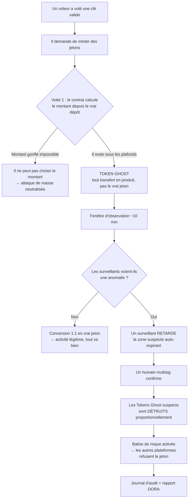

Voici comment le bouclier réagit, selon ce que tente le voleur. On suit le chemin d'une demande
de création de jetons.

## Le schéma complet

## Lecture pas à pas

<Steps>
  <Step title="Le voleur tente un mint énorme">
    **Volet 1** entre en jeu : le contrat ne lit pas le montant demandé, il le **recalcule** à
    partir du vrai dépôt. Le gros montant frauduleux est **impossible**. L'attaque « à la Resolv »
    est neutralisée ici.
  </Step>
  <Step title="Le voleur ruse et reste discret">
    Il tente de rester **sous les plafonds** pour ne pas déclencher le contrat. Mais **tout
    transfert** passe par un **Token Ghost** (pas le vrai jeton) : il doit attendre la fenêtre
    d'observation comme tout le monde.
  </Step>
  <Step title="Les surveillants observent">
    Pendant la fenêtre, les gardiens (règles, IA, signaux) analysent. Mouvement suspect ?
    N'importe lequel peut **retarder** la zone concernée en allongeant sa fenêtre — une action
    **auto-expirante**, qui ne touche que le périmètre où le soupçon est réel.
  </Step>
  <Step title="Un humain tranche">
    Pour **détruire** (irréversible), il faut une **validation humaine à plusieurs** (multisig).
    L'IA n'a pas décidé seule : elle a seulement retardé.
  </Step>
  <Step title="Les faux jetons disparaissent">
    Les Tokens Ghost suspects sont **détruits proportionnellement au soupçon** avant d'être
    convertis. Le vrai jeton n'a jamais été créé frauduleusement : **le protocole reste intact**.
  </Step>
  <Step title="On protège les autres + on documente">
    La **balise de risque** prévient les autres plateformes (anti-contagion), et le **journal
    d'audit + rapport DORA** gardent la trace de tout.
  </Step>
</Steps>

<Note>
**Le point important** : à chaque étape, soit l'attaque est bloquée, soit le pire cas est un
**retard** (le temps que les surveillants et l'humain tranchent). Jamais une perte directe pour le
protocole.
</Note>
