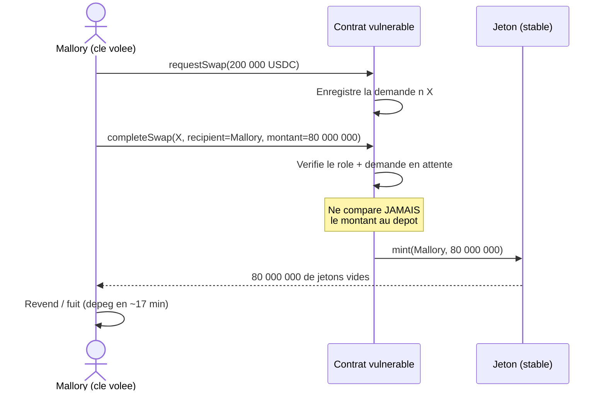
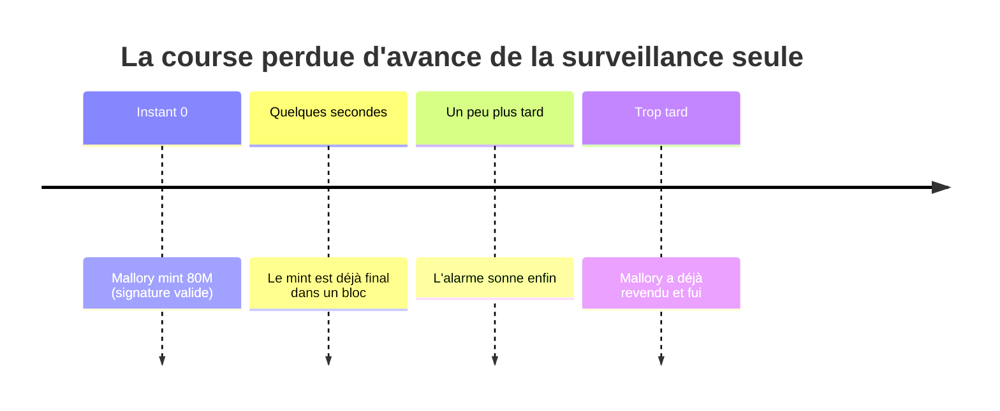

<Info>
**Ce que tu vas comprendre ici**
- Ce que c'est, concrètement, une « clé de signature de service » et le pouvoir qu'elle donne.
- Le hack Resolv raconté étape par étape, avec notre voleuse **Mallory**.
- Pourquoi « surveiller et réagir » arrive toujours **trop tard**.
- La faille, montrée **dans le vrai code** de notre contrat volontairement vulnérable.

Temps de lecture : environ 8 minutes. Si « clé », « mint » ou « signer » sont flous, lis d'abord
[La blockchain en 10 minutes](/bases-blockchain).
</Info>

## Les personnages de l'histoire

On suit les mêmes personnages dans toute la doc :

| Personnage | Rôle |
|------------|------|
| **Alice** | une utilisatrice honnête |
| **Bob** | un commerçant / destinataire honnête |
| **Mallory** | la voleuse de clé (l'attaquante) |
| **Spéculos** | l'acheteur qui prend le risque sur le marché du Ghost |

## Rappel : minter, c'est fabriquer

Sur une blockchain, **minter** veut dire **fabriquer** de nouveaux jetons. Normalement, on ne mint
un jeton que si une vraie contrepartie (le **collatéral**) a été déposée : un jeton = une vraie
valeur derrière.

Dans beaucoup de protocoles, c'est un **compte de service** qui déclenche le mint : un compte
automatique qui valide les demandes des utilisateurs. Ce compte possède une **clé de signature de
service**.

## La clé de service : un pouvoir énorme

Une **clé de signature de service** autorise un rôle très précis mais très puissant : **ordonner
au contrat de minter**. Tant qu'elle est entre de bonnes mains, tout va bien : elle ne fait que
valider les demandes légitimes.

<Warning>
Le problème n'est pas que la clé soit mal utilisée par son propriétaire. Le problème est **qu'elle
peut être volée**. Et une signature volée est acceptée **comme si c'était le vrai propriétaire** :
pas de « mot de passe oublié », pas de service client pour annuler.
</Warning>

<Tip>
**Analogie** : la clé de service est le **tampon officiel** d'une imprimerie de billets. Celui qui
tient le tampon peut valider l'impression. Si Mallory vole le tampon, l'imprimante lui obéit sans
poser de question.
</Tip>

## Le hack Resolv, raconté pas à pas

Notre projet s'inspire d'un vrai incident : le hack **Resolv** du 22 mars 2026. Une clé de
signature de service a été compromise, et l'attaquant a minté des jetons non collatéralisés avant
de s'enfuir. Rejouons-le avec Mallory et des chiffres fictifs du même ordre de grandeur.

<Steps>
  <Step title="Mallory vole la clé de service">
    Par un moyen ou un autre (fuite, phishing, serveur compromis), Mallory met la main sur la clé
    `SERVICE_ROLE`. Le contrat, lui, ne voit **aucune différence** : une signature valide est une
    signature valide.
  </Step>
  <Step title="Elle crée une petite demande honnête en apparence">
    Mallory dépose un petit collatéral réel : **200 000 USDC** (fictifs). Le contrat enregistre la
    demande n°X et prélève le dépôt. Jusqu'ici, rien d'anormal.
  </Step>
  <Step title="Elle mint une somme énorme, sans rapport avec le dépôt">
    Avec la clé volée, elle appelle la fonction qui termine la demande — mais en demandant
    **80 000 000** de jetons vers **sa propre adresse**. Le contrat vérifie seulement qu'elle a le
    bon rôle et que la demande existe. Il ne compare **jamais** le montant minté au dépôt. Ratio :
    environ **400×** le collatéral.
  </Step>
  <Step title="Elle vide les fonds en quelques minutes">
    Mallory revend ou déplace ces jetons « vides » avant que quiconque réagisse. Chez Resolv, le
    jeton a perdu son ancrage (**dépeg**) en **17 minutes**. L'argent est parti.
  </Step>
</Steps>

<Info>
Sources : `docs/OPEN_ANSWERS.md` §1 (≈200 000 USDC déposés, 80M mintés en deux appels à
`completeSwap()`, ratio ~400×, dépeg en 17 min) ; post-mortem Resolv et analyse CertiK cités dans
le même document. Les montants sont des **fixtures** reprenant l'ordre de grandeur, pas des
mesures.
</Info>



## La faille, dans le vrai code

Ce n'est pas une histoire abstraite : l'équipe a **reproduit la faille** dans un contrat
volontairement vulnérable, pour pouvoir la démontrer et la comparer ensuite au contrat protégé.
Voici le passage qui compte.

```solidity contracts/src/VulnerableMinter.sol
/// @notice LA FAILLE : `recipient` et `mintAmount` sont fournis par l'appelant et jamais
///         comparés au dépôt de la demande.
function completeSwap(uint256 requestId, address recipient, uint256 mintAmount) external onlyRole(SERVICE_ROLE) {
    SwapRequest storage req = _requests[requestId];
    if (req.status != RequestStatus.Pending) revert RequestNotPending(requestId);
    req.status = RequestStatus.Completed;
    stable.mint(recipient, mintAmount);
    emit SwapCompleted(requestId, recipient, mintAmount);
}
```

Lisons-le ligne à ligne, en français simple :

- `completeSwap(uint256 requestId, address recipient, uint256 mintAmount)` : la fonction accepte
  **trois** choses de l'appelant — le numéro de demande, **le destinataire**, et **le montant**.
  Ce sont ces deux derniers qui sont dangereux.
- `onlyRole(SERVICE_ROLE)` : seul le détenteur de la clé de service peut l'appeler. Mallory, qui
  a volé la clé, **passe ce contrôle**.
- `if (req.status != RequestStatus.Pending) revert …` : le contrat vérifie bien que la demande
  existe et est en attente. C'est **tout** ce qu'il vérifie.
- `stable.mint(recipient, mintAmount)` : il fabrique **le montant choisi par l'appelant**, vers
  **le destinataire choisi par l'appelant**. À aucun moment il ne regarde combien Mallory a
  réellement déposé.

En une phrase : **le contrat signe un chèque en blanc.** La clé de service dit « combien » et
« pour qui », et le contrat obéit.

Un test rejoue exactement l'attaque de Mallory :

```solidity contracts/test/VulnerableMinter.t.sol
/// @notice L'attaque : petit dépôt réel, mint énorme signé par la clé de service.
function test_attack_smallDepositHugeMint() public {
    uint256 id = _requestVulnerable(minter, attacker, DEPOSIT);
    vm.prank(attacker);
    minter.completeSwap(id, attacker, INFLATED);

    uint256 minted = stable.balanceOf(attacker);
    assertEq(minted, INFLATED);
    assertGt(minted, DEPOSIT * SCALE);
    assertEq(usdc.balanceOf(address(minter)), DEPOSIT);
}
```

Ce test vérifie que, sur le contrat vulnérable :

- l'attaquante dépose `DEPOSIT` (200 000 USDC fictifs), puis `completeSwap` mint `INFLATED`
  (80 M) vers elle-même ;
- `assertEq(minted, INFLATED)` : elle reçoit bien **tout** le montant gonflé ;
- `assertGt(minted, DEPOSIT * SCALE)` : le minté dépasse **largement** le dépôt converti ;
- `assertEq(usdc.balanceOf(address(minter)), DEPOSIT)` : le collatéral réel dans le contrat est
  resté le petit dépôt. Les 80 M de jetons ne sont adossés à **rien**.

<Info>
Sources : `contracts/src/VulnerableMinter.sol` (fonction `completeSwap`), `contracts/test/VulnerableMinter.t.sol`
(`test_attack_smallDepositHugeMint`). `DEPOSIT = 200_000e6`, `INFLATED = 80_000_000e18` sont des
fixtures reprenant l'ordre de grandeur de l'incident Resolv (`docs/OPEN_ANSWERS.md` §1).
</Info>

<Accordion title="Pour les curieux : l'autre variante de l'attaque">
Le même contrat laisse aussi Mallory **détourner le mint d'une victime**. Le test
`test_attack_mintToArbitraryRecipient` montre qu'elle peut traiter la demande d'Alice mais
envoyer les jetons chez elle : `stable.balanceOf(alice)` finit à `0`, et
`stable.balanceOf(attacker)` reçoit tout. Même avec un montant « correct » (1:1), l'argent change
de poche. On traitera ce cas précis avec l'invariant **I3** dans
[Les trois volets](/les-trois-volets).
</Accordion>

## Pourquoi « surveiller et réagir » arrive trop tard

La réaction naturelle serait : « posons une alarme qui sonne quand un gros mint bizarre arrive ».
C'est insuffisant, et il faut comprendre pourquoi avant de proposer autre chose.



Trois raisons, imbriquées :

- **Le mint est déjà valide.** Quand l'alarme sonne, l'opération frauduleuse **a déjà eu lieu** et
  est inscrite dans un bloc.
- **C'est très difficile à annuler.** Sur une blockchain, une transaction finale ne se « défait »
  pas d'un clic.
- **Le voleur est rapide.** Mallory peut vider les fonds en quelques secondes, bien avant qu'un
  humain ne décide quoi que ce soit.

<Note>
C'est le constat qui structure tout le projet : si la seule défense est de **réagir après**, on a
déjà perdu la première salve. La surveillance reste utile en **renfort**, mais la vraie protection
doit agir **au moment où l'opération se produit** — c'est-à-dire **dans le contrat**.
</Note>

<Check>
**À retenir**
- Une **clé de service volée** laisse l'attaquant minter : la signature est acceptée comme vraie.
- Le hack Resolv : petit dépôt, mint énorme (~400×), fuite en ~17 min — rejoué par Mallory.
- La faille est **concrète** : `completeSwap` accepte un montant et un destinataire libres, sans
  les comparer au dépôt (`VulnerableMinter.sol`).
- **Surveiller et réagir arrive trop tard** : le mint est déjà final quand l'alarme sonne.
</Check>

<CardGroup cols={2}>
  <Card title="L'idée clé" icon="lightbulb" href="/lidee-cle">
    La réponse au problème : « la sécurité vit dans le contrat ».
  </Card>
  <Card title="Les trois volets" icon="layer-group" href="/les-trois-volets">
    Comment on verrouille le montant, borne la perte et endigue la contagion.
  </Card>
  <Card title="La blockchain en 10 minutes" icon="cube" href="/bases-blockchain">
    Les mots de base si un terme t'a échappé.
  </Card>
  <Card title="Le Token Ghost" icon="ghost" href="/token-ghost">
    La quarantaine liquide qui laisse une fenêtre pour récupérer.
  </Card>
</CardGroup>
