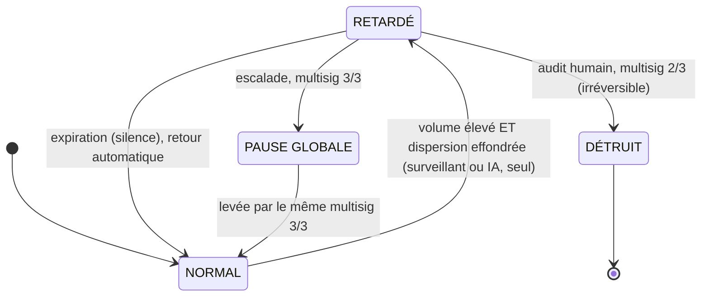

<Info>
**Ce que tu vas comprendre ici**
- Qui sont les **surveillants** et ce qu'ils peuvent faire.
- Les **trois verbes** — retarder, détruire, pause globale — et **qui a le droit de quoi**.
- Le **veto asymétrique** et le **multisig M parmi N**, dans le vrai code.
- La **machine à états** d'un périmètre (réponse graduée).
- Le **journal d'audit** et le **rapport DORA**.

Temps de lecture : environ 10 minutes. Les trois protections de fond sont dans
[Les trois volets](/les-trois-volets).
</Info>

En plus des trois volets, des renforts rendent le système plus solide **et** le gardent sûr même
si un surveillant se trompe ou est compromis.

## Les surveillants

<Note>
**Plusieurs gardiens indépendants, et aucun n'a tous les pouvoirs.**
</Note>

Deux surveillants suffisent pour la démo (un modèle de machine learning reste en option, pour une
vague ultérieure) :

- un surveillant **de règles sur le mint** : il recalcule hors chaîne les invariants du volet 1
  (I1, I5, I6), surveille les **événements d'administration** (upgrade, changement de rôle ou de
  taux) et un écart anormal de l'oracle ;
- un surveillant **des transferts anormaux** : il applique la baseline adaptative du volet 2
  (volume élevé **et** dispersion effondrée).

<Info>
Sources : `docs/OPEN_ANSWERS.md` §0 (« deux suffisent pour la démo… ML en option, vague 5 ») et §1
(ce que surveille le surveillant de mint : I1/I5/I6, événements admin, écart d'oracle). Le
`monitor` écoute les événements de **mint et de transfert** (`monitor/README.md`).
</Info>

## Les trois verbes : retarder, détruire, pause globale

C'est le point le plus important de cette page. Toute la sûreté du système repose sur une
distinction nette entre **trois actions** et **qui a le droit de les déclencher**.

| Verbe | Ce que c'est | Qui décide | Réversibilité |
|-------|--------------|------------|---------------|
| **Retarder** | allonger la fenêtre Ghost d'un périmètre suspect | surveillant / IA, **seul** | **expire tout seul** |
| **Détruire** | brûler la part suspecte du Ghost d'un périmètre | humains, **multisig 2/3** | **irréversible** |
| **Pause globale** | tout mettre en pause (dernier recours) | humains, **multisig 3/3** | réversible (même multisig) |

<Tip>
**Analogie** : un surveillant d'aéroport peut **retenir** un bagage douteux sur le tapis (geste
réversible, qu'il fait seul). Mais **détruire** le bagage ou **fermer tout l'aéroport** exige
l'accord de **plusieurs responsables** ensemble. On agit seul dans le sens prudent, à plusieurs
dans le sens grave.
</Tip>

### Pourquoi « retarder » n'est pas « bloquer »

<Warning>
L'IA et les surveillants ne **bloquent** jamais et ne **pausent** jamais. Ils **retardent** :
allonger la fenêtre Ghost d'un périmètre, de façon **locale** et **auto-expirante**. La vieille
phrase « l'IA ne décide jamais seule d'un blocage » doit se lire : **l'IA ne décide jamais seule
d'une destruction ni d'une pause globale**.
</Warning>

Pendant un retard, sur le périmètre suspect :

- **la circulation reste autorisée** — les Ghost suspects peuvent encore être transférés (le
  modèle de [contamination par ratio](/contamination-par-ratio) garantit que disperser **ne
  nettoie pas**) ;
- seule la **conversion Ghost → vrai jeton est suspendue** tant que la fenêtre est allongée. On ne
  gèle pas les fonds, on **retarde seulement la sortie**.

Et surtout : **le silence ramène tout à la normale**. Si aucun humain ne confirme rien, la fenêtre
revient d'elle-même à la normale à l'expiration. Le biais par défaut favorise donc
l'**utilisateur légitime** — un bon biais pour les faux positifs.

<Info>
Source : `docs/OPEN_ANSWERS.md` §3 (vocabulaire « retarder » ≠ « bloquer », ce qui est permis
pendant un retard, « silence = retour automatique à la normale »).
</Info>

## Le veto asymétrique

<CardGroup cols={2}>
  <Card title="Agir dans le sens sûr : SEUL" icon="hand">
    Retarder (allonger une fenêtre) est **solitaire** et **auto-expirant**. Dans le doute, on
    ralentit.
  </Card>
  <Card title="Agir dans le sens risqué : à PLUSIEURS" icon="ban">
    Détruire, raccourcir, libérer, pauser : **jamais seul**. Il faut le **multisig**.
  </Card>
</CardGroup>

Conséquence : le **pire cas** d'une erreur de surveillant, c'est un simple **retard**, jamais une
perte. Et l'IA n'est **qu'un gardien parmi d'autres** — elle alerte et retarde, elle ne décide
jamais seule du grave.

## Le multisig M parmi N, dans le vrai code

Un **multisig** exige l'accord de plusieurs gardiens (« M parmi N »). Voler **une** clé ne suffit
plus. Dans le projet, la pause globale est gardée par un multisig **simulé** de 3 gardiens.

```solidity contracts/src/GuardianPausable.sol
/// @notice Approuve la pause ; la 3e approbation du round met le contrat en pause.
function approvePause() external onlyGuardian whenNotPaused {
    if (_approve(true)) _pause();
}

/// @notice Approuve la dépause ; la 3e approbation du round lève la pause.
function approveUnpause() external onlyGuardian whenPaused {
    if (_approve(false)) _unpause();
}
```

Lisons-le :

- `onlyGuardian` : seul un des 3 gardiens figés au déploiement peut appeler. Une clé de service
  volée **n'est pas** gardien : elle ne peut ni pauser ni dépauser.
- `if (_approve(true)) _pause()` : chaque gardien **approuve** ; la pause ne se déclenche qu'à la
  **3e** approbation (quorum **3/3**).
- La **dépause** passe par le **même** multisig (`approveUnpause`) : aucun acteur seul ne peut
  raccourcir ou libérer — le veto asymétrique est respecté jusque dans le code.

<Note>
Quorums actés (§3) : **détruire** le Ghost suspect d'un périmètre = **2 sur 3** ; **pause
globale** (dernier recours) = **unanimité 3 sur 3** ; **lever** une pause = le **même** multisig
que pour la décréter.
</Note>

<Warning>
C'est un multisig **simulé** (un `mapping(address => bool)` de gardiens et un compteur
d'approbations), présenté **honnêtement comme simulé** — pas un vrai Gnosis Safe. Simplifications
assumées : pas de révocation d'approbation, pas de rotation des gardiens.
</Warning>

<Info>
Sources : `contracts/src/GuardianPausable.sol` (`approvePause` / `approveUnpause`, quorum 3/3) et
`docs/OPEN_ANSWERS.md` §3 (quorums : détruire 2/3, pause globale 3/3, lever = même multisig).
</Info>

## La réponse graduée : la machine à états d'un périmètre

Un périmètre suspect passe par des **états** bien définis. C'est la base directe de
`response/orchestrator.py`.



- **`NORMAL → RETARDÉ`** : décidé par un surveillant / l'IA, **seul** (direction sûre).
- **`RETARDÉ → NORMAL`** : **automatique** à l'expiration, aucune action humaine requise.
- **`RETARDÉ → DÉTRUIT`** : multisig **2/3** ; détruit `ratio × solde Ghost non converti`
  (proportionnel à l'exposition réelle).
- **`RETARDÉ → PAUSE_GLOBALE`** : escalade, multisig **3/3** ; on en sort par le même multisig.

<Info>
Source : `docs/OPEN_ANSWERS.md` §3 (machine à états, transitions et quorums).
`response/orchestrator.py` est aligné sur cette machine à états (PR #56). Statut de la §3 :
**tranché en équipe**. Les durées et facteurs d'allongement exacts restent **à mesurer**.
</Info>

## La quarantaine « Token Ghost » (en 5 lignes)

Le Token Ghost est le cœur du projet et a **sa propre page**. En résumé : chaque **transfert**
crédite le destinataire en **Token Ghost** (pas en vrai jeton) ; le Ghost **s'échange librement**
pendant une courte fenêtre (ex. 10 min) sur un **marché parallèle décoté** ; sans anomalie il
devient du vrai jeton **1:1** ; en cas de gel confirmé, la part suspecte est **détruite**. Le vrai
jeton n'est jamais émis frauduleusement, et la perte éventuelle est portée par les acheteurs de
Ghost.

<Card title="Tout comprendre sur le Token Ghost" icon="ghost" href="/token-ghost">
  Le marché parallèle, le prix décoté, qui gagne et qui perd.
</Card>

## La preuve de conformité (DORA)

**DORA** est une réglementation européenne sur la résilience numérique du secteur financier. Pour
y répondre, le système tient automatiquement deux choses :

- un **journal d'audit** : la trace horodatée de chaque alerte et de chaque décision ;
- un **rapport d'incident pré-rempli** : généré par l'IA (via Amazon Bedrock) quand un incident
  est confirmé.

<Tip>
**Analogie** : la **boîte noire** d'un avion. Tout est enregistré pour pouvoir expliquer, après
coup, exactement ce qui s'est passé et quand.
</Tip>

<Note>
DORA est utilisé comme **cadre qui chapeaute**, pas comme angle technique isolé : il n'y a pas de
« prestataire tiers » dans la maquette, l'invoquer tel quel serait plaqué. On assume aussi une
**tension** : le Token Ghost **transfère** une partie de la perte vers un marché secondaire, ce
qui est en tension avec l'esprit DORA (protéger tout l'écosystème). Réponse retenue : la
contamination par ratio **cible proportionnellement** l'exposition réelle, elle ne punit pas
l'écosystème en bloc.
</Note>

<Info>
Source : `docs/OPEN_ANSWERS.md` §4 (journal d'audit, rapport d'incident LLM, DORA comme cadre,
tension assumée). Le module `response/` tient le journal d'audit ; `llm/` produit le rapport.
Statut de la §4 : **tranché en équipe**.
</Info>

<Check>
**À retenir**
- **Trois verbes** : retarder (seul, auto-expirant), détruire (**2/3**), pause globale (**3/3**).
- **Veto asymétrique** : seul dans le sens sûr, à plusieurs dans le sens grave. Pire cas d'une
  erreur = un simple retard.
- Le **multisig simulé** vit dans `GuardianPausable.sol` ; la clé volée n'est pas gardienne.
- **Silence = retour automatique à la normale** : le biais par défaut favorise l'utilisateur
  légitime.
- **DORA** : journal d'audit + rapport d'incident, comme une boîte noire.
</Check>

<CardGroup cols={2}>
  <Card title="Le Token Ghost" icon="ghost" href="/token-ghost">
    La quarantaine liquide en détail.
  </Card>
  <Card title="Pricer le risque" icon="gauge-high" href="/contamination-par-ratio">
    Le ratio qui dit quelle part détruire.
  </Card>
  <Card title="Les trois volets" icon="layer-group" href="/les-trois-volets">
    Les protections de fond que ces garde-fous renforcent.
  </Card>
  <Card title="Promesses au jury" icon="scale-balanced" href="/promesses-jury">
    Ce qu'on affirme et comment on le mesure.
  </Card>
</CardGroup>
