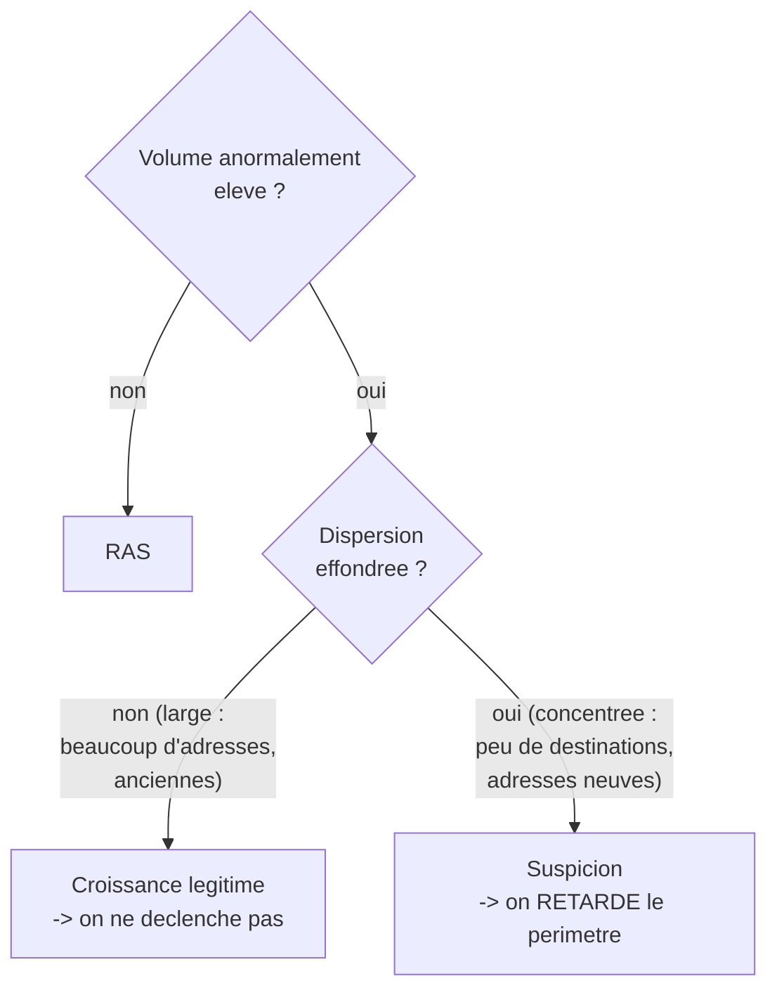
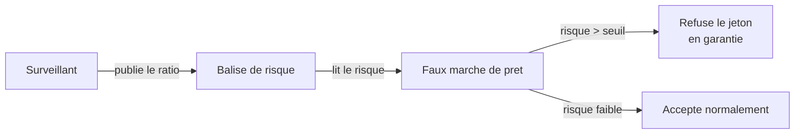

<Info>
**Ce que tu vas comprendre ici**
- **Volet 1** : le contrat dérive lui-même le montant du dépôt (avant/après, code à l'appui).
- **Volet 2** : **deux** bornes testées — perte max côté attaquant **et** friction max côté
  défense — avec une baseline adaptative.
- Le déclencheur « **volume élevé ET dispersion effondrée** », et pourquoi le volume seul ne
  suffit pas.
- **Volet 3** : la balise de risque et le faux marché de prêt qui refuse le jeton gelé.

Temps de lecture : environ 12 minutes. Les mots de base sont dans
[La blockchain en 10 minutes](/bases-blockchain).
</Info>

Notre bouclier a **trois couches**. Chacune arrête le voleur à un endroit différent, dans un ordre
de priorité acté : **volet 1 → volet 2 → volet 3**. Le volet 1 est non négociable ; il doit
exister et compiler en premier.

<Info>
Source de l'ordre de priorité : `docs/OPEN_ANSWERS.md` §0 (« volet 1 → volet 2 → volet 3 »).
</Info>

## Volet 1 — Le montant est dérivé on-chain

<Note>
**Mallory ne choisit plus combien minter ni pour qui. Le contrat le calcule lui-même, à partir du
dépôt enregistré.**
</Note>

C'est le cœur de la défense. On l'a vu dans [Le problème](/le-probleme) : le contrat vulnérable
accepte un **montant** et un **destinataire** libres. Le contrat protégé supprime ces deux
paramètres.

**Analogie** : au lieu de signer un **chèque en blanc**, Mallory ne peut plus que signer
« rembourse la facture n°42 ». Même avec sa signature volée, elle ne peut écrire **ni le montant,
ni le bénéficiaire** : les deux sont déjà inscrits sur la facture.

### Avant / après, dans le vrai code

Le contrat **vulnérable** laisse tout choisir :

```solidity contracts/src/VulnerableMinter.sol
// recipient et mintAmount viennent de l'appelant, jamais comparés au dépôt
function completeSwap(uint256 requestId, address recipient, uint256 mintAmount) external onlyRole(SERVICE_ROLE) {
    SwapRequest storage req = _requests[requestId];
    if (req.status != RequestStatus.Pending) revert RequestNotPending(requestId);
    req.status = RequestStatus.Completed;
    stable.mint(recipient, mintAmount);
}
```

Le contrat **protégé** ne prend plus que le numéro de demande :

```solidity contracts/src/ProtectedMinter.sol
// « Traiter la demande n°X ». PAS de montant, PAS de destinataire.
function completeSwap(uint256 requestId) external onlyRole(SERVICE_ROLE) whenNotPaused {
    SwapRequest storage req = _requests[requestId];
    if (req.status == RequestStatus.None) revert RequestNotFound(requestId);
    if (req.status != RequestStatus.Pending) revert RequestNotPending(requestId);

    req.status = RequestStatus.Completed;
    address depositor = req.depositor;
    uint256 depositAmount = req.depositAmount;
    uint256 reqRate = req.rate;
    uint256 minted = quoteMint(depositAmount, reqRate);
    stable.mint(depositor, minted);
}
```

Lisons la différence :

- La signature de la fonction n'a plus que `requestId` : **ni `recipient`, ni `mintAmount`**.
  Mallory ne peut littéralement plus les prononcer.
- `address depositor = req.depositor` : le destinataire est **le déposant enregistré**, pas un
  choix de l'appelant.
- `uint256 minted = quoteMint(depositAmount, reqRate)` : le montant est **calculé** à partir du
  dépôt et du taux figé à la création de la demande.
- `stable.mint(depositor, minted)` : on mint **le montant dérivé**, vers **le déposant**. Fin de
  l'histoire.

### Les invariants que le contrat garantit

Le volet 1 tient quatre promesses, vérifiées par le contrat et testées par fuzzing :

| # | Invariant | Ce qu'il bloque |
|---|-----------|-----------------|
| I1 | `minted = deposit × taux`, à ε près (frais) | Le mint gonflé (le cas Resolv) |
| I2 | La demande existe, est en attente, traitée **une seule fois** | Le rejeu, la demande inventée |
| I3 | Le destinataire du mint est le **déposant** | Le détournement à 1:1 |
| I4 | Une seule fonction, un seul rôle peut minter | Un chemin de mint parallèle |

<Info>
Sources : `contracts/src/ProtectedMinter.sol` et `contracts/src/VulnerableMinter.sol` (fonctions
`completeSwap`), tableau d'invariants `docs/OPEN_ANSWERS.md` §1 (I1–I4) et `contracts/README.md`.
I3 est **nouveau** : sans lui, le volet 1 laisserait passer un vol à 1:1.
</Info>

<Note>
Statut : la décision sur la détection du mint (§1) est **« validée en session, à relire par
l'équipe »**. Les valeurs de ε (frais) et δ (écart d'oracle) restent **à mesurer**.
</Note>

## Volet 2 — Perte max ET friction max, toutes deux bornées

<Note>
**Le volet 2 affirme DEUX bornes, pas une.** Côté attaquant : « même avec la clé volée, la perte
max est bornée ». Côté défense : « même notre propre surveillance ne peut geler plus de X % de
l'offre ».
</Note>

C'est un point souvent oublié. Un système qui « bloque tout au moindre doute » protège contre le
voleur mais **étrangle les utilisateurs légitimes**. Le volet 2 borne donc **les deux** côtés.

### Une baseline adaptative, pas des plafonds fixes

<Warning>
Pas de **plafond fixe par opération**. Une baleine légitime qui dépose 80 M et reçoit 80 M est
parfaitement normale : un plafond fixe la bloquerait pour rien.
</Warning>

À la place, le système **apprend le trafic habituel** et réagit quand le trafic courant s'en
écarte anormalement. Trois précautions actées rendent cette baseline difficile à tromper :

- **Ratios normalisés**, jamais de volumes absolus (mint/collatéral, volume/offre). La croissance
  légitime laisse les ratios stables → invisible pour le détecteur.
- **Baseline médiane + MAD** (écart absolu médian) sur fenêtre glissante. La médiane et le MAD
  sont **robustes** : un attaquant qui injecte du bruit pour élargir une moyenne n'y arrive pas.
- **Déclencheur = volume élevé ET dispersion effondrée.** Pas le volume seul.

<Tip>
**Analogie** : la médiane, c'est le prix « du milieu » du marché. Si un marchand crie des prix
délirants pour fausser la moyenne, le prix du milieu, lui, ne bouge quasiment pas. C'est pour ça
qu'on l'utilise plutôt que la moyenne.
</Tip>

### Pourquoi « volume élevé ET dispersion effondrée »

C'est le discriminant central. Il distingue une **croissance légitime** d'une **attaque**.



- La **croissance légitime** est **large** : beaucoup d'adresses, de contreparties, d'adresses
  anciennes. Beaucoup de monde achète, c'est la fête, mais c'est dispersé.
- L'**attaque** est **concentrée** : peu de destinations, des adresses neuves, une sortie rapide.
  La dispersion s'**effondre**.

Si on déclenchait sur le volume seul, **chaque pic légitime** (un listing, une campagne) ferait
sonner l'alarme. En exigeant **les deux**, on ne réagit qu'au profil vraiment suspect.

<Info>
Source : `docs/OPEN_ANSWERS.md` §9 — ratios normalisés, baseline médiane + MAD, déclencheur
« volume élevé ET dispersion effondrée ». Statut : **validée en session, à relire par l'équipe**.
</Info>

### Comment on vérifie les deux bornes

Avec des **tests d'invariants** et du **fuzzing** Foundry : des robots qui bombardent le contrat
de milliers de scénarios en essayant de dépasser la borne. On vise un attaquant détenant la clé
`SERVICE_ROLE` **volée**.

```solidity contracts/test/StolenServiceKey.fuzz.t.sol
/// @notice Quels que soient le montant et le destinataire voulus, la clé volée obtient
///         exactement dépôt × taux, versé au déposant.
function testFuzz_stolenKey_cannotInflate(uint256 deposit, uint256 rate_, uint256 fakeAmount, address fakeRecipient)
    public
{
    deposit = bound(deposit, 1, 1e18);
    rate_ = bound(rate_, 1e6, 1e24);
    uint256 expected = deposit * SCALE * rate_ / 1e18; // recalculé par le test
    vm.assume(expected > 0);
    vm.prank(admin);
    minter.setRate(rate_);

    uint256 id = _requestProtected(minter, attacker, deposit);
    vm.prank(attacker);
    (bool ok,) = address(minter)
        .call(abi.encodeWithSignature("completeSwap(uint256,address,uint256)", id, fakeRecipient, fakeAmount));
    assertFalse(ok);

    vm.prank(attacker);
    minter.completeSwap(id);
    assertEq(stable.totalSupply(), expected);
    assertEq(stable.balanceOf(attacker), expected);
}
```

Ce que ce fuzz vérifie, pour **n'importe quels** montant et destinataire voulus par l'attaquante :

- `(bool ok,) = …call(…"completeSwap(uint256,address,uint256)"…)` puis `assertFalse(ok)` :
  l'ancienne fonction « à trois paramètres » **n'existe plus**, l'appel échoue.
- `minter.completeSwap(id)` : le seul appel possible dérive le montant.
- `assertEq(stable.totalSupply(), expected)` et `assertEq(stable.balanceOf(attacker), expected)` :
  elle obtient **exactement** `dépôt × taux`, versé au déposant — jamais plus.

<Warning>
On dit toujours **« vérifié par tests d'invariants »**, **jamais « prouvé »**. Un fuzz qui ne
trouve pas de faille ne garantit pas qu'il n'y en a aucune. Honnêteté avant tout, surtout face au
jury.
</Warning>

<Accordion title="Pour les curieux : les autres invariants testés">
Le dossier `contracts/test/invariant/` et le fuzz `StolenServiceKey.fuzz.t.sol` vérifient entre
autres : `invariant_solvency` (`totalSupply ≤ Σ dépôts × taux`), `invariant_recipientIsDepositor`
(chaque mint va à son déposant), `testFuzz_stolenKey_cannotRedirect`, `cannotReplay`,
`cannotMintDirectly`, `cannotChangeRate`, `cannotPause`. Les valeurs attendues sont **recalculées
par le test**, pas lues depuis le contrat. Hypothèses posées (H1–H5) : clés admin et guardians
**non compromises**, collatéral standard, contrat non upgradable.
Source : `contracts/README.md`, `contracts/test/invariant/`, `contracts/test/StolenServiceKey.fuzz.t.sol`.
</Accordion>

### Le garde-fou sur la défense elle-même

Pour qu'une IA buguée ou compromise ne gèle pas toute l'économie, deux limites bornent la friction :

- un **facteur d'allongement maximal** par périmètre ;
- un **budget de quarantaine** : la part maximale de l'offre sous fenêtre allongée à un instant
  donné. Au-delà, étendre exige un **humain**.

C'est la deuxième borne testable : « même notre surveillance ne peut geler plus de X % de
l'offre », vérifiée par fuzzing.

<Info>
Source : `docs/OPEN_ANSWERS.md` §9 (« Garde-fou sur le surveillant lui-même » : facteur
d'allongement max, budget de quarantaine ; deux bornes testables). X reste **à mesurer**.
</Info>

## Volet 3 — Le pare-feu de contagion

<Note>
**Empêcher les dégâts de se propager aux autres protocoles.**
</Note>

Dans l'attaque Resolv, une partie des dégâts est venue d'**autres plateformes** qui ont continué à
accepter le jeton compromis comme s'il avait de la valeur. Le volet 3 coupe cette propagation.

Deux pièces :

<CardGroup cols={2}>
  <Card title="La balise de risque" icon="tower-broadcast">
    Un panneau numérique public où les surveillants publient le **prix du risque** (le ratio) de
    chaque adresse / jeton. Lisible par n'importe quel protocole en aval.
  </Card>
  <Card title="Le faux marché de prêt" icon="building-columns">
    Une maquette (pour la démo) qui **lit la balise** et **cesse d'accepter** comme garantie un
    jeton dont le risque dépasse un seuil.
  </Card>
</CardGroup>

**Analogie** : quand une banque signale une carte volée, **tous** les commerçants la refusent d'un
coup, grâce à un signalement partagé. La balise joue ce rôle de signalement commun.



<Note>
La §0 **élève le volet 3 au rang de cœur**, pas d'option : la balise publie le prix du risque, et
l'aval réagit à ce prix. C'est l'angle principal de la démo (scénario C : mauvaises créances
**avec vs sans** balise). Pour la démo, les pertes évitées sont **à mesurer**, jamais inventées.
</Note>

<Info>
Sources : `docs/OPEN_ANSWERS.md` §0 (volet 3 « retenu comme cœur ») et §4 (angle principal
anti-contagion, scénario C). Le contrat de la balise et du marché de prêt est listé « à produire
plus tard » dans `contracts/README.md` (**volet 3, proposé, à valider**).
</Info>

<Check>
**À retenir**
- **Volet 1** : le contrat dérive montant **et** destinataire du dépôt (I1–I4). Mallory ne signe
  plus de chèque en blanc.
- **Volet 2** : baseline adaptative (médiane + MAD, ratios normalisés), déclencheur **volume élevé
  ET dispersion effondrée**, et **deux** bornes testées (perte max **et** friction max).
- **Volet 3** : la **balise de risque** publie le prix du risque ; le **faux marché de prêt**
  refuse le jeton trop risqué.
- Tous les chiffres restent **à mesurer** ; on dit « vérifié par tests », jamais « prouvé ».
</Check>

<CardGroup cols={2}>
  <Card title="Les garde-fous" icon="lock" href="/les-garde-fous">
    Les surveillants, les trois verbes, le multisig et DORA.
  </Card>
  <Card title="Le Token Ghost" icon="ghost" href="/token-ghost">
    La quarantaine liquide qui porte tous les transferts.
  </Card>
  <Card title="Pricer le risque" icon="gauge-high" href="/contamination-par-ratio">
    Le ratio de contamination derrière le prix du risque.
  </Card>
  <Card title="Parcours d'une attaque" icon="route" href="/le-parcours-dune-attaque">
    Les trois volets à l'œuvre, étape par étape.
  </Card>
</CardGroup>
