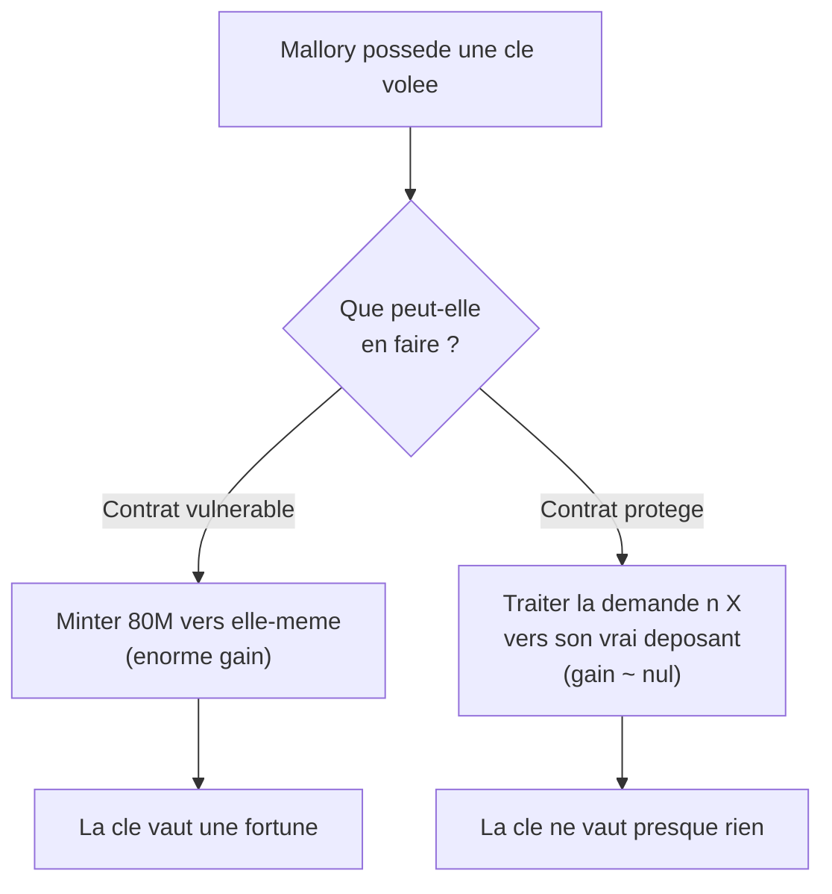
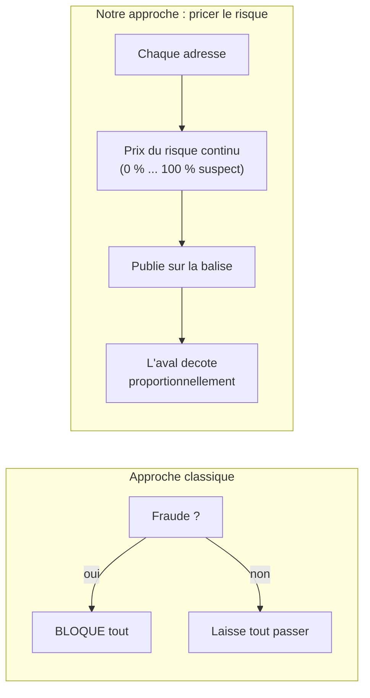

<Info>
**Ce que tu vas comprendre ici**
- Pourquoi on met la sécurité **dans le contrat**, et pas dans un vigile autour.
- Notre devise : « une clé volée ne doit presque rien valoir ».
- Le principe de conception complet de l'équipe (qui décide quoi, et ce qu'on promet).
- La décision §0 « **pricer le risque** » : ne pas seulement bloquer la fraude, la **chiffrer**.

Temps de lecture : environ 7 minutes. La suite concrète est dans
[Les trois volets](/les-trois-volets).
</Info>

## Rappel du problème

On l'a vu dans [Le problème](/le-probleme) : face à une **clé de service volée**, surveiller et
réagir arrive trop tard. Le mint frauduleux est déjà final quand l'alarme sonne. Il faut donc
empêcher le dégât **au moment où il se produit**.

## « La sécurité vit dans le contrat »

<Note>
**« La sécurité vit dans le contrat. »** Les règles de protection sont inscrites **dans
l'imprimante elle-même**, pas confiées à un vigile qui regarde la sortie.
</Note>

Un **smart contract** applique ses règles tout seul, sans faire confiance à qui l'appelle (revois
le [distributeur automatique](/bases-blockchain) si besoin). Si la règle « on ne mint pas plus que
le dépôt » est **dans le contrat**, alors même une signature valide — y compris volée — ne peut
pas la contourner. Le contrat refuse, point.

<Tip>
**Analogie** : un distributeur de billets ne te donne que ce qu'il y a sur ton compte, même si tu
insistes, même si tu as la carte de quelqu'un d'autre. La règle est **dans la machine**, pas dans
l'humilité du client.
</Tip>

Les invariants durs (montant dérivé on-chain, bornes de perte) vivent donc **on-chain**. La
surveillance et l'IA restent **autour**, en renfort, pour la démonstration et la conformité — pas
comme première ligne de défense.

<Info>
Source : `docs/OPEN_ANSWERS.md` §0 — « La sécurité vit dans le contrat, pas seulement autour. La
surveillance "autour" arrive trop tard face à une clé de signature volée. »
</Info>

## Notre devise

> **« Une clé volée ne doit presque rien valoir. »**

C'est le test que doit passer chaque décision de conception. Si voler une clé permet encore de
gagner beaucoup, on n'a pas fini. Si voler une clé ne rapporte **presque rien** (au mieux retarder
des demandes légitimes, jamais choisir un montant ou un destinataire), alors l'attaque n'a plus
d'intérêt économique.

## Le principe de conception complet

Voici la règle de conception de l'équipe, telle qu'elle est écrite dans `CLAUDE.md`. Elle tient en
quatre idées.

<CardGroup cols={2}>
  <Card title="La sécurité est dans le contrat" icon="shield">
    Les invariants durs vivent on-chain. C'est la première ligne, pas un renfort.
  </Card>
  <Card title="La surveillance est un renfort" icon="binoculars">
    Les surveillants et l'IA observent et aident à la démo et à la conformité — ils ne tiennent
    pas la ligne de front.
  </Card>
  <Card title="L'IA ne décide jamais seule du grave" icon="robot">
    L'IA ne fait que **retarder** (localement, auto-expirant). Elle ne décide **jamais seule** une
    **destruction** ni une **pause globale** : ça, c'est un **multisig humain**.
  </Card>
  <Card title="On ne promet que ce qu'on mesure" icon="ruler">
    Aucun chiffre sans mesure. On dit « vérifié par tests », **jamais « prouvé »**.
  </Card>
</CardGroup>

<Warning>
Attention au vocabulaire, c'est un point acté. La vieille formule « l'IA ne décide jamais seule
d'un blocage » doit se lire : **l'IA ne décide jamais seule d'une destruction ni d'une pause
globale**. L'IA **retarde** (allonge une fenêtre, localement et temporairement) ; elle ne
« bloque » pas. Détail dans [Les garde-fous](/les-garde-fous).
</Warning>

<Info>
Source : `CLAUDE.md` (« Principe de conception ») et `docs/OPEN_ANSWERS.md` §3 (glissement de
vocabulaire acté le 2026-10-10).
</Info>

<Note>
Statut : ce principe est marqué **« proposé, à valider en équipe »** dans `CLAUDE.md`. On ne le
présente donc pas comme gravé dans le marbre.
</Note>

## La décision §0 : « pricer le risque »

L'équipe a tranché, le 2026-10-10, **où vit la sécurité** et **quel est le cœur du projet**. Le
cœur retenu porte un nom : **« pricer le risque »** — autrement dit, mettre un **prix** sur le
risque au lieu de le traiter en tout-ou-rien.

<Tip>
**Analogie** : un feu de circulation n'a que deux états, vert ou rouge. Une **assurance auto**,
elle, met un **prix** sur ton risque : plus tu es risqué, plus ta prime monte, en continu. On veut
être l'assurance, pas le feu rouge.
</Tip>

Concrètement, chaque adresse porte un **« prix du risque »** continu (sa part suspecte), publié
sur une **balise de risque** et lisible par les autres protocoles. On ne se contente pas de dire
« fraude : oui/non » : on **rend le risque visible et chiffré**, et on laisse le marché et les
protocoles en aval réagir à ce prix.

Le mécanisme chiffré derrière ce prix — le **ratio de contamination**, ses tranches, et la racine
de Merkle qui le rend contestable — a sa propre page. Ici, retiens juste l'idée ; le détail est là :

<Card title="Pricer le risque : le ratio en détail" icon="gauge-high" href="/contamination-par-ratio">
  Le ratio de contamination par adresse, les tranches, la racine de Merkle.
</Card>

<Info>
Source : `docs/OPEN_ANSWERS.md` §0 — DÉCISION (2026-10-10, Équipe 20) : sécurité **dans le
contrat**, cœur = **« pricer le risque »** via le Token Ghost à contamination par ratio. Statut :
**tranché en équipe**. Le détail du ratio relève de la §9.
</Info>

<Note>
La §0 laisse explicitement **des points ouverts** : le barème exact de la marge de conversion
(forfaitaire ou indexée sur le ratio), la grandeur affichée comme « risque » (proportion suspecte
vs probabilité de fraude), et **tous les seuils**, qui restent **à mesurer** sur le trafic
synthétique. On ne les tranche pas ici.
</Note>

## Ce que ça donne, en une image

<Steps>
  <Step title="Ancienne approche (fragile)">
    Imprimante bête + vigile qui regarde la sortie. Le vigile crie **après** l'impression. Trop
    tard.
  </Step>
  <Step title="Notre approche (robuste)">
    Imprimante **intelligente** qui refuse elle-même d'imprimer n'importe quoi (sécurité dans le
    contrat), et qui **affiche un prix du risque** quand quelque chose cloche, au lieu de tout
    bloquer d'un coup.
  </Step>
</Steps>

<Check>
**À retenir**
- La protection vit **dans le contrat** ; la surveillance n'est qu'un **renfort**.
- Objectif : **une clé volée ne doit presque rien valoir**.
- Quatre règles : sécurité on-chain, surveillance en renfort, l'IA ne fait que **retarder**, on ne
  promet que ce qu'on **mesure**.
- Cœur du projet (§0, tranché) : **pricer le risque** — le rendre visible et chiffré, pas
  seulement bloquer.
</Check>

<CardGroup cols={2}>
  <Card title="Les trois volets" icon="layer-group" href="/les-trois-volets">
    Le montant verrouillé, la perte bornée, le mur anti-contagion.
  </Card>
  <Card title="Les garde-fous" icon="lock" href="/les-garde-fous">
    Les surveillants, les trois verbes, le multisig.
  </Card>
  <Card title="Pricer le risque" icon="gauge-high" href="/contamination-par-ratio">
    Le ratio de contamination, le vrai cœur chiffré.
  </Card>
  <Card title="Le problème" icon="triangle-exclamation" href="/le-probleme">
    Revoir pourquoi réagir après coup ne suffit pas.
  </Card>
</CardGroup>
