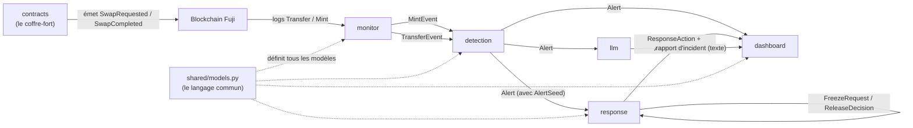
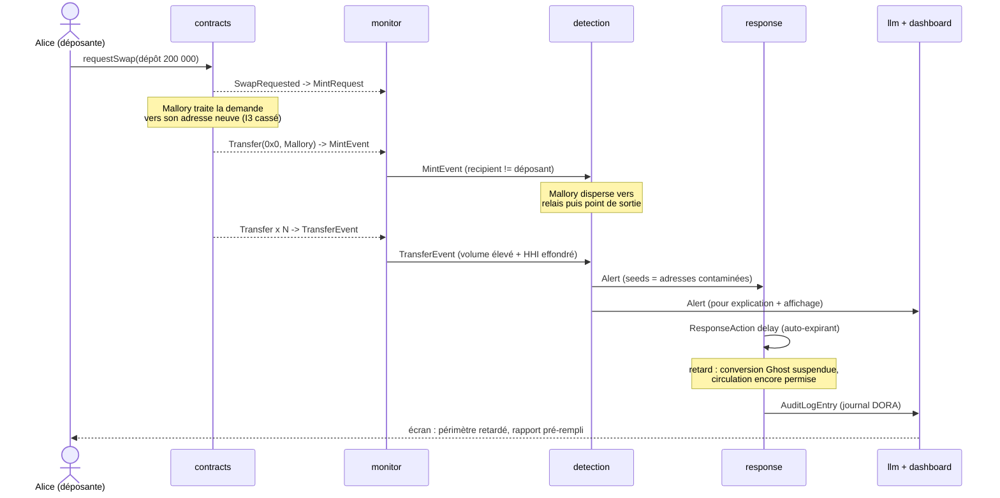

<Info>
**Ce que tu vas comprendre ici**
- Le **chemin complet** d'une donnée : contrats → événements → monitor → detection → response →
  llm / dashboard.
- **Quel modèle Pydantic** de `shared/models.py` circule à chaque flèche (nom exact des classes).
- Les **conventions transverses** de `docs/CONTRACTS.md` : temps, identités / montants EVM,
  Pydantic strict.
- Le parcours d'un **mint suspect** de bout en bout, en schéma.

Temps de lecture : environ 12 minutes. Le détail de chaque modèle est dans
[Le langage commun](/modules/shared).
</Info>

Le système est une **chaîne de postes** : chacun reçoit un type de donnée, en produit un autre, et
le passe au suivant. Personne ne saute un poste.

<Tip>
**Analogie** : imagine une **usine de tri postal**. Le camion (la blockchain) dépose des colis
(événements). Le quai de réception (monitor) les enregistre. Le service de contrôle (detection)
ouvre les suspects et colle une **étiquette rouge** (une alerte). Le responsable (response) décide
quoi faire du colis étiqueté. Le rédacteur (llm) écrit le rapport, et l'écran du hall (dashboard)
affiche l'état en direct.
</Tip>

## Le trajet en une image

<Note>
Les flèches portent le **nom exact** de la classe Pydantic échangée. Toutes ces classes vivent
dans `shared/models.py` et sont spécifiées dans `docs/CONTRACTS.md`.
</Note>

## Étape par étape, avec le modèle échangé

<Steps>
  <Step title="contracts émet des événements on-chain">
    Le contrat `ProtectedMinter` (volet 1) émet `SwapRequested` quand une demande est créée, puis
    `SwapCompleted` quand la clé de service la traite. Le `StableToken` émet en plus le
    `Transfer(0x0, déposant, montant)` standard de l'ERC-20 : c'est **ça** qu'un mint produit sur
    la chaîne. Source : `contracts/README.md`, `contracts/src/ProtectedMinter.sol`.
  </Step>
  <Step title="monitor écoute et traduit en modèles">
    Le `ChainListener` lit les logs par polling `eth_getLogs`. Un `Transfer(from = 0x0, …)`
    devient un `MintEvent` ; un `Transfer` entre deux adresses devient un `TransferEvent`. C'est
    la **première fois** que la donnée brute devient un modèle Pydantic validé.
    Source : `monitor/README.md`.
  </Step>
  <Step title="detection analyse et lève une Alert">
    Le `RuleBasedMonitor` reçoit les `MintEvent` (`check_mint`) et `TransferEvent`
    (`check_transfer`). S'il repère « volume élevé ET dispersion effondrée », il produit une
    `Alert`, qui transporte une liste d'`AlertSeed` (les adresses graines à marquer au départ).
    Source : `detection/README.md`.
  </Step>
  <Step title="response décide la réponse graduée">
    Le `ResponseOrchestrator` reçoit l'`Alert` (`handle_alert`) et crée une `ResponseAction` de
    type `delay` (retard auto-expirant). Une `FreezeRequest` peut allonger la fenêtre ; une
    `ReleaseDecision` multisig tranche une destruction ou une pause globale. Chaque pas écrit une
    `AuditLogEntry` (journal DORA). Source : `response/README.md`.
  </Step>
  <Step title="llm explique, dashboard affiche">
    Sur alerte **uniquement**, `llm` appelle Amazon Bedrock pour expliquer l'`Alert` et pré-rédiger
    un rapport d'incident. Le `dashboard` lit les `Alert`, `ResponseAction`, `AuditLogEntry`,
    `QuarantineRecord` et `RiskBeaconUpdate` pour montrer l'état en direct.
    Sources : `llm/README.md`, `dashboard/README.md`.
  </Step>
</Steps>

## Le modèle à chaque flèche (table de référence)

| De → vers | Modèle `shared/models.py` | Qui le produit |
|-----------|---------------------------|----------------|
| chaîne → monitor → detection | `MintEvent` | `monitor` (`stream_mint_events`) |
| chaîne → monitor → detection | `TransferEvent` | `monitor` (`stream_transfer_events`) |
| detection → response / llm / dashboard | `Alert` (contient des `AlertSeed`) | `detection` |
| response (sur alerte) | `ResponseAction` | `response` |
| surveillant → response | `FreezeRequest` | `detection` / IA |
| multisig → response | `ReleaseDecision` | humains |
| response → journal | `AuditLogEntry` | `response` |
| contrat Ghost (scénarios C/D) | `GhostTokenMintEvent`, `GhostTokenRedemptionEvent`, `GhostTokenBurnEvent` | `data` (simulation) |
| balise de risque → aval | `RiskBeaconUpdate` | `data` / contrat (#7) |
| quarantaine (dashboard) | `QuarantineRecord` | `dashboard` / contrat |

<Note>
`MintRequest` existe aussi dans `shared/models.py` : c'est la demande de mint enregistrée on-chain
(dépôt + signature « traiter la demande n°X »). Dans les données de test, elle précède le
`MintEvent`. Source : `shared/models.py`, `docs/CONTRACTS.md`.
</Note>

## Les conventions transverses (le même pour tout le monde)

Ces règles sont **actées** dans `docs/CONTRACTS.md` et appliquées par `shared/models.py`. Elles ne
se rediscutent pas poste par poste : elles valent pour **tous** les modèles.

<AccordionGroup>
  <Accordion title="Pydantic strict : aucun champ en trop" icon="shield">
    Chaque modèle porte `model_config = ConfigDict(extra="forbid")` (base `_StrictModel`). Un JSON
    avec un champ hors schéma est **refusé**, pas ignoré. Les bornes sont validées
    (`ge` / `le` pour les ratios, `gt` / `ge` pour les montants, `pattern` pour adresses et hash),
    et les ensembles fermés sont des `Enum`, jamais des chaînes libres.
  </Accordion>
  <Accordion title="Le temps : datetime UTC en ISO 8601" icon="clock">
    Tous les champs temporels sont des `datetime` UTC, nommés avec le suffixe `_at` (`observed_at`,
    `created_at`, `expires_at`…). En JSON, ils sont sérialisés en ISO 8601 avec offset
    (`"2026-10-10T14:30:00Z"`). **Jamais** d'entier epoch opaque : un journal DORA lisible vaut
    mieux.
  </Accordion>
  <Accordion title="Identités EVM : Address et TxHash" icon="fingerprint">
    Deux alias validés par regex : `Address` = `0x` + 40 hex (20 octets), `TxHash` = `0x` + 64 hex
    (32 octets). `chain_id` vaut `43113` pour Fuji ; `block_number` est un entier `ge=0`.
  </Accordion>
  <Accordion title="Montants : entiers en base units" icon="coins">
    Un montant est **toujours** un `int` en base units, **jamais** un `float` monétaire. Positivité
    imposée : `gt=0` quand zéro n'a pas de sens (le montant d'un mint), `ge=0` quand zéro est
    licite (un solde, un montant suspect résiduel). Le token fictif a 6 décimales, donc tout tient
    dans un int64.
  </Accordion>
  <Accordion title="Le soupçon : ratio ET montant absolu" icon="scale-unbalanced">
    Partout où circule le soupçon, **deux** champs coexistent : `contamination_ratio` (float
    `[0, 1]`, fraction suspecte normalisée) **et** `suspect_amount` (int base units, montant absolu
    suspect). Le montant absolu est la **parade à la dilution** : il n'est jamais dérivé
    silencieusement du ratio.
  </Accordion>
</AccordionGroup>

<Warning>
Hors blocs de code, on écrit « inférieur à » plutôt que le signe mathématique, parce que ce guide
est en MDX : un chevron ouvrant suivi d'une lettre serait lu comme du JSX et casserait la page.
</Warning>

## Bout en bout : un mint suspect

On suit **Mallory** (la voleuse de clé de service) qui tente le détournement du scénario B : la
demande d'**Alice** (déposante honnête) est mintée vers une adresse neuve de Mallory, puis les
fonds filent vers un point de sortie avant la fin de la fenêtre Ghost.

<Info>
Pourquoi le détournement « à 1:1 » est dangereux : le bilan global reste équilibré (I1 tient, un
dépôt pour un mint), donc le surveillant de **mint** ne voit l'anomalie que s'il vérifie I3
(destinataire = déposant). C'est le surveillant de **transferts** (volume élevé ET dispersion
effondrée) qui rattrape la sortie. Source : `data/README.md` (scénario B), `detection/README.md`.
</Info>

<Warning>
Dans ce schéma, **rien n'est bloqué** : un retard suspend seulement la **conversion** Ghost →
vrai jeton. La destruction d'une part suspecte exige un multisig humain (`ReleaseDecision`), jamais
l'IA seule. Détail dans [Les garde-fous](/les-garde-fous).
</Warning>

<Check>
**À retenir**
- La donnée suit une chaîne fixe : contrats → chaîne → monitor → detection → response → llm /
  dashboard.
- Chaque flèche porte un **modèle Pydantic nommé** de `shared/models.py`.
- Les conventions (temps UTC, Address/TxHash, montants en int, ratio **et** montant absolu) sont
  les mêmes partout, actées dans `docs/CONTRACTS.md`.
- Un mint suspect finit en `Alert` → `ResponseAction delay` → journal DORA, sans jamais bloquer
  automatiquement.
</Check>

<CardGroup cols={2}>
  <Card title="Le langage commun" icon="cubes" href="/modules/shared">
    Le détail de chaque modèle Pydantic, champ par champ.
  </Card>
  <Card title="Qui fait quoi" icon="sitemap" href="/qui-fait-quoi">
    Les modules, leurs propriétaires et comment ils s'emboîtent.
  </Card>
  <Card title="Les contrats" icon="file-contract" href="/modules/contracts">
    Le coffre-fort intelligent qui émet les événements.
  </Card>
  <Card title="Le parcours d'une attaque" icon="route" href="/le-parcours-dune-attaque">
    Les scénarios A/B/C/D suivis pas à pas.
  </Card>
</CardGroup>
