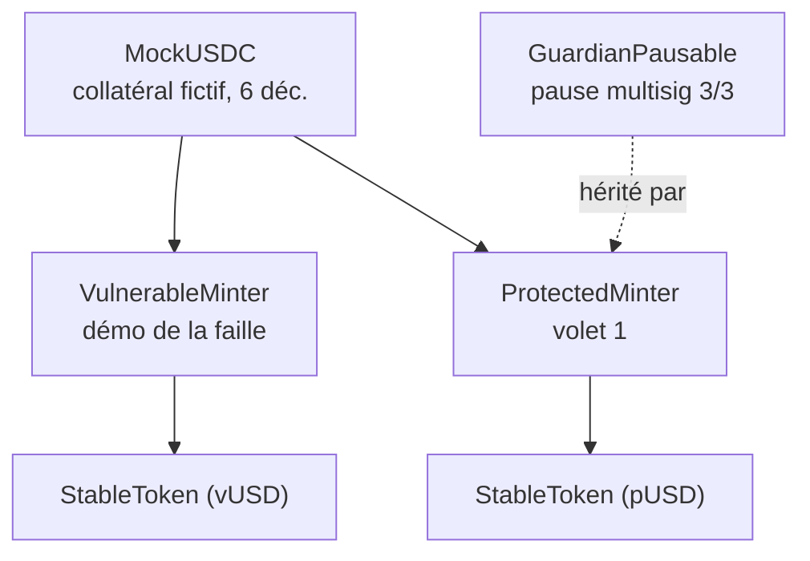

<Info>
**Ce que tu vas comprendre ici**
- Les 5 contrats de `contracts/src/` : rôle, fonctions clés, événements, extraits commentés.
- Les tests **Foundry** de `contracts/test/` (unitaires, fuzz, invariants, handler, BaseTest).
- Le **déploiement** sur Fuji (`DEPLOYMENTS.md`, `foundry.toml`).
- Pourquoi le contrat **Token Ghost** (#8) n'est pas encore là.

Temps de lecture : environ 13 minutes. L'idée de fond est dans [L'idée clé](/lidee-cle) et
[Les trois volets](/les-trois-volets).
</Info>

Le module `contracts` est le **coffre-fort intelligent** : du Solidity, testé avec **Foundry**,
cible le testnet **Avalanche Fuji**. Toutes les données sont **fictives** (collatéral `MockUSDC`,
stables « (fictif) »), aucune vraie clé. **Propriétaire : @denybs.**

<Tip>
**Analogie** : compare deux distributeurs de billets. Le **vulnérable** fait ce qu'on lui demande :
« imprime 80 millions pour cette personne ». Le **protégé** ne connaît qu'un geste : « traite la
demande n°X » — et c'est **lui** qui calcule le montant à partir du dépôt déjà posé. Voler le
badge du second ne sert presque à rien.
</Tip>

## Vue d'ensemble des 5 contrats



## `MockUSDC` — le collatéral fictif

- **Rôle** : un faux stablecoin de collatéral à **6 décimales**, avec un `mint` **ouvert à tous**
  (un faucet de test, sans aucune valeur).
- **Fonctions clés** : `mint(to, amount)` (ouvert), `decimals()` → `6`.

```solidity
// contracts/src/MockUSDC.sol
function mint(address to, uint256 amount) external {
    _mint(to, amount);
}
```

Ligne à ligne : `mint` n'a **aucun** contrôle d'accès — c'est voulu, c'est un robinet de test.
Jamais à déployer comme vraie monnaie.

## `StableToken` — le stable émis (18 décimales)

- **Rôle** : le stablecoin fictif émis par le minter. **Seul** le contrat `minter` fixé au
  déploiement peut en créer (invariant I4), et ce `minter` est **immuable**.
- **Fonctions clés** : `mint(to, amount)` (réservé au minter), erreurs `NotMinter`, `ZeroAddress`.

```solidity
// contracts/src/StableToken.sol
function mint(address to, uint256 amount) external {
    if (msg.sender != minter) revert NotMinter(msg.sender);
    _mint(to, amount);
}
```

Ligne à ligne : si l'appelant n'est pas le `minter` immuable, l'appel **échoue** (`revert`). Aucun
admin ne peut ajouter un second chemin de création. C'est l'invariant **I4** : un seul chemin de
mint.

## `VulnerableMinter` — la faille, en démo

<Warning>
**Volontairement vulnérable. À ne JAMAIS déployer comme vrai contrat.** Il reproduit le schéma
Resolv pour montrer l'attaque.
</Warning>

- **Rôle** : un utilisateur dépose du collatéral (`requestSwap`), puis un compte `SERVICE_ROLE`
  appelle `completeSwap` avec un **montant et un destinataire libres**.
- **La faille** : `recipient` et `mintAmount` sont fournis par l'appelant et **jamais** comparés au
  dépôt.
- **Événements** : `SwapRequested(requestId, depositor, depositAmount)`,
  `SwapCompleted(requestId, recipient, mintAmount)`.

```solidity
// contracts/src/VulnerableMinter.sol — LA FAILLE
function completeSwap(uint256 requestId, address recipient, uint256 mintAmount)
    external onlyRole(SERVICE_ROLE)
{
    SwapRequest storage req = _requests[requestId];
    if (req.status != RequestStatus.Pending) revert RequestNotPending(requestId);
    req.status = RequestStatus.Completed;
    stable.mint(recipient, mintAmount);          // <-- montant et destinataire LIBRES
    emit SwapCompleted(requestId, recipient, mintAmount);
}
```

Ligne à ligne : le contrat vérifie bien le **rôle** et que la demande est en attente… mais il mint
le **montant choisi** vers le **destinataire choisi**, sans aucun lien avec le dépôt. Une clé de
service volée transforme donc un petit dépôt réel en mint arbitraire.

## `ProtectedMinter` — volet 1

- **Rôle** : « une clé de service volée ne doit presque rien valoir ». La clé `SERVICE_ROLE`
  n'autorise que **« traiter la demande n°X »** : `completeSwap(requestId)` n'a **ni montant ni
  destinataire**. Tout est dérivé de la demande enregistrée on-chain.
- **Fonctions clés** : `requestSwap(depositAmount)` (crée la demande, taux figé), `completeSwap(requestId)`
  (mint dérivé), `setRate(newRate)` (réservé à `RATE_ADMIN_ROLE`), `quoteMint(deposit, rate)`.
- **Événements** : `SwapRequested`, `SwapCompleted` (déposant **et** destinataire indexés),
  `RateChanged`, plus ceux hérités (`Paused`, `GuardianApproval`, `RoleGranted`…).

```solidity
// contracts/src/ProtectedMinter.sol — le geste unique
function completeSwap(uint256 requestId) external onlyRole(SERVICE_ROLE) whenNotPaused {
    SwapRequest storage req = _requests[requestId];
    if (req.status == RequestStatus.None) revert RequestNotFound(requestId);
    if (req.status != RequestStatus.Pending) revert RequestNotPending(requestId);
    req.status = RequestStatus.Completed;              // traité exactement une fois
    uint256 minted = quoteMint(req.depositAmount, req.rate);  // dérivé du dépôt
    stable.mint(req.depositor, minted);                // va au DÉPOSANT, pas à l'appelant
    emit SwapCompleted(requestId, req.depositor, req.depositor, req.depositAmount, minted, req.rate);
}
```

Ligne à ligne : pas de paramètre montant, pas de paramètre destinataire. Le montant est
`quoteMint(dépôt, taux figé)` et il va à `req.depositor`. La demande passe à `Completed` :
impossible de la rejouer.

Les invariants appliqués on-chain :

| Invariant | Ce qu'il garantit |
|-----------|-------------------|
| **I1** | `minted = dépôt × taux`, taux **figé à la création** de la demande, arrondi vers le bas, ε = 0 |
| **I2** | la demande existe, est en attente, est traitée **exactement une fois** |
| **I3** | le destinataire du mint est le **déposant** de la demande |
| **I4** | un seul chemin de mint (`StableToken.minter` immuable = ce contrat) |
| **I5** | `totalSupply == totalMinted` (pas de burn ni de rachat ici) |

<Note>
Ce qu'une clé de service volée **ne peut pas** faire : choisir un montant, choisir un destinataire,
rejouer une demande, en inventer une, minter directement, changer le taux, pauser ou s'attribuer un
rôle. Ce qu'elle peut faire : traiter (ou pas) des demandes existantes, au moment de son choix —
sans effet sur le montant, grâce au snapshot du taux. Pas de plafond fixe par opération (§0).
Source : `contracts/README.md`.
</Note>

## `GuardianPausable` — la pause multisig 3/3

- **Rôle** : pause globale gardée par un **multisig simulé 3/3**. Trois guardians figés au
  déploiement ; pause **et** dépause exigent les 3 approbations. Aucun acteur seul (admin compris)
  ne peut pauser ni dépauser.
- **Fonctions clés** : `approvePause()`, `approveUnpause()`, `guardians()`. Les approbations sont
  comptées par « round » (`pauseRound`), remises à zéro après chaque action exécutée.

```solidity
// contracts/src/GuardianPausable.sol
function approvePause() external onlyGuardian whenNotPaused {
    if (_approve(true)) _pause();   // la 3e approbation du round déclenche la pause
}
```

Ligne à ligne : seul un guardian peut approuver ; `_approve` compte les voix du round courant, et
quand le quorum (3) est atteint, `_pause()` s'exécute. Simplifications assumées : pas de révocation
d'approbation, pas de rotation des guardians.

## Les tests Foundry

Les tests vivent dans `contracts/test/`. On les lance depuis `contracts/` après avoir installé
Foundry et les dépendances.

<Tabs>
  <Tab title="Windows (WSL / Git Bash)">
    ```bash
    forge install --no-git foundry-rs/forge-std@v1.17.0 OpenZeppelin/openzeppelin-contracts@v5.4.0
    forge build
    forge test -vv
    ```
  </Tab>
  <Tab title="PowerShell (forge hors PATH)">
    ```powershell
    & "$env:USERPROFILE\.foundry\bin\forge.exe" test -vv
    ```
  </Tab>
</Tabs>

Ce que vérifie chaque fichier :

| Fichier | Type | Ce qu'il vérifie |
|---------|------|------------------|
| `utils/BaseTest.sol` | socle | acteurs fictifs (`makeAddr`, **aucune clé**) : admin, service/attacker, alice, bob, 3 guardians ; déploiements `MockUSDC`, vulnérable, protégé |
| `Tokens.t.sol` | unitaire | `MockUSDC` a 6 décimales, `StableToken` 18, et seul son minter mint |
| `VulnerableMinter.t.sol` | unitaire + fuzz | l'attaque passe : petit dépôt → mint énorme, redirection, `testFuzz_vulnerable_mintsAnyAmount` |
| `ProtectedMinter.t.sol` | unitaire | un (ou plusieurs) test par invariant I1–I5, séparation des rôles, événements |
| `GuardianPausable.t.sol` | unitaire | pause/dépause **3/3**, aucun guardian seul, remise à zéro des approbations par round |
| `ScenarioA.t.sol` | scénario | **même attaque** rejouée sur les deux contrats, montants affichés côte à côte |
| `StolenServiceKey.fuzz.t.sol` | fuzz | clé volée : impossible de gonfler, rediriger, rejouer, minter, changer le taux, pauser |
| `invariant/ProtectedMinterHandler.sol` | handler | pilote les actions aléatoires (dépôts honnêtes + clé volée) et recalcule les valeurs attendues |
| `invariant/ProtectedMinter.invariant.t.sol` | invariants | solvabilité, `supply == complétées == totalMinted`, destinataire = déposant, borne de la clé volée |

<AccordionGroup>
  <Accordion title="Le test de l'attaque (fuzz) — pour les curieux" icon="bug">
    `testFuzz_stolenKey_cannotInflate` tire un dépôt, un taux, un faux montant et un faux
    destinataire **au hasard**. Quelle que soit la combinaison, l'appel « à la Resolv »
    (`completeSwap(uint256,address,uint256)`) **échoue**, et le seul appel possible mint
    exactement `dépôt × taux` au déposant. La valeur attendue est **recalculée par le test**, sans
    appeler `quoteMint` du contrat. Source : `contracts/test/StolenServiceKey.fuzz.t.sol`.
  </Accordion>
  <Accordion title="Les tests d'invariants (handler) — pour les curieux" icon="infinity">
    Le `ProtectedMinterHandler` joue des séquences aléatoires avec 4 déposants honnêtes + la clé
    de service volée. Un drapeau `ghost_unexpectedSuccess` passe à `true` si **une seule** action
    interdite réussit — et `invariant_stolenKeyBound` vérifie qu'il reste `false`. Profils
    d'exploration dans `foundry.toml` : `default` (256 runs) et `deep` (1024 runs).
  </Accordion>
</AccordionGroup>

<Warning>
On dit « **vérifié par tests d'invariants** », **jamais** « prouvé ». Les montants (200 000 USDC
déposés, 80 M mintés, ratio ~400×) sont des **fixtures** reprenant l'ordre de grandeur de
l'incident Resolv, pas des mesures. Source : `contracts/README.md`, `docs/CLAIMS.md`.
</Warning>

## Déploiement

- **Réseau** : Avalanche Fuji C-Chain, `chain_id = 43113`, RPC publique
  `https://api.avax-test.network/ext/bc/C/rpc`, explorateur [testnet.snowtrace.io](https://testnet.snowtrace.io).
- **Registre** : `contracts/DEPLOYMENTS.md` tient une ligne par contrat déployé (adresse, tx hash,
  commit, date). **Aucun contrat n'est déployé pour l'instant** : la table ne contient qu'un
  modèle de ligne à copier.
- **Build** : `contracts/foundry.toml` fixe `solc 0.8.33`, EVM `cancun`, et deux profils —
  `default` (fuzz 256, invariant 256/128) et `deep` (fuzz 1024, invariant 512/256).

<Warning>
**Testnet uniquement.** Les AVAX de Fuji sont des jetons de test sans valeur. Jamais de vraie clé
privée ni de wallet avec de vrais fonds. `out/`, `cache/`, `broadcast/` restent gitignorés : ne
jamais committer d'artefacts ni de clés. Source : `contracts/DEPLOYMENTS.md`.
</Warning>

## Le Token Ghost (#8) — en cours ailleurs

<Note>
Le contrat **ERC20 « Token Ghost »** (quarantaine liquide, burn réservé au guardian) est **en
cours sur une autre branche** (issue #8) et n'est **pas** dans `contracts/src/` aujourd'hui. Sa
spécification est tranchée (`docs/OPEN_ANSWERS.md` §0bis-b, §0bis-c, §9), mais son code n'existe pas
encore ici — on ne décrit donc pas son contenu. En attendant, le comportement du Ghost est simulé
**hors chaîne** dans [les données](/modules/data). Source : `contracts/README.md` (section « À
produire plus tard »), `docs/ROADMAP.md` (#8, vague 5).
</Note>

<Check>
**À retenir**
- `MockUSDC` (6 déc., faucet ouvert) et `StableToken` (18 déc., minter immuable = I4).
- `VulnerableMinter` montre la faille ; `ProtectedMinter` applique I1–I5 : « traiter la demande
  n°X » sans montant ni destinataire.
- `GuardianPausable` : pause **3/3**, personne seul.
- Tests Foundry = unitaires + fuzz + invariants (handler) ; on dit « **vérifié**, pas prouvé ».
- Le Token Ghost (#8) est **ailleurs, en cours** : non décrit ici.
</Check>

<CardGroup cols={2}>
  <Card title="Les trois volets" icon="layer-group" href="/les-trois-volets">
    Les protections de fond que ces contrats appliquent.
  </Card>
  <Card title="Les données" icon="database" href="/modules/data">
    Les scénarios qui rejouent l'attaque sur ces contrats.
  </Card>
  <Card title="Lire et écrire un test" icon="vial" href="/pratique/tests-expliques">
    pytest + Foundry expliqués pas à pas.
  </Card>
  <Card title="Le token Ghost" icon="ghost" href="/token-ghost">
    L'idée de la quarantaine liquide.
  </Card>
</CardGroup>
