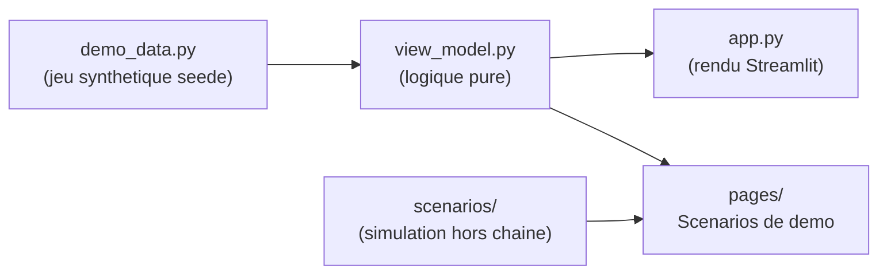
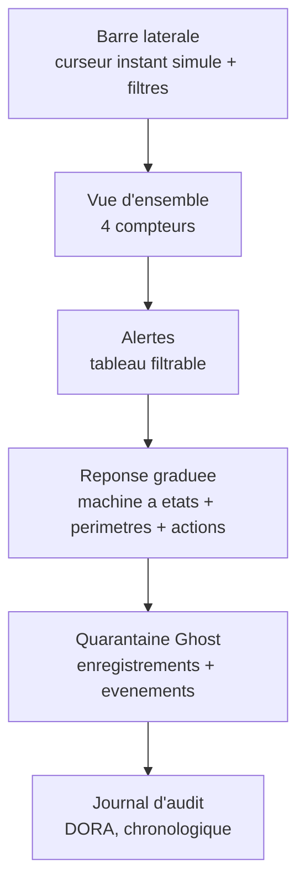
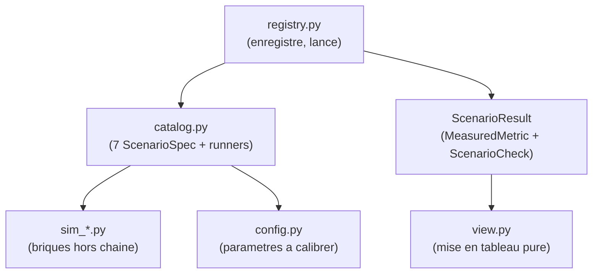

<Info>
**Ce que tu vas comprendre ici**
- Le rôle de `dashboard` : **montrer** le système à l'écran (Streamlit), rien de plus.
- Ce qu'on voit, **zone par zone** (vue d'ensemble, alertes, réponse, quarantaine, audit).
- Comment les **scénarios de démo** sont simulés **hors chaîne** et rejouables à l'identique.
- Comment lancer la page (`make run-dashboard`) et la CLI (`make demo ARGS=...`).
- Les limites : tout est **simulation**, aucun chiffre n'est une mesure du contrat déployé.

Temps de lecture : environ 15 minutes. Avant, lis [Le module response](/modules/response) (les
états qu'on affiche) et [Le langage commun](/modules/shared) (les modèles consommés).
</Info>

Le module `dashboard/` est la **vitrine** du projet : une interface Streamlit qui **affiche** les
alertes, l'état de la réponse graduée, la quarantaine Ghost et le journal d'audit, plus une page de
**scénarios de démo** rejouables. Il ne décide rien, ne calcule aucune vraie mesure : il **montre**.

<Tip>
**Analogie** : `dashboard`, c'est le **tableau de bord dans le poste de sécurité** de la banque.
Les caméras ([monitor](/modules/monitor)), les agents ([detection](/modules/detection)) et le
responsable ([response](/modules/response)) font le travail ; le tableau de bord **affiche** l'état
en clair, pour qu'un humain comprenne d'un coup d'œil. Les chiffres affichés sont des **comptages**
sur un jeu fictif, **pas** des mesures de performance.
</Tip>

## Où il se situe dans la chaîne



<Note>
Découpage net : les **données** (`demo_data.py`), la **logique pure sans Streamlit**
(`view_model.py`), et le **rendu** (`app.py`, `pages/`). Aucun chiffre affiché n'est écrit en dur :
tout est calculé à partir du jeu synthétique. Source : `dashboard/README.md`.
</Note>

## Les modèles consommés

`dashboard` lit, en lecture seule, une large part du [langage commun](/modules/shared) : `Alert`,
`AlertSeed`, `ResponseAction`, `AuditLogEntry`, `QuarantineRecord`, `RiskBeaconUpdate`,
`ReleaseDecision`, et les trois événements Ghost (`GhostTokenMintEvent`,
`GhostTokenRedemptionEvent`, `GhostTokenBurnEvent`). L'état d'un périmètre (`PerimeterState`) est
une **enum locale** : `shared/` n'en définit pas.

## L'écran, zone par zone

Voici la page principale (`app.py`), de haut en bas :



<Steps>
  <Step title="Barre latérale — piloter la vue">
    Un **curseur « instant simulé »** (en minutes après l'heure de référence) montre un retard
    **expirer tout seul** quand on avance le temps. Plus des **filtres** par gravité et par type
    d'alerte.
  </Step>
  <Step title="Vue d'ensemble — 4 compteurs">
    Alertes critiques · Périmètres retardés · Ghost suspect détruit (base units) · Actions en
    attente multisig. Tous **recalculés** à l'instant simulé (`compute_summary`).
  </Step>
  <Step title="Alertes — le tableau filtrable">
    Une ligne par alerte (créée le, gravité **en texte**, type, surveillant, adresse raccourcie,
    ratio, montant suspect, dispersion, z-score, nb de graines, raison), de la plus récente à la
    plus ancienne.
  </Step>
  <Step title="Réponse graduée — la machine à états">
    Le texte de la machine à états (NORMAL → RETARDÉ → DÉTRUIT / PAUSE), puis l'**état de chaque
    périmètre** (dérivé des actions à l'instant simulé) avec sa quarantaine et sa dernière balise,
    puis les **actions de réponse** (avec « expire dans X min »).
  </Step>
  <Step title="Quarantaine Ghost — les enregistrements">
    L'instantané des quarantaines (actif / allongé / converti / détruit) et la **chronologie des
    événements Ghost** (émission, conversion 1:1, destruction) jusqu'à l'instant simulé.
  </Step>
  <Step title="Journal d'audit — DORA">
    Toutes les entrées, triées chronologiquement, payload aplati en `clé=valeur`.
  </Step>
</Steps>

<Tip>
**Accessibilité** : chaque état, gravité ou statut a un **libellé texte explicite** (« Retardé
(fenêtre allongée) », « Critique », « Convertie (libérée) »). La couleur ou l'icône n'est **jamais**
le seul porteur d'information. Source : `dashboard/view_model.py`.
</Tip>

### Comment les compteurs sont calculés (ligne à ligne)

```python
# dashboard/view_model.py — _action_state(action, at)
if action.created_at > at or action.status != ResponseActionStatus.APPLIED:
    return None
if action.action_type == ResponseActionType.DELAY:
    if action.expires_at is not None and action.expires_at > at:
        return PerimeterState.DELAYED
    return None
```

- **ligne 1-2** : une action créée **après** l'instant simulé, ou non **appliquée** (proposée,
  rejetée, expirée), n'a **aucun effet** sur l'affichage.
- **ligne 3-5** : un **retard** compte comme RETARDÉ **seulement** si sa fin est **après**
  l'instant simulé. Sinon, le silence l'a ramené à la normale — c'est ce qu'on voit quand on pousse
  le curseur de temps.

## Le jeu de données de démo

`demo_data.py` fabrique un jeu **synthétique et seedé** (`DEMO_SEED = 20`) : même seed = même jeu
(aucun `datetime.now()`, aucun `uuid4`). Il met en scène quatre périmètres qui couvrent toute la
machine à états :

| Périmètre | Histoire | État final affiché |
|-----------|----------|--------------------|
| (a) NORMAL | alerte `info`, retard **proposé puis rejeté** | Normal |
| (b) RETARDÉ | alerte critique (volume ET dispersion), retard **encore actif** | Retardé |
| (c) EXPIRÉ | retard **expiré en silence**, Ghost converti 1:1 | Normal |
| (d) DÉTRUIT | multisig 2/3 `confirm_destroy`, Ghost suspect brûlé | Ghost suspect détruit |
| (e) — | pause globale **seulement proposée** (en attente 3/3) | aucun effet |

<Warning>
Les fenêtres **10 min / 1 h** sont la « proposition de référence » (§3.1) : des **valeurs de démo
à mesurer**, pas des chiffres actés. Adresses, hash et montants sont **fictifs** (`0x…`). Source :
`dashboard/demo_data.py`.
</Warning>

## Les scénarios de démo (#47)

La page « Scénarios de démo » (et la CLI `python -m dashboard.demo`) rejoue **7 scénarios** en
**simulation hors chaîne** : les modules amont sont encore des squelettes, donc chaque résultat
porte le bandeau « simulation hors chaîne, à remplacer par #… ».

<Tip>
**Analogie** : un **simulateur de vol**. On n'est pas dans un vrai avion (le contrat déployé) ; on
rejoue des situations types pour vérifier que les procédures tiennent. Même **réglage de départ**
(seed) = même vol exactement, ce qui rend la démo reproductible.
</Tip>

| Scénario | Attendu | Dépend de |
|----------|---------|-----------|
| A | Le vulnérable se fait vider, le protégé borne la perte | #4, #5 |
| B | Détection + alerte + allongement de fenêtre Ghost | #11, #12, #17 |
| C (optionnel) | Moins de pertes en aval quand la balise est lue | #7, #25 |
| D (optionnel) | Pertes protocole ≈ zéro vs pertes spéculateurs | #8, #25 |
| N1 | Zéro alerte, zéro gel (trafic légitime seul) | #11, #12 |
| N2 | Pas de déclenchement (volume élevé **sans** dispersion effondrée) | #11, #12 |
| N3 | La fenêtre revient seule à la normale, aucun gel définitif | #11, #12, #17 |

<Note>
Un scénario **désactivé** (`--disable C`, ou case décochée) affiche « désactivé » sans aucune
métrique. Un scénario dont la brique amont n'existe pas (runner levant `NotImplementedError`)
affiche automatiquement « non disponible (dépend de #X) ». Brancher la vraie implémentation =
remplacer le `runner` du `ScenarioSpec`, **rien d'autre** ; la CLI et la page ne changent pas.
Source : `dashboard/scenarios/registry.py`, `catalog.py`.
</Note>

### Architecture du moteur de scénarios



- `sim_contracts.py` : minteurs vulnérable/protégé, pool AMM, marché de prêt, grand livre Ghost
  (tous simulés).
- `sim_detector.py` : surveillant simulé (médiane + MAD, dispersion).
- `sim_traffic.py` : trafic légitime et transferts d'attaquant.
- `sim_response.py` : retard, confirmation de destruction, expiration, construction du dataset.

<Warning>
Les paramètres de `scenarios/config.py` (seuils, volumes, délais) sont des **valeurs de départ à
calibrer** (`docs/OPEN_QUESTIONS.md` §6) : **aucun seuil n'est acté**. Les grandeurs affichées sont
**mesurées sur la simulation uniquement** (`docs/CLAIMS.md`), et les « attendus » sont **constatés**
(`OK` / `KO`), pas garantis. Chaque champ de `config.py` porte le commentaire « à calibrer ».
</Warning>

## Le lancer

<Tabs>
  <Tab title="Windows">
    ```text
    python -m streamlit run dashboard/app.py
    py -m dashboard.demo list
    py -m dashboard.demo run B --seed 20
    ```
  </Tab>
  <Tab title="macOS / Linux (make)">
    ```text
    make run-dashboard
    make demo ARGS="list"
    make demo ARGS="run B"
    ```
  </Tab>
</Tabs>

<Warning>
Ne lance **pas** le serveur Streamlit dans un environnement contraint en mémoire (la page tourne
en continu). La CLI `python -m dashboard.demo`, elle, est légère et se termine seule.
</Warning>

Sortie **réelle** de `python -m dashboard.demo list` (extrait) :

```text
A | Même attaque rejouée (vulnérable vs protégé) | — | activé | dépend de #4, #5 | simulation hors chaîne, à remplacer par #4, #5, #24
B | Attaquant sous les plafonds | — | activé | dépend de #11, #12, #17 | simulation hors chaîne, à remplacer par #11, #12, #17, #24
N1 | Trafic légitime seul | — | activé | dépend de #11, #12 | simulation hors chaîne, à remplacer par #11, #12
```

Sortie **réelle** de `python -m dashboard.demo run B --seed 20` (extrait) :

```text
Scénario B : Attaquant sous les plafonds
Statut : terminé
Attendu : Détection + alerte + allongement de fenêtre Ghost.
Bandeau : simulation hors chaîne, à remplacer par #11, #12, #17, #24
== Attaquant sous les plafonds (main) ==
  Rejets par le contrat seul : 0 transferts
  Alertes : 3 alertes
  Délai de détection : 300.000 s
  Faux positifs : 0 alertes
  Ghost suspect détruit : 90 000 000 000 base units
  [OK] détecté par les surveillants (attendu : au moins une alerte sur l'attaquant)
  [OK] contrat seul ne rejette rien (attendu : rejets par le contrat seul = 0)
  [OK] fenêtre allongée (attendu : retard appliqué sur chaque adresse attaquante alertée)
```

<Note>
Même seed = **même JSON** (`--json` pour la sortie brute). Le délai de détection « 300 s » = la
tranche de 5 min du surveillant simulé : l'alerte part à la clôture, **avant** la fin de la fenêtre
Ghost de 10 min. Source : `dashboard/demo.py`.
</Note>

## Ce que testent ses tests

<AccordionGroup>
  <Accordion title="test_view_model.py — la logique pure" icon="vial">
    - `test_active_delay_is_delayed` / `test_delay_past_expiry_is_normal` /
      `test_expired_delay_is_normal` : un retard est RETARDÉ seulement s'il est actif à l'instant
      donné.
    - `test_applied_destroy_is_destroyed` / `test_proposed_global_pause_has_no_effect` /
      `test_applied_global_pause_affects_all` : destruction appliquée → DÉTRUIT, pause proposée sans
      effet, pause appliquée touche tout.
    - `test_destroy_has_priority_over_delay` : la destruction prime sur le retard.
    - `test_compute_summary_matches_independent_recount` : les 4 compteurs = recomptage indépendant.
    - `test_demo_delayed_perimeter_returns_to_normal` : un périmètre retardé **revient seul** à la
      normale.
    - `test_frames_columns_order_and_labels` / `test_filter_alerts` / `test_formatting_helpers` :
      colonnes, libellés texte, filtres et formatage des montants.
  </Accordion>
  <Accordion title="test_scenarios_catalog.py — les 7 scénarios" icon="vial">
    - `test_same_seed_same_json` : même seed = même JSON, tout en « simulation hors chaîne », jamais
      le mot « prouvé ».
    - `test_other_seed_changes_b` : une autre seed change le résultat de B.
    - `test_n1_no_alert_no_freeze` / `test_n2_growth_without_alert` /
      `test_n3_returns_to_normal_without_destroy` : les scénarios « normaux » ne déclenchent rien
      à tort, N3 revient seul à la normale.
    - `test_a_vulnerable_drained_protected_bounded` : A — le vulnérable perd, le protégé borne.
    - `test_b_detected_under_cap` : B — détecté sous les plafonds, le contrat seul ne rejette rien.
    - `test_c_beacon_reduces_bad_debt` / `test_d_protocol_loss_zero_speculators_pay` : C — la balise
      réduit la dette ; D — perte protocole nulle, les spéculateurs paient.
  </Accordion>
  <Accordion title="test_scenarios_sim.py — les briques simulées" icon="vial">
    - `test_robust_zscore` : le z robuste (médiane + MAD, plancher) est correct.
    - `test_legit_traffic_has_high_dispersion` / `test_attacker_transfers_collapse_dispersion_under_cap` :
      le trafic légitime est dispersé, l'attaquant effondre la dispersion **sous** le plafond
      on-chain.
    - `test_protected_minter_ignores_signed_amount` : le minteur protégé dérive le montant du dépôt
      (le vulnérable, non).
    - `test_pool_preserves_constant_product` / `test_lending_market_refuses_above_threshold_only_if_reading_beacon` /
      `test_ghost_ledger_hold_then_burn` : pool AMM, marché de prêt lisant la balise, grand livre
      Ghost.
  </Accordion>
  <Accordion title="test_demo_cli.py + test_app.py — CLI et page" icon="vial">
    - `test_list_shows_all_scenarios` / `test_run_json_is_reproducible` / `test_run_text` /
      `test_run_disabled` / `test_unknown_id_exit_2` : la CLI liste, rejoue (reproductible),
      désactive, et refuse un id inconnu (code 2).
    - `test_app_renders` / `test_slider_updates_metrics_from_computation` : la page s'affiche sans
      erreur, le curseur recalcule bien les compteurs.
    - `test_no_forbidden_wording` : le mot « prouvé » n'apparaît **jamais** à l'écran (règle
      `docs/CLAIMS.md`).
  </Accordion>
</AccordionGroup>

## Limites et questions ouvertes

<Warning>
Liens : `docs/OPEN_QUESTIONS.md` §6 (paramètres à calibrer), `docs/CLAIMS.md` (aucun chiffre
inventé), `docs/OPEN_ANSWERS.md` §3 (machine à états). Points assumés ci-dessous.
</Warning>

- **Tout est simulation** : contrats, surveillant, réponse sont **simulés hors chaîne** ; chaque
  résultat porte le bandeau « à remplacer par #… ».
- **Aucune mesure de perf** : les chiffres affichés sont des **comptages sur le jeu fictif**, pas
  des mesures du contrat déployé. Les « attendus » sont **constatés**, pas garantis.
- **Paramètres non actés** : tous les champs de `scenarios/config.py` sont « à calibrer ».
- **Priorité d'affichage des états** quand plusieurs actions coexistent : règle locale **à valider
  en équipe**.
- **Forme retenue** (CLI + page du dashboard) : **à valider en équipe** (#47).

<Check>
**À retenir**
- `dashboard` **montre**, il ne décide ni ne mesure : comptages sur un **jeu fictif seedé**.
- Un **curseur de temps** fait voir un retard **expirer tout seul** (silence = retour à la normale).
- Chaque état/gravité a un **libellé texte** : l'accessibilité ne dépend pas de la couleur.
- Les **7 scénarios** sont **rejouables à l'identique** (même seed = même JSON) et marqués
  « simulation hors chaîne ».
- Brancher le vrai code = remplacer un **runner** ; **aucun chiffre** affiché n'est écrit en dur ni
  n'est une mesure du contrat.
</Check>

<CardGroup cols={2}>
  <Card title="Le module response" icon="shield-halved" href="/modules/response">
    La machine à états que le dashboard affiche.
  </Card>
  <Card title="Le module detection" icon="magnifying-glass-chart" href="/modules/detection">
    D'où viennent les alertes montrées à l'écran.
  </Card>
  <Card title="Le parcours d'une attaque" icon="route" href="/le-parcours-dune-attaque">
    Les scénarios A/B/C/D suivis pas à pas.
  </Card>
  <Card title="Promesses au jury" icon="scale-balanced" href="/promesses-jury">
    Ce qu'on affirme et comment on le mesure.
  </Card>
</CardGroup>
