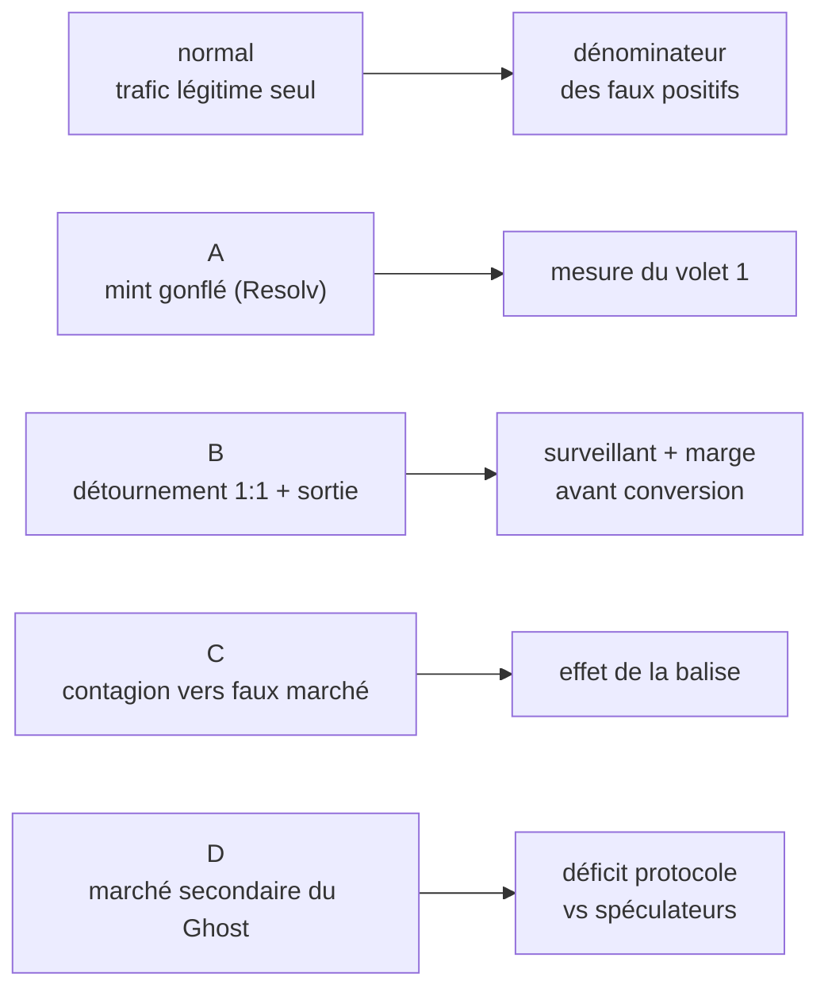

<Info>
**Ce que tu vas comprendre ici**
- Le **générateur** synthétique (`data/generate.py`) et le format **JSONL**.
- Les scénarios : `normal`, `A`, `B`, puis `C` / `D` (`data/scenarios_cd.py`), le **registre Ghost**
  simulé (`data/ghost_ledger.py`), la **calibration** (`data/calibrate.py`), le marquage tardif
  (`data/late_marking.py`), le support de décision (`data/DECISION_SUPPORT_3.md`).
- La **reproductibilité par graine (seed)**.
- Les commandes `make data` / `make calibrate` et les vraies options CLI.
- Une **ligne JSONL** d'exemple, déduite du code.

Temps de lecture : environ 12 minutes. Pour voir dans quels modèles sont faites ces lignes, lis
[Le langage commun](/modules/shared).
</Info>

Le module `data` fabrique des **données de test fictives** qui rejouent des attaques, pour tout
démontrer **sans risque**. **Propriétaire : @EnzoFB06.**

<Warning>
**Toutes les données de ce dossier sont FICTIVES.** Aucune vraie donnée on-chain, aucune vraie
adresse, aucune vraie clé. Faux secrets autorisés du type `FLAG{team20-canary}`.
Source : `data/README.md`.
</Warning>

<Tip>
**Analogie** : c'est un **plateau de cinéma**. Les billets, les figurants et le cambriolage sont
faux, mais la scène est jouée **exactement** comme la vraie, pour que l'équipe de sécurité
s'entraîne. Même décor rejoué à l'identique = même **graine** (seed).
</Tip>

## Le format JSONL

- **JSONL** = un fichier texte où **une ligne = un objet JSON**. Ici, une ligne = **un modèle de
  `shared.models`** (`MintRequest`, `MintEvent`, `TransferEvent` ; pour C et D aussi les trois
  `GhostToken…Event` et `RiskBeaconUpdate`), validé en **Pydantic strict**.
- Chaque fichier `<nom>.jsonl` est accompagné d'un **manifeste** `<nom>.manifest.json` : graine,
  paramètres, comptes, et la **vérité terrain** de l'attaque (adresses, `request_id`, tx,
  `started_at` = `t0`).
- Relecture : `data.generate.load_jsonl(path)` ou `pandas.read_json(path, lines=True)`.
- Sortie par défaut : `data/generated/` (**à ne pas committer** tant que l'équipe n'a pas tranché).

### Une ligne JSONL, déduite du code

Le générateur écrit chaque ligne avec `event.model_dump_json()`. La **première** ligne d'un jeu est
en général une `MintRequest` (créée avant son `MintEvent`). Voici à quoi elle ressemble, déduite des
champs du modèle et des constantes du code (`DEPOSIT_TOKEN = "0x" + "d0"*20`,
`chain_id = 43113`, token à 6 décimales, `signature` = `0x` + 130 hex) — **valeurs fictives** :

```json
{"request_id":0,"requester":"0x3a9f1c2b4d5e6f708192a3b4c5d6e7f809101112","deposit_token":"0xd0d0d0d0d0d0d0d0d0d0d0d0d0d0d0d0d0d0d0d0","deposit_amount":1000000000,"created_at":"2026-10-10T00:03:12+00:00","chain_id":43113,"signature":"0x4b1d...e7a9","created_at_tz":"UTC"}
```

<Note>
C'est une **illustration** du schéma, pas une ligne copiée d'un fichier généré : les valeurs
aléatoires dépendent de la graine et de l'ordre des événements. Le dépôt moyen fictif est ~1 000
jetons (soit `1000 × 10**6` base units). Pour obtenir la vraie ligne, lance la génération (ci-dessous)
et ouvre la première ligne du `.jsonl`. Source : `data/generate.py` (`MintRequest`,
`write_scenario`).
</Note>

## Les scénarios produits



| Jeu | Contenu | Sert à |
|-----|---------|--------|
| `normal` | trafic légitime seul : mints 1:1 vers le déposant (I1 + I3), transferts dispersés, saisonnalité par créneau de 5 min, croissance progressive | baseline médiane + MAD, **dénominateur** du taux de faux positifs |
| `A` | même fond ; deux demandes (dépôt total 200 000) ; mint ×400 sur le contrat **vulnérable**, 1:1 sur le **protégé** | volet 1 : montant mintable pour un même dépôt |
| `B` | détournement **à 1:1** (I3 non appliqué) : la demande d'une victime est mintée vers une adresse neuve, puis sortie rapide vers peu d'adresses + un point de sortie | surveillant hors chaîne, marge avant conversion |
| `C` / `D` | simulation **hors chaîne** sur le registre Ghost de référence (voir plus bas) | effet de la balise (C), déficit protocole vs spéculateurs (D) |

<Info>
Dans le scénario B, le bilan global reste à 1:1 (I1 tient), donc le surveillant de **mint** ne lève
que s'il vérifie I3 (destinataire ≠ déposant) ; la sortie est rattrapée par le surveillant de
**transferts** (volume élevé ET dispersion effondrée, §9). Personnages du guide : **Mallory** la
voleuse, **Alice** la victime, le **point de sortie** fictif. Source : `data/README.md`,
`data/generate.py`.
</Info>

## Le registre Ghost simulé (`data/ghost_ledger.py`)

Un modèle de référence **hors chaîne** du Token Ghost, en Python, qui reproduit les mécanismes
actés dans `docs/OPEN_ANSWERS.md`. **Ce n'est pas le contrat** (#7, #8) : la vérité reste on-chain.
Il sert à générer C/D et à servir de point de comparaison aux futurs tests du contrat.

- §0bis : tout transfert produit du Ghost chez le destinataire.
- §0bis-b : la fenêtre est **portée par la valeur** — le solde Ghost est rangé en **tranches
  d'échéance** ; les plus anciennes partent en premier et gardent leur échéance.
- §9 : un **ratio de contamination par adresse** ; la destruction retire `ratio × solde Ghost non
  converti`.
- §3 : pendant un retard, le Ghost circule mais ne se convertit pas.

<Warning>
Simplifications assumées (à signaler pour #8) : soupçon en `float` (le contrat utilisera du point
fixe), vrai token considéré propre, **pas** de marge de conversion, `window = 0` désactive le Ghost
(monde « Resolv tel quel », baseline des mesures). Source : `data/ghost_ledger.py`.
</Warning>

## La calibration (`data/calibrate.py`)

`python -m data.calibrate` rejoue **8 jours** de trafic dans les surveillants de `detection/` et
**mesure** (il ne choisit pas) : la friction de la fenêtre Ghost W, les seuils de déclenchement
(faux positifs + marge avant conversion), et le comportement du surveillant de mint sur `normal`,
`A` et `B`. Résultats écrits dans `data/generated/calibration.{json,md}`.

<Info>
Le script **mesure**, le **choix du point de fonctionnement est une décision d'équipe** (§5 Q2).
Tous les résultats sont des **mesures sur simulation**, avec une seule graine (42) pour l'instant,
et des paramètres de génération eux-mêmes à calibrer (`docs/CLAIMS.md`). Source : `data/calibrate.py`.
</Info>

Deux enseignements des mesures (graine 42, à valider) :

- **Le profil du trafic légitime pèse plus que les seuils** : avec de gros transferts, une attaque
  de 2 % de l'offre passe inaperçue quel que soit le seuil.
- **La marge est bornée par la tranche** (5 min) : au mieux ~5 min de marge avec W = 10 min.

## Le marquage tardif (`data/late_marking.py`)

`python -m data.late_marking` chiffre la question de **#85** (décision §10bis) sur la « chaîne des
40 » : le voleur revend son M' pur **avant** d'être marqué suspect, donc son ratio valait 0 pendant
les ventes. Il compare trois pistes de récupération :

| Piste | M' récupéré (détection à 3 min, W = 10 min) |
|-------|---------------------------------------------|
| (a) lignage d'origine par tranche | 100 % |
| (b) recalcul rétroactif hors chaîne | 100 % (même couverture que (a)) |
| (c) prospectif seul (ratio tel quel) | 0 % |

<Note>
Le levier n'est pas la piste mais **la vitesse de détection face à l'échéance**. Conclusion pour
l'équipe (à valider) : (c) seule ne suffit pas ; il faut (a) ou (b), et détecter avant l'échéance.
Le choix (a) vs (b) est opérationnel, pas quantitatif. Source : `data/late_marking.py`,
`data/README.md`.
</Note>

## Le support de décision (`data/DECISION_SUPPORT_3.md`)

Ce document **ne tranche rien** : il rassemble les valeurs mesurées par `make calibrate` et propose
un point de fonctionnement **argumenté**, que l'équipe valide ou ajuste.

| Valeur à acter | Proposition | Statut |
|----------------|-------------|--------|
| Fenêtre Ghost W normale | 10 min | à valider |
| Tranche d'agrégation de détection | 5 min (déjà le défaut) | à valider |
| Seuil `z volume` | 6 | à valider, dépend du profil |
| Seuil `z Herfindahl` | 3 | à valider |
| Lignage pour la récupération (#85) | (a) ou (b) | décision §10bis |

<Warning>
Ce sont des **propositions sur mesures de simulation**, pas des décisions. La décision finale est
reportée dans `docs/OPEN_ANSWERS.md` §3 par le propriétaire de `docs/`. Source :
`data/DECISION_SUPPORT_3.md`.
</Warning>

## Reproductibilité par graine (seed)

<Tip>
**Analogie** : la **graine**, c'est le numéro de la partie d'un jeu vidéo. Même numéro = même
monde, à l'identique, chez tout le monde. Changer le numéro change le monde, mais de façon
**reproductible**.
</Tip>

Tout le hasard passe par `random.Random(seed)`. Avec la même graine, les mêmes paramètres et le
même code, on obtient **exactement** le même JSONL — indispensable pour comparer deux mesures.

## Lancer : `make` et les vraies options CLI

<Tabs>
  <Tab title="Avec make">
    ```bash
    make data        # génère tous les jeux (SEED=42 par défaut)
    make calibrate   # mesure les valeurs de #3
    make data SEED=20
    ```
  </Tab>
  <Tab title="Directement (python -m)">
    ```bash
    python -m data.generate --scenario B --seed 42
    python -m data.calibrate --seed 42 --days 8
    python -m data.late_marking
    ```
  </Tab>
</Tabs>

Les options **réelles** de `data/generate.py` (lues dans son `argparse`) :

| Option | Valeurs / défaut | Rôle |
|--------|------------------|------|
| `--scenario` | `normal` / `A` / `B` / `C` / `D` / `all` (défaut `all`) | quel jeu produire |
| `--seed` | entier (défaut `42`) | la graine de reproductibilité |
| `--hours` | flottant (défaut `24.0`) | durée simulée |
| `--users` | entier (défaut `200`) | taille de la population légitime |
| `--out-dir` | chemin (défaut `data/generated`) | dossier de sortie |

<Note>
Pour `data/calibrate.py`, les options sont `--seed`, `--days` (défaut `8`) et `--out-dir`. Les
paramètres fins (nombre de mints/transferts par créneau, saisonnalité, fenêtre Ghost…) vivent dans
les `@dataclass` `GenerationParams` / `CalibrationConfig` et sont des **paramètres de génération à
calibrer**, pas des mesures. Source : `data/generate.py`, `data/calibrate.py`, `data/README.md`.
</Note>

<Warning>
Les fichiers générés sortent **hors du dépôt** (`data/generated/` est destiné à rester local tant
que l'équipe n'a pas tranché « graine seule vs JSONL committés »). La mémoire machine est serrée :
pas de suite de tests complète ni de génération lourde pour simplement regarder une ligne — déduis
le schéma du code, comme ci-dessus.
</Warning>

<Check>
**À retenir**
- Une ligne JSONL = **un modèle `shared.models`** validé en Pydantic strict ; chaque jeu a un
  **manifeste** avec la vérité terrain.
- Scénarios : `normal` (dénominateur FP), `A` (volet 1), `B` (détournement 1:1 + sortie), `C`/`D`
  (simulation Ghost hors chaîne).
- `calibrate` et `late_marking` **mesurent** ; le choix reste une **décision d'équipe**
  (`DECISION_SUPPORT_3.md`).
- Même **graine** = mêmes données, partout.
- Lancer : `make data` / `make calibrate`, ou `python -m data.generate --scenario … --seed …`.
</Check>

<CardGroup cols={2}>
  <Card title="Le langage commun" icon="cubes" href="/modules/shared">
    Les modèles dont ces lignes JSONL sont faites.
  </Card>
  <Card title="Les contrats" icon="file-contract" href="/modules/contracts">
    Les contrats que ces scénarios attaquent.
  </Card>
  <Card title="Le parcours d'une attaque" icon="route" href="/le-parcours-dune-attaque">
    Les scénarios A/B/C/D racontés pas à pas.
  </Card>
  <Card title="Lire et écrire un test" icon="vial" href="/pratique/tests-expliques">
    pytest + Foundry expliqués.
  </Card>
</CardGroup>
