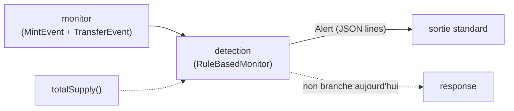
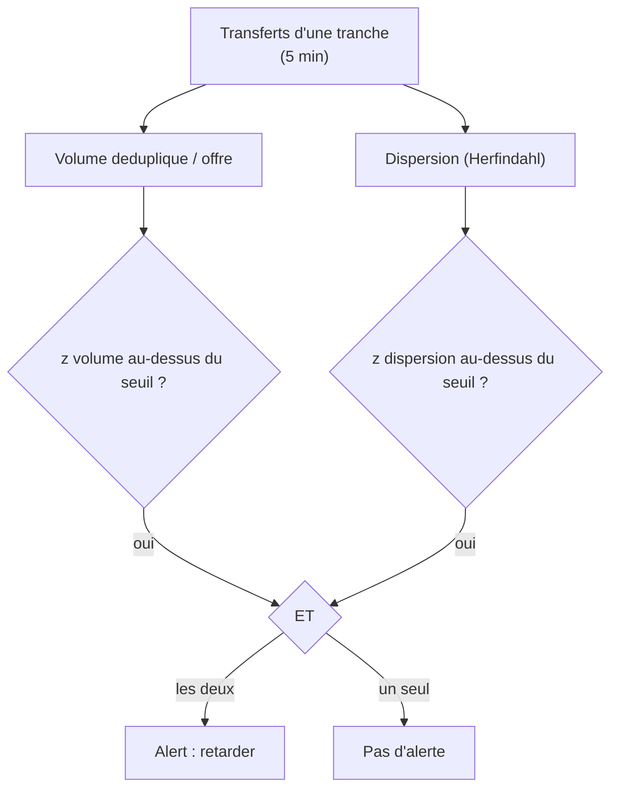

<Info>
**Ce que tu vas comprendre ici**
- Le rôle de `detection` : un ou plusieurs **surveillants** qui lèvent une `Alert`, jamais plus.
- Les règles sur le **mint** : les invariants I1 à I6, chacun avec un exemple **Mallory**.
- Les règles sur les **transferts** : « volume élevé ET dispersion effondrée », et pourquoi.
- La **déduplication des relais** (#87), les **graines**, les paramètres et leur statut.
- La **prédiction conforme** : ce que le code fait vraiment, et la **tension** avec la décision §0.

Temps de lecture : environ 18 minutes. Avant, lis [Le module monitor](/modules/monitor) (d'où
viennent les événements) et [Le langage commun](/modules/shared) (le modèle `Alert`).
</Info>

Le module `detection/` est le **poste de sécurité** : il regarde les événements que `monitor`
pousse et décide s'il faut **lever un soupçon**. Un soupçon, c'est une `Alert`. Et une `Alert` ne
veut jamais dire « détruis » ou « gèle tout » — au mieux « **retarde** ce périmètre, qu'un humain
regarde ».

<Tip>
**Analogie** : `detection`, c'est l'**agent derrière les écrans** d'une banque. Il ne plaque
personne au sol — il **sonne une cloche** et appelle le responsable. La décision d'arrêter
quelqu'un revient à un humain (le [module response](/modules/response) et le multisig). L'IA, elle,
n'est qu'**un agent parmi d'autres** : jamais le décideur (proposé, à valider — `docs/TEAM.md`,
`docs/OPEN_ANSWERS.md` §1).
</Tip>

## Où il se situe dans la chaîne



<Note>
Aujourd'hui `python -m detection` écrit chaque `Alert` en **JSON, une ligne par alerte**, sur la
sortie standard. Il n'y a **aucune** intégration directe avec `response/` : le branchement reste à
faire. Source : `detection/pipeline.py`, `detection/README.md`.
</Note>

## Les deux surveillants (plus un, optionnel)

| Surveillant | Entrée | Déclencheur | Statut |
|-------------|--------|-------------|--------|
| **Règles sur le mint** (`check_mint`) | `MintEvent` + `MintContext` | invariant violé (I1/I3/I5/I6), admin non annoncé, écart d'oracle | règle |
| **Règles sur les transferts** (`check_transfer`) | `TransferEvent` | **volume élevé ET dispersion effondrée** | règle |
| **ML + conforme** (`ConformalSlotMonitor`) | mesures d'une tranche | p-valeur `inférieur à` alpha | **non branché**, piste de recherche |

## Le surveillant de mint : vérifier des invariants, pas chasser les gros montants

La **décision actée** (§1, « validée en session, à relire par l'équipe ») est contre-intuitive :
**aucun seuil sur la taille d'un mint**.

<Tip>
**Analogie** : un distributeur de billets honnête ne refuse pas un retrait **parce qu'il est gros**
— une baleine qui dépose 80M et reçoit 80M est **légitime**. Ce qu'on surveille, ce n'est pas le
montant, c'est que **les règles du coffre tiennent toujours** : le bon taux, le bon destinataire,
les comptes qui tombent juste. Un gros mint cohérent avec son dépôt ne rapporte **rien** à un
voleur.
</Tip>

Référence réelle qui motive tout ça : l'incident **Resolv** (22 mars 2026), ~200 000 USDC déposés
mais **80M** mintés (ratio ~400×) avec une clé de service compromise, signatures toutes valides.
C'est exactement ce que l'invariant I1 rend impossible. Source :
`docs/OPEN_ANSWERS.md` §1.

### Les invariants I1 à I6, avec Mallory

Voici la table **telle que définie** dans `docs/OPEN_ANSWERS.md` §1. Attention : certains sont
appliqués par le **contrat** (volet 1), d'autres recalculés **hors chaîne** par ce surveillant.

| # | Invariant | Qui l'applique | Dans ce module ? |
|---|-----------|----------------|------------------|
| I1 | `minté = dépôt × taux`, à ε près | contrat + surveillant (alarme) | **oui** (`_check_i1`) |
| I2 | la demande existe, en attente, traitée une seule fois | contrat | non (on-chain) |
| I3 | le destinataire du mint est le déposant | contrat + surveillant | **oui** (`_check_i3`) |
| I4 | une seule fonction/un seul rôle peut minter | contrat | non (on-chain) |
| I5 | `Δ totalSupply = Σ Mint − Σ Burn` | surveillant | **oui** (`_check_i5`) |
| I6 | `totalSupply ≤ collatéral × facteur` | surveillant | **oui** (`_check_i6`) |

<AccordionGroup>
  <Accordion title="I1 — minté = dépôt × taux (le cas Resolv)" icon="scale-balanced">
    **Mallory** vole une clé de service et traite une demande en déposant 200 000 fictifs mais en
    se faisant créditer 80M. Le contrat dérive normalement le montant du dépôt ; si ce n'est plus
    le cas (clé compromise), le surveillant **recalcule** `dépôt × taux` hors chaîne et voit l'écart
    (au-delà de ε des frais). `suspect_amount` = l'excès (`minté − attendu`).
  </Accordion>
  <Accordion title="I3 — destinataire = déposant (le vol à 1:1)" icon="user-xmark">
    **Mallory** traite la demande d'**Alice** (victime) mais fait minter les jetons **chez elle**.
    Le bilan global reste à 1:1 (I1, I5, I6 passent !), mais l'argent a changé de poche. Seul I3
    le voit : destinataire `≠` déposant. Tout le mint est marqué suspect (`ratio = 1.0`). C'est le
    scénario B. Source : `detection/detector.py` (`_check_i3`), issue #91.
  </Accordion>
  <Accordion title="I5 — Δ offre = Σ mints − Σ burns (chemin parallèle)" icon="calculator">
    **Mallory** trouve une **deuxième porte** pour minter (un chemin non prévu). Chaque mint
    semble correct, mais à la fin l'offre totale a augmenté **plus** que la somme des mints
    observés moins les burns. L'identité comptable ne tombe plus juste : alerte (dérive non
    attribuable à une adresse, donc **sans graine**).
  </Accordion>
  <Accordion title="I6 — offre ≤ collatéral × facteur (solvabilité)" icon="vault">
    **Mallory** manipule l'oracle de collatéral pour gonfler la valeur affichée, ou l'offre dépasse
    ce que le collatéral couvre. Si `totalSupply` passe au-dessus de `collatéral × facteur`
    (défaut `1`, soit 1:1), alerte : le jeton n'est plus entièrement couvert.
  </Accordion>
  <Accordion title="Écart d'oracle — bon ratio, mauvais prix" icon="tower-broadcast">
    **Mallory** manipule le taux (ex. flash loan) : I1 **tient** (minté = dépôt × *mauvais* taux),
    mais le taux appliqué s'écarte de plus de δ d'un **taux de référence** indépendant. Le
    surveillant le signale (gravité WARNING).
  </Accordion>
  <Accordion title="Événement admin non annoncé" icon="user-gear">
    Un `Upgraded` ou `RoleGranted` (changement de contrat/rôle) **non annoncé au préalable** lève
    une alerte WARNING : le contrat n'est peut-être plus celui qu'on croit. Un changement annoncé
    (déclaré au surveillant avant d'être vu) ne lève rien.
  </Accordion>
</AccordionGroup>

<Warning>
Les entrées hors `MintEvent` (dépôt, taux, offre, collatéral, admin, déposant) arrivent via
`MintContext` (`detection/inputs.py`). C'est un **GAP** : `MintEvent` ne porte ni dépôt ni taux
(aucun modèle partagé). Une vérification dont les entrées manquent est **sautée** (ce n'est pas une
anomalie), et **sans aucun contexte, aucune règle de mint n'est vérifiée** (un WARNING le signale
une fois). Le dépôt n'est **pas** retrouvé via `request_id` (qui vaut `None` depuis #79). Source :
`detection/inputs.py`, `docs/OPEN_ANSWERS.md` §79.
</Warning>

### I3 en code, ligne à ligne

```python
# detection/detector.py — _check_i3
if context.requester is None:
    return None
if event.recipient.lower() == context.requester.lower():
    return None
return _Finding(
    severity=self.params.invariant_severity,
    reason=(f"I3 viole : mint de {event.amount} vers {event.recipient}, "
            f"deposant de la demande {context.requester} (detournement ?)"),
    recipient_suspect_amount=event.amount,
)
```

- **ligne 1-2** : sans déposant connu, on **saute** la vérification (pas une anomalie).
- **ligne 3-4** : si destinataire = déposant, tout va bien, rien à signaler.
- **ligne 5-10** : sinon, on fabrique un « constat » : gravité critique, raison lisible, et **tout
  le montant** marqué suspect — le vol à 1:1 est entièrement attribué au destinataire.

## Le surveillant de transferts : volume ET dispersion

La **décision actée** (§9) : on normalise le volume par l'offre, on compare à une **baseline
médiane + MAD** du même créneau horaire, et on n'alerte **jamais sur le volume seul** — il faut
**volume élevé ET dispersion effondrée**.

<Tip>
**Analogie** : un péage d'autoroute un soir de match voit **beaucoup** de voitures — c'est un gros
volume, mais **réparti** sur des centaines de conducteurs : normal. Un braquage, c'est **beaucoup
d'argent qui converge vers très peu de mains**. On ne sonne pas quand il y a du monde ; on sonne
quand le monde se **concentre** anormalement.
</Tip>



<Steps>
  <Step title="Agréger par tranche de 5 minutes">
    Les transferts sont regroupés en tranches de `slot_seconds` (300 s, **provisoire**). L'alerte
    part à la **clôture** de la tranche : au premier transfert de la tranche suivante, ou via
    `close_slot_if_due(now)` sur un minuteur — pour rester plus rapide que la fenêtre Ghost de
    10 min.
  </Step>
  <Step title="Dédupliquer les relais (#87)">
    Le volume d'une tranche = somme des **soldes entrants nets** (reçu − envoyé). Un montant qui
    rebondit **A → B → C** dans la tranche ne compte **qu'une fois** : B, simple relais, a un solde
    net nul et disparaît.
  </Step>
  <Step title="Mesurer la concentration (Herfindahl)">
    Le HHI = somme des parts au carré des soldes entrants nets. Haut = tout converge au même
    endroit. Dans l'`Alert`, `dispersion_score` = **1/HHI** (« nombre effectif de destinataires »,
    bas = concentré).
  </Step>
  <Step title="Comparer à la baseline du même créneau">
    Un z robuste `(x − médiane) / échelle` est calculé pour le volume ET pour le HHI, contre les
    tranches passées du même créneau horaire (médiane + MAD). Alerte **si les deux** dépassent leur
    seuil.
  </Step>
  <Step title="Poser des graines">
    L'`Alert` liste des **graines** (`seeds`) : où se trouvent, à la clôture, les fonds envoyés par
    des adresses neuves. Les relais neufs tombent à 0 ; le soupçon arrive sur les bridges. La somme
    est conservée.
  </Step>
</Steps>

### Déduplication des relais, chiffré avec Mallory

<Tip>
**Analogie** : **Mallory** vole 50M et les fait passer par **3 comptes-écrans neufs**, qui
re-dispatchent vers **4 bridges** de sortie. En « brut », on compterait 100M (50M entrés + 50M
re-sortis). Mais c'est **le même argent** : le volume réel est **50M**. Les 3 comptes-écrans ne
gardent rien (solde net nul) ; les 4 bridges, eux, reçoivent la totalité.
</Tip>

Testé noir sur blanc (`detection/tests/test_relay_dedup.py`) : l'attaque de référence a
`gross_volume = 100M` mais `volume = 50M`, et le HHI vaut `0.25` (= 4 destinataires effectifs, les
bridges). Les relais ne figurent **pas** dans les soldes nets.

<AccordionGroup>
  <Accordion title="Pour les curieux : pourquoi pas « le nombre de destinataires » ?" icon="users-slash">
    Parce qu'il bouge à peine sous attaque. Mesuré : 50M vers 3 adresses neuves puis 4 bridges fait
    passer les destinataires distincts de 150 à **157** seulement — alors que le HHI **explose**.
    `distinct_recipients` est donc exposé pour le dashboard mais **jamais** utilisé seul comme
    indicateur. Source : `detection/transfers.py`, `detection/tests/test_transfer_rules.py`.
  </Accordion>
  <Accordion title="Les signaux « par transfert » (fan-out, découpage…)" icon="diagram-project">
    Gros montant vers adresse neuve, découpage, sortie rapide, éventail (fan-out) : ils sont
    **déjà captés** par le HHI (concentration). Ils sont seulement **exposés** en descriptif
    (`new_sender_share`, `exit_share`, `max_fan_out`) et ne déclenchent **rien** seuls.
  </Accordion>
  <Accordion title="Limites assumées de la déduplication" icon="triangle-exclamation">
    Elle est indifférente à l'ordre des transferts dans la tranche ; un aller-retour A → B → A
    compte **0** ; deux flux indépendants qui se croisent sur une même adresse se compensent. Le
    volume brut reste exposé (`gross_volume`). Source : `detection/transfers.py`,
    `docs/OPEN_QUESTIONS.md` §2.
  </Accordion>
</AccordionGroup>

## Paramètres et leur statut

Un **seul** fichier : `detection/params.py`. **Aucune valeur n'est une mesure.**

| Paramètre | Rôle | Défaut | Statut |
|-----------|------|--------|--------|
| `i1_epsilon` | tolérance de frais sur I1 | `1/1000` (0,1 %) | provisoire, à mesurer |
| `oracle_delta` | écart toléré vs taux de référence | `1/100` (1 %) | provisoire, à mesurer |
| `i6_collateral_factor` | facteur de I6 | `1` (1:1) | provisoire |
| `i5_supply_tolerance` | écart toléré sur I5 | `0` | provisoire |
| `slot_seconds` | longueur d'une tranche | `300` (5 min) | provisoire |
| `baseline_window_slots` | tranches gardées en baseline | `7` | provisoire, à mesurer |
| `min_history_slots` | historique minimal avant d'alerter | `5` | provisoire, à mesurer |
| `volume_z_threshold` / `hhi_z_threshold` | seuils de z | `3.0` / `3.0` | provisoire, à mesurer |

<Note>
**Profils de chauffe** : `default` (ci-dessus — exige 5 jours d'historique du même créneau,
inutilisable sur 24 h de données synthétiques) et `demo` — **DEMO, ne pas utiliser en production,
provisoire** : chaque tranche comparée aux 24 précédentes, alerte possible après 12 tranches (1 h).
Sélection : `--profile`, sinon `DETECTION_PROFILE`, sinon `default`. Source : `detection/params.py`.
</Note>

## La prédiction conforme : ce que le code fait, et la tension

C'est le point le plus délicat de la page, et le guide demande de **ne pas le trancher** — juste de
décrire et de signaler.

<Warning>
**Tension à signaler, non résolue.** La **décision §0** dit : « Prédiction conforme **écartée pour
48 h** » au profit de seuils simples mesurés (« règle aucun chiffre sans mesure »). **ET pourtant**,
un module de prédiction conforme **existe bel et bien dans le code** : `detection/conformal.py`
(`ConformalSlotMonitor`) + `detection/conformal_eval.py`. Les deux faits coexistent — je ne les
réconcilie pas, je les expose. Sources : `docs/OPEN_ANSWERS.md` §0, `detection/conformal.py`.
</Warning>

Ce que le **code** fait réellement (pas ce que la décision dit) :

<Tip>
**Analogie** : la prédiction conforme, c'est comme un **détecteur de fumée réglé sur un taux de
fausses alertes**. On lui montre d'abord **beaucoup de journées normales** pour qu'il apprenne « à
quoi ressemble la normalité ». Ensuite, pour chaque nouvelle tranche, il dit « cette situation est
plus rare que X % des situations normales que j'ai vues » : si c'est plus rare qu'un seuil `alpha`,
il **lève un drapeau**.
</Tip>

<Steps>
  <Step title="Décrire chaque tranche">
    Un petit vecteur de **ratios** (`volume_ratio`, `herfindahl`, part neuve, part sortie,
    log du fan-out) — jamais de montant absolu.
  </Step>
  <Step title="Apprendre la normalité">
    Un `IsolationForest` (scikit-learn) est entraîné sur une **moitié** du trafic normal.
  </Step>
  <Step title="Calibrer sur l'autre moitié">
    On garde les scores de l'autre moitié (disjointe). La p-valeur d'une nouvelle tranche est
    `p = (1 + #{scores calib ≥ s}) / (n + 1)`.
  </Step>
  <Step title="Lever un drapeau si p ≤ alpha">
    Et **c'est tout** : le module renvoie un `ConformalVerdict`, **jamais une `Alert`**. Il ne
    déclenche **aucune** action.
  </Step>
</Steps>

<Note>
**Garantie et ses limites, telles quelles.** Si le trafic testé est **échangeable** avec la
calibration, le taux de fausses alertes par tranche est `≤ alpha`, quel que soit le modèle. Mais
cette garantie **tombe** dès que le trafic change (croissance, usage nouveau), elle est
**marginale** (pas une borne par journée), et ne dit **rien** sur la détection des attaques. Ce
n'est **pas** une preuve de sécurité (`docs/CLAIMS.md`).
</Note>

**Mesure** (seed 42, simulation, **à relire** — `docs/OPEN_QUESTIONS.md` §13) : le taux de fausses
alertes mesuré est proche d'alpha (0,7–1,0 % à α = 1 %, 3,8–4,5 % à α = 5 %), **mais pas meilleur
que les règles** (un scénario B à 0,5 % reste non détecté). Lancer la mesure : `python -m
detection.conformal_eval` (~1 min). Elle **mesure**, elle ne décide rien.

## Le lancer seul

<Tabs>
  <Tab title="Windows">
    ```text
    py -m detection
    py -m detection --replay C:\tmp\sh-data\scenario_b.jsonl --profile demo
    ```
  </Tab>
  <Tab title="macOS / Linux">
    ```text
    python -m detection
    python -m detection --replay /tmp/sh-data/scenario_b.jsonl --profile demo
    ```
  </Tab>
</Tabs>

Options **réelles** (`detection/pipeline.py`, `build_parser`) : `--replay FICHIER.jsonl` (rejoue un
JSONL de `data/generate.py` au lieu d'écouter Fuji), `--profile {default,demo}`, `--exit-point
ADRESSE` (répétable), `--initial-supply BASE_UNITS` (replay, défaut 0), `--log-level`. En LIVE sans
RPC ni token, un message est logué et la sortie est **propre** (code 0).

<Warning>
Les fichiers JSONL d'exemple se génèrent **hors du dépôt** (ex. `/tmp/sh-data`). Ne génère rien
dans `docs-site/` ni dans le code. En replay, l'offre est **surestimée** (les soldes
pré-existants du générateur n'ont pas d'événement), donc le ratio volume/offre du replay est
biaisé — **provisoire**, à valider.
</Warning>

## Ce que testent ses tests

<AccordionGroup>
  <Accordion title="test_mint_rules.py — les invariants" icon="vial">
    - `test_legit_big_mint_no_alert` : un mint énorme mais cohérent **ne** déclenche **rien**.
    - `test_mint_within_fee_epsilon_no_alert` : 0,05 % de frais `inférieur à` ε, pas d'alerte.
    - `test_resolv_like_mint_alerts_on_i1` : le cas Resolv (ratio ~400×) déclenche I1, critique.
    - `test_supply_drift_alerts_on_i5` : une dérive d'offre déclenche I5, **sans graine**.
    - `test_i5_accounts_for_burns` : I5 tient compte des burns.
    - `test_collateral_breach_alerts_on_i6` : offre `supérieure à` collatéral → I6.
    - `test_unannounced_admin_event_alerts` / `test_announced_admin_event_no_alert` : admin non
      annoncé alerte, annoncé non.
    - `test_oracle_deviation_alerts_with_seed` : taux manipulé (I1 tient) → écart d'oracle.
    - `test_i3_diverted_one_to_one_mint_alerts` : le vol à 1:1 (scénario B) n'est vu **que** par I3.
    - `test_no_context_no_alert` / `test_i3_skipped_without_requester` : sans contexte/déposant,
      vérification sautée.
  </Accordion>
  <Accordion title="test_transfer_rules.py — volume ET dispersion" icon="vial">
    - `test_normal_user_bridging_5000_no_alert` : un transfert normal vers un bridge n'alerte pas.
    - `test_attack_50m_three_new_addresses_four_bridges_alerts_with_seeds` : l'attaque de référence
      alerte, graines = les 4 bridges, somme = 50M, avant la fin de la fenêtre Ghost.
    - `test_attack_alert_also_raised_by_next_slot_transfer` : l'alerte peut aussi partir au premier
      transfert de la tranche suivante.
    - `test_legit_broad_growth_no_alert` : volume ×4 mais **bien dispersé** → pas d'alerte (z
      volume haut, z dispersion bas).
    - `test_insufficient_history_no_alert` : sous `min_history_slots`, jamais d'alerte.
    - `test_no_circulating_supply_no_alert` : sans offre, tranche sautée.
  </Accordion>
  <Accordion title="test_relay_dedup.py — rebonds comptés une fois (#87)" icon="vial">
    - `test_reference_attack_counts_once` : brut 100M, volume 50M, HHI 0,25, relais exclus.
    - `test_chain_a_b_c_counts_once` : A → B → C compte 100, HHI = 1.
    - `test_partial_relay_keeps_its_remainder` : un relais qui garde une part la conserve.
    - `test_round_trip_counts_zero_documented_limit` : A → B → A compte 0 (limite assumée).
    - `test_address_case_does_not_break_dedup` : la casse d'adresse ne casse pas la dédup.
  </Accordion>
  <Accordion title="test_pipeline.py — branchement monitor → detection (#86)" icon="vial">
    - `test_profile_resolution_cli_then_env_then_default` : priorité `--profile` puis env puis
      défaut.
    - `test_replay_normal_no_alert_attack_alert_with_seeds` : replay normal muet, replay attaque
      → 1 alerte avec graines (JSON ASCII).
    - `test_replay_supply_from_mints_evaluated_before_counting_next_mint` : l'offre d'une tranche
      est celle de son époque.
    - `test_live_wiring_feeds_monitor_from_fake_streams` : l'ordre des appels LIVE est correct.
    - `test_live_closes_slot_on_clock_without_new_transfer` : l'horloge clôture une tranche sans
      transfert.
    - `test_skipped_slot_warns_when_supply_unknown` / `..._history_insufficient` /
      `test_mint_without_context_warns_once` : les tranches/mints sautés émettent un WARNING
      explicite (une fois pour le contexte de mint).
  </Accordion>
  <Accordion title="test_conformal.py — ML + conforme" icon="vial">
    - `test_features_follow_documented_order` : l'ordre des caractéristiques est respecté.
    - `test_empirical_false_positive_rate_close_to_alpha` : le taux de fausses alertes est `≤ alpha`
      (+ marge).
    - `test_obvious_attack_slot_is_flagged` : une tranche manifestement anormale est signalée.
    - `test_p_value_formula` : la formule de p-valeur est exacte.
    - `test_too_small_calibration_is_refused` : trop peu de calibration = refus.
    - `test_invalid_alpha` : alpha hors `]0,1[` refusé.
  </Accordion>
</AccordionGroup>

## Limites et questions ouvertes

<Warning>
Tout ce bloc est **ouvert / provisoire** (`docs/OPEN_QUESTIONS.md` §2 et §13, `docs/OPEN_ANSWERS.md`
§1 et §79). Rien ici n'est tranché par l'équipe.
</Warning>

- **GAP `shared/`** : `MintEvent` ne porte ni dépôt, ni taux, ni offre, ni collatéral ; `Alert`
  n'a pas de champ pour le HHI brut ni les destinataires distincts (d'où `1/HHI` dans
  `dispersion_score` et le détail dans `reason`). À remonter à @marceaupatu123.
- **Définition « adresse neuve »** : « aucune transaction avant la tranche dans nos données »
  (provisoire) ; un attaquant aux adresses **chauffées à l'avance** ne produit **aucune graine**
  (l'alerte part quand même, sans graine). Variante future : « moins de K transactions ».
- **Points de sortie** : liste **vide** par défaut, à fournir par le générateur de données
  (@EnzoFB06, #24).
- **« Offre en circulation »** : aucune définition actée ; on utilise l'offre **totale** (biais en
  replay).
- **Tous les seuils** (ε, δ, z, fenêtre, historique) : **à mesurer**.
- **Tension prédiction conforme §0 vs code** : écartée pour 48 h **mais** présente dans le code —
  **non résolue ici** (voir plus haut).

<Check>
**À retenir**
- `detection` lève une `Alert` = « **retarder** » ; il ne détruit ni ne gèle (c'est le multisig).
- Sur le **mint** : pas de seuil de taille, mais des **invariants** (I1/I3/I5/I6, admin, oracle).
- Sur les **transferts** : **volume élevé ET dispersion effondrée**, jamais le volume seul.
- Les **relais sont dédupliqués** (#87) : A → B → C compte une fois ; les **graines** suivent
  l'argent.
- La **prédiction conforme** existe dans le code mais est **écartée** par la décision §0 — tension
  signalée, non tranchée.
</Check>

<CardGroup cols={2}>
  <Card title="Le module response" icon="shield-halved" href="/modules/response">
    Ce qui transforme une alerte en réponse graduée (gel, multisig, audit).
  </Card>
  <Card title="Le module monitor" icon="satellite-dish" href="/modules/monitor">
    D'où viennent les `MintEvent` et `TransferEvent`.
  </Card>
  <Card title="Contamination par ratio" icon="droplet" href="/contamination-par-ratio">
    Comment le soupçon (ratio + montant) se propage ensuite.
  </Card>
  <Card title="Décisions actées vs ouvertes" icon="scale-balanced" href="/decisions">
    Le statut de §1, §9, §0 et des seuils.
  </Card>
</CardGroup>
