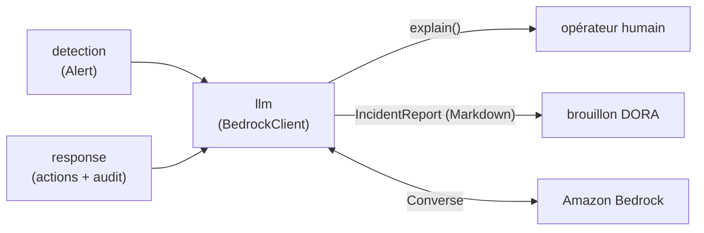
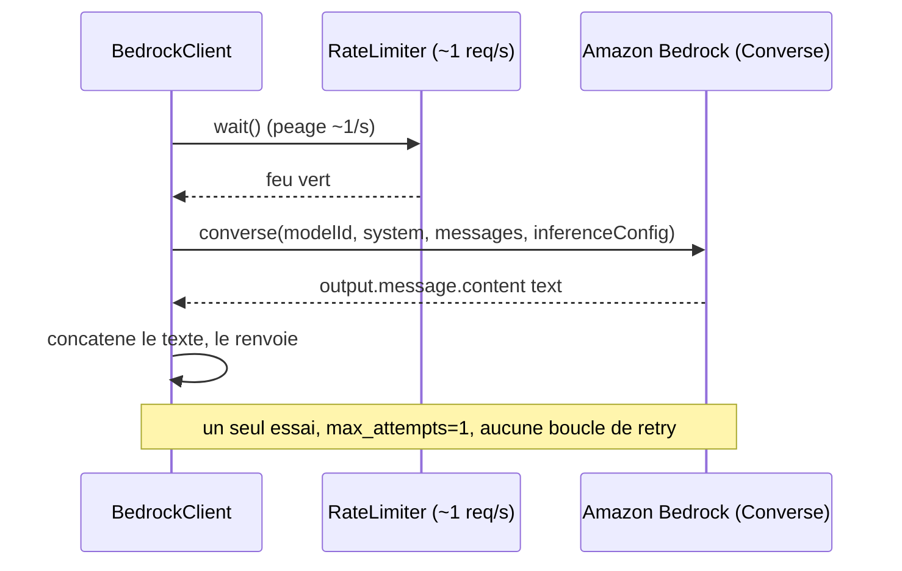

<Info>
**Ce que tu vas comprendre ici**
- Le rôle de `llm` : **expliquer** une alerte et **pré-rédiger** un rapport d'incident. Rien d'autre.
- Pourquoi l'IA **ne décide rien** et comment le code l'empêche structurellement.
- L'appel **Amazon Bedrock (API Converse)**, le **limiteur** (~1 req/s), un seul essai.
- Ce que le LLM **voit** (et ne voit pas), les prompts, le rapport **DORA**.
- Le **mode démo hors ligne** par défaut, et comment lancer le mode réel.

Temps de lecture : environ 12 minutes. Avant, lis [Le module response](/modules/response) (d'où
viennent actions et audit) et [Le langage commun](/modules/shared) (le modèle `Alert`, le limiteur).
</Info>

Le module `llm/` est le **rédacteur** du système. Quand une alerte tombe, il peut l'**expliquer**
en français à un opérateur, et pré-remplir un **rapport d'incident** structuré d'après DORA. Mais
il ne touche à **aucun levier** : il explique et rédige, point.

<Tip>
**Analogie** : `llm`, c'est le **secrétaire juridique** d'une banque. Il rédige des notes claires
(« voici ce qui a été observé, voici ce qu'il faut vérifier ») et un brouillon de déclaration
d'incident. Mais il ne **signe rien**, ne **gèle aucun compte**, ne **vide aucun coffre** : les
décisions restent au [module response](/modules/response) et au multisig humain.
</Tip>

## Où il se situe dans la chaîne



`llm` est en **bout de chaîne** : il consomme une `Alert` (et, si disponibles, les `ResponseAction`
et le journal d'audit) et produit **du texte**. Il ne renvoie **aucune** action vers `response`.

## La règle d'or : l'IA ne décide rien

C'est le point le plus important de la page. Le code le garantit à plusieurs niveaux :

<AccordionGroup>
  <Accordion title="Aucune méthode qui agit" icon="ban">
    `BedrockClient` n'expose que `complete(...)` et `explain(...)` ; `report.py` n'expose que
    `build_incident_report(...)`. **Aucune** ne retourne une `ResponseAction` ni ne touche
    l'orchestrateur. L'IA n'a littéralement **pas de bouton**.
  </Accordion>
  <Accordion title="Les prompts l'interdisent explicitement" icon="scroll">
    Les prompts système rappellent : « L'IA ne décide rien : tu expliques et tu rédiges » ; « la
    seule action côté surveillant/IA est un retard local auto-expirant ; la destruction exige un
    multisig 2/3 et la pause globale un multisig 3/3 » ; « ne recommande jamais une action comme si
    elle était déjà décidée ».
  </Accordion>
  <Accordion title="Le rapport porte la mention « IA ne décide pas »" icon="file-shield">
    Chaque rapport contient la ligne `AI_NO_DECISION_LINE` (« L'IA n'a pris aucune décision de
    destruction ni de pause globale ») et les parties rédigées par le LLM sont marquées
    « _(rédaction IA — à relire)_ ».
  </Accordion>
</AccordionGroup>

<Note>
Vocabulaire acté (§3) : « l'IA ne décide jamais seule d'un blocage » se lit « l'IA ne décide jamais
seule d'une **destruction** ni d'une **pause globale** ». Source : `llm/prompts.py`,
`docs/OPEN_ANSWERS.md` §3.
</Note>

## L'appel Amazon Bedrock (API Converse)



<Steps>
  <Step title="Passer le péage">
    Avant **chaque** appel, `RateLimiter.wait()` impose ~1 requête/seconde (le **péage** de
    [shared](/modules/shared)). Le LLM n'est appelé **que sur alerte**, jamais en boucle serrée.
  </Step>
  <Step title="Un seul appel Converse">
    `complete(user_text, system_prompt)` envoie **un** appel. Le modèle vient **uniquement** de
    `BEDROCK_MODEL_ID` (jamais codé en dur), la région de `AWS_REGION`.
  </Step>
  <Step title="Zéro nouvel essai">
    `botocore` est configuré avec `max_attempts=1` : **pas de « retry storm »**. Un échec est un
    échec.
  </Step>
  <Step title="Dégrader proprement">
    Une erreur AWS/botocore ou une réponse vide lève `LLMError`. Pour `explain()`, c'est rattrapé
    par un **texte de repli** déterministe ; pour le rapport, les champs narratifs deviennent
    « à compléter » mais les champs **factuels restent remplis**.
  </Step>
</Steps>

### Garde-fous, en code

```python
# llm/client.py — complete(...)
self._rate_limiter.wait()
try:
    client = self._get_client()
    response = client.converse(
        modelId=self._settings.bedrock_model_id,
        system=[{"text": system_prompt}],
        messages=[{"role": "user", "content": [{"text": user_text}]}],
        inferenceConfig={"maxTokens": ..., "temperature": self._temperature},
    )
except ClientError as exc:
    raise LLMError(f"Bedrock a refusé l'appel (...) ; pas de nouvel essai automatique.")
```

- **ligne 1** : le **péage** d'abord — toujours, avant tout appel réseau.
- **ligne 3-9** : un **unique** `converse`, température basse (0,2 par défaut = factuel), `maxTokens`
  **borné**.
- **ligne 10-11** : une erreur AWS devient une `LLMError` claire — **aucun** nouvel essai.

## Ce que le LLM voit (et ne voit pas)

Le LLM ne reçoit **que des faits déterministes** mis en forme par `format_alert_facts(alert)` :
`alert_id`, type, gravité, adresses, `contamination_ratio`, `suspect_amount` (en **base units**,
repris **tels quels**, aucune conversion flottante), motif, et les graines.

<Warning>
**Il ne voit pas** : les soldes réels, l'état on-chain, les clés, ou quoi que ce soit hors des
champs de l'`Alert` et de la chronologie fournie. Et il ne doit **inventer aucun chiffre** : les
prompts imposent « n'utilise que les faits et chiffres fournis ; si une information manque, écris
"non disponible" ». Source : `llm/prompts.py`.
</Warning>

## Le rapport d'incident DORA

`build_incident_report(...)` produit un `IncidentReport` en deux parties :

| Partie | Rempli par | Exemple |
|--------|-----------|---------|
| **Factuelle** (déterministe) | le code, copié des modèles | identifiant, détection, classification, périmètre, chronologie triée, qui a décidé quoi |
| **Narrative** | le LLM, **un seul appel** | description, cause probable, impact, mitigation |

<Note>
Si l'appel LLM échoue ou répond hors format JSON, les champs narratifs deviennent des **espaces
réservés** « À compléter par l'analyste » (`narrative_source = "placeholder"`) : **le rapport est
toujours produit**. Le texte du LLM est **neutralisé** (ses `#` de titre sont échappés) pour qu'il
ne puisse pas fabriquer de fausse rubrique. Source : `llm/report.py`.
</Note>

<Warning>
Le rapport est un **brouillon structuré d'après DORA**, **pas une déclaration conforme** : il doit
être relu et complété par un humain. Appeler `build_incident_report` sur une alerte **confirmée**
est à la charge de l'appelant (`Alert` n'a pas de champ de confirmation). Données **fictives**
uniquement. Source : `docs/OPEN_ANSWERS.md` §4, `llm/report.py`.
</Warning>

## Le lancer seul

Par défaut, `python -m llm` est une **démo hors ligne** : aucun appel AWS, aucun `.env` requis
(un faux client Converse répond en dur).

<Tabs>
  <Tab title="Windows">
    ```text
    py -m llm
    py -m llm --live
    ```
  </Tab>
  <Tab title="macOS / Linux">
    ```text
    python -m llm
    python -m llm --live
    ```
  </Tab>
</Tabs>

Sortie **réelle** de la démo hors ligne (début) :

```text
llm : mode hors ligne (aucun appel AWS ; --live ou LLM_LIVE=1 pour Bedrock)

--- Explication de l'alerte ---
[démo hors ligne] Le surveillant a détecté un mint sans dépôt correspondant. L'IA ne décide rien : la suite revient au multisig.

--- Rapport d'incident ---
# Rapport d'incident (pré-rempli) — DEMO-ALERT-0001

> Brouillon structuré d'après les rubriques de notification d'incident majeur lié aux TIC (DORA). Ce document ne constitue pas une déclaration conforme ; il doit être relu et complété par un humain. Données fictives (environnement de test).

## 1. Identification de l'incident
```

<AccordionGroup>
  <Accordion title="Mode réel (--live ou LLM_LIVE=1)" icon="cloud">
    Fait un **vrai** appel Bedrock. Requiert un `.env` renseigné (les 4 variables de
    [shared/config](/modules/shared) : `AWS_REGION`, `BEDROCK_MODEL_ID`, `FUJI_RPC_URL`,
    `GUARDIAN_PRIVATE_KEY`) et des identifiants AWS valides. Le modèle vient **uniquement** de
    `BEDROCK_MODEL_ID`.
  </Accordion>
</AccordionGroup>

<Warning>
Une exécution fait **exactement 2 appels LLM** (explication + rapport), chacun passé par le
limiteur. En hors ligne, **aucun** appel réseau. Source : `llm/__main__.py`.
</Warning>

## Ce que testent ses tests

<AccordionGroup>
  <Accordion title="test_client.py — l'appel Bedrock" icon="vial">
    - `test_explain_request_shape` : l'appel a la bonne forme (modèle, prompt système, température
      basse, `maxTokens` borné).
    - `test_rate_limiter_before_every_call` : `wait()` est appelé **avant chaque** `converse`.
    - `test_complete_max_tokens_override` / `test_complete_joins_text_blocks_and_skips_others` :
      plafond réglable, blocs texte concaténés.
    - `test_complete_empty_or_malformed_raises` : réponse vide/mal formée → `LLMError`.
    - `test_throttling_raises_without_retry` : un throttling **ne relance pas** (1 seul appel).
    - `test_explain_fallback_on_error` : `explain()` renvoie un texte de repli reprenant le motif.
    - `test_botocore_error_wrapped` / `test_client_construction_error_wrapped` : erreurs
      d'identifiants/profil enveloppées en `LLMError`.
    - `test_boto3_client_created_lazily_once` : le client boto3 est créé **une seule fois**, et
      jamais à la construction.
  </Accordion>
  <Accordion title="test_prompts.py — les prompts" icon="vial">
    - `test_system_prompts_state_ai_does_not_decide` : les prompts disent « ne décide », « retard »,
      « multisig 2/3 », « multisig 3/3 », « aucun chiffre ».
    - `test_report_system_prompt_requires_json_keys` : le prompt rapport impose les 4 clés JSON.
    - `test_format_alert_facts_contains_inputs` / `..._na_when_missing` : les faits reprennent les
      champs ; « n/a » / « aucune » quand c'est absent.
    - `test_build_explain_prompt_contains_facts` / `test_build_report_prompt_contains_keys_and_lines` :
      les messages utilisateur contiennent les faits, les clés et les lignes de chronologie.
  </Accordion>
  <Accordion title="test_report.py — le rapport d'incident" icon="vial">
    - `test_deterministic_fields_and_single_llm_call` : les champs factuels sont copiés, **un seul**
      appel LLM (`REPORT_MAX_TOKENS`).
    - `test_timeline_sorted_and_complete` : la chronologie est triée et complète (alerte + actions +
      expiration + audit).
    - `test_decisions_who_decided_what` : « qui a décidé quoi » (IA pour le retard, multisig 2/3
      pour la destruction).
    - `test_json_in_fences_accepted` : un JSON entre ``` est accepté.
    - `test_markdown_rendering` / `test_markdown_escapes_pipes` : rubriques dans l'ordre, pipes
      échappés.
    - `test_llm_error_gives_placeholder` / `test_client_construction_error_gives_placeholder` /
      `test_bad_llm_answer_gives_placeholder` : à l'échec, narratif « à compléter », rapport quand
      même produit.
    - `test_naive_and_aware_datetimes_mixed` : les horodatages naïfs/avec fuseau se trient sans
      planter.
    - `test_markdown_neutralises_headings_in_narrative` : le LLM **ne peut pas** fabriquer de titre.
  </Accordion>
  <Accordion title="test_main.py — point d'entrée + démo hors ligne" icon="vial">
    - `test_is_live_mode` : `--live` / `LLM_LIVE=1` activent le mode réel.
    - `test_main_offline_never_calls_aws` : hors ligne, **aucun** `boto3.client` ; le rapport est
      complet.
    - `test_offline_stub_answers` : le faux client répond au bon format et dit « ne décide rien ».
    - `test_fictive_data_is_consistent` : les données fictives sont cohérentes.
  </Accordion>
</AccordionGroup>

## Limites et questions ouvertes

<Warning>
Liens : `docs/OPEN_ANSWERS.md` §3 (l'IA ne décide pas), §4 (DORA = brouillon, pas conformité), §5.
Points assumés ci-dessous.
</Warning>

- **Rapport ≠ déclaration conforme** : critère « incident majeur » **non déterminé** (à fixer par
  l'équipe) ; le rapport doit être relu par un humain.
- **Confirmation d'alerte** : `Alert` n'a pas de champ de confirmation — c'est à l'appelant de
  n'appeler le rapport que sur une alerte confirmée.
- **Modèle non figé** : le `BEDROCK_MODEL_ID` est à **vérifier dans la console**, pas à deviner ;
  aucun modèle n'est codé en dur.
- **Pas de métrique de qualité** du texte généré : température basse et données fournies limitent
  l'invention, mais la relecture humaine reste nécessaire.

<Check>
**À retenir**
- `llm` **explique** et **rédige** ; il ne **décide rien** (ni destruction, ni pause).
- **Bedrock Converse**, un appel par tâche, derrière un **péage ~1 req/s**, **sans** nouvel essai.
- Le LLM ne voit **que les faits fournis** ; il n'invente **aucun chiffre**.
- Le **rapport DORA** a des champs factuels déterministes + une partie narrative IA « à relire » ;
  c'est un **brouillon**, pas une déclaration conforme.
- `python -m llm` est **hors ligne par défaut** ; `--live` fait un vrai appel AWS.
</Check>

<CardGroup cols={2}>
  <Card title="Le module response" icon="shield-halved" href="/modules/response">
    Les actions et le journal d'audit que le rapport cite.
  </Card>
  <Card title="Le langage commun" icon="cubes" href="/modules/shared">
    Le modèle `Alert` et le limiteur Bedrock (le péage).
  </Card>
  <Card title="Les garde-fous" icon="lock" href="/les-garde-fous">
    Pourquoi l'IA ne décide rien, côté concept.
  </Card>
  <Card title="Le module dashboard" icon="chart-line" href="/modules/dashboard">
    Où ces explications et rapports s'affichent à l'écran.
  </Card>
</CardGroup>
