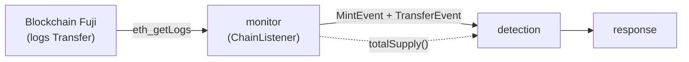
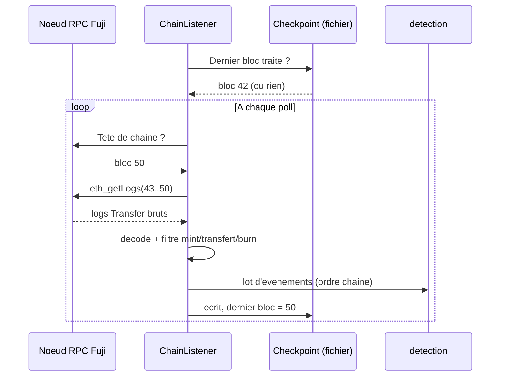
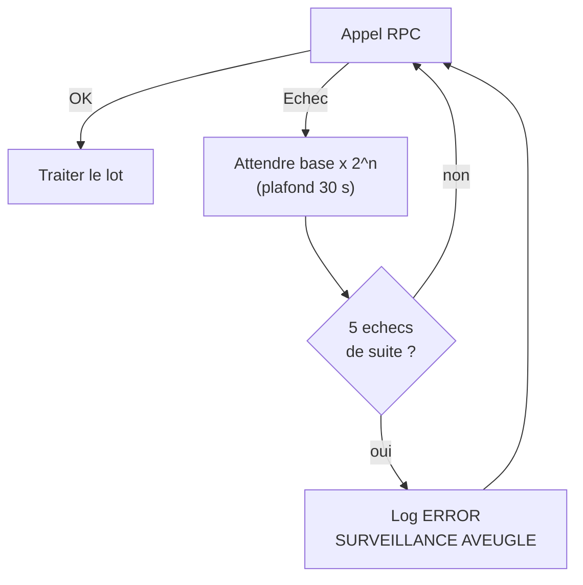

<Info>
**Ce que tu vas comprendre ici**
- Le rôle de `monitor` : **écouter** la blockchain et poser des événements propres sur le tapis.
- Ce qu'il écoute (mints ET transferts), comment, et par où ça sort.
- Comment il **ne perd rien** quand le RPC tombe (reprise, checkpoint, lots).
- Ses réglages réels (`monitor/config.py`), comment le lancer seul, ce que testent ses tests.
- Ses limites honnêtes (réorganisations, Ghost, id de demande) — toutes **ouvertes**.

Temps de lecture : environ 13 minutes. Pour voir où ces événements vont ensuite, lis
[Le module detection](/modules/detection).
</Info>

Le module `monitor/` est le **premier maillon** de la chaîne logicielle. Il ne décide rien et
n'alerte personne : il **regarde la blockchain** et traduit ce qu'il voit en objets Python propres
(`MintEvent`, `TransferEvent`) que le reste du système sait lire.

<Tip>
**Analogie** : `monitor`, c'est la **caméra de vidéosurveillance** d'une banque. Elle ne court
après personne et ne ferme aucune porte — elle filme, en continu, et transmet un flux net au poste
de sécurité (le module [detection](/modules/detection)). Si le câble est coupé une seconde, elle
**reprend exactement là où elle s'était arrêtée**, sans trou dans l'enregistrement.
</Tip>

## Où il se situe dans la chaîne



`monitor` est tout à gauche : il lit la chaîne et pousse des événements vers `detection`. Rien ne
revient vers lui — c'est un **capteur à sens unique**.

<Note>
Aucun contrat n'est déployé à ce jour (voir `contracts/DEPLOYMENTS.md`). `monitor` est donc écrit
pour un **contrat ERC-20 générique** : il n'attend pas un contrat précis, il écoute l'événement
standard `Transfer`. Source : `monitor/listener.py`, `monitor/README.md`.
</Note>

## Entrées et sorties

**Entrée** : des *logs* bruts renvoyés par l'appel RPC `eth_getLogs` — l'événement standard
`Transfer(from, to, value)` du token ERC-20 configuré.

**Sorties** : deux modèles de `shared/models.py`, décrits en détail dans
[Le langage commun](/modules/shared).

| Sortie | Quand | Champ clé à connaître |
|--------|-------|-----------------------|
| `MintEvent` | log `Transfer` dont l'émetteur est l'adresse nulle (`from = 0x0`) | `request_id = None` (inconnu, voir plus bas) |
| `TransferEvent` | log `Transfer` entre deux adresses réelles (ni mint, ni burn) | `is_ghost` (lu dans la config) |

<Tip>
**Analogie** : sur une blockchain ERC-20, « créer des jetons » et « en envoyer » sont **le même
geste** vu de loin — un `Transfer`. Ce qui change, c'est l'expéditeur. Un **mint** part de
« personne » (l'adresse nulle `0x0000…0000`), comme un billet qui sort tout neuf de l'imprimerie
de la banque centrale. Un **transfert** part d'une personne vers une autre. `monitor` fait le tri
en regardant **d'où part** le jeton.
</Tip>

## Fonctionnement interne, pas à pas



<Steps>
  <Step title="Reprendre où on s'était arrêté">
    Au démarrage, `ChainListener` lit le **checkpoint** (le dernier bloc déjà traité). S'il existe,
    il reprend au bloc suivant ; sinon il part de `MONITOR_START_BLOCK`, ou du bloc courant si rien
    n'est fixé.
  </Step>
  <Step title="Demander la tête de chaîne">
    À chaque tour (« poll »), il demande au RPC le dernier bloc disponible, puis **recule** de
    `MONITOR_CONFIRMATIONS` blocs (marge de sécurité contre les réorganisations).
  </Step>
  <Step title="Lire les logs par tranches">
    Il lit les blocs nouveaux par plages d'au plus `MONITOR_BLOCK_BATCH_SIZE` (les RPC publics
    refusent les plages trop larges). Fonction `block_ranges` : `[10, 14]` par 2 donne
    `(10,11) (12,13) (14,14)`.
  </Step>
  <Step title="Décoder et trier">
    Chaque log est décodé : topic0 = `Transfer` ? trois topics (ERC-20) et pas quatre (ERC-721) ?
    montant `supérieur à` 0 ? Les mints (`from = 0x0`) deviennent des `MintEvent`, les transferts
    ordinaires des `TransferEvent`. Les **burns** (`to = 0x0`) sont exclus. Tout est trié par
    `(block_number, log_index)` : l'**ordre exact de la chaîne**.
  </Step>
  <Step title="Rendre un lot, puis noter le checkpoint">
    Le lot part vers le consommateur. Le checkpoint n'est écrit **qu'après** que le consommateur a
    repris la main : si le process meurt en plein traitement, le lot sera **relu** au redémarrage
    (jamais sauté).
  </Step>
</Steps>

### Les trois façons de consommer le flux

<AccordionGroup>
  <Accordion title="stream_mint_events() — seulement les mints" icon="coins">
    Émet un `MintEvent` par mint observé, au fil de l'eau. C'est ce que `python -m monitor` affiche.
  </Accordion>
  <Accordion title="stream_transfer_events() — seulement les transferts" icon="arrow-right-arrow-left">
    Émet un `TransferEvent` par transfert ordinaire. Même boucle de polling que les mints.
  </Accordion>
  <Accordion title="stream_event_batches() — mints ET transferts, par lots" icon="layer-group">
    La voie utilisée par `detection` (#86). Émet **un lot par poll**, mints et transferts mélangés
    dans l'ordre de la chaîne — et un lot **vide** quand rien n'est arrivé, pour que `detection`
    puisse clôturer ses tranches de temps à l'heure même sans trafic.
  </Accordion>
</AccordionGroup>

### Décoder un transfert, ligne à ligne

Extrait réel du décodeur (le cœur du tri) :

```python
# monitor/listener.py — decode_erc20_transfer_log
topics = [to_hex(t) for t in log.get("topics", ())]
if len(topics) != 3 or topics[0] != ERC20_TRANSFER_TOPIC:
    return None
sender = topic_to_address(topics[1])
recipient = topic_to_address(topics[2])
if sender is None or recipient is None:
    return None
data = to_hex(log.get("data", "0x"))
if len(data) != 2 + 64:
    return None
return DecodedTransfer(sender=sender, recipient=recipient, amount=int(data, 16))
```

Lecture simple :

- **ligne 1** : on met tous les *topics* (les champs indexés du log) au même format hex.
- **ligne 2-3** : un vrai `Transfer` ERC-20 a **exactement 3 topics** et son premier topic est la
  « signature » de l'événement. Sinon (ex. un ERC-721 qui en a 4), on renvoie `None` = « pas pour
  nous ».
- **ligne 4-6** : on lit l'expéditeur et le destinataire depuis les topics 1 et 2 ; un topic mal
  formé fait renvoyer `None`.
- **ligne 7-9** : le montant est dans le champ `data` ; on vérifie sa taille exacte (32 octets).
- **ligne 10** : on renvoie un objet propre `(sender, recipient, amount)`.

<Note>
Le filtre « mint vs transfert vs burn » se fait juste après : `decode_erc20_mint` ne garde que
`from = 0x0`, `decode_erc20_transfer` exclut `from = 0x0` (mint) ET `to = 0x0` (burn).
Source : `monitor/listener.py`.
</Note>

## Résilience : ne jamais se taire en silence

La règle d'équipe (actée pour Yannis, **à valider en équipe**, voir `docs/OPEN_QUESTIONS.md` §12)
est le *fail-open* : **un monitor arrêté est pire qu'un monitor qui réessaie**.



<AccordionGroup>
  <Accordion title="RPC qui tombe → on réessaie sans abandonner" icon="plug-circle-exclamation">
    Tout échec d'appel RPC est **retenté sans limite**, avec une attente qui double à chaque fois
    (`MONITOR_RPC_RETRY_BASE_SECONDS` × 2ⁿ), plafonnée à `MONITOR_RPC_RETRY_MAX_SECONDS` (défaut
    **provisoire** 1 s → 30 s). Le curseur n'avance qu'après une plage **lue et rendue** : reprise
    sans trou ni doublon.
  </Accordion>
  <Accordion title="Panne longue → alerte « surveillance aveugle »" icon="eye-slash">
    À partir de `MONITOR_RPC_FAILURE_ALERT_AFTER` échecs consécutifs (défaut **provisoire** 5), les
    logs passent de WARNING à **ERROR « SURVEILLANCE AVEUGLE »** pour qu'un humain soit prévenu.
    Question **ouverte** : faut-il geler par précaution quand le monitor est aveugle plus longtemps
    qu'une fenêtre Ghost ? Non tranché (`docs/OPEN_QUESTIONS.md` §12).
  </Accordion>
  <Accordion title="Log mal formé → ignoré, pas fatal" icon="triangle-exclamation">
    Un log qui ne passe pas la validation (`MintEvent`/`TransferEvent`) est logué en ERROR puis
    **ignoré** : l'erreur est déterministe, un retry ne changerait rien, et couper tout le flux
    pour un log abîmé serait pire.
  </Accordion>
  <Accordion title="Réglage manquant → arrêt net (pas de retry)" icon="key">
    Une URL RPC ou une adresse de token absente lève `MonitorConfigurationError` et **n'est pas**
    retentée : rien à réessayer tant que la config est vide.
  </Accordion>
</AccordionGroup>

### Le checkpoint, en une image

<Tip>
**Analogie** : le checkpoint, c'est le **marque-page** d'un lecteur. Il n'est posé qu'**après**
avoir fini la page (le lot traité), jamais avant. Si on referme le livre brutalement, on rouvre
sur la dernière page finie — on la **relit** peut-être, mais on n'en **saute** aucune. C'est la
sémantique « au moins une fois ».
</Tip>

- Fichier JSON `{"last_block": N}`, écriture **atomique** (fichier temporaire + `os.replace`) : un
  crash en pleine écriture ne laisse jamais un checkpoint tronqué.
- **Désactivé par défaut** (un warning le signale au démarrage) : **un fichier par process**. Ne
  partage jamais le même chemin entre `python -m monitor` et `python -m detection`, sinon chacun
  ferait avancer le curseur de l'autre.

<Warning>
Les consommateurs doivent **dédupliquer** sur `(tx_hash, log_index)` : comme un lot peut être relu
après un crash, le même événement peut arriver deux fois. Source : `monitor/checkpoint.py`.
</Warning>

## Configuration (`monitor/config.py`)

Un **seul** endroit pour tous les réglages. Les variables requises viennent de `.env` ; les
`MONITOR_*` sont optionnelles et ont des défauts **provisoires** (aucun n'est une mesure).

| Variable | Rôle | Défaut |
|----------|------|--------|
| `FUJI_RPC_URL` | nœud RPC Fuji à écouter (requis pour écouter) | — |
| `MONITOR_TOKEN_ADDRESS` | adresse du contrat token (requis pour écouter) | — |
| `MONITOR_POLL_INTERVAL_SECONDS` | pause entre deux polls | `2.0` (provisoire) |
| `MONITOR_BLOCK_BATCH_SIZE` | largeur max d'une plage `eth_getLogs` | `2000` (à mesurer) |
| `MONITOR_CONFIRMATIONS` | blocs de retard sous la tête | `0` (provisoire) |
| `MONITOR_START_BLOCK` | premier bloc lu | vide = bloc courant |
| `MONITOR_TOKEN_IS_GHOST` | valeur de `TransferEvent.is_ghost` | `false` (provisoire) |
| `MONITOR_RPC_RETRY_BASE_SECONDS` | 1ʳᵉ attente après échec RPC | `1.0` (provisoire) |
| `MONITOR_RPC_RETRY_MAX_SECONDS` | plafond de l'attente | `30.0` (provisoire) |
| `MONITOR_RPC_FAILURE_ALERT_AFTER` | échecs avant log « aveugle » | `5` (provisoire) |
| `MONITOR_CHECKPOINT_PATH` | fichier du dernier bloc | vide = désactivé |

<Note>
`FUJI_CHAIN_ID = 43113` (Avalanche Fuji C-Chain) est un **fait**, pas un réglage : c'est
l'identifiant de la chaîne de test. Source : `monitor/config.py`, `contracts/DEPLOYMENTS.md`.
</Note>

## Le lancer seul

<Tabs>
  <Tab title="Windows">
    ```text
    py -m monitor
    ```
  </Tab>
  <Tab title="macOS / Linux">
    ```text
    python -m monitor
    ```
  </Tab>
</Tabs>

Sans RPC ni adresse de token (le cas par défaut aujourd'hui), la sortie **réelle** est :

```text
monitor : FUJI_RPC_URL, MONITOR_TOKEN_ADDRESS non renseignee(s) dans .env. Rien a ecouter (aucun contrat deploye, voir contracts/DEPLOYMENTS.md).
```

Avec un RPC et un token configurés, il annonce l'écoute puis affiche **une ligne JSON par mint**
(`event.model_dump_json()`). À noter : `python -m monitor` n'affiche **que les mints** ; les
transferts et le flux par lots sont consommés depuis le code (`detection`). Source :
`monitor/__main__.py`.

## Ce que testent ses tests

Résumé fichier par fichier (`monitor/tests/`), une ligne par test important.

<AccordionGroup>
  <Accordion title="test_listener.py — décodage + polling des mints" icon="vial">
    - `test_transfer_topic_is_keccak_of_signature` : le topic0 est bien le hash de
      `Transfer(address,address,uint256)`.
    - `test_decode_erc20_mint_extracts_recipient_and_amount` : un mint donne destinataire + montant,
      `request_id = None`.
    - `test_decode_ignores_ordinary_transfer` : un transfert normal n'est **pas** vu comme un mint.
    - `test_decode_ignores_zero_amount_and_erc721_shape` : montant 0 et forme ERC-721 (4 topics)
      ignorés.
    - `test_block_ranges_split_inclusive` : le découpage en plages est correct (bornes incluses).
    - `test_fetch_converts_only_mints_to_mint_event` : sur un mélange, seuls les mints deviennent
      des `MintEvent`, avec le bon filtre RPC (topic1 = `0x0`).
    - `test_fetch_skips_removed_logs_and_sorts_by_chain_order` : les logs `removed` (réorg) sont
      sautés, le reste est trié dans l'ordre de la chaîne.
    - `test_custom_decoder_can_replace_erc20` : un décodeur dédié futur (`Minted` avec `request_id`)
      se branche à la place de l'ERC-20.
    - `test_stream_polls_new_block_ranges_only` : au fil des polls, on ne relit pas d'anciens blocs.
    - `test_stream_defaults_to_current_head_and_respects_confirmations` : départ à la tête sûre
      (tête − confirmations).
  </Accordion>
  <Accordion title="test_transfers.py — décodage + polling des transferts" icon="vial">
    - `test_decode_transfer_extracts_sender_recipient_amount` : un transfert donne les trois champs.
    - `test_decode_transfer_excludes_mint_and_burn` : mint (`from = 0x0`) et burn (`to = 0x0`)
      exclus.
    - `test_decode_transfer_ignores_zero_amount_erc721_and_other_topic0` : montant 0, ERC-721 et
      autre topic0 ignorés.
    - `test_fetch_converts_only_ordinary_transfers` : sur un mélange, seuls les transferts
      ordinaires deviennent des `TransferEvent`.
    - `test_is_ghost_comes_from_config` : `is_ghost` est bien lu dans la config, pas deviné.
    - `test_fetch_transfers_skips_removed_sorts_and_chunks` : réorg sautée, tri et découpage
      corrects.
  </Accordion>
  <Accordion title="test_resilience.py — reprise RPC + checkpoint" icon="shield-halved">
    - `test_head_error_is_retried_with_exponential_backoff` : attentes `1, 2, 3` (plafonnées).
    - `test_get_logs_error_resumes_without_gap_or_duplicate` : après une panne, aucun bloc perdu ni
      doublé.
    - `test_failure_mid_poll_does_not_reread_already_yielded_ranges` : une panne en milieu de poll
      ne relit pas les plages déjà rendues.
    - `test_persistent_failure_escalates_to_error_log` : WARNING, WARNING, puis ERROR
      « SURVEILLANCE AVEUGLE ».
    - `test_missing_rpc_url_is_not_retried` : config manquante = arrêt, pas de retry.
    - `test_malformed_log_is_skipped_not_fatal` : un log abîmé est sauté sans couper le flux.
    - `test_checkpoint_roundtrip_and_absent` : écrire puis relire le checkpoint fonctionne.
    - `test_corrupt_checkpoint_is_ignored` : un checkpoint corrompu est traité comme absent.
    - `test_checkpoint_written_after_each_consumed_range` : le checkpoint n'avance qu'après
      consommation du lot.
    - `test_restart_resumes_after_checkpoint` : au redémarrage, le checkpoint **prime** sur
      `start_block`.
  </Accordion>
  <Accordion title="test_event_batches.py — flux combiné + totalSupply" icon="vial">
    - `test_fetch_events_merges_mints_and_transfers_in_chain_order` : mints et transferts fusionnés
      dans l'ordre, burn exclu.
    - `test_stream_event_batches_yields_empty_batch_when_nothing_new` : un lot **vide** est émis
      quand rien n'arrive.
    - `test_read_total_supply_decodes_uint256` : `totalSupply()` est bien décodé.
    - `test_read_total_supply_rejects_malformed_reply` : une réponse mal formée est rejetée.
  </Accordion>
  <Accordion title="test_config.py — réglages + point d'entrée" icon="gear">
    - `test_defaults_without_env` : les défauts provisoires sont ceux attendus.
    - `test_reads_env_overrides_and_checksums_token` : les variables `.env` sont lues et l'adresse
      mise au format checksum.
    - `test_invalid_values_are_rejected` : adresse courte, batch non entier, intervalle 0, etc. sont
      refusés.
    - `test_main_without_token_prints_hint_and_exits` : sans token, `python -m monitor` affiche
      l'aide et s'arrête.
  </Accordion>
</AccordionGroup>

## Limites et questions ouvertes

<Warning>
Tout ce bloc est **ouvert / provisoire** (`docs/OPEN_QUESTIONS.md` §12, et les READMEs du module).
Rien ici n'est acté.
</Warning>

- **Réorganisations de chaîne (réorg)** : le code **saute** les logs marqués `removed` et tient une
  marge de `MONITOR_CONFIRMATIONS` blocs sous la tête, mais il n'y a **pas** de réconciliation
  profonde d'une réorg déjà traitée. La marge par défaut (`0`) est provisoire. Source :
  `monitor/listener.py`.
- **`request_id` inconnu** : un `Transfer` ERC-20 nu ne porte pas l'identifiant de la demande de
  mint. `MintEvent.request_id` vaut donc `None` (= **INCONNU**, décision #79) tant qu'un contrat
  dédié (#5) n'émettra pas un événement `Minted` portant l'id ; il suffira alors de brancher un
  autre `MintLogDecoder`. **Analogie** : on voit le colis arriver, mais sans le **numéro de
  commande** dessus.
- **`is_ghost` deviné par config** : un `Transfer` ERC-20 ne dit pas si le token est un Ghost. La
  valeur vient de `MONITOR_TOKEN_IS_GHOST` (défaut `false`) tant que le design du contrat Ghost
  n'est pas fixé.
- **Événements d'administration** (`Upgraded`, `RoleGranted`, `docs/OPEN_ANSWERS.md` §1) : **pas
  encore** écoutés ; leur liste exacte reste ouverte.
- **Checkpoint multi-instances** : la sémantique « un fichier par process » est à revoir si le
  monitor tourne en plusieurs instances.
- **Chiffres** : poll, batch, confirmations, retry — **aucun n'est mesuré**, tous à valider /
  mesurer en équipe.

<Check>
**À retenir**
- `monitor` = la **caméra** : il lit la chaîne et produit `MintEvent` + `TransferEvent`, rien de
  plus.
- Un **mint** part de `0x0`, un **transfert** entre deux adresses, un **burn** (`to = 0x0`) est
  exclu.
- Il lit par **tranches de blocs**, trie dans l'ordre de la chaîne, et pousse des **lots** (même
  vides) vers `detection`.
- Il **ne se tait jamais en silence** : retry sans limite, puis alerte « surveillance aveugle ».
- Le **checkpoint** garantit « au moins une fois » : on relit, on ne saute pas — d'où la
  déduplication en aval.
</Check>

<CardGroup cols={2}>
  <Card title="Le module detection" icon="magnifying-glass-chart" href="/modules/detection">
    Ce qui lit ces événements et déclenche les alertes.
  </Card>
  <Card title="Le langage commun" icon="cubes" href="/modules/shared">
    Les modèles `MintEvent` et `TransferEvent` en détail.
  </Card>
  <Card title="L'architecture" icon="diagram-project" href="/modules/architecture">
    Le trajet complet d'une donnée, de la chaîne à l'écran.
  </Card>
  <Card title="Décisions actées vs ouvertes" icon="scale-balanced" href="/decisions">
    Le statut des choix provisoires du monitor.
  </Card>
</CardGroup>
