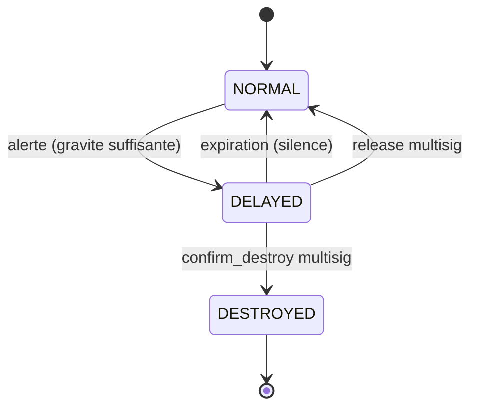
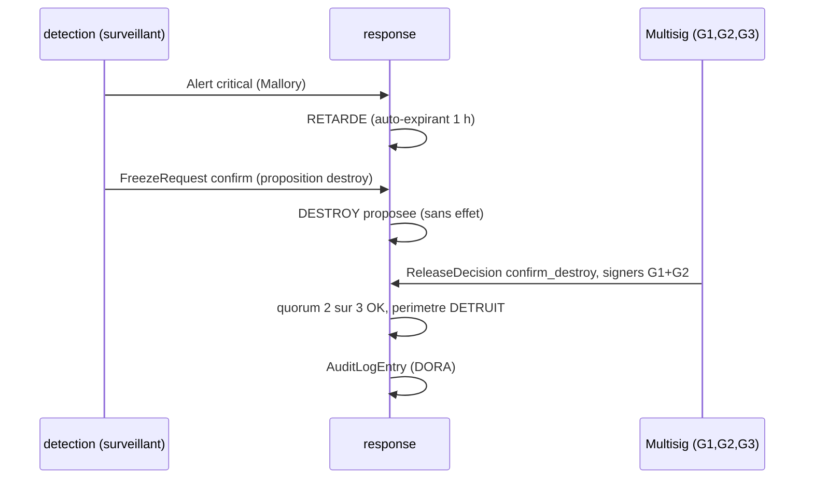

<Info>
**Ce que tu vas comprendre ici**
- Le rôle de `response` : transformer une alerte en **réponse graduée**, jamais en blocage brutal.
- La **machine à états** d'un périmètre : NORMAL → RETARDÉ → (DÉTRUIT) ou retour à la normale.
- Le **veto asymétrique** : ralentir est facile et sûr, détruire exige des humains.
- Le **quorum multisig** (2/3, 3/3) et pourquoi voler une clé ne suffit pas.
- Le **journal d'audit DORA** append-only, et comment lancer la démo fictive.

Temps de lecture : environ 14 minutes. Avant, lis [Le module detection](/modules/detection) (qui
produit les alertes) et [Les garde-fous](/les-garde-fous) (le pourquoi du multisig et de DORA).
</Info>

Le module `response/` est la **main** du système : il reçoit les alertes de
[detection](/modules/detection) et décide **quoi faire**, par paliers. Son principe fondateur
(acté `docs/OPEN_ANSWERS.md` §3) : **« retarder » n'est pas « bloquer »**.

<Tip>
**Analogie** : `response`, c'est le **responsable d'agence** d'une banque. Face à un soupçon, il ne
vide pas le compte et ne ferme pas la banque — il met une **retenue temporaire** sur une opération
précise, le temps qu'un humain vérifie. Si personne ne confirme, la retenue **se lève toute seule**
(le client honnête n'est pas puni). Pour une mesure grave — saisir des fonds, fermer l'agence — il
faut **plusieurs responsables** qui signent ensemble.
</Tip>

## Un miroir hors chaîne

<Warning>
`response` est un **miroir hors chaîne** : la vraie fenêtre Ghost, le vrai burn et le vrai multisig
vivent dans le **contrat**. Ici, le multisig est **simulé** (on vérifie que les signataires
`ReleaseDecision.signers` sont bien dans la liste `guardians`, **sans cryptographie**). À présenter
comme tel au jury. Source : `response/orchestrator.py`, `response/README.md`.
</Warning>

## La machine à états d'un périmètre

Un « périmètre », c'est une adresse. Chaque périmètre suit cette machine à états (actée §3) :



<Note>
La **pause globale** n'est pas un état d'un périmètre : c'est un état du **protocole entier**
(`global_pause_active`). Elle est décrétée et levée par un multisig unanime. Source :
`response/orchestrator.py` (`PerimeterState`).
</Note>

### Ce qui est permis pendant un retard (le point clé)

<Tip>
**Analogie** : un retard, c'est un **péage ralenti**, pas une barrière fermée. Les jetons suspects
peuvent encore **circuler** (le modèle de [contamination par ratio](/contamination-par-ratio)
garantit que les disperser **ne les nettoie pas** : le soupçon est conservé). Ce qui est suspendu,
c'est seulement la **conversion** du Ghost en vrai token — la **sortie**. On ne gèle personne, on
retarde une sortie ciblée.
</Tip>

- **Circulation autorisée** pendant le retard (disperser ne nettoie pas).
- **Conversion Ghost → vrai token suspendue** tant que la fenêtre est allongée.
- **Silence = retour automatique à la normale** : le biais par défaut favorise l'**utilisateur
  légitime**, pas l'attaquant (bon biais pour les faux positifs). Source : `docs/OPEN_ANSWERS.md`
  §3.

## Les trois verbes et qui peut les prononcer

| Verbe (`ResponseActionType`) | Qui décide | Réversible ? |
|------------------------------|-----------|--------------|
| `delay` (retarder) | surveillant / IA, **seul** | oui, auto-expirant |
| `destroy` (détruire la fraction suspecte) | humains, **multisig** | non, irréversible |
| `global_pause` (pause globale) | humains, **multisig unanime** | oui, par le même quorum |

<Tip>
**Analogie du veto asymétrique** : tirer le **frein à main** d'un train (ralentir) peut être fait
par n'importe quel contrôleur, seul — c'est le sens **sûr**. Mais **accélérer** ou **détruire un
wagon** demande l'accord de plusieurs chefs. L'erreur dans le sens prudent coûte peu ; l'erreur
dans le sens risqué coûte cher, donc on exige plus de monde.
</Tip>

## Les cinq entrées de l'orchestrateur

<AccordionGroup>
  <Accordion title="handle_alert(alert) — l'alerte arrive" icon="bell">
    Retarde le sujet **et chaque graine** (`alert.seeds`), chacune avec son propre soupçon. Si la
    gravité atteint `auto_delay_min_severity` (défaut `warning`), le retard est **appliqué** ;
    en dessous, il est seulement **proposé** (revue humaine possible). Jamais de destruction ni de
    pause ici.
  </Accordion>
  <Accordion title="request_freeze(req) — un surveillant demande plus" icon="snowflake">
    `extend` : **allonge** un retard (jamais ne le raccourcit), plafonné à
    `max_monitor_delay_minutes` depuis le début du retard ; au-delà, c'est seulement **proposé**.
    `confirm` : une **proposition** de destruction, **sans effet** tant qu'un multisig ne l'a pas
    tranchée.
  </Accordion>
  <Accordion title="apply_release(decision) — le multisig humain tranche" icon="users">
    `release` (lever un retard ou la pause globale), `confirm_freeze` (maintenir), `confirm_destroy`
    (détruire, **uniquement depuis RETARDÉ**, `burn_ratio` requis), `global_pause`. Quorum non
    atteint, signataire inconnu ou en double → action `rejected`, **tracée**.
  </Accordion>
  <Accordion title="record_audit(action) — journaliser" icon="file-lines">
    Ajoute une `AuditLogEntry` au journal append-only (copie JSONL optionnelle). Chaque étape est
    tracée.
  </Accordion>
  <Accordion title="expire_due() — l'horloge" icon="clock">
    Fait passer les retards échus en `expired` et ramène le périmètre à la normale. Appelée au
    **début de chaque méthode** publique : le silence agit tout seul.
  </Accordion>
</AccordionGroup>

### Entrées / sorties

**Entrées** : `Alert`, `FreezeRequest`, `ReleaseDecision` (tous de `shared/models.py`, voir
[Le langage commun](/modules/shared)). **Sorties** : des `ResponseAction` (avec leur `status`) et
un flux d'`AuditLogEntry`.

## Le quorum humain, chiffré avec Alice, Mallory et les gardiens

<Tip>
**Analogie** : trois gardiens (**G1, G2, G3**) tiennent chacun **une clé différente** d'un coffre.
Il en faut **2 sur 3** pour détruire des fonds, et **3 sur 3** pour fermer tout le protocole. Si
**Mallory** vole **une** clé, elle ne peut rien faire de grave seule : il lui en manque toujours
une (ou deux). Voler une clé ne suffit **pas**.
</Tip>



<Note>
Règles de rejet (toutes tracées) : signataire **en double** (même clé comptée deux fois),
signataire **non gardien**, **quorum non atteint**, `threshold` déclaré au-dessus du quorum non
satisfait, destruction hors de l'état RETARDÉ, `burn_ratio` manquant, retard déjà **expiré** (trop
tard). Source : `response/tests/test_freeze_release.py`.
</Note>

### Valeurs par défaut — à mesurer, pas actées

| Paramètre | Défaut | Source / statut |
|-----------|--------|-----------------|
| `delay_minutes` | 60 | §3 « proposition de référence » (10 min → 1 h) |
| `max_monitor_delay_minutes` | 60 | §3 « facteur fixe et modeste » ; **à mesurer** |
| `confirmed_freeze_minutes` | 60 | choix d'implémentation, à valider |
| `auto_delay_min_severity` | `warning` | choix d'implémentation, à valider |
| `perimeter_quorum` | 2 | §3 (détruire 2/3) ; appliqué aussi à lever/confirmer, à valider |
| `global_pause_quorum` | unanimité (3/3) | §3 |

## Le journal d'audit DORA

Chaque étape — alerte reçue, demande de gel, décision multisig, expiration — écrit une
`AuditLogEntry` **append-only** (jamais modifiée après coup). C'est l'exigence de **traçabilité
DORA** : qui a fait quoi, quand, sur quoi, pourquoi.

<Warning>
Le journal est **immuable de l'extérieur** : `audit_log` renvoie une **copie profonde**, donc
modifier la copie ne touche pas l'original (testé : `test_audit_log_cannot_be_mutated_from_outside`).
Les `payload` sont des `clé → valeur` de **chaînes**, données **fictives** uniquement. Source :
`response/orchestrator.py`, `response/tests/test_audit.py`.
</Warning>

## Le lancer seul (démo fictive)

`python -m response` rejoue un parcours **entièrement fictif** de bout en bout : alerte critique →
retard auto-expirant → proposition de destruction par l'IA → décision multisig 2/3 → destruction,
puis un second périmètre dont le retard **expire en silence**. Puis il affiche le journal d'audit.

<Tabs>
  <Tab title="Windows">
    ```text
    py -m response
    py -m response --audit-jsonl C:\tmp\audit.jsonl
    ```
  </Tab>
  <Tab title="macOS / Linux">
    ```text
    python -m response
    python -m response --audit-jsonl /tmp/audit.jsonl
    ```
  </Tab>
</Tabs>

Sortie **réelle** (extrait, horodatages et adresses fictifs) :

```text
Journal d'audit (DORA) - donnees fictives :
  2026-10-10T14:30:00+00:00  monitor:rule_transfer  Alerte critical recue de monitor:rule_transfer : Volume eleve ET dispersion effondree (donnees fictives)
  2026-10-10T14:30:00+00:00  monitor:rule_transfer  Retard applique sur 0x2222... jusqu'a 2026-10-10T15:30:00+00:00 : auto-expirant, conversion Ghost suspendue, circulation autorisee
  2026-10-10T14:32:00+00:00  llm                    Destruction proposee par llm sur 0x2222... : sans effet tant que le multisig (2 signatures) n'a pas tranche
  2026-10-10T14:42:00+00:00  multisig               Destruction de la fraction suspecte (87.00% du Ghost non converti) autorisee par multisig sur 0x2222... : irreversible, burn on-chain
  2026-10-10T15:43:00+00:00  response:auto_expiry   Retard expire sans decision humaine sur 0x8888... : retour automatique a la normale
```

<Note>
Le `--audit-jsonl PATH` recopie le journal en JSONL. **Supprime** tout fichier généré hors
`docs-site/` après usage. Source : `response/__main__.py`.
</Note>

## Ce que testent ses tests

<AccordionGroup>
  <Accordion title="test_handle_alert.py — alerte → retard (#17)" icon="vial">
    - `test_critical_alert_applies_auto_expiring_delay` : une alerte critique applique un retard
      auto-expirant (60 min).
    - `test_alert_never_destroys_nor_pauses` : une alerte ne produit **jamais** destroy ni pause.
    - `test_info_alert_only_proposes` : une alerte `info` ne fait que **proposer**.
    - `test_severity_threshold_is_configurable` : le seuil d'auto-retard est réglable.
    - `test_seeds_are_each_delayed_with_their_own_suspicion` : chaque graine est retardée avec son
      propre soupçon.
    - `test_silence_returns_to_normal` : sans décision, le retard expire et le périmètre revient
      à la normale (acteur `response:auto_expiry`).
    - `test_address_case_does_not_split_perimeters` : la casse d'adresse ne crée pas deux
      périmètres.
    - `test_policy_rejects_impossible_quorum` / `test_naive_clock_is_refused` : garde-fous de
      config/horloge.
  </Accordion>
  <Accordion title="test_freeze_release.py — veto asymétrique + multisig (#18)" icon="vial">
    - `test_extend_creates_delay` / `test_extend_never_shortens` : `extend` crée ou allonge, jamais
      ne raccourcit.
    - `test_extend_lengthens_up_to_monitor_cap` / `test_extend_beyond_cap_is_only_proposed` : le
      plafond d'allongement d'un surveillant est respecté ; au-delà, proposé.
    - `test_ai_confirm_request_is_only_a_proposal` : une demande `confirm` de l'IA n'est qu'une
      proposition.
    - `test_destroy_with_two_of_three_applies_and_links_proposal` : la destruction 2/3 s'applique et
      relie la proposition.
    - `test_destroy_with_single_signer_is_rejected` / `test_non_guardian_signer_is_rejected` /
      `test_duplicate_signer_does_not_count_twice` / `test_declared_threshold_above_quorum_is_enforced` :
      un seul signataire, un non-gardien, un doublon, un seuil trop haut → **rejet**.
    - `test_destroy_requires_delayed_state` / `test_destroy_requires_burn_ratio` /
      `test_destroy_rejects_freeze_of_other_perimeter` / `test_destroy_after_expiry_is_too_late` :
      la destruction exige l'état RETARDÉ, un `burn_ratio`, le bon périmètre, et avant expiration.
    - `test_release_with_multisig_lifts_delay` / `test_single_actor_cannot_release` : lever un
      retard exige le quorum.
    - `test_confirm_freeze_extends_beyond_monitor_cap` / `test_confirmed_freeze_still_expires` : le
      multisig peut dépasser le plafond, mais ça reste auto-expirant.
    - `test_global_pause_requires_unanimity` / `test_global_pause_is_idempotent` /
      `test_lifting_global_pause_needs_same_quorum` / `test_global_pause_does_not_expire_by_itself` :
      la pause globale exige l'unanimité, est idempotente, se lève au même quorum, et n'expire pas
      seule.
  </Accordion>
  <Accordion title="test_audit.py — journal DORA (#19)" icon="vial">
    - `test_record_audit_returns_entry_and_appends` : chaque action ajoute une entrée bien formée.
    - `test_every_step_is_traced_with_actor` : alerte, gel, décision sont tous tracés avec leur
      acteur.
    - `test_rejected_decision_is_traced` : même une décision rejetée est journalisée.
    - `test_audit_log_cannot_be_mutated_from_outside` : le journal est immuable de l'extérieur.
    - `test_audit_jsonl_export` : l'export JSONL correspond au journal.
    - `test_demo_runs_end_to_end` : la démo `python -m response` tourne de bout en bout.
  </Accordion>
</AccordionGroup>

## Limites et questions ouvertes

<Warning>
Lien direct avec `docs/OPEN_ANSWERS.md` §3 (acté, « tranché en équipe ») et les défauts
**à mesurer**. Les points ci-dessous sont des limites assumées.
</Warning>

- **Multisig simulé** : vérification de la **liste** des signataires, pas de cryptographie — le
  vrai multisig vit dans le contrat.
- **Budget de quarantaine** (§9, part max de l'offre sous retard) : **non** appliqué ici
  (l'orchestrateur ne connaît pas les soldes Ghost) ; relève du contrat / fuzzing (#6).
- **Durées et quorums** : les valeurs par défaut sont des **propositions de référence à mesurer**,
  pas des chiffres actés.
- **Pas branché à `detection`** aujourd'hui : `detection` écrit ses alertes en JSON, le
  branchement vers `response` reste à faire.

<Check>
**À retenir**
- `response` applique une **réponse graduée** : retarder (sûr, auto-expirant) → détruire / pause
  (humains, multisig).
- Pendant un retard : **circulation OK**, **conversion suspendue** ; **silence = retour à la
  normale**.
- **Veto asymétrique** : l'IA ne peut que **retarder** ; détruire = 2/3, pause globale = 3/3.
- Voler **une** clé ne suffit pas : le quorom multisig protège les actions irréversibles.
- Tout est **tracé** dans un journal **DORA** append-only et immuable.
</Check>

<CardGroup cols={2}>
  <Card title="Le module detection" icon="magnifying-glass-chart" href="/modules/detection">
    D'où viennent les alertes que `response` traite.
  </Card>
  <Card title="Les garde-fous" icon="lock" href="/les-garde-fous">
    Multisig, veto asymétrique et DORA, côté concept.
  </Card>
  <Card title="Le module llm" icon="robot" href="/modules/llm">
    L'IA qui rédige le rapport — mais ne décide rien.
  </Card>
  <Card title="Décisions actées vs ouvertes" icon="scale-balanced" href="/decisions">
    Le statut de §3 et des durées/quorums.
  </Card>
</CardGroup>
