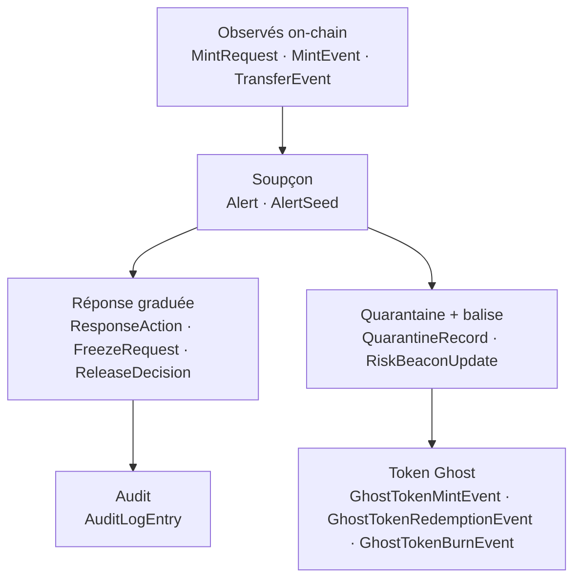

<Info>
**Ce que tu vas comprendre ici**
- Ce qu'est `shared/models.py` : le **dictionnaire** que tous les modules partagent.
- Les modèles importants : rôle, champs clés, un exemple JSON **fictif** pour chacun.
- `shared/config.py` et les variables `.env` (sans jamais afficher de vraie valeur).
- `shared/rate_limiter.py` : le limiteur Bedrock (~1 req/s), expliqué avec l'image du **péage**.
- Pourquoi `shared/` est une **zone sensible**.

Temps de lecture : environ 11 minutes. Pour voir où ces modèles circulent, lis d'abord
[L'architecture](/modules/architecture).
</Info>

Le module `shared/` ne « fait » rien tout seul : c'est une **bibliothèque**. Il ne contient que le
**vocabulaire** que les autres modules utilisent pour se parler.

<Tip>
**Analogie** : `shared/`, c'est le **dictionnaire officiel** d'une équipe de traducteurs. Tant que
tout le monde emploie les mots au même sens, les services se comprennent. Si une personne redéfinit
un mot dans son coin, les phrases ne veulent plus rien dire ailleurs — d'où la règle de revue à
deux (plus bas).
</Tip>

## `shared/models.py` — les 13 modèles

Le fichier implémente **exactement** les 13 modèles spécifiés dans `docs/CONTRACTS.md`, tous en
**Pydantic strict** (`extra="forbid"` : aucun champ en trop toléré). On ne redéfinit pas le schéma
ailleurs ; chaque module importe ces classes.



<Note>
Tous les montants ci-dessous sont en **base units** (le token fictif a 6 décimales, donc
`1 000 000` = 1 jeton). Les adresses et hash sont **fictifs** : `0xAAAA…`. Source :
`shared/models.py`, `docs/CONTRACTS.md`.
</Note>

### `MintEvent` — un mint observé

Un mint vu on-chain. Le montant est celui **dérivé on-chain par le contrat** (volet 1), pas un
montant signé par le demandeur.

- **Champs clés** : `tx_hash`, `log_index`, `block_number`, `chain_id`, `observed_at`,
  `recipient` (adresse créditée), `amount` (`gt=0`), `request_id` (`int | None`).
- **Piège** : `request_id = None` veut dire **INCONNU**, jamais la demande n°0 (les vraies
  demandes sont numérotées à partir de 0). Un `Transfer` ERC-20 nu ne porte pas l'id de demande.

```json
{
  "tx_hash": "0xaaaa000000000000000000000000000000000000000000000000000000000001",
  "log_index": 0,
  "block_number": 30001234,
  "chain_id": 43113,
  "observed_at": "2026-10-10T14:30:00Z",
  "recipient": "0xAAaAAaaAaAAaaaaAAaaaAaaAaaaAAaAAaAaAAAAa",
  "amount": 200000000000,
  "request_id": 42
}
```

### `MintRequest` — la demande de mint

La demande enregistrée on-chain. La signature autorise « traiter la demande n°X », **pas** un
montant : le contrat dérive lui-même le montant du dépôt. Il n'y a donc **aucun** champ
`requested_amount`.

- **Champs clés** : `request_id` (`ge=0`), `requester`, `deposit_token`, `deposit_amount`
  (`gt=0`), `created_at`, `chain_id`, `signature` (hex).

```json
{
  "request_id": 42,
  "requester": "0xAAaAAaaAaAAaaaaAAaaaAaaAaaaAAaAAaAaAAAAa",
  "deposit_token": "0xd0d0d0d0d0d0d0d0d0d0d0d0d0d0d0d0d0d0d0d0",
  "deposit_amount": 200000000,
  "created_at": "2026-10-10T14:29:40Z",
  "chain_id": 43113,
  "signature": "0xabcdef"
}
```

### `TransferEvent` — un transfert observé

Un transfert de jetons vu on-chain. Dans le modèle Ghost, **tout** transfert déclenche une émission
de Ghost chez le destinataire ; cet événement est l'observation brute, pas le Ghost lui-même.

- **Champs clés** : `sender`, `recipient`, `amount` (`gt=0`), `is_ghost` (`true` si le token
  transféré est déjà un Ghost).

```json
{
  "tx_hash": "0xbbbb000000000000000000000000000000000000000000000000000000000002",
  "log_index": 3,
  "block_number": 30001250,
  "chain_id": 43113,
  "observed_at": "2026-10-10T14:31:12Z",
  "sender": "0xAAaAAaaAaAAaaaaAAaaaAaaAaaaAAaAAaAaAAAAa",
  "recipient": "0xBBbBbBBbBBbBBbBBbBBbBBbBbbBBbBBbBBbBBBBb",
  "amount": 50000000,
  "is_ghost": true
}
```

### `Alert` — une anomalie détectée

Produite par `detection`. Porte le soupçon (ratio **et** montant absolu) et une liste de graines à
marquer au départ.

- **Champs clés** : `alert_id`, `kind` (`mint` / `transfer` / `baseline_anomaly` / `beacon`),
  `severity` (`info` / `warning` / `critical`), `subject_address`, `contamination_ratio`
  (`[0, 1]`), `suspect_amount`, `reason`, `seeds` (liste d'`AlertSeed`).

```json
{
  "alert_id": "alert-fictif-0001",
  "kind": "transfer",
  "severity": "critical",
  "created_at": "2026-10-10T14:35:00Z",
  "monitor_name": "rule_transfer",
  "subject_address": "0xBBbBbBBbBBbBBbBBbBBbBBbBbbBBbBBbBBbBBBBb",
  "source_tx_hash": null,
  "contamination_ratio": 0.8,
  "suspect_amount": 40000000,
  "dispersion_score": 1.4,
  "volume_zscore": 7.2,
  "reason": "volume élevé et dispersion effondrée (HHI élevé)",
  "seeds": [
    {
      "address": "0xBBbBbBBbBBbBBbBBbBBbBBbBbbBBbBBbBBbBBBBb",
      "suspect_amount": 40000000,
      "contamination_ratio": 0.8
    }
  ]
}
```

### Les autres modèles importants (en bref)

<AccordionGroup>
  <Accordion title="AlertSeed — une graine suspecte" icon="seedling">
    Une adresse à marquer au départ de la contamination, avec son propre `suspect_amount` et
    `contamination_ratio`. Une `Alert` en transporte une liste (`seeds`).
  </Accordion>
  <Accordion title="ResponseAction — un des trois verbes" icon="sliders">
    `action_type` ∈ `delay` / `destroy` / `global_pause`, avec un `status`
    (`proposed` / `applied` / `expired` / `rejected`). `delay` est auto-expirant (`expires_at`
    renseigné) ; `destroy` et `global_pause` référencent une `decision_id` multisig.
  </Accordion>
  <Accordion title="FreezeRequest — demande de gel (veto asymétrique)" icon="snowflake">
    `direction = extend` (allonger la fenêtre, sûr, auto-expirant) ou `confirm` (proposer un gel /
    une destruction, simple proposition tranchée par le multisig).
  </Accordion>
  <Accordion title="ReleaseDecision — la décision humaine multisig" icon="users">
    Seule voie pour `destroy` et `global_pause`. Porte `signers` (adresses), `threshold` (le M du
    M parmi N) et un `rationale` consigné pour l'audit. Voler une clé ne suffit pas.
  </Accordion>
  <Accordion title="AuditLogEntry — le journal DORA" icon="file-lines">
    Entrée **append-only** : `actor`, `event_type`, `subject_address`, `payload` (clé → valeur,
    données fictives), `message` lisible. Jamais modifiée après écriture.
  </Accordion>
  <Accordion title="QuarantineRecord — l'état d'une quarantaine" icon="box-archive">
    `status` ∈ `active` / `extended` / `released` / `burned`, avec `ghost_balance`,
    `contamination_ratio`, `suspect_amount` et la fenêtre (`window_opened_at`,
    `window_expires_at`).
  </Accordion>
  <Accordion title="RiskBeaconUpdate — le prix du risque" icon="tower-broadcast">
    Publication de l'état de risque d'une adresse : `risk_level` ∈ `normal` / `elevated` /
    `frozen`, plus le `contamination_ratio` que l'aval lit pour accepter ou refuser une garantie.
  </Accordion>
  <Accordion title="GhostToken… (Mint / Redemption / Burn) Event" icon="ghost">
    Les trois événements du Token Ghost : émission chez le destinataire (`incoming_ratio`,
    `window_expires_at`), conversion 1:1 après la fenêtre (`token_amount`, `fee_amount`), et
    destruction de la part suspecte (`burned_amount`, `decision_id` multisig requis).
  </Accordion>
</AccordionGroup>

<Note>
Les ensembles fermés (`AlertKind`, `AlertSeverity`, `ResponseActionType`, `QuarantineStatus`,
`BeaconRiskLevel`, etc.) sont des `Enum` str. Une valeur hors liste est **refusée**.
Source : `shared/models.py`.
</Note>

## `shared/config.py` — les réglages d'environnement

Ce module charge les variables du fichier `.env` (jamais committé) via `python-dotenv`. **Aucune
valeur n'est codée en dur.** Il expose un objet `Settings` typé, et lève une erreur claire si une
variable requise manque.

Les 4 variables **requises** (noms seulement — on ne montre jamais de vraie valeur) :

| Variable | À quoi ça sert |
|----------|----------------|
| `AWS_REGION` | la région AWS (le projet n'utilise que `us-east-1`) |
| `BEDROCK_MODEL_ID` | l'identifiant du modèle Bedrock, à **vérifier dans la console**, pas à deviner |
| `FUJI_RPC_URL` | l'URL du nœud RPC public Fuji à écouter |
| `GUARDIAN_PRIVATE_KEY` | une clé de **compte de TEST Fuji uniquement** |

Variables **optionnelles** vues dans `.env.example` : `MONITOR_TOKEN_ADDRESS` (adresse du contrat
token à écouter, vide tant qu'aucun contrat n'est déployé) et `DETECTION_PROFILE`
(`default` / `demo`).

<Warning>
**Jamais de vraie clé privée** dans un `.env`, un exemple ou un commit. On n'utilise que des
comptes de test et un faux secret du type `FLAG{team20-canary}`. Un pre-commit hook anti-secrets
est activé par `make install`. Source : `.env.example`, `docs/TEAM.md`.
</Warning>

<Steps>
  <Step title="Copier le gabarit">
    `cp .env.example .env` (le `.env` est ignoré par git).
  </Step>
  <Step title="Remplir avec des valeurs de TEST">
    Renseigne les 4 variables requises avec des valeurs de test uniquement.
  </Step>
  <Step title="Laisser config.py faire le reste">
    `load_settings()` lit l'environnement et refuse de démarrer si une variable manque, avec un
    message qui dit laquelle.
  </Step>
</Steps>

## `shared/rate_limiter.py` — le limiteur Bedrock

Règle d'équipe déjà actée : **environ 1 requête par seconde** vers Amazon Bedrock, et **jamais**
d'appel LLM en boucle serrée. Le `RateLimiter` garantit un **intervalle minimal** entre deux
appels (par défaut 1,0 s), et il est thread-safe.

<Tip>
**Analogie** : un **péage d'autoroute** avec une barrière qui ne se relève qu'une fois par seconde.
Peu importe combien de voitures (requêtes) arrivent : la barrière impose son rythme. Si une voiture
arrive trop tôt, elle **attend** devant la barrière, puis passe. Personne ne double, personne ne
sature l'autoroute (le service Bedrock).
</Tip>

Comment on s'en sert, en 3 lignes (extrait du module) :

```python
limiter = RateLimiter(min_interval_seconds=1.0)
limiter.wait()        # bloque si besoin pour respecter l'intervalle
# ... appel Bedrock ...
```

Lecture ligne à ligne :

- **ligne 1** : on crée un péage réglé à 1 passage par seconde.
- **ligne 2** : `wait()` regarde l'heure du dernier passage ; s'il est trop récent, il **dort** le
  temps qu'il faut, puis note le nouveau passage.
- **ligne 3** : seulement **après** la barrière, on fait l'appel Bedrock réel.

<Note>
Le LLM n'est appelé **que sur alerte**, jamais en continu, et au plus **un** appel par rapport,
sans nouvel essai. Si l'appel échoue, les champs factuels du rapport restent remplis et les champs
narratifs passent à « à compléter ». Source : `llm/README.md`, `shared/rate_limiter.py`.
</Note>

## Pourquoi `shared/` est une zone sensible

<Warning>
`shared/` et `docs/CONTRACTS.md` définissent les **interfaces communes**. Les modifier seul casse
le travail de tous les autres modules. **Revue de 2 propriétaires obligatoire**
(@marceaupatu123 **+** @denybs). Toute évolution de schéma passe d'abord par `docs/CONTRACTS.md`,
puis par le propriétaire de `shared/`. Source : `.github/CODEOWNERS`, `shared/README.md`.
</Warning>

<Check>
**À retenir**
- `shared/models.py` = le **dictionnaire** de 13 modèles Pydantic stricts, partagé par tous.
- Montants en **base units** (int), temps en **datetime UTC**, soupçon = **ratio ET montant
  absolu**.
- `config.py` lit un `.env` **jamais committé** ; aucune vraie clé, uniquement des valeurs de test.
- `rate_limiter.py` = un **péage** à ~1 req/s devant Bedrock, appelé seulement sur alerte.
- `shared/` est **sensible** : on n'y touche qu'à deux.
</Check>

<CardGroup cols={2}>
  <Card title="L'architecture" icon="diagram-project" href="/modules/architecture">
    Où circule chacun de ces modèles.
  </Card>
  <Card title="Les contrats" icon="file-contract" href="/modules/contracts">
    Qui émet les événements que ces modèles décrivent.
  </Card>
  <Card title="Les données" icon="database" href="/modules/data">
    Comment on fabrique des JSONL faits de ces modèles.
  </Card>
  <Card title="Les garde-fous" icon="lock" href="/les-garde-fous">
    Multisig, veto asymétrique et journal DORA en détail.
  </Card>
</CardGroup>
