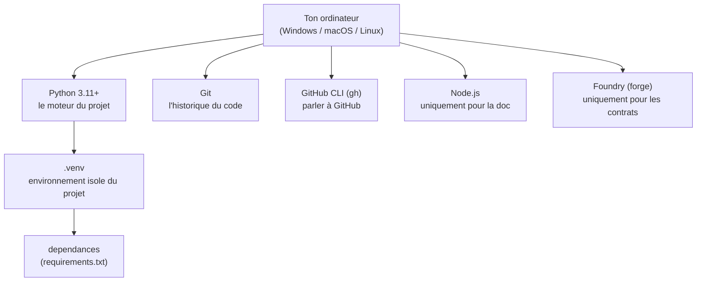

<Info>
**Ce que tu vas comprendre ici**
- Les **outils** à installer avant de commencer (Python, Git, GitHub CLI, Node, Foundry) et **pourquoi** chacun.
- Comment **cloner** le projet, créer un **environnement Python** isolé, et installer les dépendances.
- Comment préparer ton fichier **`.env`** sans jamais y mettre une vraie clé.
- Ce que fait le **hook anti-secrets** et pourquoi il te protège.
- Comment **vérifier** que tout marche à la fin.

Temps de lecture : environ 12 minutes. Compte 20 à 40 minutes pour tout installer la première fois.
</Info>

Tu n'as jamais ouvert un terminal ? C'est le bon endroit. On va tout faire ensemble, commande
par commande. Pour **chaque** commande tu auras : ce qu'elle fait, ce que tu dois voir si ça
marche, et quoi faire si ça rate.

<Tip>
**Analogie** : installer le projet, c'est comme **monter un meuble en kit**. Les outils (Python,
Git…) sont le tournevis et la clé. Le dépôt cloné, c'est le carton de pièces. L'environnement
Python (`.venv`), c'est l'établi propre où tu poses tes pièces pour ne pas les mélanger avec
celles d'un autre meuble. Et le `.env`, c'est la petite notice que tu gardes pour toi.
</Tip>

## Ce qu'on installe, et où



<Warning>
Les **vraies** valeurs secrètes (clés, mots de passe) ne s'installent nulle part dans ce guide.
On n'utilise que des comptes de **test** et des données **fictives**. Jamais de vraie clé privée.
Source : `README.md` §4, `docs/TEAM.md`.
</Warning>

## Étape 0 — Les prérequis (à installer une fois)

| Outil | À quoi il sert ici | Obligatoire ? |
|---|---|---|
| **Python 3.11+** | Faire tourner tous les modules Python et les tests. | Oui |
| **Git** | Récupérer le code et sauvegarder ton travail. | Oui |
| **GitHub CLI (`gh`)** | S'assigner une issue, ouvrir une PR, laisser Kiro suivre le board. | Oui |
| **Node.js** | Lancer la doc Mintlify en local (`mintlify dev`). | Seulement pour la doc |
| **Foundry (`forge`)** | Compiler et tester les smart contracts du dossier `contracts/`. | Seulement pour `contracts/` |

<AccordionGroup>
  <Accordion title="Installer Python 3.11 ou plus">
    Le projet exige **Python 3.11 minimum** (c'est la version garantie par la CI, voir
    `.github/workflows/ci.yml`).

    <Tabs>
      <Tab title="Windows (PowerShell)">
        ```powershell
        winget install Python.Python.3.12
        ```
        Ce que ça fait : télécharge et installe Python. Ferme puis rouvre ton terminal après.

        Vérifie :
        ```powershell
        python --version
        ```
        Sortie attendue (le numéro peut différer, mais &ge; 3.11) :
        ```
        Python 3.12.7
        ```
        Si ça échoue (`python n'est pas reconnu`) : voir [Dépannage](/pratique/depannage).
      </Tab>
      <Tab title="macOS / Linux">
        ```bash
        # macOS (Homebrew)
        brew install python@3.12
        # Debian / Ubuntu
        sudo apt-get update && sudo apt-get install -y python3.12 python3.12-venv
        ```
        Vérifie :
        ```bash
        python3 --version
        ```
        Sortie attendue : `Python 3.12.7` (ou toute version &ge; 3.11).
      </Tab>
    </Tabs>
  </Accordion>

  <Accordion title="Installer Git">
    <Tabs>
      <Tab title="Windows (PowerShell)">
        ```powershell
        winget install Git.Git
        ```
        Vérifie : `git --version` → sortie du type `git version 2.47.0.windows.1`.
      </Tab>
      <Tab title="macOS / Linux">
        ```bash
        # macOS : déjà présent, ou
        brew install git
        # Debian / Ubuntu
        sudo apt-get install -y git
        ```
        Vérifie : `git --version` → `git version 2.4x.x`.
      </Tab>
    </Tabs>
  </Accordion>

  <Accordion title="Installer GitHub CLI (gh)">
    `gh` sert à t'assigner des issues et à ouvrir des PR en une commande, et il permet à Kiro de
    tenir le board à jour tout seul (`.kiro/steering/github-tracking.md`). Sans lui, le suivi
    GitHub automatique ne marche pas (`docs/TEAM.md`, checklist de démarrage).

    <Tabs>
      <Tab title="Windows (PowerShell)">
        ```powershell
        winget install GitHub.cli
        ```
      </Tab>
      <Tab title="macOS / Linux">
        ```bash
        brew install gh          # macOS
        sudo apt-get install -y gh   # Debian / Ubuntu récent
        ```
      </Tab>
    </Tabs>
    Vérifie : `gh --version`. La **connexion** à ton compte se fait plus bas (étape 6).
  </Accordion>

  <Accordion title="Installer Node.js (seulement pour la doc)">
    Mintlify (la doc que tu lis) tourne avec Node.js, pas Python (`docs-site/README.md`).

    <Tabs>
      <Tab title="Windows (PowerShell)">
        ```powershell
        winget install OpenJS.NodeJS.LTS
        ```
      </Tab>
      <Tab title="macOS / Linux">
        ```bash
        brew install node        # macOS
        # Linux : via nvm (recommandé)
        ```
      </Tab>
    </Tabs>
    Vérifie : `node --version` → un numéro du type `v22.x.x`. Tu n'en as besoin que si tu veux
    lancer la doc en local.
  </Accordion>

  <Accordion title="Installer Foundry (seulement pour contracts/)">
    Foundry (`forge`) compile et teste les smart contracts. Il s'installe surtout via `foundryup`,
    un script pensé pour un shell Unix.

    <Tabs>
      <Tab title="Windows (PowerShell)">
        L'outil `foundryup` n'est pas natif Windows. Deux chemins fiables :
        - **WSL (recommandé)** ou **Git Bash** : dans un terminal Ubuntu/WSL ou Git Bash,
          ```bash
          curl -L https://foundry.paradigm.xyz | bash
          foundryup
          ```
        - **Zip officiel** : télécharger `forge.exe` depuis les
          [releases Foundry](https://github.com/foundry-rs/foundry/releases) et le placer dans
          `%USERPROFILE%\.foundry\bin`.

        Si `forge` n'est pas dans le `PATH` sous PowerShell, appelle-le directement :
        ```powershell
        & "$env:USERPROFILE\.foundry\bin\forge.exe" --version
        ```
      </Tab>
      <Tab title="macOS / Linux">
        ```bash
        curl -L https://foundry.paradigm.xyz | bash
        foundryup
        ```
      </Tab>
    </Tabs>
    Vérifie : `forge --version`. Doc officielle :
    [book.getfoundry.sh](https://book.getfoundry.sh/getting-started/installation).
    Source : `contracts/README.md`.
  </Accordion>
</AccordionGroup>

## Étape 1 — Cloner le projet

Cloner = télécharger une copie du dépôt sur ton ordinateur, avec tout son historique.

<Tabs>
  <Tab title="Windows (PowerShell)">
    ```powershell
    git clone https://github.com/marceaupatu123/secure-horizons.git
    cd secure-horizons
    ```
  </Tab>
  <Tab title="macOS / Linux">
    ```bash
    git clone https://github.com/marceaupatu123/secure-horizons.git
    cd secure-horizons
    ```
  </Tab>
</Tabs>

Ce que ça fait : crée un dossier `secure-horizons/` et t'y place. **Sortie attendue** : quelques
lignes `Cloning into 'secure-horizons'...`, `Receiving objects: 100%`, puis la main te revient.
Source : `README.md` §2.

## Étape 2 — Créer ton environnement Python isolé (`.venv`)

Un **environnement virtuel** range les dépendances du projet dans un coin, séparé du reste de ta
machine. On l'appelle `.venv`.

<Steps>
  <Step title="Créer l'environnement">
    <Tabs>
      <Tab title="Windows (PowerShell)">
        ```powershell
        python -m venv .venv
        ```
      </Tab>
      <Tab title="macOS / Linux">
        ```bash
        python3 -m venv .venv
        ```
      </Tab>
    </Tabs>
    Ce que ça fait : crée un dossier `.venv/`. Pas de sortie si tout va bien.
  </Step>
  <Step title="Activer l'environnement">
    <Tabs>
      <Tab title="Windows (PowerShell)">
        ```powershell
        .venv\Scripts\Activate.ps1
        ```
        Si PowerShell refuse (`l'exécution de scripts est désactivée`), lance une fois :
        ```powershell
        Set-ExecutionPolicy -Scope CurrentUser RemoteSigned
        ```
        puis réessaie.
      </Tab>
      <Tab title="macOS / Linux">
        ```bash
        source .venv/bin/activate
        ```
      </Tab>
    </Tabs>
    **Sortie attendue** : ton invite de commande commence maintenant par `(.venv)`. C'est le
    signe que l'environnement est actif.
  </Step>
</Steps>

<Warning>
Si tu ne vois **pas** `(.venv)` au début de ta ligne, l'environnement **n'est pas activé** : tes
`pip install` iraient au mauvais endroit et tu verrais plus tard des `ModuleNotFoundError`.
Réactive-le avant de continuer. Voir [Dépannage](/pratique/depannage).
</Warning>

## Étape 3 — Installer les dépendances (`make install`)

Le projet fournit un **Makefile** : `make install` installe les dépendances **et** active le hook
anti-secrets d'un coup. C'est la voie officielle.

```bash
make install
```

Ce que ça fait, en détail (lu dans le `Makefile`) :
1. met `pip` à jour ;
2. installe les paquets listés dans `requirements.txt` (boto3, web3, fastapi, pydantic, pytest,
   streamlit, scikit-learn, pandas…) ;
3. exécute `git config core.hooksPath .githooks` → **active le hook anti-secrets** ;
4. rend le hook exécutable (`chmod`, sans effet notable sous Windows).

**Sortie attendue** (fin) :
```
OK : dependances installees et pre-commit hook active (core.hooksPath=.githooks).
```

<Warning>
**`make` n'existe pas par défaut sous Windows.** Si `make install` répond
`make n'est pas reconnu`, deux choix :
- installer `make` : `winget install GnuWin32.Make` (ou passer par Git Bash / WSL) ;
- **ou faire les mêmes gestes à la main** (équivalent exact de `make install`).
</Warning>

### L'équivalent de `make install` sans `make`

<Tabs>
  <Tab title="Windows (PowerShell)">
    ```powershell
    python -m pip install --upgrade pip
    python -m pip install -r requirements.txt
    git config core.hooksPath .githooks
    ```
  </Tab>
  <Tab title="macOS / Linux">
    ```bash
    python -m pip install --upgrade pip
    python -m pip install -r requirements.txt
    git config core.hooksPath .githooks
    chmod +x .githooks/pre-commit
    ```
  </Tab>
</Tabs>

La ligne `git config core.hooksPath .githooks` est **indispensable** : sans elle, le hook
anti-secrets ne tourne pas. Source : `Makefile`, `README.md` §2 et §6.

## Étape 4 — Préparer ton fichier `.env`

Le projet lit sa configuration dans un fichier `.env` que **tu ne commites jamais**. On le crée à
partir du modèle `.env.example`.

<Tabs>
  <Tab title="Windows (PowerShell)">
    ```powershell
    copy .env.example .env
    ```
  </Tab>
  <Tab title="macOS / Linux">
    ```bash
    cp .env.example .env
    ```
  </Tab>
</Tabs>

Ouvre ensuite `.env` et remplis-le avec des valeurs de **test uniquement**. Voici ce que contient
le modèle (lu dans `.env.example`), expliqué :

| Variable | À quoi ça sert | Quoi mettre |
|---|---|---|
| `AWS_REGION` | Région AWS du compte atelier. | `us-east-1` (déjà rempli). |
| `BEDROCK_MODEL_ID` | Modèle LLM via Amazon Bedrock (API Converse). | Valeur à **confirmer dans la console Bedrock**, pas à deviner (`docs/OPEN_QUESTIONS.md`). |
| `FUJI_RPC_URL` | Point d'accès au réseau de test Avalanche Fuji. | L'URL publique déjà présente, ou la tienne. |
| `GUARDIAN_PRIVATE_KEY` | Clé d'un **compte de TEST Fuji**. | Jamais une vraie clé. Un compte jetable alimenté par faucet. |
| `MONITOR_TOKEN_ADDRESS` | Adresse du contrat à écouter. | Vide tant qu'aucun contrat n'est déployé (`contracts/DEPLOYMENTS.md`). |
| `DETECTION_PROFILE` | Profil de chauffe de la détection. | Vide = `default`. `demo` = provisoire, pas en production. |

<Warning>
`GUARDIAN_PRIVATE_KEY` attend une clé de **compte de test Fuji uniquement**. Un exemple **fictif**
ressemble à `0xAAAA…` (64 caractères hex). Ne colle **jamais** une vraie clé : le hook de l'étape
suivante refuse d'ailleurs tout commit qui contient une telle chaîne.
</Warning>

Rappels de bon sens, tirés de `.env.example` : « N'utilise que des comptes de TEST et des données
synthétiques », et « `.env` ne doit JAMAIS être commité ».

## Étape 5 — Le hook anti-secrets (`.githooks/pre-commit`)

`make install` a activé un **hook de pre-commit** : un petit script qui s'exécute **tout seul** à
chaque `git commit`, avant que le commit ne parte.

<Tip>
**Analogie** : c'est le **portique de sécurité à l'aéroport**. À chaque fois que tu veux
« embarquer » un commit, il passe au scanner. S'il détecte un objet interdit (un secret), il te
refoule poliment avant le décollage.
</Tip>

Ce qu'il bloque, exactement (lu dans `.githooks/pre-commit`) :
1. **tout fichier `.env`** mis au commit — **sauf** `.env.example`, qui est autorisé ;
2. **toute chaîne hexadécimale de 64 caractères** dans le contenu mis au commit (ça ressemble à
   une clé privée).

Si l'une des deux conditions est vraie, le commit est **refusé** avec un message du type :
```
ERREUR pre-commit : fichier de secrets interdit au commit -> .env
Commit refuse. Retire les secrets/cles avant de recommencer.
```

<Note>
Le hook est un **filet**, pas une permission de ranger des secrets dans le code. Un faux positif
(une vraie chaîne hex de 64 caractères légitime) se discute avec l'équipe ; on ne contourne pas le
hook sans raison. Source : `.githooks/pre-commit`.
</Note>

## Étape 6 — Connecter GitHub CLI

Tu as installé `gh` à l'étape 0. Maintenant, connecte-le à ton compte :

```bash
gh auth login
```

Ce que ça fait : te pose quelques questions (GitHub.com, protocole HTTPS, authentification par
navigateur), puis ouvre ton navigateur pour te connecter. **Sortie attendue** à la fin :
```
✓ Logged in as <ton-pseudo>
```
Vérifie à tout moment :
```bash
gh auth status
```
Source : `README.md` §2, `docs/TEAM.md` (checklist), `.kiro/steering/github-tracking.md`.

## Étape 7 — Vérification finale

On vérifie que l'installation Python est bonne en **comptant** les tests (opération légère, elle
ne lance rien) :

```bash
python -m pytest --collect-only -q
```

**Sortie attendue** (dernière ligne), mesurée le 2026-10-11 sur `main` :
```
342 tests collected in 8.68s
```

<Warning>
La **suite complète** (`make test` / `python -m pytest -q`) peut être lourde si ta machine a peu
de mémoire. Pour une simple vérification, lance **un seul module léger** :
```bash
python -m pytest -q shared
```
Sortie attendue :
```
................................                                         [100%]
32 passed in 0.43s
```
Source : exécution réelle du 2026-10-11 depuis le worktree.
</Warning>

<Check>
**À retenir**
- Tu as installé **Python 3.11+**, **Git**, **`gh`** (et, si besoin, **Node** pour la doc,
  **Foundry** pour les contrats).
- Tu as cloné le dépôt, créé et **activé** `.venv`, puis fait `make install` (ou son équivalent).
- Ton `.env` ne contient **que des valeurs de test** ; le hook anti-secrets veille.
- `python -m pytest -q shared` passe : ton installation Python est saine.
</Check>

<CardGroup cols={2}>
  <Card title="Lancer les démos" icon="play" href="/pratique/premiere-demo">
    Fais tourner les démonstrations qui existent vraiment et apprends à lire ce qu'elles affichent.
  </Card>
  <Card title="Comprendre les tests" icon="vial" href="/pratique/tests-expliques">
    C'est quoi un test, comment les lancer, et comment en écrire un.
  </Card>
  <Card title="Le workflow d'équipe" icon="code-branch" href="/pratique/workflow-equipe">
    Issue → branche → PR → CI → merge, sans se marcher dessus.
  </Card>
  <Card title="Dépannage" icon="wrench" href="/pratique/depannage">
    `make` absent, `python` introuvable, venv non activé… les erreurs fréquentes et leurs solutions.
  </Card>
</CardGroup>
