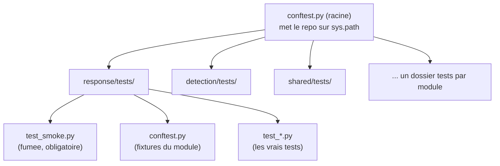
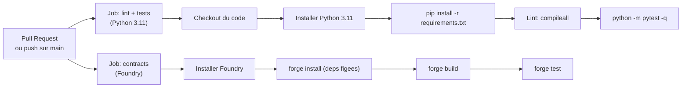

<Info>
**Ce que tu vas comprendre ici**
- **C'est quoi** un test, et pourquoi on en a (surtout dans un projet de sécurité).
- La **structure** des tests du dépôt : `conftest.py`, `<module>/tests/`, test de fumée.
- L'**anatomie** d'un vrai test, commentée ligne à ligne.
- **Lancer** tous les tests, un module, un seul test — et **lire** la sortie pytest.
- Le hook **pytest-on-save**, la **CI**, les tests **Foundry**, et « écrire ton premier test ».

Temps de lecture : environ 14 minutes.
</Info>

<Tip>
**Analogie** : un test, c'est le **contrôle technique d'une voiture**. On ne conduit pas en
espérant que les freins marchent : on les teste sur le banc, à l'arrêt, avant de prendre la route.
Chaque test vérifie **une** chose précise (« les freins répondent ») et donne un verdict net :
réussi ou échoué.
</Tip>

## C'est quoi un test, et pourquoi

Un **test** est un petit programme qui exécute un bout de ton code avec des entrées connues et
**vérifie** que le résultat est bien celui attendu. S'il l'est, le test « passe » ; sinon, il
« échoue » et te montre où.

Pourquoi c'est vital ici :
- **Sécurité** : on affirme « même avec une clé volée, la perte est bornée ». On ne peut pas dire
  « prouvé », mais on peut dire « **vérifié par tests** » — à condition d'avoir les tests.
- **Travail à plusieurs** : la règle d'équipe est « **chaque nouvelle fonction arrive avec son
  test** ». Les tests sont le filet qui empêche qu'une personne casse le code d'une autre.
- **Non-régression** : un test qui passe aujourd'hui et échoue demain te dit **exactement** ce
  qu'un changement a cassé.

Source : `README.md` §4 et §6, `docs/AI_WORKFLOW.md`, `docs/CLAIMS.md`.

## La structure des tests du dépôt



Les règles de rangement :
- **`conftest.py` à la racine** garantit que les modules (`response`, `detection`, `shared`…)
  s'importent dans les tests sans installation particulière. Il ajoute la racine du dépôt à
  `sys.path`. Source : `conftest.py`.
- **Un dossier `tests/` par module.** Chaque module a au minimum un **test de fumée**
  (`test_smoke.py`) : il vérifie juste que le module **s'importe** et tourne seul. C'est le
  minimum garanti par les conventions (`README.md` §3).
- **Des `conftest.py` de module** fournissent des **fixtures** : des objets prêts à l'emploi
  réutilisés par plusieurs tests (par exemple une horloge factice, un orchestrateur configuré).

<Note>
**Fixture** = un ingrédient préparé d'avance. Au lieu de reconstruire le même objet dans dix
tests, on le prépare une fois dans une fixture et chaque test le reçoit tout prêt.
</Note>

## Anatomie de vrais tests, ligne à ligne

### Exemple 1 — le test de fumée (le plus simple)

Fichier : `response/tests/test_smoke.py`

```python
"""Test de fumee du module response : le package s'importe et tourne seul."""


def test_import_response() -> None:
    import response

    assert response is not None
```

Décorticage :
- La **docstring** (ligne 1) dit en une phrase ce que le fichier vérifie.
- `def test_import_response()` : pytest reconnaît une fonction de test à son nom qui **commence
  par `test_`**.
- `import response` : on tente d'importer le module. Si l'import plante, le test échoue tout seul.
- `assert response is not None` : une **assertion**. Elle affirme un fait ; si le fait est faux,
  le test échoue. Ici elle confirme que l'import a bien produit quelque chose.

C'est tout — et c'est précieux : si quelqu'un casse un import quelque part, ce test minuscule
l'attrape immédiatement. (`detection/tests/test_smoke.py` et `shared/tests/test_smoke.py` sont
bâtis sur le même modèle.)

### Exemple 2 — un test de règle métier

Fichier : `detection/tests/test_relay_dedup.py` (extrait &le; 25 lignes)

```python
def _slot(*transfers: tuple[str, str, int]) -> SlotAggregate:
    slot = SlotAggregate(0)
    for sender, recipient, amount in transfers:
        slot.add(_transfer(sender, recipient, amount, AT))
    return slot


def test_chain_a_b_c_counts_once() -> None:
    slot = _slot((A, B, 100), (B, C, 100))
    assert slot.gross_volume == 200
    assert slot.volume == 100
    assert slot.herfindahl() == 1.0
```

Décorticage :
- `_slot(...)` est une petite **aide** (son nom commence par `_`, donc pytest ne la prend pas pour
  un test) : elle construit une « tranche » et y ajoute des transferts fictifs.
- `test_chain_a_b_c_counts_once` vérifie une règle **métier** importante : un montant qui transite
  A → B → C **dans la même tranche** ne doit être compté **qu'une fois**.
- Les trois `assert` disent : le volume **brut** est 200 (deux sauts de 100), mais le volume
  **dédupliqué** est 100 (l'argent n'a traversé qu'une fois), et la concentration (`herfindahl`)
  vaut 1.0.
- Le **nom** du test est une phrase : « chaîne A→B→C comptée une fois ». Un bon nom de test se lit
  comme une spécification.

<Warning>
Cette règle de déduplication est marquée **PROVISOIRE** dans le code (voir `SlotAggregate.volume`
et `docs/OPEN_QUESTIONS.md`). Un test qui fige une règle provisoire est utile : il documente le
comportement **actuel** sans prétendre qu'il est définitif. Source : `detection/tests/test_relay_dedup.py`.
</Warning>

### Exemple 3 — une fixture (ingrédient réutilisable)

Fichier : `response/tests/conftest.py` (extrait)

```python
class FakeClock:
    """Horloge manuelle (UTC)."""

    def __init__(self, start: datetime = START) -> None:
        self.now = start

    def advance(self, minutes: float) -> None:
        self.now += timedelta(minutes=minutes)


@pytest.fixture
def clock() -> FakeClock:
    return FakeClock()
```

Décorticage :
- `FakeClock` est une **fausse horloge** : au lieu du temps réel, le test décide quand « avancer »
  (`advance(minutes=...)`). C'est ce qui rend les tests **déterministes** : un retard qui expire
  « 10 minutes plus tard » se teste sans attendre 10 vraies minutes.
- `@pytest.fixture` au-dessus de `clock()` : pytest **injecte** cette horloge dans tout test qui
  demande un argument nommé `clock`. Pas de copier-coller d'un test à l'autre.

Source : `response/tests/conftest.py`.

## Lancer les tests

<Steps>
  <Step title="Tous les tests">
    ```bash
    make test
    ```
    Équivalent sans `make` : `python -m pytest -q`. Lance **toute** la suite.
    <Warning>
    Sur une machine à mémoire serrée, la suite complète peut peser. Pour une vérification
    courante, lance plutôt **un module léger** (ci-dessous).
    </Warning>
  </Step>
  <Step title="Un seul module">
    ```bash
    python -m pytest -q shared
    ```
    Ne lance que les tests du dossier `shared/`.
  </Step>
  <Step title="Un seul test, par mot-clé (-k)">
    ```bash
    python -m pytest -q -k chain_a_b_c
    ```
    `-k` filtre par **sous-chaîne** du nom : ici, seuls les tests dont le nom contient
    `chain_a_b_c` tournent.
  </Step>
  <Step title="Un seul test, par chemin (::)">
    ```bash
    python -m pytest -q detection/tests/test_relay_dedup.py::test_chain_a_b_c_counts_once
    ```
    La syntaxe `fichier::fonction` cible **exactement** un test.
  </Step>
</Steps>

### Lire une sortie pytest

Voici une **vraie** sortie, obtenue en lançant `python -m pytest -q shared` le 2026-10-11 :

```text
................................                                         [100%]
32 passed in 0.43s
```

Comment la lire :
- Chaque **point `.`** = un test **réussi**. Ici 32 points = 32 tests passés.
- **`F`** apparaîtrait pour un test **échoué** (une assertion fausse), **`E`** pour une **erreur**
  (le test a planté avant même d'arriver à l'assertion, par ex. un import cassé).
- La dernière ligne résume : `32 passed in 0.43s`.

En cas d'échec, pytest affiche un **traceback** : la pile d'appels qui mène à la ligne fautive,
puis la ligne `assert` qui a échoué avec la valeur réellement obtenue. On lit le traceback **de
bas en haut** : la dernière ligne pointe souvent droit sur le problème.

### Compter sans lancer

Pour savoir combien de tests existent **sans** rien exécuter (opération légère) :

```bash
python -m pytest --collect-only -q
```

**Sortie attendue** (dernière ligne), mesurée le 2026-10-11 sur `main` :

```text
342 tests collected in 8.68s
```

<Note>
**État actuel** : la suite pytest compte **environ 342 tests** sur `main` (mesuré le 2026-10-11
par `--collect-only`). Recompte toi-même avec la commande ci-dessus — c'est léger. Évite de lancer
la **suite complète** si ta mémoire est limitée ; lance un module (`python -m pytest -q shared`).
</Note>

## Le hook Kiro « pytest-on-save »

Dans l'IDE Kiro, un **hook** lance pytest **à chaque sauvegarde** d'un fichier Python. C'est un
filet local : tu vois tout de suite si tu casses un test, avant même de pousser.

Ce que dit sa configuration (`.kiro/hooks/pytest-on-save.json`) :
- déclencheur : `PostFileSave` ;
- filtre : les fichiers qui finissent par `.py` ;
- action : la commande `python -m pytest -q`, avec un délai maximum de 120 s.

Il s'active au prochain démarrage de session Kiro après le clone — **rien à installer**. Source :
`.kiro/hooks/pytest-on-save.json`, `docs/AI_WORKFLOW.md`.

## La CI (GitHub Actions), étape par étape

À chaque Pull Request (et à chaque push sur `main`), GitHub lance automatiquement le workflow
`.github/workflows/ci.yml`. **Une PR dont la CI est rouge ne se fusionne pas.** Voici ce qu'il
fait, étape par étape.



- **Job `test`** (Python 3.11) : récupère le code, installe Python, installe les dépendances
  depuis `requirements.txt`, lance un **lint** léger (`compileall` compile tous les modules pour
  attraper les erreurs de syntaxe), puis `python -m pytest -q`.
- **Job `contracts`** : installe Foundry (version figée), installe les dépendances de contrats aux
  tags figés, puis `forge build` et `forge test`.

Source : `.github/workflows/ci.yml`, `.github/pull_request_template.md`.

## Les tests Foundry (contrats)

Les smart contracts se testent avec **Foundry** (`forge`), pas pytest. Depuis `contracts/` :

```bash
forge build          # compile
forge test -vv       # lance les tests (verbeux)
```

Trois familles de tests Foundry, à distinguer :

| Famille | Ce qu'elle fait | Exemple dans `contracts/test/` |
|---|---|---|
| **Unitaires** | Vérifient un comportement précis avec des valeurs fixées. | `ProtectedMinter.t.sol` (un test par invariant I1–I5) |
| **Fuzz** | Rejouent le même test avec des **centaines d'entrées aléatoires**. | `StolenServiceKey.fuzz.t.sol` |
| **Invariants** | Vérifient qu'une propriété reste vraie **quelle que soit** la séquence d'actions. | `invariant/ProtectedMinter.invariant.t.sol` |

<Tip>
**Analogie** : un test **unitaire** demande « est-ce que 2+2 fait 4 ? ». Un test **fuzz** demande
« est-ce que a+b fait b+a, pour **mille** paires a,b tirées au hasard ? ». Un **invariant** dit
« peu importe l'ordre des opérations, le coffre contient toujours **au plus** ce qu'on y a mis ».
</Tip>

Quelques cibles utiles (lues dans `contracts/README.md`) :

```bash
forge test --match-contract VulnerableMinterTest -vv   # l'attaque qui passe sur le contrat vulnerable
forge test --match-contract ScenarioATest -vv          # meme attaque, deux contrats cote a cote
forge test --match-path "test/invariant/*" -vv         # les invariants (perte bornee)
```

Rappel honnête du README des contrats : la borne de perte est « **vérifiée par tests**
d'invariants », **pas prouvée**. Source : `contracts/README.md`.

## Écrire ton premier test (pas à pas)

Objectif : écrire un test simple pour une fonction imaginaire `somme(a, b)`. L'exemple ci-dessous
est **fictif** et sert d'illustration — **n'ajoute aucun fichier de test au dépôt** en suivant ce
tutoriel.

<Steps>
  <Step title="Choisir où le ranger">
    Un test va dans le dossier `tests/` du module concerné, à côté du `test_smoke.py` existant.
    Pour une fonction du module `shared`, ce serait `shared/tests/test_somme.py`.
  </Step>
  <Step title="Écrire le test">
    ```python
    # exemple FICTIF — ne pas committer
    from shared.exemple import somme   # fonction imaginaire


    def test_somme_additionne_deux_entiers() -> None:
        resultat = somme(2, 3)
        assert resultat == 5
    ```
    Trois réflexes : un **nom** qui décrit le comportement, **un** comportement par test, une
    **assertion** claire sur le résultat attendu.
  </Step>
  <Step title="Tester aussi le cas d'erreur">
    Si la fonction doit lever une erreur, on le vérifie explicitement :
    ```python
    import pytest

    def test_somme_refuse_un_texte() -> None:
        with pytest.raises(TypeError):
            somme("deux", 3)
    ```
    `pytest.raises(...)` dit : « ce bloc **doit** lever cette erreur ». S'il ne la lève pas, le
    test échoue.
  </Step>
  <Step title="Le lancer">
    ```bash
    python -m pytest -q -k somme
    ```
    Tu dois voir des points et `passed`. S'il échoue, lis le traceback de bas en haut et corrige.
  </Step>
</Steps>

<Warning>
La règle d'équipe : **chaque nouvelle fonction que tu écris arrive avec son test** dans le
`tests/` de ton module. C'est aussi ce que la CI vérifie indirectement (une PR sans test pour le
code ajouté ne doit pas être fusionnée). Source : `docs/AI_WORKFLOW.md`,
`.github/pull_request_template.md`.
</Warning>

<Check>
**À retenir**
- Un test vérifie **un** comportement avec une **assertion** ; son nom se lit comme une spec.
- Chaque module a un **test de fumée** ; les **fixtures** (`conftest.py`) évitent les répétitions.
- `.` = réussi, `F` = échoué, `E` = erreur ; lire le traceback **de bas en haut**.
- État actuel : **~342 tests** verts sur `main` (2026-10-11). Lance un module, pas toute la suite.
- Foundry : **unitaires / fuzz / invariants** ; la perte est « vérifiée par tests », pas prouvée.
</Check>

<CardGroup cols={2}>
  <Card title="Le workflow d'équipe" icon="code-branch" href="/pratique/workflow-equipe">
    Où les tests s'insèrent : PR, CI verte obligatoire, merge.
  </Card>
  <Card title="Lancer les démos" icon="play" href="/pratique/premiere-demo">
    Les démos que ces tests protègent.
  </Card>
  <Card title="Les trois volets" icon="layer-group" href="/les-trois-volets">
    Le volet 2 (« perte bornée ») repose entièrement sur les tests Foundry.
  </Card>
  <Card title="Dépannage" icon="wrench" href="/pratique/depannage">
    `ModuleNotFoundError`, CI rouge, Foundry absent…
  </Card>
</CardGroup>
