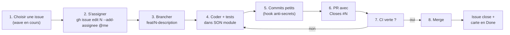
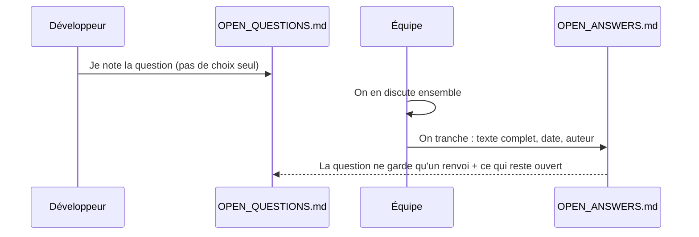

<Info>
**Ce que tu vas comprendre ici**
- Le **cycle complet** d'une tâche : de l'issue au merge, étape par étape.
- Pourquoi `main` est **protégée** et ce que ça change pour toi.
- Les **règles d'or** de la collaboration (un dossier = un propriétaire).
- Comment **parler à ton IA** sans empiéter sur le travail des autres.
- Comment une **question** devient une **décision** (OPEN_QUESTIONS → OPEN_ANSWERS).
- Le **tableau de bord d'avancement** pour voir où en est l'équipe.

Temps de lecture : environ 12 minutes.
</Info>

<Tip>
**Analogie** : travailler à plusieurs sur le code, c'est comme **cuisiner à quatre dans une même
cuisine**. Chacun a son plan de travail (son module), on ne touche pas à la casserole d'un autre
sans prévenir, et le plat ne part en salle (`main`) qu'après un **contrôle qualité** (la CI verte
+ la relecture). Les ustensiles communs (`shared/`) ne se déplacent qu'avec l'accord de tous.
</Tip>

## Le cycle d'une tâche, de A à Z



Les 8 étapes, détaillées (source : `README.md` §5, `docs/AI_WORKFLOW.md`) :

<Steps>
  <Step title="Choisir une issue">
    Commence par la **vague en cours** (`docs/ROADMAP.md`, labels `wave:0` … `wave:5`).
    ```bash
    gh issue list --label "wave:0"
    gh issue list --label "module:detection"
    ```
  </Step>
  <Step title="S'assigner l'issue">
    ```bash
    gh issue edit <N> --add-assignee "@me"
    ```
    Et passe la carte en **In Progress** sur le board.
  </Step>
  <Step title="Créer sa branche">
    Jamais de travail direct sur `main`. Une branche par tâche :
    ```bash
    git checkout -b feat/<N>-<description-courte>
    ```
    Exemple : `feat/42-transfer-rules`.
  </Step>
  <Step title="Coder dans son module + ajouter des tests">
    Tu codes **uniquement** dans ton dossier (`docs/TEAM.md`), et **chaque fonction arrive avec
    son test** dans `<module>/tests/`.
  </Step>
  <Step title="Commits petits et fréquents">
    ```bash
    git add <tes fichiers du module>
    git commit -m "feat(mon-module): ..."
    ```
    Le hook anti-secrets tourne **tout seul** à chaque commit. Préfère `git add <fichier>` à
    `git add -A` pour ne pas embarquer le dossier d'un autre.
  </Step>
  <Step title="Ouvrir une PR avec Closes #N">
    ```bash
    git push -u origin feat/<N>-<description>
    gh pr create --fill
    ```
    Dans la description, écris **`Closes #N`** : au merge, l'issue se ferme et la carte passe en
    **Done** automatiquement. Remplis le gabarit (`.github/pull_request_template.md`) et **coche
    les modules touchés**.
  </Step>
  <Step title="Attendre la CI verte">
    La CI (`.github/workflows/ci.yml`) lance lint + pytest + les contrats Foundry. **Rouge = on ne
    merge pas.** Corrige, repousse, la CI relance.
  </Step>
  <Step title="Merger">
    Une fois la CI verte (et la relecture faite pour les zones sensibles), fusionne. L'issue se
    ferme, la carte passe en **Done**.
  </Step>
</Steps>

## La protection de `main`

`main` est **protégée** côté GitHub : pas de push direct, PR obligatoire, et **CI verte requise**
avant de pouvoir fusionner.

<Tip>
**Analogie** : `main` est le **coffre-fort de la banque**. On n'y entre pas directement avec son
chariot ; on dépose par un **sas** (la PR) qui ne s'ouvre que si le détecteur (la CI) est au vert
et qu'un collègue a validé. Comme le compte AWS est supprimé à la fin, **GitHub est notre seule
sauvegarde** : d'où « push + PR au moins toutes les heures ».
</Tip>

Source : `README.md` §6 (« Branch protection sur `main` »), `docs/TEAM.md`.

## Les règles d'or

| Règle | Pourquoi |
|---|---|
| **Un dossier = un propriétaire.** | Quatre personnes en parallèle sans collision (`docs/TEAM.md`). |
| **Pas de travail direct sur `main`.** | `main` doit toujours être verte et déployable. |
| **Petits commits, PR toutes les heures.** | GitHub est la seule sauvegarde (compte AWS éphémère). |
| **Jamais de vraie clé ni de vraies données.** | Comptes de test Fuji + synthétique (`FLAG{team20-canary}`). |
| **Aucune dépendance sans l'ajouter à `requirements.txt`** et prévenir l'équipe. | Source unique des deps. |
| **Chaque fonction arrive avec son test.** | La CI vérifie, et c'est notre filet de sécurité. |
| **`shared/` et `docs/CONTRACTS.md` : accord explicite.** | Ce sont les interfaces communes : les changer seul casse tout le monde. |

Source : `README.md` §4, `docs/TEAM.md`, `.kiro/steering/collaboration.md`.

<Warning>
`shared/`, `docs/CONTRACTS.md`, `.kiro/steering/` et `CLAUDE.md` sont des **zones sensibles** :
elles impactent toutes les sessions. On ne les modifie **pas seul** — une relecture par deux
propriétaires est requise. Source : `docs/TEAM.md`.
</Warning>

## Parler à son IA sans empiéter

Chaque membre code avec son propre assistant. La règle d'or vaut aussi pour lui : **il ne touche
qu'à ton dossier**. Cadre-le au début de chaque session (modèle de prompt dans
`docs/AI_WORKFLOW.md`).

Avec **Kiro**, c'est en partie automatique : les fichiers de `.kiro/steering/` injectent les
règles sans que tu les répètes.

| Fichier de steering | Quand il se charge |
|---|---|
| `.kiro/steering/collaboration.md` | **Toujours** : règles d'équipe + but du projet. |
| `.kiro/steering/module-<nom>.md` | **Automatiquement** quand tu ouvres un fichier du module (`monitor`, `detection`, `llm`, `response`, `dashboard`, `shared`, `contracts`, `data`). |
| `.kiro/steering/github-tracking.md` | Rappelle à l'IA de tenir issues + board à jour. |

Phrases utiles à dire à ton IA (tirées de `docs/AI_WORKFLOW.md`) :
- « Reste dans `<TON_MODULE>/`, ne modifie aucun autre dossier. »
- « Tu veux changer un modèle partagé : stop. Explique-moi pourquoi, je verrai avec l'équipe. »
- « C'est une décision de conception : ne tranche pas, propose 2-3 options et je les note dans
  `OPEN_QUESTIONS.md`. »

**Signaux d'alarme** — reprends la main si ton IA veut éditer hors de ton dossier, modifie
`shared/` « pour que ça marche », ajoute une dépendance en douce, **invente des chiffres**, ou
écrit « prouvé » / « révolutionnaire » (au mieux « vérifié par tests »).

<Note>
Rien n'est décidé par l'IA. Les choix d'archi, de seuils, de design passent par l'équipe. Source :
`docs/AI_WORKFLOW.md`, `.kiro/steering/collaboration.md`.
</Note>

## Comment une question devient une décision



- Une décision de conception non tranchée se **dépose** dans `docs/OPEN_QUESTIONS.md` — on n'y
  invente rien, on y pose la question avec des options.
- Une fois tranchée en équipe, le texte complet (avec date et auteur) part dans
  `docs/OPEN_ANSWERS.md`, la **source unique** des décisions actées. La question d'origine ne
  garde qu'un **renvoi** et ce qui reste ouvert.
- Dans la doc grand public, le statut d'une décision se lit sur la page [Décisions](/decisions) :
  **acté** (recopié tel quel, sans le renforcer) vs **ouvert** (« à valider en équipe »).

Source : `docs/AI_WORKFLOW.md`, `docs/OPEN_QUESTIONS.md`, `docs/OPEN_ANSWERS.md`.

## Le tableau de bord d'avancement

Pour voir où en est l'équipe, un outil **en lecture seule** lit les issues GitHub et les affiche :

```bash
make dashboard-progress
# ou directement :
streamlit run tools/progress_dashboard.py
```

Ce qu'il montre (lu dans `tools/progress_dashboard.py`) : progression globale, avancement par
**vague** (`wave:0` … `wave:5`), répartition par **module**, tâches en cours. Il **ne modifie
rien** : ni issue, ni board. Il nécessite `gh` **authentifié** (`gh auth status` vert). Rafraîchir
la page = actualiser.

<Note>
Ce n'est **pas** le dashboard métier (`dashboard/`, Streamlit lui aussi) : celui-ci est un outil
de **suivi d'équipe**, rangé dans `tools/` pour n'appartenir à aucun module. Source :
`tools/progress_dashboard.py`, `README.md` §6.
</Note>

### Les commandes `gh` du quotidien

```bash
gh issue list --label "wave:0"              # ce qu'il y a à faire maintenant
gh issue edit <N> --add-assignee "@me"      # prendre une tâche
gh pr create --fill                          # ouvrir une PR (puis "Closes #N")
gh issue create --title "<module>: ..." --label "module:<x>,wave:<n>"   # nouvelle tâche
```

Déplacer une carte entre colonnes (Todo / In Progress / Done) se fait le plus simplement **à la
main** dans l'interface du board. L'important : la colonne reflète l'état réel. Source :
`.kiro/steering/github-tracking.md`.

<Check>
**À retenir**
- Le cycle : **issue → s'assigner → branche `feat/N-…` → tests → PR `Closes #N` → CI verte → merge**.
- `main` est **protégée** : PR obligatoire + CI verte ; GitHub est la seule sauvegarde.
- Un **dossier = un propriétaire** ; `shared/` et `CONTRACTS.md` ne se touchent pas seul.
- Ton IA reste dans **ton** module ; Kiro charge les règles via `.kiro/steering/`.
- Une question se **dépose** dans OPEN_QUESTIONS, se **tranche** en équipe, atterrit dans OPEN_ANSWERS.
</Check>

<CardGroup cols={2}>
  <Card title="Les tests expliqués" icon="vial" href="/pratique/tests-expliques">
    La CI verte, c'est d'abord les tests : apprends à les lire et à les écrire.
  </Card>
  <Card title="Décisions" icon="scale-balanced" href="/decisions">
    Ce qui est acté vs ouvert, et comment le statut est marqué.
  </Card>
  <Card title="Qui fait quoi" icon="sitemap" href="/qui-fait-quoi">
    Qui possède quel module, et qui contacter pour quoi.
  </Card>
  <Card title="Installer le projet" icon="download" href="/pratique/installer">
    Avant de brancher : cloner, venv, gh auth login.
  </Card>
</CardGroup>
