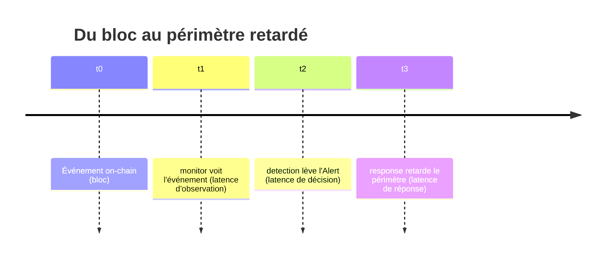

<Info>
**Ce que tu vas comprendre ici**
- La règle d'or : **aucun chiffre sans mesure**.
- Ce qu'on affirme au jury, et **comment** on le vérifie (par scénario).
- Les **métriques** : délai de détection, marge avant conversion, taux de faux positifs.
- Le **vocabulaire autorisé** (« vérifié par tests ») vs **interdit** (« prouvé »).
- Les **pistes futures** mentionnées mais **pas implémentées**.

Temps de lecture : environ 9 minutes. C'est la page à relire **avant une démo**.
</Info>

## La règle d'or

<Warning>
**Aucun chiffre n'est affiché au jury sans avoir été mesuré.** On ne promet que ce qu'on mesure ;
on ne dit **jamais « prouvé »** (au mieux « vérifié par tests d'invariants »). Les cases chiffrées
restent **vides** tant que la mesure n'a pas été faite.
</Warning>

C'est la règle qui tient tout le projet honnête. Elle vient directement de `docs/CLAIMS.md`.

<Tip>
**Analogie** : un emballage alimentaire. On n'écrit « 0 % de matière grasse » que si le
laboratoire l'a mesuré. Sinon, la case reste vide — on ne « suppose » pas une valeur flatteuse.
</Tip>

## Ce qu'on affirme, et comment on le vérifie

Voici les affirmations de `docs/CLAIMS.md`, reformulées pour un novice. Chacune a une **méthode de
vérification** ; les colonnes chiffrées sont encore **à remplir** (c'est voulu).

| On affirme que… | Comment on le vérifie | Statut du chiffre |
|-----------------|------------------------|-------------------|
| La clé volée **ne peut pas choisir le montant** (dérivé du dépôt). | rejeu de l'attaque, contrat vulnérable vs protégé (scénario A) | **à mesurer** |
| La **perte maximale est bornée**. | tests d'invariants / fuzzing Foundry cherchant à dépasser la borne | **à mesurer** |
| Un **gel protège les protocoles en aval**. | mauvaises créances d'un faux marché de prêt **avec vs sans** balise (scénario C) | **à mesurer** |
| Le **taux de faux positifs** est mesuré sur du trafic normal rejoué. | mesure sur un jeu de trafic normal synthétique | **à mesurer** |
| **Solvabilité** (affirmation principale du Ghost) : un mint frauduleux détecté avant la fin de la fenêtre ne produit aucun vrai jeton non adossé (`supply ≤ collatéral`). | tests d'invariants Foundry + rejeu A/D ; **mesure du délai vs fenêtre** | **à mesurer** |
| **Récupération** (affirmation secondaire) : un transfert suspect est annulable tant que son Ghost n'est pas converti. | rejeu d'une chaîne de N transferts puis annulation ; **mesure de la part récupérée** | **à mesurer** |
| La **friction est bornée** : notre surveillance ne peut mettre plus de **X %** de l'offre en fenêtre allongée. | tests d'invariants sur le budget de quarantaine | **X à mesurer** |
| Le **soupçon est conservé** : fractionner un lot suspect ne réduit pas le soupçon total. | tests d'invariants sur la contamination par ratio | **à mesurer** |
| La **friction reste locale** : un allongement ne touche que le périmètre suspect. | mesure de la part du jeton restée en fenêtre normale pendant un incident simulé | **à mesurer** |

<Info>
Source : `docs/CLAIMS.md` (tableau complet, colonnes « comment on le vérifie » et « limites et
hypothèses »). Statut du tableau : **proposé, à valider en équipe**. Hypothèse récurrente des
affirmations : **clés d'administration non compromises**.
</Info>

<Note>
Deux affirmations sur le Ghost, pas une : **solvabilité** (principale, se vérifie seule par
invariants) et **récupération** (secondaire, dépend d'un arbitrage humain et de questions encore
ouvertes). La solvabilité est mise en tête car elle ne dépend d'aucune question ouverte.
Source : `docs/OPEN_ANSWERS.md` §0bis-a.
</Note>

## Les métriques : qu'est-ce qu'on mesure, exactement ?

La §5 de `docs/OPEN_ANSWERS.md` définit **comment** on mesure. Le fil conducteur : **tout se
mesure par rapport à la fenêtre Ghost**, pas en secondes absolues. Une alerte « rapide » qui
arrive **après** la conversion est inutile.

### Le délai de détection, découpé en segments

- **Délai de détection = `t2 − t0`** : la métrique brute.
- **Marge avant conversion = `fenêtre_Ghost − (t3 − t0)`** : **le** chiffre à montrer au jury. Un
  délai n'est un **succès** que si cette marge est **positive** (on a retardé avant que les fonds
  suspects ne deviennent du vrai jeton).
- On rejoue chaque scénario N fois et on rapporte **médiane et p95** (pas la moyenne, sensible aux
  pics), horodaté sur `block.timestamp`.

### Le taux de faux positifs

- **Dénominateur** : le **trafic normal synthétique sans aucune attaque**.
- **Un faux positif** = une fenêtre de trafic normal qui déclenche à tort un allongement
  (`NORMAL → RETARDÉ`).
- **Second compteur, plus honnête** : la **part de l'offre inutilement retardée** (un faux positif
  qui retarde 0,1 % de l'offre ne coûte pas comme un qui en retarde 20 %).
- On ne **devine** pas le seuil : on **balaie** le seuil et on trace faux positifs vs
  détection-avant-conversion, puis on **choisit** un point sur la courbe.

<Info>
Source : `docs/OPEN_ANSWERS.md` §5. Statut : **validée en session, à relire par l'équipe**. La
fenêtre d'agrégation doit être **strictement plus courte** que la fenêtre Ghost, sinon l'alerte
arrive trop tard.
</Info>

### La baseline : à quoi on se compare

La **baseline** (le « avant ») est le monde **sans notre système** = Resolv tel quel : mint
accepté, aucune alerte, conversion immédiate, perte totale. Référence du hack réel : ~200 000 USDC
déposés, 80 M mintés, dépeg en **17 minutes**.

### Les critères de succès, par scénario

| Scénario | Métrique | Succès si… |
|----------|----------|-----------|
| A — vulnérable vs protégé | montant mintable pour un même dépôt | protégé = 1:1 ; vulnérable = gonflé |
| B reformulé | marge avant conversion | alerte émise avec marge **positive** |
| trafic normal | taux de faux positifs + part d'offre retardée | mesurés, et faibles au seuil retenu |
| C — contagion | mauvaises créances aval, avec vs sans balise | avec **inférieur à** sans |
| D — Token Ghost | perte protocole vs spéculateurs | protocole ≈ 0, perte reportée au marché |

<Info>
Source : `docs/OPEN_ANSWERS.md` §5 (tableau des critères de succès). Règle transversale : chaque
ligne de `CLAIMS.md` doit avoir une mesure dans un de ces scénarios.
</Info>

## Les valeurs proposées (mesurées en simulation, pas encore actées)

Le document `data/DECISION_SUPPORT_3.md` rassemble des valeurs **mesurées sur des données
fictives** par `make calibrate` et propose un point de fonctionnement. Elles sont **proposées, à
valider** — pas des promesses au jury.

| Valeur | Mesure (fictive) | Proposition | Statut |
|--------|------------------|-------------|--------|
| Fenêtre Ghost W (normale) | friction 3,2 % de l'offre (p95 5,7 %) à 10 min | **10 min** | à valider |
| Tranche d'agrégation | doit être inférieure à W | **5 min** | à valider |
| Seuil `z volume` | 0 faux positif à partir de 6 (profil gros transferts) | **6** | à valider, dépend du profil |
| Seuil `z Herfindahl` | 2 à 4 équivalents | **3** | à valider |
| Lignage pour la récupération | prospectif seul = 0 % récupéré | lignage d'origine / rétroactif | décision #85 |

<Warning>
Ces chiffres viennent d'**une seule graine** (42) sur des **données fictives**. Ils illustrent un
point de fonctionnement **argumenté**, pas une performance garantie. Ils restent **à régénérer**
et **à acter** par l'équipe.
</Warning>

<Info>
Source : `data/DECISION_SUPPORT_3.md` (tableau de synthèse, mesures `make calibrate` et
`python -m data.late_marking`, graine 42). Un résultat frappant : récupération **0 %** avec le
ratio prospectif seul, **100 %** avec un lignage d'origine, tant que l'alerte précède l'échéance.
</Info>

## Le vocabulaire : autorisé vs interdit

Un mot mal choisi devant le jury peut ruiner la crédibilité. On s'y tient strictement.

<CardGroup cols={2}>
  <Card title="Autorisé" icon="circle-check">
    « **vérifié par tests d'invariants** », « **mesuré** sur trafic rejoué », « **borné et
    testé** », « **à mesurer** », « **proposé, à valider** », « données **fictives** ».
  </Card>
  <Card title="Interdit" icon="circle-xmark">
    « **prouvé** », « **garanti à 100 %** », « **impossible** », tout chiffre de performance
    **non mesuré**, « sécurisé » sans qualificatif.
  </Card>
</CardGroup>

<Note>
Pourquoi « vérifié par tests » et pas « prouvé » : un test (même du fuzzing massif) qui ne trouve
pas de faille **ne garantit pas** qu'il n'y en a aucune. Seule une **preuve formelle** le ferait,
et on n'en fait pas. L'honnêteté est un atout, pas une faiblesse, devant un jury technique.
</Note>

## Les pistes futures (mentionnées, pas implémentées)

Ces idées répondent au problème de la clé volée mais sont **trop lourdes pour 48 h**. On peut les
**mentionner** comme perspectives, à condition de dire clairement qu'elles ne sont **pas** dans la
maquette.

<AccordionGroup>
  <Accordion title="Signature dans une enclave sécurisée" icon="microchip">
    Garder la clé de signature dans un composant matériel isolé, d'où elle ne sort jamais. Réduit
    le risque de vol à la source. **Non implémenté.**
  </Accordion>
  <Accordion title="Signatures à seuil (MPC)" icon="key">
    Découper la clé entre plusieurs machines : aucune ne détient la clé entière, il en faut
    plusieurs pour signer. Un vol unique ne suffit plus. **Non implémenté.**
  </Accordion>
  <Accordion title="Preuves à connaissance nulle de solvabilité" icon="shield-halved">
    Prouver cryptographiquement que `supply ≤ collatéral` sans tout dévoiler. Élégant mais lourd.
    **Non implémenté.**
  </Accordion>
</AccordionGroup>

<Info>
Source : `docs/CLAIMS.md` (« Pistes futures — mentionnées, non implémentées — trop lourdes pour
48 h »).
</Info>

<Check>
**À retenir**
- **Aucun chiffre sans mesure** ; les cases chiffrées de `CLAIMS.md` restent vides tant que non
  mesurées.
- La vraie métrique jury : la **marge avant conversion** (positive = succès), médiane + p95.
- Faux positifs mesurés sur le **trafic normal**, baseline = Resolv tel quel (dépeg en 17 min).
- Valeurs de `DECISION_SUPPORT_3.md` : **proposées, à valider**, sur données fictives, une seule
  graine.
- On dit **« vérifié par tests »**, jamais **« prouvé »**. Pistes MPC / enclave / ZK = **non
  implémentées**.
</Check>

<CardGroup cols={2}>
  <Card title="Les trois volets" icon="layer-group" href="/les-trois-volets">
    Les protections que ces promesses mesurent.
  </Card>
  <Card title="Les garde-fous" icon="lock" href="/les-garde-fous">
    Les surveillants, le multisig et DORA.
  </Card>
  <Card title="Le Token Ghost" icon="ghost" href="/token-ghost">
    Solvabilité et récupération, les deux affirmations du Ghost.
  </Card>
  <Card title="Pricer le risque" icon="gauge-high" href="/contamination-par-ratio">
    Le ratio derrière le soupçon conservé.
  </Card>
</CardGroup>
