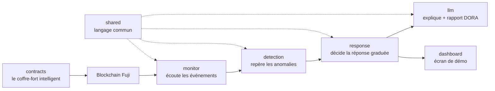

Le projet est découpé en **modules** (un dossier chacun). Un module = un propriétaire. Voici le
rôle de chacun, sans jargon.

## Les modules

<CardGroup cols={2}>
  <Card title="contracts" icon="file-contract">
    Le **coffre-fort intelligent** (smart contracts). C'est lui qui applique les volets 1, 2, 3.
    Écrit en Solidity, déployé sur le réseau de test Avalanche Fuji.
  </Card>
  <Card title="monitor" icon="satellite-dish">
    Les **oreilles** : écoute en direct ce qui se passe sur la blockchain (créations et transferts
    de jetons) et transmet les événements.
  </Card>
  <Card title="detection" icon="magnifying-glass">
    Les **surveillants** : analysent les événements et lèvent une **alerte** si quelque chose est
    anormal. Peuvent demander un gel, mais ne décident jamais seuls.
  </Card>
  <Card title="response" icon="sliders">
    Le **chef d'orchestre** : reçoit les alertes et déclenche la réponse graduée (geler, demander
    une validation humaine, tout journaliser).
  </Card>
  <Card title="llm" icon="comment-dots">
    Le **traducteur** : utilise une IA (Amazon Bedrock) pour expliquer un incident en langage
    clair et pré-remplir le rapport réglementaire. Appelé seulement sur alerte.
  </Card>
  <Card title="dashboard" icon="chart-line">
    L'**écran de démo** : montre visuellement les alertes et la réponse, pour la présentation.
  </Card>
  <Card title="shared" icon="cubes">
    Le **langage commun** : les formats de données que tous les modules utilisent pour se parler.
    Zone sensible, on n'y touche pas seul.
  </Card>
  <Card title="data" icon="database">
    Les **scénarios de test** : des données **fictives** rejouant des attaques, pour tout
    démontrer sans risque.
  </Card>
</CardGroup>

## Comment ça circule (en une phrase)

La **blockchain** émet des événements → **monitor** les écoute → **detection** repère le louche →
**response** décide quoi faire → **llm** explique et documente, **dashboard** l'affiche. Le
**contracts** est la forteresse en amont, et **shared** est la langue que tout le monde parle.

<Note>
Qui possède quel module, les branches de travail et l'ordre des tâches sont dans `docs/TEAM.md` et
`docs/ROADMAP.md`. Les décisions encore ouvertes sont dans `docs/OPEN_QUESTIONS.md`.
</Note>
