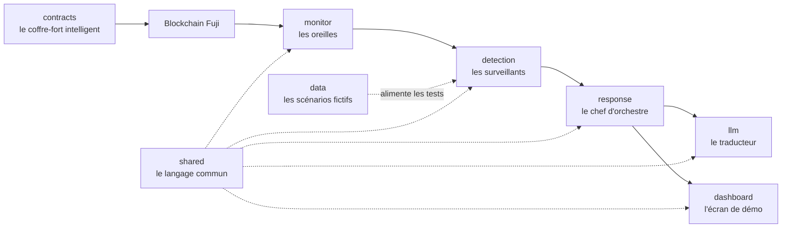
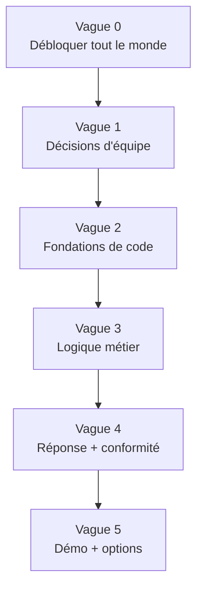

<Info>
**Ce que tu vas comprendre ici**
- Les **8 modules** de code (+ la doc), le rôle de chacun en une image.
- **Qui possède quoi** : un dossier = un propriétaire, et pourquoi.
- La **répartition en cours** et l'ordre de travail en **vagues** (0 à 5).
- **Qui contacter** pour quoi, et quelles sont les **zones sensibles**.

Temps de lecture : environ 9 minutes. Pour le trajet technique d'une donnée d'un module à
l'autre, enchaîne sur [L'architecture](/modules/architecture).
</Info>

Le projet est découpé en **modules** : un dossier = un sujet = un propriétaire. On range chaque
chose à sa place pour que quatre personnes travaillent en parallèle sans se marcher dessus.

<Tip>
**Analogie** : un module, c'est un **service** dans une entreprise. Le service « accueil »
(monitor) note tout ce qui entre, le service « sécurité » (detection) repère ce qui cloche, le
service « direction » (response) décide quoi faire, et le service « communication » (llm) rédige
le rapport. Chacun a **un responsable** et une **porte** (le dossier).
</Tip>

## La carte des modules

## Les 8 modules + la doc, en une image

<CardGroup cols={2}>
  <Card title="contracts" icon="file-contract">
    Le **coffre-fort intelligent** (smart contracts Solidity). C'est lui qui applique les
    volets 1, 2, 3. Déployé sur le réseau de test Avalanche Fuji. **Propriétaire : @denybs.**
  </Card>
  <Card title="monitor" icon="satellite-dish">
    Les **oreilles** : écoute en direct les créations (mints) et transferts de jetons sur la
    chaîne, et les transmet. **Propriétaire : @Yannis1307.**
  </Card>
  <Card title="detection" icon="magnifying-glass">
    Les **surveillants** : analysent les événements et lèvent une **alerte** si quelque chose est
    anormal. Peuvent demander un retard, jamais décider seuls. **Propriétaire : @Yannis1307.**
  </Card>
  <Card title="response" icon="sliders">
    Le **chef d'orchestre** : reçoit les alertes et déclenche la réponse graduée (retarder,
    demander une validation humaine, tout journaliser). **Propriétaire : @EnzoFB06.**
  </Card>
  <Card title="llm" icon="comment-dots">
    Le **traducteur** : utilise une IA (Amazon Bedrock) pour expliquer un incident en langage
    clair et pré-remplir le rapport réglementaire. Appelé seulement sur alerte.
    **Propriétaire : @denybs.**
  </Card>
  <Card title="dashboard" icon="chart-line">
    L'**écran de démo** (Streamlit) : montre visuellement les alertes et la réponse pour la
    présentation. **Propriétaire : @marceaupatu123.**
  </Card>
  <Card title="shared" icon="cubes">
    Le **langage commun** : les formats de données (modèles Pydantic) que tous les modules
    utilisent pour se parler. Zone sensible. **Propriétaire : @marceaupatu123.**
  </Card>
  <Card title="data" icon="database">
    Les **scénarios de test** : des données **fictives** rejouant des attaques, pour tout
    démontrer sans risque. **Propriétaire : @EnzoFB06.**
  </Card>
  <Card title="docs" icon="book">
    La **documentation d'équipe** : décisions, contrats d'interface, roadmap. C'est la mémoire du
    projet. **Propriétaire : @marceaupatu123.**
  </Card>
</CardGroup>

<Note>
Il y a **4 personnes pour 8 modules** : certaines en portent deux. C'est volontaire et acté.
Source : `docs/TEAM.md`, `.github/CODEOWNERS`.
</Note>

## Qui possède quoi (table officielle)

Cette table est la copie de `docs/TEAM.md`. La règle d'attribution est reportée dans
`.github/CODEOWNERS` : **la dernière règle qui matche un fichier l'emporte**.

| Module | Propriétaire | Branche type |
|--------|--------------|--------------|
| `contracts` | @denybs | `denybs/contracts` |
| `monitor` | @Yannis1307 | `yannis/monitor` |
| `detection` | @Yannis1307 | `yannis/detection` |
| `llm` | @denybs | `denybs/llm` |
| `response` | @EnzoFB06 | `enzo/response` |
| `dashboard` | @marceaupatu123 | `marceau/dashboard` |
| `shared` | @marceaupatu123 | `marceau/shared` |
| `data` | @EnzoFB06 | `enzo/data` |
| `docs` | @marceaupatu123 | `marceau/docs` |

<Info>
Sources : `docs/TEAM.md` (table de répartition, actée le 2026-10-10) et `.github/CODEOWNERS`
(règles de propriété appliquées par GitHub). Pour contacter quelqu'un sur son module, on passe
par son pseudo GitHub.
</Info>

## La règle d'or : un dossier = un propriétaire

<Warning>
**On ne modifie pas le dossier d'un autre sans le prévenir.** Chaque module a un seul
propriétaire : toute PR qui touche un dossier demande la revue de son propriétaire.
</Warning>

Pourquoi c'est strict :

- **Pas de collision** : chacun lance son agent Kiro sur **son** PC, sur **sa** branche, dans un
  dossier distinct. Zéro conflit de fichiers.
- **Une responsabilité claire** : quand un module casse, on sait qui appeler.
- **Pas de travail direct sur `main`** : une branche par personne ou par fonctionnalité, petits
  commits, push et pull request au moins toutes les heures (le compte AWS est supprimé à la fin de
  l'événement, donc **GitHub est la seule sauvegarde**).

## Les zones sensibles (revue à deux)

Certains fichiers définissent les **interfaces communes** : si on les change seul, on casse le
travail de tout le monde. Ils exigent la revue de **2 propriétaires**.

| Zone sensible | Pourquoi | Revue demandée |
|---------------|----------|----------------|
| `shared/` | le langage commun (modèles Pydantic) ; chaque module en dépend | @marceaupatu123 **+** @denybs |
| `docs/CONTRACTS.md` | la spécification des 13 modèles partagés | @marceaupatu123 **+** @denybs |
| `/.kiro/steering/` | les consignes qui pilotent toutes les sessions Kiro | @marceaupatu123 |
| `CLAUDE.md` | les règles globales du projet | @marceaupatu123 |

<Tip>
**Analogie** : `shared/` et `docs/CONTRACTS.md`, c'est la **langue** que tout le monde parle. Si
une personne change le sens d'un mot dans son coin, plus personne ne se comprend. D'où la règle :
on change la langue **à deux**, jamais seul.
</Tip>

## La répartition en cours

Instantané du 2026-10-10 (source : `docs/ROADMAP.md`). Les deux goulots (#2, #4) sont pris en
priorité pour débloquer la suite.

| Membre | Issue en cours | Dossier | Vague |
|--------|----------------|---------|-------|
| @marceaupatu123 | #2 champs des modèles | `shared/` | 1 (`blocker`) |
| @denybs | #4 Foundry + contrat vulnérable | `contracts/` | 2 |
| @EnzoFB06 | #26 onboarding (fait) | — | 0 |
| @Yannis1307 | #9 monitor : écoute des mints | `monitor/` | 2 |

<Note>
Au moment où `docs/ROADMAP.md` a été écrit, #2 était « en cours » ; il a depuis été **mergé**
(PR #53), ce qui a débloqué la vague 2 et au-delà. La table ci-dessus est l'instantané tel quel ;
l'état réel des issues vit sur GitHub.
</Note>

## L'ordre de travail en vagues (0 → 5)

On attaque le backlog par **vagues** pour ne pas se bloquer les uns les autres. Sur GitHub, chaque
issue porte un label `wave:0` … `wave:5`. Une flèche signifie « doit être fait avant ».

Ce que chaque vague contient (résumé de `docs/ROADMAP.md`) :

<AccordionGroup>
  <Accordion title="Vague 0 — Débloquer tout le monde" icon="rocket">
    Setup RPC Fuji + faucet AVAX + `BEDROCK_MODEL_ID` (#28), onboarding (#26), CODEOWNERS +
    TEAM.md (#27), registre des déploiements (#31). Sans ça, ni chaîne ni LLM ni organisation.
  </Accordion>
  <Accordion title="Vague 1 — Décisions d'équipe" icon="scale-balanced">
    Les choix qui bloquent le code métier : sécurité dans le contrat (#1, **tranché**), plafonds
    et mode Token Ghost (#3), champs des modèles partagés (#2, **mergé**). Ces décisions sont dans
    `docs/OPEN_ANSWERS.md`.
  </Accordion>
  <Accordion title="Vague 2 — Fondations de code" icon="layer-group">
    Foundry + contrat vulnérable (#4), contrat protégé volet 1 (#5), écoute des mints (#9) et des
    transferts (#10). Dépend surtout de #2.
  </Accordion>
  <Accordion title="Vague 3 — Logique métier" icon="gears">
    Surveillant de mint (#11) et de transferts (#12), client Bedrock (#14), orchestration de la
    réponse (#17), invariants / fuzzing du contrat (#6).
  </Accordion>
  <Accordion title="Vague 4 — Réponse complète + conformité" icon="shield-halved">
    Gel / levée multisig (#18), journal d'audit DORA (#19), rapport d'incident DORA (#15),
    scénarios de données A et B (#24).
  </Accordion>
  <Accordion title="Vague 5 — Démo + options" icon="flask">
    Dashboard (#20), outil de scénarios de démo (#47), ERC20 Token Ghost (#8), balise de risque +
    faux marché (#7), pool simulé (#65), surveillant ML (#13), scénarios C et D (#25). Tout ce qui
    est `optional` ne se fait que si le reste tient debout.
  </Accordion>
</AccordionGroup>

<Info>
Source : `docs/ROADMAP.md` (ordre des vagues, dépendances entre issues, statut coché). Le fichier
le dit lui-même : « c'est un guide, pas une loi » — si une dépendance saute, on peut avancer une
vague.
</Info>

## Qui contacter pour quoi

<CardGroup cols={2}>
  <Card title="Un bug dans un contrat Solidity" icon="file-contract">
    @denybs (`contracts`, `llm`).
  </Card>
  <Card title="Un souci d'écoute de la chaîne ou de détection" icon="satellite-dish">
    @Yannis1307 (`monitor`, `detection`).
  </Card>
  <Card title="La réponse graduée ou les données de test" icon="sliders">
    @EnzoFB06 (`response`, `data`).
  </Card>
  <Card title="Les modèles partagés, le dashboard ou la doc" icon="cubes">
    @marceaupatu123 (`shared`, `dashboard`, `docs`).
  </Card>
</CardGroup>

<Note>
Besoin d'AVAX de test ? Envoyer **l'adresse EVM** (`0x…`) du wallet de test — jamais une clé
privée ni une seed phrase. Source du contact faucet : `contracts/DEPLOYMENTS.md`.
</Note>

<Check>
**À retenir**
- 8 modules + la doc, **4 propriétaires** ; un dossier = un propriétaire.
- `shared/` et `docs/CONTRACTS.md` sont des **zones sensibles** : revue à deux, jamais seul.
- Le travail avance en **vagues 0 → 5**, labellisées `wave:N` sur GitHub.
- Pour joindre quelqu'un, on passe par le propriétaire de son module.
</Check>

<CardGroup cols={2}>
  <Card title="L'architecture" icon="diagram-project" href="/modules/architecture">
    Le trajet complet d'une donnée, de la chaîne jusqu'à l'écran.
  </Card>
  <Card title="Le langage commun" icon="cubes" href="/modules/shared">
    Les modèles Pydantic que tous les modules partagent.
  </Card>
  <Card title="Les garde-fous" icon="lock" href="/les-garde-fous">
    Surveillants, veto asymétrique, multisig, DORA.
  </Card>
  <Card title="Le workflow d'équipe" icon="code-branch" href="/pratique/workflow-equipe">
    Git, branches, PR, issues et board.
  </Card>
</CardGroup>
