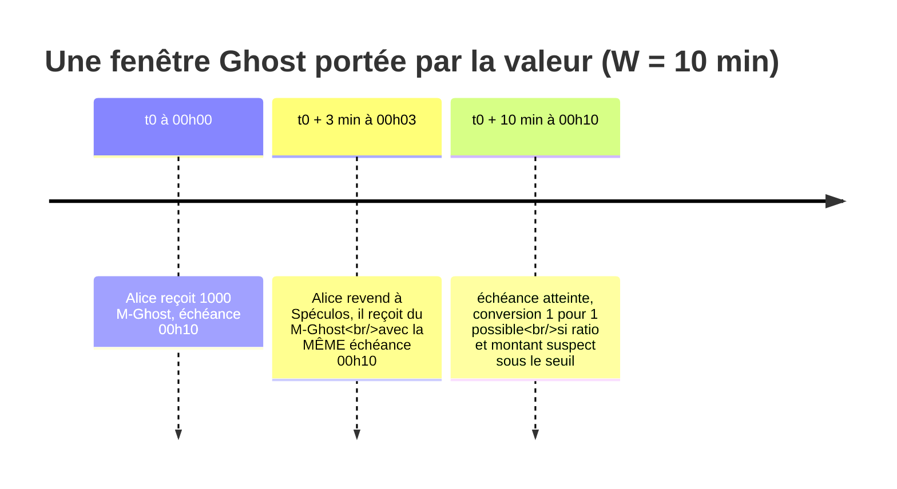
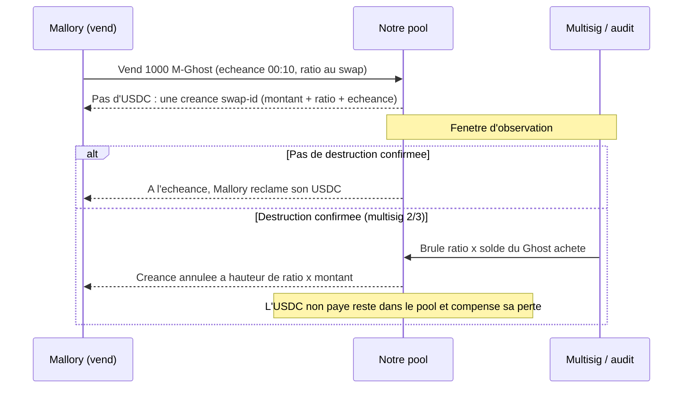
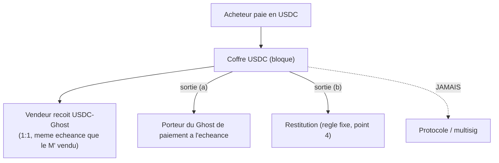

<Info>
**Ce que tu vas comprendre ici**
- Pourquoi **tout** transfert (pas seulement le mint) produit un Token Ghost chez celui qui reçoit.
- Les deux promesses faites au jury : **solvabilité** d'abord, **récupération** ensuite.
- Ce que produit le transfert d'un Ghost : une fenêtre **portée par la valeur**, rangée en
  **tranches d'échéance**.
- Ce qui arrive au collatéral quand on détruit un Ghost : la **réserve de restitution**.
- Qui porte le risque dans une vente (M' **protégé**, **pur**, **chèque**) et la **marge de
  conversion** avec sa limite assumée.

Temps de lecture : environ 18 minutes. Les mots de base sont dans
[La blockchain en 10 minutes](/bases-blockchain) et dans le [Glossaire](/glossaire).
</Info>

<Note>
On suit quatre personnages fictifs tout du long : **Alice** (utilisatrice honnête), **Bob**
(commerçant honnête qui reçoit), **Mallory** (la voleuse de clé) et **Spéculos** (l'acheteur de
Ghost qui prend le risque en connaissance de cause). Tous les montants, adresses et horodatages
sont **fictifs** (`docs/CLAIMS.md`).
</Note>

## L'idée en une phrase

Quand des jetons changent de mains, le destinataire ne reçoit pas tout de suite le vrai jeton : il
reçoit un **Token Ghost**, un jeton temporaire **librement échangeable** pendant une courte fenêtre
(proposition de référence : 10 minutes). Sans anomalie, le Ghost devient 1:1 du vrai jeton. Avec
une fraude confirmée, la **fraction suspecte** du Ghost est détruite **avant** qu'elle ne devienne
du vrai jeton.

**Exemple de référence** : Alice achète 1 000 M à Bob → Alice reçoit 1 000 **M-Ghost** → après
10 minutes sans anomalie, ses M-Ghost deviennent 1 000 **M**.

<Tip>
**Analogie du billet de concert.** Acheter un Ghost, c'est acheter un billet **pas encore
confirmé**, à prix réduit. Concert confirmé (pas de fraude) → le billet devient valable et tu as
payé moins cher. Concert annulé (fraude détectée) → tu perds ta petite mise, mais **tu savais** en
payant moins cher, et c'est **toi** qui as choisi ce pari, pas la salle.
</Tip>

## La décision : le Ghost sur TOUS les transferts

<Note>
**Décision §0bis (2026-10-10, Marceau) — tranché.** Le Token Ghost n'est **pas** limité au mint.
**Tout transfert** de token produit du Ghost chez le destinataire, converti 1:1 en vrai token après
la fenêtre (ex. 10 min) sans anomalie.
</Note>

Un Ghost limité au mint protège contre une **émission frauduleuse**, mais s'arrête là. Deux raisons
ont fait pencher la décision vers « tous les transferts » :

<CardGroup cols={2}>
  <Card title="Récupérer après coup" icon="rotate-left">
    Une fois le vrai jeton en circulation, plus rien n'est rattrapable. En gardant chaque mouvement
    en Ghost pendant la fenêtre, on peut encore **annuler** des transferts liés à une fraude —
    c'est ce qui ouvre la porte à la lutte **anti-blanchiment**.
  </Card>
  <Card title="Un marché parallèle qui existe vraiment" icon="chart-line">
    On ne mint pas toutes les minutes : un Ghost limité au mint laisserait le marché
    **M / M-Ghost quasi vide**. En portant tous les transferts, le marché parallèle est
    **alimenté en continu** — donc observable et démontrable pour la démo.
  </Card>
</CardGroup>

La décision assume quatre conséquences, à traiter comme du travail d'ingénierie et **pas à perdre** :

1. **Liquidité gelée en continu** : 100 % des usages légitimes subissent la fenêtre, plus seulement
   le cas rare du mint volé. À **mesurer**, pas à estimer.
2. **Compatibilité AMM / pools** : chaque swap produit du Ghost non convertible pendant la fenêtre.
3. **Destruction d'une chaîne de transferts** : annuler un échange suppose de défaire des Ghost déjà
   fragmentés chez N adresses. Le cas exceptionnel devient le cas normal.
4. **Choix de la fenêtre** (10 min proposé) : arbitrage entre capacité de récupération et friction
   subie par les légitimes.

<Warning>
Option intermédiaire **écartée** par cette décision (conservée pour mémoire si les points 1 à 3
bloquent à l'implémentation) : ne mettre en Ghost que les **transferts flaggés** par les
surveillants (gros montant, adresse neuve, structuring).
</Warning>

<Info>
Source : `docs/OPEN_ANSWERS.md` §0bis (décision, conséquences assumées, option écartée).
</Info>

## Les deux affirmations portées devant le jury (§0bis-a)

<Note>
**Décision §0bis-a (2026-10-10, Marceau) — tranché.** La ligne unique sur le Ghost est scindée en
**deux affirmations distinctes**, chacune avec sa propre méthode de vérification. La **solvabilité**
passe en tête ; la **récupération** vient ensuite.
</Note>

| Affirmation | Ce qu'on affirme | Comment on le vérifie | Pourquoi dans cet ordre |
|---|---|---|---|
| **Solvabilité** (principale) | Un mint frauduleux détecté avant la fin de la fenêtre Ghost ne produit **aucun** vrai token non adossé (`supply ≤ collateral`). | Tests d'invariants Foundry + rejeu des scénarios A/D. | Se vérifie **seule** (invariants), ne dépend d'aucune question ouverte. |
| **Récupération** (secondaire) | Un transfert suspect est **annulable** tant que son Ghost n'est pas converti, y compris après fragmentation. | Rejeu d'une chaîne de transferts + mesure de la part récupérée. | Dépend du sort du collatéral libéré (§0bis-c) et d'un arbitrage humain (§3). |

Les deux restent vraies avec le Ghost sur tous les transferts : brûler un Ghost adossé donne
`supply < collateral`, ce qui **reste solvable** si l'invariant s'écrit `≤`. Le Ghost conserve la
solvabilité **et ajoute** la récupération.

<Warning>
Deux corrections actées sur l'ancienne ligne : « 100 % solvable » est retiré (la garantie est
**conditionnelle** à ce que la détection soit plus rapide que la fenêtre) ; et le Ghost est un
**renfort**, pas le volet 1 (le volet 1 est la dérivation du montant depuis le dépôt). On ne dit
jamais « prouvé », au mieux « vérifié par tests d'invariants ».
</Warning>

<Info>
Source : `docs/OPEN_ANSWERS.md` §0bis-a et `docs/CLAIMS.md` (lignes « Solvabilité » et
« Récupération »). Statut : **tranché**.
</Info>

## Ce que produit le transfert d'un Ghost : la fenêtre portée par la valeur (§0bis-b)

<Note>
**Décision §0bis-b (2026-10-10, denybs) — validée en session, à relire par l'équipe.** Il n'existe
qu'**un seul Ghost par token** (M-Ghost), jamais de « Ghost d'un Ghost ». La fenêtre court depuis
l'entrée de la valeur dans le Ghost et **ne redémarre pas** quand le Ghost circule.
</Note>

- Transfert de **vrai M** : le destinataire reçoit du M-Ghost avec une échéance **neuve**
  (`maintenant + W`, W = fenêtre normale).
- Transfert de **M-Ghost** : le destinataire reçoit du M-Ghost qui **garde son échéance d'origine**.
  Le transfert **transmet** le Ghost, il n'en crée pas.

**Analogie** : un Ghost, c'est un **yaourt avec une date de péremption**. Le donner à quelqu'un ne
change pas la date : c'est toujours le même yaourt, péremption inchangée.



Les deux autres options de l'issue #35 sont **écartées** :

<AccordionGroup>
  <Accordion title="(a) Fenêtre remise à zéro à chaque transfert — écartée">
    Un token qui circule ne mature **jamais**. Et c'est une faille : n'importe qui pourrait envoyer
    1 wei de Ghost à une adresse pour **repousser** l'échéance de tout son solde, autant de fois
    qu'il veut.
  </Accordion>
  <Accordion title="(c) Transferts de Ghost interdits — écartée">
    Contredit « librement échangeable » et **supprime** le marché secondaire (scénario D, angle
    différenciant §4).
  </Accordion>
</AccordionGroup>

### Mise en œuvre : des tranches d'échéance bornées par adresse

Deux façons simples de stocker l'échéance ont chacune une faille, c'est pourquoi elles sont écartées :

| Rangement naïf | Faille |
|---|---|
| **Échéance moyenne pondérée** | *Faille de mélange* : 1 000 Ghost presque mûrs + 100 Ghost frais suspects → échéance moyenne presque immédiate, les suspects se convertissent trop tôt. |
| **Échéance maximale** (la plus tardive gagne) | *Faille de poussière* : envoyer un peu de Ghost frais bloque **tout** le solde ; répété toutes les W minutes, gel indéfini. |

**Retenu :** chaque adresse range son solde Ghost en **N tranches d'échéance**. La fenêtre W est
découpée en N créneaux fixes, et l'échéance est **arrondie au créneau supérieur** (le sens sûr).

<Steps>
  <Step title="Seules les tranches échues sont convertibles">
    Une valeur n'est convertible qu'après W écoulé depuis son entrée dans le Ghost.
  </Step>
  <Step title="À l'envoi, les plus anciennes partent en premier">
    Le destinataire reçoit l'argent le plus proche de la maturité ; le Ghost frais reste chez
    l'expéditeur.
  </Step>
  <Step title="Coût borné par N">
    Le coût par transfert est borné par N, quel que soit le nombre de transferts passés. Ce n'est
    pas le FIFO par lots (écarté en §9), dont le coût croît avec le nombre de transferts. N est
    petit et fixe (proposition : créneaux d'une minute), à ajuster selon le gas **mesuré**.
  </Step>
</Steps>

Dans le registre de référence hors chaîne (`data/ghost_ledger.py`), c'est exactement ce que fait la
fonction d'échéance : on arrondit au **créneau supérieur**.

```python data/ghost_ledger.py
def maturity_for(self, at: datetime) -> datetime:
    """Echeance d'une valeur entrant dans le Ghost a `at`, arrondie au creneau superieur."""
    slots = math.ceil((at + self.params.window - _EPOCH) / self.params.slot)
    return _EPOCH + slots * self.params.slot
```

Ligne à ligne : `at + self.params.window` = l'instant d'entrée + la fenêtre W ; `math.ceil(... /
slot)` arrondit **vers le haut** au créneau suivant (jamais plus tôt que W : sens sûr) ; on
reconstruit l'instant d'échéance. Détail complet du modèle dans
[Pricer le risque](/contamination-par-ratio).

<Info>
Propriétés à vérifier par tests d'invariants (#8) : aucune valeur ne devient convertible avant W
après son entrée ; la poussière ne retarde que la poussière. Source : `docs/OPEN_ANSWERS.md`
§0bis-b.
</Info>

## Quand on détruit un Ghost adossé : la réserve de restitution (§0bis-c)

<Note>
**Décision §0bis-c (2026-10-10, denybs) — validée en session, à relire par l'équipe.** L'invariant
s'écrit `valeur(supply M + supply M-Ghost) ≤ collatéral`. La différence est une **réserve de
restitution cantonnée** : ni profit du protocole, ni redistribution automatique.
</Note>

Détruire un Ghost **non adossé** (une fraude qui a contourné le volet 1) réduit le déficit.
Détruire un Ghost **adossé** (de la valeur légitime volée puis transférée) crée un **excédent**. Le
contrat n'a pas besoin de savoir dans quel cas il est :

```
réserve = collatéral − valeur(supply)      (toujours ≥ 0 tant que l'invariant tient)
```

Le registre de référence calcule exactement cette réserve :

```python data/ghost_ledger.py
@property
def reserve(self) -> int:
    """Reserve de restitution (§0bis-c). Negative = deficit."""
    return self.collateral - self.total_supply
```

- **Restituer à une victime identifiée** est une décision **multisig 2/3**, distincte de la
  destruction. Le montant restitué est **plafonné par la réserve** : une restitution ne peut jamais
  casser la solvabilité.
- Ce qui n'est pas réclamé après un délai (à fixer) part au **fonds d'assurance**.

<AccordionGroup>
  <Accordion title="Pour les curieux : pourquoi pas une restitution automatique à la victime ?">
    Le contrat ne **sait pas** qui est la victime. Le ratio (§9) dit quelle **proportion** d'un
    solde est suspecte, pas **à qui** elle a été prise. Identifier la victime est une **enquête**,
    donc une décision humaine.
  </Accordion>
  <Accordion title="Pour les curieux : pourquoi le protocole ne garde pas l'excédent ?">
    Garder l'excédent créerait une **incitation à détruire**, contraire à l'esprit DORA
    (protéger l'écosystème, pas en tirer une rente).
  </Accordion>
</AccordionGroup>

<Info>
Effet sur la perte max bornée : le protocole ne perd rien (`supply ≤ collateral`). Les porteurs de
bonne foi perdent `ratio × solde Ghost non converti`, en partie compensable par la réserve.
Source : `docs/OPEN_ANSWERS.md` §0bis-c.
</Info>

## Vendre un Ghost : lignage, `swap-id` et règlement différé (§10)

<Note>
**Décision §10 (2026-10-10, denybs) — validée en session, à relire par l'équipe.** Sur **notre**
pool, un swap ne paie pas l'actif sortant tout de suite : il crée une **créance** liée au swap
(`swap-id`), réclamable quand le Ghost vendu arrive à échéance. Si la fraude est confirmée, les
**deux jambes** s'annulent ensemble.
</Note>

Mallory vend du M-Ghost suspect à notre pool contre de l'USDC fictif. Au lieu de la payer tout de
suite :



Points clés actés :

- **Pas de stablecoin pivot, pas de nouveau dépositaire.** L'USDC est déjà dans le pool (sa
  liquidité) ; on **retarde** seulement son paiement.
- **DEX tiers** : pas de `swap-id` possible, on ne contrôle pas leur règlement. Limite assumée :
  l'USDC qu'un DEX tiers a déjà payé à un attaquant **n'est pas récupérable**.
- Le `swap-id` est seulement un **lien de revert** ; le soupçon passe par le ratio côté M (§9).

<Info>
Source : `docs/OPEN_ANSWERS.md` §10. Priorité : **vague 5**. Étendu par §10bis ci-dessous.
</Info>

## Qui porte le risque : M' protégé / pur / chèque, routeur et Ghost de paiement (§10bis)

<Note>
**Décision §10bis (2026-10-10, Marceau) — validée en session, à relire par l'équipe.** Le voleur ne
reçoit **jamais que du Ghost** ; le risque ne porte que sur les acteurs du **M' pur** ; le protocole
**ne garde rien** (ni fonds issu d'une fraude, ni frais).
</Note>

**Le problème.** Avec §0bis et §10 seuls, une vente de M-Ghost frauduleux **hors** de notre pool
paie le voleur en vrai actif tout de suite. Exemple de référence : 10 M frauduleux revendus 10 $ de
main en main jusqu'à 40 personnes. Au gel, seul le 40e détenteur voit ses M' brûlés : il perd 10 $
et **le voleur garde 10 $**. Le protocole est solvable, mais la fraude reste rentable.

### Trois statuts de M' (une étiquette par tranche)

| Comment on l'a reçu | Statut | En cas de destruction confirmée |
|---|---|---|
| Acheté contre du **vrai M**, via le routeur, paiement bloqué | **protégé** | on récupère **son propre paiement bloqué** |
| Acheté alors que c'était **encore du M'** | **pur** | on perd sa part (`ratio × solde`) : risque choisi, pricé par la décote |
| Reçu **sans paiement on-chain** (don, salaire direct) | **chèque** | le M' est brûlé ; on n'avait rien payé on-chain |

- Revendre un M' (protégé ou chèque) avant l'échéance donne du M' **pur** chez l'acheteur.
- **Chèque** : un paiement en M n'est vraiment encaissé qu'à l'échéance, comme un chèque. Annulé →
  le receveur n'a rien perdu on-chain ; il garde sa créance **hors chaîne** contre le payeur (comme
  un chèque sans provision). Ce statut **remplace tout fonds de protection**.
- **Anti-blanchiment** : un don ne donne **jamais** de protection. Un voleur ne peut pas « offrir »
  son M à un complice pour le rendre protégé.

### Le routeur et le coffre : deux sorties, aucune vers le protocole

Pendant la fenêtre, le M' ne bouge **que via le routeur** (DEX tiers et transfert direct refusés).
Ce que paie l'acheteur (USDC, wBTC…) est bloqué dans le **coffre de cet actif** ; le vendeur reçoit
le **Ghost de cet actif** (USDC-Ghost…), 1:1, converti à l'échéance du M' vendu.



<Warning>
Le coffre a **exactement deux sorties** : le porteur du Ghost de paiement à l'échéance, ou une
restitution selon la règle fixe. **Aucune** sortie vers le protocole ni le multisig. Une clé volée
ne permet pas de vider un coffre.
</Warning>

### À la destruction confirmée : restituer, jamais garder

Au multisig 2/3, on brûle le M' contaminé et le Ghost de paiement des **seules adresses graines**
(`AlertSeed`) ; les vendeurs intermédiaires **gardent** leur paiement. L'argent bloqué derrière le
Ghost de paiement du voleur **n'a jamais été à lui** (c'est celui de ses acheteurs) : il est
restitué **automatiquement**, d'abord aux porteurs dont le M' a été brûlé dans ce lot (au prorata,
plafonné par ce qu'ils avaient payé), le reste à celui qui avait payé le voleur.

### Qui gagne, qui perd

<Tabs>
  <Tab title="Cas 1 — achat protégé">
    Alice paie 10 $ (bloqués), reçoit du M' **protégé** ; Mallory reçoit 10 USDC-Ghost. Fraude
    confirmée : le M' d'Alice et l'USDC-Ghost de Mallory sont brûlés, **les 10 $ d'Alice lui
    reviennent**. Alice 0, Mallory 0. Le collatéral libéré va à la réserve de restitution.
  </Tab>
  <Tab title="Cas 2 — chaîne des 40 (M' pur, même prix)">
    | Qui | Résultat |
    | --- | --- |
    | Mallory (A1) | 0 : son USDC-Ghost est brûlé |
    | A2 à A39 | 0 : ils gardent leur paiement |
    | A40 (dernier M' pur) | M' brûlé, 10 $ restitués : 0 |
    | Protocole | 0 : ne touche rien |
  </Tab>
  <Tab title="Cas 2bis — prix qui montent">
    Mallory vend 10 $, A40 achète 15 $. A40 récupère 10 $ et **perd 5 $**. Ces 5 $ ont été gagnés
    par les intermédiaires qui ont revendu plus cher : le risque se **partage** entre acheteurs et
    vendeurs de M' pur, **par les prix**.
  </Tab>
  <Tab title="Cas 3 — salaire payé hors routeur">
    Bob reçoit un salaire en M d'une Mallory, hors routeur → du M' **chèque**. Fraude confirmée :
    le M' est brûlé, Bob n'a **rien payé on-chain** ; il garde sa créance hors chaîne contre
    l'employeur.
  </Tab>
</Tabs>

<Info>
Où reste le risque : **uniquement** sur les acteurs du M' pur, quand l'argent bloqué du voleur ne
couvre pas les pertes (il a fait circuler sans vendre, été payé à côté, ou les prix ont monté).
C'est ce risque qui justifie la **décote**, donc le marché. Source : `docs/OPEN_ANSWERS.md` §10bis.
</Info>

## La marge de conversion token ⇄ Ghost et sa limite assumée (§0)

<Note>
**Décision §0 (2026-10-10, Équipe 20).** Une **marge est prélevée à la conversion** dans les deux
sens (token → Ghost et Ghost → token).
</Note>

Dans les événements de conversion, cette marge est le champ `fee_amount` (en base units, `0` si
aucune) — voir `GhostTokenRedemptionEvent` dans `docs/CONTRACTS.md`.

<Warning>
**Limite assumée (à dire au jury, pas à cacher).** Une marge **forfaitaire** sur toutes les
conversions taxe aussi les utilisateurs légitimes et entre en tension avec l'argument « friction
bornée et **locale** » (§9) et avec l'esprit DORA. Piste recommandée **à confirmer** : **indexer la
marge sur le ratio de contamination** (convertir un Ghost propre coûte ~0, un Ghost contaminé coûte
plus) et **affecter** les montants collectés à la couverture des destructions / un fonds
d'assurance, pas au profit. Barème et affectation restent **à mesurer et acter**.
</Warning>

<Note>
La §10bis ajoute un point important : avec le statut « chèque » et la restitution, **la marge de
conversion n'est plus nécessaire au système**. C'est à **confirmer en équipe** (cela modifierait la
décision §0). Dans le registre de référence `data/ghost_ledger.py`, il n'y a d'ailleurs **pas** de
marge (barème encore ouvert).
</Note>

<Info>
Source : `docs/OPEN_ANSWERS.md` §0 (« Marge sur conversion token ⇄ Ghost ») et §10bis point 8.
</Info>

## Coûts assumés et ce qui reste ouvert

<CardGroup cols={2}>
  <Card title="Friction permanente" icon="hourglass">
    100 % des usages légitimes passent par la fenêtre. L'ampleur est **à mesurer** (voir la mesure
    de la friction W dans [la page data](/modules/data)).
  </Card>
  <Card title="Compatibilité des pools (AMM)" icon="droplet">
    Chaque swap produit du Ghost non convertible pendant la fenêtre. Un pool est **une adresse avec
    un ratio** (§9) : il n'est ni figé ni vidé, mais sa compatibilité reste à cadrer.
  </Card>
  <Card title="Destruction en chaîne" icon="link-slash">
    Défaire des Ghost fragmentés chez N adresses est le **cas normal**. Résolu par la contamination
    par ratio (coût constant) + le recalcul hors chaîne (§11).
  </Card>
  <Card title="Pouvoir de clawback" icon="triangle-exclamation">
    « Le protocole peut récupérer des fonds » ⇒ « le protocole peut vous en reprendre ». Hypothèse
    de confiance, pas gratuite.
  </Card>
</CardGroup>

Questions encore ouvertes (`docs/OPEN_QUESTIONS.md` §0bis) : conformité **DORA** du transfert de
perte, impact exact sur la **liquidité** des pools, et le **barème de la marge**. Tous les seuils
(conversion, allongement, alerte) restent **à mesurer** sur le trafic synthétique.

<Check>
**À retenir**
- Le Ghost porte **tous** les transferts ; la conversion 1:1 vient après la fenêtre, sans anomalie.
- Deux promesses au jury : **solvabilité** d'abord (invariant `supply ≤ collateral`),
  **récupération** ensuite.
- La fenêtre est **portée par la valeur** (pas de « Ghost d'un Ghost »), rangée en **tranches
  d'échéance** bornées par adresse.
- Détruire un Ghost adossé crée une **réserve de restitution** cantonnée (restitution multisig 2/3,
  plafonnée).
- Qui porte le risque : seulement les acteurs du **M' pur** ; le voleur n'a que du Ghost ; le
  protocole **ne garde rien**.
- La **marge de conversion** est actée mais sa forme (et son existence même) reste **à confirmer**.
- Rien n'est « prouvé » ; au mieux « vérifié par tests ». Aucun chiffre non mesuré.
</Check>

<CardGroup cols={2}>
  <Card title="Pricer le risque" icon="gauge-high" href="/contamination-par-ratio">
    Le ratio de contamination par adresse, les tranches, la racine de Merkle.
  </Card>
  <Card title="Les trois volets" icon="layer-group" href="/les-trois-volets">
    Où le Ghost s'insère dans le bouclier en trois couches.
  </Card>
  <Card title="Les garde-fous" icon="lock" href="/les-garde-fous">
    Les trois verbes, le veto asymétrique et le multisig.
  </Card>
  <Card title="Parcours d'une attaque" icon="route" href="/le-parcours-dune-attaque">
    Le Ghost à l'œuvre dans les scénarios A/B/C/D.
  </Card>
</CardGroup>
