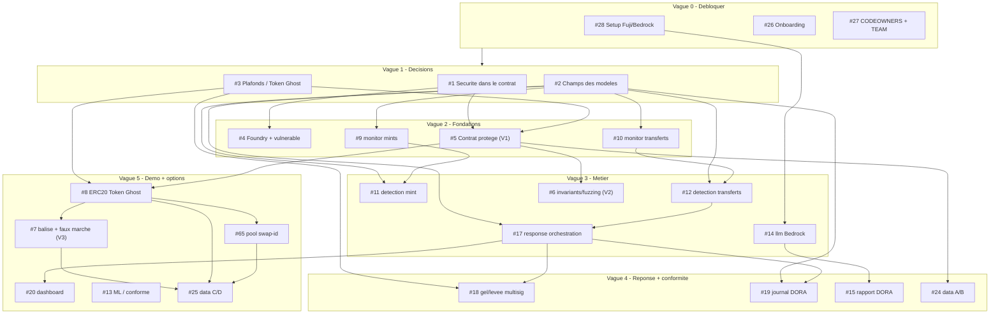

# ROADMAP.md — ordre de travail (équipe 20)

Ordre conseillé pour attaquer le backlog GitHub sans se bloquer les uns les autres. Les numéros
`#N` renvoient aux [issues GitHub](https://github.com/marceaupatu123/secure-horizons/issues).

**Principe de priorité (déjà acté dans `OPEN_QUESTIONS.md`)** : volet 1 → volet 2 → volet 3.
Tout reste **proposé, à valider en équipe**. Cocher la case quand c'est fait.

Sur GitHub, chaque issue porte un label `wave:0` … `wave:5` pour trier le backlog dans le même
ordre que ce tableau.

## Répartition en cours (travail parallèle 4 PC) — 2026-10-10

Chacun lance son agent Kiro sur **son** PC, sur **sa** branche, dans un **dossier distinct** (zéro
collision). Les deux goulots (#2, #4) sont pris en priorité pour débloquer la suite.

| Membre | Issue en cours | Dossier | Vague |
|--------|----------------|---------|-------|
| **marceaupatu123** | #2 champs des modèles | `shared/` | 1 (`blocker`) |
| **denybs** | #4 Foundry + contrat vulnérable | `contracts/` | 2 |
| **EnzoFB06** | #26 onboarding | — | 0 |
| **Yannis1307** | #9 monitor : écoute des mints | `monitor/` | 2 |

> Dès que #2 est mergée, monitor/detection/response/llm se débloquent : prochaine vague de
> répartition possible (#10, #11, #12, #14, #17…). Dès que #1 est tranchée, #5 s'ouvre.

## Schéma du plan d'action

Diagramme des dépendances entre issues (source : `docs/plan-action.mmd`, visualisable sur
<https://mermaid.live>). Les flèches signifient « doit être fait avant ».

---

## Vague 0 — Débloquer tout le monde (en parallèle, tout de suite)

| Fait | Issue | Tâche | Pourquoi d'abord |
|------|-------|-------|------------------|
| [x] | #28 | setup RPC Fuji + faucet AVAX + BEDROCK_MODEL_ID | `blocker` : sans ça, ni chaîne ni LLM. (fermée via PR #32) |
| [ ] | #26 | onboarding (clone, venv, make install, .env, branche) | chacun doit être opérationnel. _(EnzoFB06, en cours)_ |
| [ ] | #27 | CODEOWNERS + tableau TEAM.md | fige « qui possède quoi » avant de coder. |
| [x] | #31 | contracts : registre des déploiements Fuji (`DEPLOYMENTS.md`) | consigne staff : tracer les adresses déployées. |

## Vague 1 — Décisions d'équipe (bloquent le code métier)

| Fait | Issue | Tâche | Débloque |
|------|-------|-------|----------|
| [x] | #1 | sécurité dans le contrat vs seulement autour | oriente contracts + response. **Tranché** (OPEN_ANSWERS §0), issue fermée. |
| [ ] | #3 | plafonds / fenêtre quarantaine / mode Token Ghost | #5, #8, #18. Mécanismes tranchés ; recentrée sur les **valeurs à mesurer** (`module:data`). |
| [x] | #2 | champs des modèles (CONTRACTS.md + shared/models.py) | presque tout le code (monitor, detection, response, llm). **Mergé** (PR #53), issue fermée — débloque la vague 2+. |
| [ ] | #85 | contracts : contamination posée après coup (graine marquée après propagation) | **bloque #84**, touche #8. Pistes dans `OPEN_QUESTIONS.md` §11. |

## Vague 2 — Fondations de code (après #2)

| Fait | Issue | Tâche | Dépend de |
|------|-------|-------|-----------|
| [x] | #4 | Foundry + contrat vulnérable | #1 _(PR #71)_ |
| [ ] | #9 | monitor : écoute des mints | #2 — _(Yannis1307, en cours)_ |
| [ ] | #10 | monitor : écoute des transferts | #2 |
| [x] | #5 | contrat protégé (montant dérivé on-chain) — volet 1 | #1, #3 _(PR #71)_ |

## Vague 3 — Logique métier (après vague 2)

| Fait | Issue | Tâche | Dépend de |
|------|-------|-------|-----------|
| [ ] | #11 | detection : surveillant règles (mint) | #2, #9 |
| [ ] | #12 | detection : surveillant transferts anormaux | #2, #10 |
| [ ] | #14 | llm : client Bedrock Converse (rate limiter) | #28 |
| [x] | #17 | response : orchestration de la réponse graduée | #2, detection _(PR #56, mergée)_ |
| [x] | #6 | contracts : invariants/fuzzing (perte max bornée) — volet 2 | #5 _(PR #71)_ |

## Vague 4 — Réponse complète + conformité

| Fait | Issue | Tâche | Dépend de |
|------|-------|-------|-----------|
| [x] | #18 | response : gel / levée (veto asymétrique, multisig) | #3, #17 _(PR #56, mergée)_ |
| [x] | #19 | response : journal d'audit DORA | #2, #17 _(PR #56, mergée)_ |
| [ ] | #15 | llm : rapport d'incident DORA | #14 |
| [x] | #24 | data : générateur scénarios A et B | #4, #5 _(générateur JSONL, PR #57 ; + trafic normal #59)_ |

## Vague 5 — Démo + options (si le temps le permet)

| Fait | Issue | Tâche | Note |
|------|-------|-------|------|
| [x] | #20 | dashboard : vue alertes + réponse (Streamlit) | une fois qu'il y a des alertes. |
| [x] | #47 | dashboard : outil de génération et rejeu des scénarios de démo (CLI + page Streamlit) | `optional` ; simulation hors chaîne, forme à valider en équipe |
| [ ] | #8 | contracts : ERC20 Token Ghost + burn guardian | dépend de #5. Spec tranchée : §0bis-b (tranches d'échéance, #35), §0bis-c (réserve de restitution, #36), §9 (ratio) ; tests d'invariants de #33 inclus. |
| [ ] | #7 | contracts : balise de risque + faux marché — volet 3 | **cœur du projet** (§0, §4), plus optionnel ; dépend de #8 (lit le ratio). |
| [ ] | #65 | contracts : pool simulé M-Ghost/USDC, règlement différé `swap-id` (§10, #43) | dépend de #8 ; sert le scénario D (#25). Devient un cas particulier du routeur §10bis (#84). |
| [ ] | #84 | contracts : M' protégé / pur / chèque, routeur + Ghost de paiement par actif, restitution (§10bis) | dépend de #8, étend #65 ; bloqué en conception par #85. |
| [ ] | #13 | detection : surveillant ML / prédiction conforme | `optional` |
| [x] | #25 | data : scénarios C et D (contagion + Token Ghost) | `optional`, dépend de #7/#8 _(simulation hors chaîne, PR #82)_ |

---

## Lecture rapide des dépendances

- **#2 (champs des modèles)** est le plus gros goulot : il débloque monitor, detection, response,
  llm. À trancher tôt.
- **#28 (setup)** débloque tout ce qui touche la chaîne et Bedrock.
- Les contrats suivent **#1 → #4 → #5 → #6**, puis **#8 → #7 → #65** (décisions #33, #35, #36,
  #43 tranchées dans `OPEN_ANSWERS.md`, PR #66).
- Tout ce qui est `optional` (vague 5) ne se fait que si le reste tient debout.

> Ce fichier est un guide, pas une loi : si une dépendance saute (ex. on fige les modèles plus
> vite que prévu), on peut avancer une vague. Mettre à jour les cases et prévenir l'équipe.
