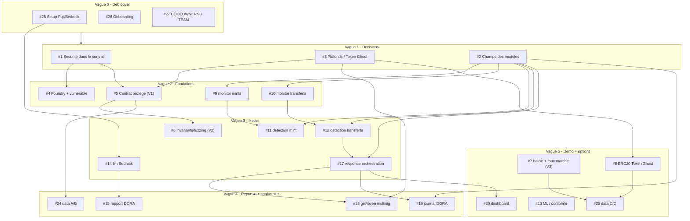

# ROADMAP.md — ordre de travail (équipe 20)

Ordre conseillé pour attaquer le backlog GitHub sans se bloquer les uns les autres. Les numéros
`#N` renvoient aux [issues GitHub](https://github.com/marceaupatu123/secure-horizons/issues).

**Principe de priorité (déjà acté dans `OPEN_QUESTIONS.md`)** : volet 1 → volet 2 → volet 3.
Tout reste **proposé, à valider en équipe**. Cocher la case quand c'est fait.

Sur GitHub, chaque issue porte un label `wave:0` … `wave:5` pour trier le backlog dans le même
ordre que ce tableau.

## Schéma du plan d'action

Diagramme des dépendances entre issues (source : `docs/plan-action.mmd`, visualisable sur
<https://mermaid.live>). Les flèches signifient « doit être fait avant ».

---

## Vague 0 — Débloquer tout le monde (en parallèle, tout de suite)

| Fait | Issue | Tâche | Pourquoi d'abord |
|------|-------|-------|------------------|
| [ ] | #28 | setup RPC Fuji + faucet AVAX + BEDROCK_MODEL_ID | `blocker` : sans ça, ni chaîne ni LLM. |
| [ ] | #26 | onboarding (clone, venv, make install, .env, branche) | chacun doit être opérationnel. |
| [ ] | #27 | CODEOWNERS + tableau TEAM.md | fige « qui possède quoi » avant de coder. |

## Vague 1 — Décisions d'équipe (bloquent le code métier)

| Fait | Issue | Tâche | Débloque |
|------|-------|-------|----------|
| [ ] | #1 | sécurité dans le contrat vs seulement autour | oriente contracts + response. |
| [ ] | #3 | plafonds / fenêtre quarantaine / mode Token Ghost | #5, #8, #18. |
| [ ] | #2 | champs des modèles (CONTRACTS.md + shared/models.py) | presque tout le code (monitor, detection, response, llm). |

## Vague 2 — Fondations de code (après #2)

| Fait | Issue | Tâche | Dépend de |
|------|-------|-------|-----------|
| [ ] | #4 | Foundry + contrat vulnérable | #1 |
| [ ] | #9 | monitor : écoute des mints | #2 |
| [ ] | #10 | monitor : écoute des transferts | #2 |
| [ ] | #5 | contrat protégé (montant dérivé on-chain) — volet 1 | #1, #3 |

## Vague 3 — Logique métier (après vague 2)

| Fait | Issue | Tâche | Dépend de |
|------|-------|-------|-----------|
| [ ] | #11 | detection : surveillant règles (mint) | #2, #9 |
| [ ] | #12 | detection : surveillant transferts anormaux | #2, #10 |
| [ ] | #14 | llm : client Bedrock Converse (rate limiter) | #28 |
| [ ] | #17 | response : orchestration de la réponse graduée | #2, detection |
| [ ] | #6 | contracts : invariants/fuzzing (perte max bornée) — volet 2 | #5 |

## Vague 4 — Réponse complète + conformité

| Fait | Issue | Tâche | Dépend de |
|------|-------|-------|-----------|
| [ ] | #18 | response : gel / levée (veto asymétrique, multisig) | #3, #17 |
| [ ] | #19 | response : journal d'audit DORA | #2, #17 |
| [ ] | #15 | llm : rapport d'incident DORA | #14 |
| [ ] | #24 | data : générateur scénarios A et B | #4, #5 |

## Vague 5 — Démo + options (si le temps le permet)

| Fait | Issue | Tâche | Note |
|------|-------|-------|------|
| [ ] | #20 | dashboard : vue alertes + réponse (Streamlit) | une fois qu'il y a des alertes. |
| [ ] | #7 | contracts : balise de risque + faux marché — volet 3 | `optional` |
| [ ] | #8 | contracts : ERC20 Token Ghost + burn guardian | `optional`, dépend de #3 |
| [ ] | #13 | detection : surveillant ML / prédiction conforme | `optional` |
| [ ] | #25 | data : scénarios C et D (contagion + Token Ghost) | `optional`, dépend de #7/#8 |

---

## Lecture rapide des dépendances

- **#2 (champs des modèles)** est le plus gros goulot : il débloque monitor, detection, response,
  llm. À trancher tôt.
- **#28 (setup)** débloque tout ce qui touche la chaîne et Bedrock.
- Les contrats suivent **#1 → #5 → #6**, puis les options (#7, #8).
- Tout ce qui est `optional` (vague 5) ne se fait que si le reste tient debout.

> Ce fichier est un guide, pas une loi : si une dépendance saute (ex. on fige les modèles plus
> vite que prévu), on peut avancer une vague. Mettre à jour les cases et prévenir l'équipe.
